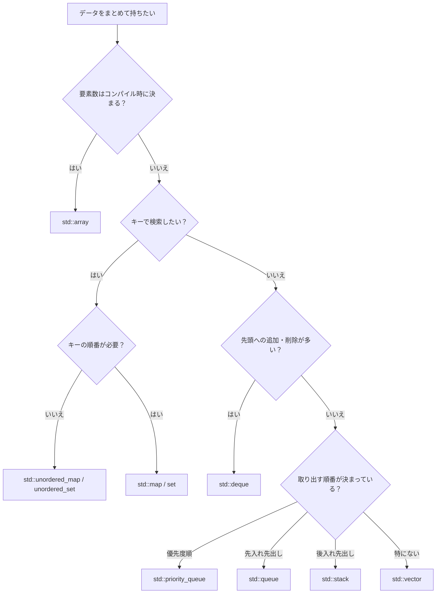

# コンテナの選び方

!!! tip "ポイント"
    <strong>迷ったら `std::vector`。</strong> ほかのコンテナは「vector だと困る理由」があるときだけ使います。

## ざっくり比較

| コンテナ | 速さ | 一言で | 追加 | 検索 | 削除 |
| --- | --- | --- | --- | --- | --- |
| [`vector`](stl/containers/vector.md) | ◎ | 伸びる配列。基本これ | 末尾 O(1) | O(n) | 末尾 O(1) |
| [`array`](stl/containers/array.md) | ◎ | 固定長の配列 | できない | O(n) | できない |
| [`unordered_map`](stl/containers/unordered_map.md) | ○ | ハッシュ表 | 平均 O(1) | 平均 O(1) | 平均 O(1) |
| [`map`](stl/containers/map.md) | ○ | 順序付きの表 | O(log n) | O(log n) | O(log n) |
| [`deque`](stl/containers/deque.md) | ○ | 両端に強い配列 | 両端 O(1) | O(n) | 両端 O(1) |
| [`priority_queue`](stl/containers/priority_queue.md) | ○ | 一番大きい物がすぐ取れる | O(log n) | 先頭のみ | 先頭 O(log n) |
| [`list`](stl/containers/list.md) | × | 連結リスト。ほぼ使わない | O(1) | O(n) | O(1) |

!!! warning "`std::list` はほぼ使わない"
    教科書では「途中の挿入・削除が O(1)」と習いますが、実際のゲームでは**キャッシュ効率が悪くて vector より遅い**ことがほとんどです。
