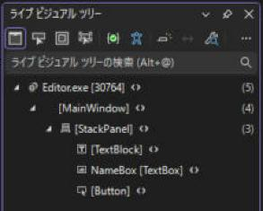

# 第 7 章 Visual Studio で XAML を書くコツ

XAML は、書いて、実行して、画面を見て、直す、を繰り返す作業です。この繰り返しを速くしてくれる道具が Visual Studio にはいくつも入っています。知っているかどうかで、画面作りの速さがまったく変わるので、まとめて紹介します。メニューの名前は、Visual Studio のバージョンで少し違うことがあります。

!!! info "このページを読む前に"
    - [第 6 章 WPF プロジェクトと XAML](06-wpf-xaml.md)（前の章。ここまでの内容が前提になる）
    - [C# 連携](index.md)（このセクション全体の地図と、読む順番）


!!! abstract "この章での Editor"
    この章では、Editor にファイルを足しません。第 6 章までに作った Editor を実行しながら、Visual Studio の道具（ホット リロード、ライブ ビジュアル ツリー、バインディング エラーの一覧）を試します。

## XAML ホット リロード

実行中のアプリに XAML の変更をその場で反映する機能です。アプリを止めて、ビルドして、起動し直して、目的の画面まで操作して戻る、という手間がなくなります。

1. `F5` でデバッグ実行する。
2. 実行したまま、Visual Studio で XAML を書き換えて保存する（保存しなくても反映される設定のこともあります）。
3. 実行中の画面がその場で書き換わる。

色、余白、文字、部品の配置、スタイルなど、XAML の変更の多くが反映されます。反映されないもの（C# のコードの大きな変更、`x:Class` の変更など）もあって、その場合は再起動が必要です。「デバッグ → オプション → .NET/C++ ホット リロード」で、有効かどうかを確認できます。

## アプリ内ツールバー

デバッグ実行すると、アプリの画面の上に小さなツールバーが出ます。ここに次のボタンがあります。

| ボタン | 役目 |
| --- | --- |
| 実行中の UI で要素の選択を有効にする | 画面の部品をクリックして、その部品をライブ ビジュアル ツリー上で選ぶ |
| デザイン時に要素を表示する | 選んだ部品が XAML のどこにあるかへジャンプする |
| レイアウトを表示 | 部品の余白と大きさを画面上に重ねて表示する |

「この部品は、XAML のどこで書いたのか」を探すのに、とても便利です。

## ライブ ビジュアル ツリー

「デバッグ → ウィンドウ → ライブ ビジュアル ツリー」で、実行中のアプリの部品の木が見られます（第 8 章）。アプリを実行すると、画面の左端に「ライブ ビジュアル ツリー」のタブが出ます。押すと、次のように開きます。



`x:Name` を付けた部品（`NameBox`）は、名前つきで表示されます。付けていない部品は、`[TextBlock]` のように、型の名前が角かっこで出ます。

- 論理ツリーとは違い、各部品の内部に入っている部品（`Button` の中の `ContentPresenter` など）まで見えます。
- 部品を選ぶと、アプリの画面側でその部品が強調されます。
- 画面で選んだ部品がツリーのどこにあるかも、その場で分かります。

「この余白はどこの余白？」「どの部品がマウスを受け取っているの？」といった謎が一気に解けます。

## ライブ プロパティ エクスプローラー

ライブ ビジュアル ツリーで部品を選んで、「ライブ プロパティ エクスプローラー」を開くと、その部品のプロパティの現在の値が一覧で見られます。

- `ActualWidth`、`ActualHeight`：実際の大きさ。
- `DataContext`：今の `DataContext` が何か（バインディングが動かないときの最優先の確認項目）。
- `Visibility`、`IsEnabled`：見えない理由、押せない理由。
- 値がどこから来ているか（ローカル、スタイル、テンプレート、継承、既定）。

プロパティをその場で書き換えると、アプリの画面に反映されるので、色や余白を試すのにも使えます（XAML は変わらないので、気に入った値は XAML に書き写します）。

## XAML バインディング エラー

「デバッグ → ウィンドウ → XAML バインディング エラー」（名前はバージョンによって少し違います）に実行中に起きたバインディングの失敗が一覧で出ます。「出力」ウィンドウを読まなくても、どの部品の、どのバインディングがなぜ失敗したのかが分かります。

バインディングが動かないときは、まずこのウィンドウを開きます（第 15 章）。

## デザイナーでの確認

XAML エディタの下には、デザイナーが付いています。実行しなくても、見た目を確認できます。

- `d:DataContext="{d:DesignInstance Type=vm:SceneTreeViewModel}"` を書くと、デザイナーがビューモデルの型を知り、バインディングの入力補完が効くようになります（第 15 章）。
- デザイナー上でしか表示したくないダミーの値は、`d:` で始まる属性（`d:Text="サンプル"`）で書けます。実行時には無視されます。
- ダイアログのように、実行しないと見えない画面は、デザイナーでは崩れることがあります。デザイナーが重いときは、「デザイン ビューを無効にして、XAML のみで編集」に切り替えて構いません。

## 入力を助けてくれる機能

| 機能 | 使い方 |
| --- | --- |
| IntelliSense | `<` や属性名を打つと、候補が出る。`Ctrl + Space` で呼び出せる |
| クイック アクションとリファクタリング | `Ctrl + .`。足りない名前空間の追加、型の生成など |
| 定義へ移動 | `F12`。XAML のクラス名からコードへ `{StaticResource ...}` からリソースの定義へ移動できる |
| すべての参照を検索 | `Shift + F12` |
| コード スニペット | C# で `prop` + `Tab` `Tab` でプロパティ、`propdp` で依存関係プロパティ、`propfull` で通知付きの完全なプロパティ |
| 名前の変更 | `Ctrl + R`, `Ctrl + R`。クラスやプロパティの名前を変えるとき、XAML 内のバインディングのパスも一緒に変わる |
| XAML の整形 | `Ctrl + K`, `Ctrl + D`。インデントと属性の並びを整える |

### プロパティの名前を変えるとバインディングが壊れる

ビューモデルのプロパティ名を `Ctrl + R, Ctrl + R` の名前変更を使わずに、手で書き換えると、XAML の `{Binding 古い名前}` がそのまま残ります。実行しても例外は出ず、静かに何も表示されなくなります。名前を変えるときは、必ずリファクタリング機能を使うか、変えたあとに「出力」ウィンドウとバインディング エラーを確認してください。

### x:Bind は使えない

WinUI や UWP の `{x:Bind}`（コンパイル時にチェックされるバインディング）は、WPF にはありません。WPF のバインディングは、実行時に文字列で解決されるので、つづりの間違いはビルドでは見つかりません。そのため、このあたりの道具に頼ることになります。

## デバッグのときに便利な機能

### ブレークポイントをプロパティの set に置く

バインディングで入力した値がビューモデルに届いているか分からないときは、プロパティの `set` にブレークポイントを置きます。値が変わるたびに止まって、呼び出し元（コール スタック）で、誰が変えたのか分かります。

### ツールチップで値を見る

デバッガーで止まっているとき、変数にカーソルを乗せると値が見えます。`ObservableCollection` や LINQ の結果も、展開して中身を見られます。

### 「出力」ウィンドウのフィルター

「出力」ウィンドウの左上の選択で、「デバッグ」を選ぶと、バインディングの失敗やログのメッセージが見られます。`Debug.WriteLine` で自分でも書き込めます。

```csharp title="例（Editor には入れない）"
Debug.WriteLine($"Selection = {SelectedItem?.Name}");
```

リリース ビルドでは、`Debug.WriteLine` は消えます。本番に残したいログは、第 50 章のログ サービスを使います。

## この章のまとめ

- 画面作りは、XAML ホット リロードで速くなる。止めずに直せる。
- 画面の疑問は、ライブ ビジュアル ツリーとライブ プロパティ エクスプローラーで解決できる。
- バインディングの失敗は、XAML バインディング エラーのウィンドウと、「出力」ウィンドウに出る。
- 名前の変更は、`Ctrl + R, Ctrl + R` で。手で変えると、バインディングが静かに壊れる。

次の章では、WPF のコントロールを用途別に整理し、「ボタンの中に何でも入る」という考え方を説明します。

[第 8 章 コントロールとコンテンツ モデル](08-controls.md) へ進みます。
