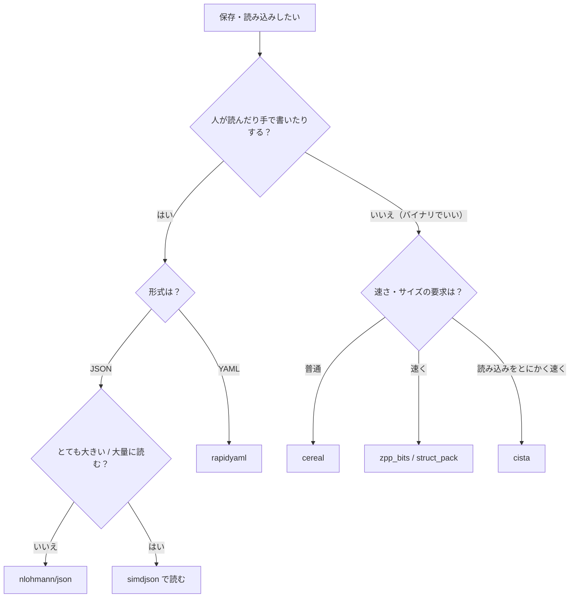

# シリアライズ（セーブ・ロード）

<div class="page-badges" markdown>
<span class="rank rank-often">よく使う</span>
</div>

**シリアライズ**は、**メモリ上のオブジェクトを、ファイルに保存したりネットワークで送ったりできる「1 本のデータの並び」に変換すること**です。逆に、データの並びからオブジェクトを作り直すことを**デシリアライズ**と言います。セーブデータ、設定ファイル、ステージデータ、エディタで作ったシーン、オンラインの通信など、ゲームのあちこちで必要になります。形式には人が読める<strong>テキスト（JSON など）</strong> と、小さくて速い**バイナリ**があり、それぞれに便利なライブラリがあります。

!!! tip "ポイント"
    - <strong>最初は JSON + [nlohmann/json](../../libs/serialization/nlohmann-json.md) が一番手軽。</strong> 人が読めて、手で直せて、デバッグしやすい。
    - 用途で使い分ける：JSON の速さ重視は [simdjson](../../libs/serialization/simdjson.md)、YAML は [rapidyaml](../../libs/serialization/rapidyaml.md)、バイナリの定番は [cereal](../../libs/serialization/cereal.md)、バイナリの速さ重視は [zpp_bits](../../libs/serialization/zpp-bits.md) / [struct_pack](../../libs/serialization/struct-pack.md)、さらに速さ重視（読み込みゼロコピー）は [cista](../../libs/serialization/cista.md)。
    - <strong>必ずバージョン番号を入れる。</strong> あとからデータの形を変えても、古いセーブを読めるようにする。
    - ポインタはそのまま保存できない。ID（[ハンドル](../handle.md)）に置き換えて保存する。
    - 構造体を `write` で丸ごと書くのは、string や vector を含むと壊れる（[ファイル入出力](../../basics/file-io.md)）。

!!! info "このページを読む前に"
    [ファイル入出力](../../basics/file-io.md)、[テンプレート](../../basics/template.md) を先に読むと分かりやすいです。

## 基本

### 何を保存するか

| データ | 保存する？ | 理由 |
| --- | --- | --- |
| プレイヤーの位置、HP、所持品 | ○ | ゲームの状態そのもの |
| フラグ（イベントを見たか） | ○ | 進行の記録 |
| テクスチャ、サウンド | × | ファイル名（または ID）だけ保存し、読み込みし直す |
| ポインタ | × | アドレスは毎回変わる。ID に置き換える |
| 計算で求められる値（キャッシュ） | × | ロード後に計算し直せばいい |

### テキストとバイナリ

| | テキスト（JSON、YAML、TOML など） | バイナリ |
| --- | --- | --- |
| 人が読める | ○ | × |
| 手で直せる | ○ | × |
| サイズ | 大きい | 小さい |
| 読み書きの速さ | 遅い | 速い |
| バージョン違いへの強さ | 強い（キーで探すので、無い項目はデフォルトにできる） | 工夫が必要 |
| 向いているもの | 設定、ステージ、エディタのデータ、開発中のセーブ | 製品版のセーブ、通信、大量のデータ |

## 詳しく

### 自作の簡単なバイナリシリアライザ

仕組みを知るために、vector と string も扱える小さなシリアライザを作ります。

```cpp
#include <cstdint>
#include <cstring>
#include <print>
#include <string>
#include <type_traits>
#include <vector>

class Writer {
 public:
  template <class T>
    requires std::is_trivially_copyable_v<T>  // int、float、単純な構造体
  void Write(const T& value) {
    const auto* p = reinterpret_cast<const std::uint8_t*>(&value);
    bytes_.insert(bytes_.end(), p, p + sizeof(T));
  }

  void Write(const std::string& s) {  // 長さ → 中身 の順に書く
    Write(static_cast<std::uint32_t>(s.size()));
    bytes_.insert(bytes_.end(), s.begin(), s.end());
  }

  template <class T>
  void Write(const std::vector<T>& v) {  // 個数 → 1 個ずつ
    Write(static_cast<std::uint32_t>(v.size()));
    for (const auto& x : v) {
      Write(x);
    }
  }

  const std::vector<std::uint8_t>& bytes() const { return bytes_; }

 private:
  std::vector<std::uint8_t> bytes_;
};

class Reader {
 public:
  explicit Reader(const std::vector<std::uint8_t>& bytes) : bytes_(bytes) {}

  template <class T>
    requires std::is_trivially_copyable_v<T>
  void Read(T& value) {
    std::memcpy(&value, bytes_.data() + pos_, sizeof(T));
    pos_ += sizeof(T);
  }

  void Read(std::string& s) {
    std::uint32_t size = 0;
    Read(size);
    s.assign(reinterpret_cast<const char*>(bytes_.data() + pos_), size);
    pos_ += size;
  }

  template <class T>
  void Read(std::vector<T>& v) {
    std::uint32_t size = 0;
    Read(size);
    v.resize(size);
    for (auto& x : v) {
      Read(x);
    }
  }

 private:
  const std::vector<std::uint8_t>& bytes_;
  std::size_t pos_ = 0;
};

struct SaveData {
  static constexpr std::uint32_t kVersion = 2;
  std::string player_name;
  int level = 1;
  std::vector<int> items;

  // 書くのと読むのを同じ順番にするのが大事
  void Save(Writer& w) const {
    w.Write(kVersion);
    w.Write(player_name);
    w.Write(level);
    w.Write(items);
  }
  bool Load(Reader& r) {
    std::uint32_t version = 0;
    r.Read(version);
    if (version != kVersion) {
      return false;  // 本当はここで古い形式から変換する
    }
    r.Read(player_name);
    r.Read(level);
    r.Read(items);
    return true;
  }
};

int main() {
  SaveData save{"Alice", 12, {101, 205, 330}};
  Writer w;
  save.Save(w);
  std::println("{} バイトになった", w.bytes().size());

  SaveData loaded;
  Reader r(w.bytes());
  bool ok = loaded.Load(r);
  std::println("{} {} Lv.{} {}", ok, loaded.player_name, loaded.level, loaded.items);
}
```

```text title="実行結果"
33 バイトになった
true Alice Lv.12 [101, 205, 330]
```

内訳は「バージョン 4 + 名前の長さ 4 + 名前 5 + レベル 4 + 個数 4 + アイテム 4 × 3 = 33 バイト」です。

!!! warning "自作バイナリの注意"
    - **エンディアン**（バイトの並び順）が違う CPU では読めません（PC 同士なら普通はリトルエンディアンで同じ）。
    - `int` の大きさが環境で変わることがあるので、`std::int32_t` など大きさの決まった型を使います。
    - 壊れたデータ（途中で切れたファイル）を読むと、範囲外アクセスになります。本番では `pos_` が `bytes_.size()` を超えないかチェックします。

### バージョン管理

データの形はゲームの開発中に何度も変わります。古いセーブを読めるようにするのが大事です。

```cpp
bool Load(Reader& r) {
  std::uint32_t version = 0;
  r.Read(version);
  r.Read(player_name);
  r.Read(level);
  if (version >= 2) {  // バージョン 2 で items を追加した
    r.Read(items);
  } else {
    items.clear();  // 古いセーブには無いのでデフォルト
  }
  return version <= kVersion;
}
```

## ライブラリの選び方

このサイトでは、用途ごとに次のライブラリをおすすめしています。それぞれのページで、導入方法から自作の型の扱い、エラー処理、バージョン管理まで詳しく解説しています。

| 用途 | ライブラリ | 形式 | 特徴 |
| --- | --- | --- | --- |
| <strong>JSON（定番）</strong> | [nlohmann/json](../../libs/serialization/nlohmann-json.md) | JSON | 一番有名で書きやすい。読み書き両方。速さはそこそこ |
| <strong>JSON（パフォーマンス）</strong> | [simdjson](../../libs/serialization/simdjson.md) | JSON | CPU の SIMD 命令でとても速く読む。読み込み専用 |
| **YAML** | [rapidyaml（ryml）](../../libs/serialization/rapidyaml.md) | YAML / JSON | 速い YAML ライブラリ。人が書く設定・データ向け |
| <strong>バイナリ（定番）</strong> | [cereal](../../libs/serialization/cereal.md) | バイナリ / JSON / XML | STL とスマートポインタに対応。バージョン管理あり |
| <strong>バイナリ（パフォーマンス）</strong> | [zpp_bits](../../libs/serialization/zpp-bits.md) | バイナリ | とても速い。構造体を書くだけで自動で対応 |
| <strong>バイナリ（パフォーマンス）</strong> | [yalantinglibs（struct_pack）](../../libs/serialization/struct-pack.md) | バイナリ | とても速い。型のチェックと互換フィールドがある |
| <strong>バイナリ（パフォーマンス＋）</strong> | [cista](../../libs/serialization/cista.md) | バイナリ | 読み込みでコピーしない（ゼロコピー）。メモリマップで一瞬で読める |

### どれを選ぶか



### 速さの目安

読み込みの速さは、おおよそ次の順です（データの形によって変わります）。

| 速い ← | | | | → 手軽 |
| --- | --- | --- | --- | --- |
| cista（ゼロコピー） | zpp_bits / struct_pack | cereal（バイナリ） | simdjson（JSON） | nlohmann/json、rapidyaml |

学生のゲームのセーブデータ程度（数 KB〜数 MB）なら、**どれを使っても体感できる差はありません**。まずは書きやすさで選び、大きなマスターデータや大量のステージを読むときに速いものを検討します。

### ポインタ・参照を保存する

オブジェクト同士のつながり（「この弾は敵 3 番が撃った」）は、ポインタではなく **ID** で保存します。

```cpp
struct BulletSave {
  std::uint32_t owner_id;  // Enemy* owner ではなく、ID を保存
  float x;
  float y;
};
```

ロードするときに、ID からオブジェクトを探して結び付け直します。

### 安全に保存する

保存中に落ちてもセーブが壊れないように、一時ファイルに書いてから名前を変えます（[ファイル入出力：壊れない保存](../../basics/file-io.md#壊れない保存一時ファイル--rename)）。チェックサム（CRC など）を付けて、壊れたデータを検出する方法もよく使われます。

## ゲームでの例

| データ | おすすめの形式 |
| --- | --- |
| ゲーム設定（音量、キー設定） | JSON（nlohmann/json）/ YAML（rapidyaml） |
| ステージ・敵の配置 | JSON（エディタで作る）。大きければ simdjson で読む |
| マスターデータ（アイテム表など） | 開発中は YAML / JSON、製品版はバイナリ（zpp_bits / struct_pack / cista）に変換 |
| セーブデータ | cereal（バイナリ）、または JSON |
| オンラインの通信 | zpp_bits / struct_pack / 自作バイナリ |
| 大きなワールドデータの一瞬ロード | cista（メモリマップ + ゼロコピー） |
| リプレイ | 入力の列を自作バイナリで |

## よくあるミス

??? failure "構造体をそのまま write する"
    string や vector の中身はヒープにあるので、ポインタの値しか保存されません。また、パディング（構造体の隙間）のゴミも保存されます。

??? failure "書く順番と読む順番がずれる"
    バイナリは「何バイト目が何か」で決まるので、1 つずれると全部おかしくなります。Save と Load を並べて書き、1 つの関数で両方を扱う仕組み（cereal の `serialize` 関数）を使うと防げます。

??? failure "バージョン番号を入れ忘れる"
    リリース後にデータの形を変えると、プレイヤーのセーブが全部読めなくなります。最初から入れておきます。

??? failure "float を JSON に書いて誤差が出る"
    `0.1f` は正確に表せないので、書いて読むと少し違う値になることがあります。完全に一致させたいなら、整数（ミリ単位など）で保存します。

## 理解度チェック

!!! question "Q1. `struct Player { std::string name; int hp; };` を `out.write((char*)&p, sizeof(p))` で保存すると何が問題？"
    <div class="spoiler" markdown>

    **答え:** `name` の文字列の中身ではなく、string の内部（ヒープへのポインタなど）が保存されます。読み込むと壊れた string になり、未定義動作です。名前は「長さ + 中身」で書くか、ライブラリを使います。

    </div>

## これだけ覚える

!!! abstract "まとめ"
    - [x] 最初は JSON（nlohmann/json）で始める
    - [x] 速さが必要になったら用途に合わせて simdjson / zpp_bits / struct_pack / cista
    - [x] バージョン番号を必ず入れる
    - [x] ポインタは ID にして保存
    - [x] 構造体を丸ごと write しない

## 関連ページ

- [ファイル入出力](../../basics/file-io.md)
- [ハンドルと世代 ID](../handle.md)
- [nlohmann/json](../../libs/serialization/nlohmann-json.md)
- [simdjson](../../libs/serialization/simdjson.md)
- [rapidyaml](../../libs/serialization/rapidyaml.md)
- [cereal](../../libs/serialization/cereal.md)
- [zpp_bits](../../libs/serialization/zpp-bits.md)
- [yalantinglibs（struct_pack）](../../libs/serialization/struct-pack.md)
- [cista](../../libs/serialization/cista.md)
