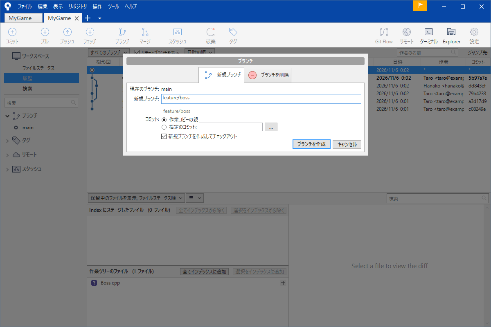
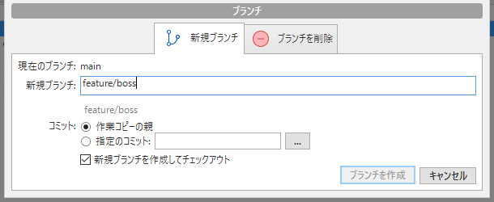
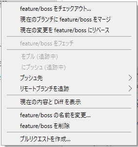

# ブランチ（枝）

ボスを作る、UI を作り直す、敵の AI を実験する。こういう作業を、動いている本線（`main`）の上で直接やると、途中で壊れたときに、ゲーム全体が動かなくなります。そこで使うのが<strong>ブランチ（枝）</strong>です。本線から枝を分けて、その上で作業し、できたら本線に合体します。うまくいかなければ、枝を捨てるだけです。

Git のブランチは、コピーを作るのではなく「コミットに付ける名前の札」なので、作るのも切り替えるのも一瞬です。気軽に使えます。

!!! tip "ポイント"
    - ブランチは、コミットに付ける名前の札。作るのは一瞬で、容量もほぼかからない
    - 作業ごとに枝を分ける。`main` は、いつでも動く状態にしておく
    - 移るときは、ブランチをダブルクリックする（またはチェックアウト）
    - 切り替える前に、作業中の変更はコミットかスタッシュしておく

!!! info "このページを読む前に"
    - [記録する](commit.md)
    - [履歴を読む](log.md)

## 枝を見る {#list}

左のサイドバーの「ブランチ」に、手元にあるブランチの一覧が出ます。いま作業している枝は、太字で出ます。`feature/boss` のように `/` を含む名前は、`feature` というフォルダーにまとまるので、フォルダーをダブルクリックして開きます。

履歴の画面でも、枝の先端に、枝の名前の色つきラベルが付きます（`main`、`feature/boss` など）。「いまの位置」を示すラベルは、太字です。リモートの枝は `origin/main` のように、`origin/` が付いて出ます。

## 枝を作って移る {#switch}

ツールバーの「ブランチ」を押すと、新しい枝を作る画面が出ます。

「新規ブランチ」の欄に名前を入れて、「ブランチを作成」を押します。「作成後にチェックアウト」にチェックが入っていれば、そのまま新しい枝へ移ります。

枝を作る元は、いま立っているコミットです。作る前に、<strong>どの枝のどのコミットに立っているか</strong>を確かめてください（普通は、最新の `main` から作ります）。

別の枝へ移るには、サイドバーの枝の名前を<strong>ダブルクリック</strong>します（右クリックの「チェックアウト」でも同じです）。移ると、作業フォルダーのファイルが、その枝の状態に一斉に入れ替わります。

右クリックのメニューには、「チェックアウト」「現在のブランチに ○○ をマージ」「現在の変更を ○○ にリベース」「名前を変更」「削除」「プルリクエストを作成」が並びます。「チェックアウト」が、枝へ移る操作です。

## 変更を持ったまま移れるか {#carry}

作業の途中（まだコミットしていない変更がある状態）で、別の枝へ移ろうとすると、2 つの場合があります。

- 移る先の枝と、直したファイルが重ならない: 変更を持ったまま移れる
- 重なる: 「変更が上書きされる」と警告が出て、移れない

警告が出たら、次のどちらかをしてください。

- コミットする（途中でも、いったんコミットしておく）
- スタッシュで脇に置く（[スタッシュ](stash.md)）

「破棄」して移るのは、変更が消えるので、おすすめしません。

## 枝を合体する・消す {#merge-delete}

枝での作業が終わったら、本線に合体します。ツールバーの「マージ」です（詳しくは [マージ](merge.md)）。

合体が終わった枝は、サイドバーで右クリックして「○○ を削除」を選んで消します。枝を消しても、コミットは消えません。枝は名前の札なので、札を外すだけです。ただし、まだ合体していない枝を消すと、そのコミットはどこからも辿れなくなります（[取り消す・戻す](undo.md#reflog) で取り戻せます）。

## 枝の名前を付ける {#naming}

枝の名前は、何の作業かが分かるものにします。チームでは、次のような決まりを使うことが多いです。

- `feature/boss`: 新しい機能（`feature/` を前に付ける）
- `fix/player-hp`: バグ修正（`fix/`）
- `exp/new-ai`: 実験（`exp/`）

`/` は、フォルダーのように枝をまとめて見せます。名前に使えない文字（空白、`~`、`^`、`:` など）があります。ハイフンでつなぐのが無難です。日本語も使えますが、環境によって化けることがあるので、英数字を勧めます。

## 枝の名前を変える {#rename}

サイドバーで枝を右クリックして「○○ の名前を変更」を選びます。<strong>共有場所（リモート）に送った枝の名前を変えるときは、注意してください。</strong>手元の名前だけが変わり、リモートには古い名前が残ります。他の人も使っている枝は、変えないのが無難です。

## ブランチを使う流れ {#flow}

1 つの機能を作る流れは、次のとおりです。

1. 最新の `main` に移って、「プル」で最新にする
2. 「ブランチ」で、`feature/boss` のような枝を作る
3. 枝の上で、コミットを重ねる
4. 枝を共有場所に「プッシュ」する（チームで見せる・バックアップになる）
5. `main` に合体する（[マージ](merge.md)）
6. 合体した枝を、削除する

## ゲームの制作で効く使い方 {#game}

- 大きな機能（ボス、UI の作り直し）は、必ず専用の枝で作る
- 実験の枝は、気軽に捨てる。うまくいかなければ、枝ごと削除すればよい
- シーンやプレハブは、複数人が同時に触ると競合しやすい。担当を決めて、枝を分ける

## よくあるミス {#mistakes}

??? failure "コミットを、別の枝（`main`）に積んでしまった"
    枝を作る画面で、「ブランチを作成」を押したつもりが、作成されていないことがあります。サイドバーに、新しい枝があるかを確かめてください。コミットが `main` に載ってしまったら、その位置に枝を作って（履歴の画面でコミットを右クリックして「ブランチ」）、`main` を戻す（リセット）のが基本です。迷ったら、[事故の対処](accidents.md) を見てください。

??? failure "切り替えようとしたら、変更が上書きされると言われた"
    作業中の変更が、移る先の枝の同じファイルと重なっています。コミットかスタッシュしてから、移ります。

??? failure "どの枝にいるか分からなくなった"
    サイドバーで、太字の枝が、いまの枝です。ウィンドウの上のタブ（リポジトリ名）の下にも、枝の名前が出ます。

## これだけ覚える {#summary}

- ブランチは名前の札。作るのも消すのも軽い
- 作業ごとに枝を分ける。`main` は動く状態に保つ
- 移るのは、ダブルクリック
- 移る前に、コミットかスタッシュ

## 関連ページ {#related}

- [マージ](merge.md)
- [スタッシュ](stash.md)
- [コンフリクトを直す](conflict.md)
