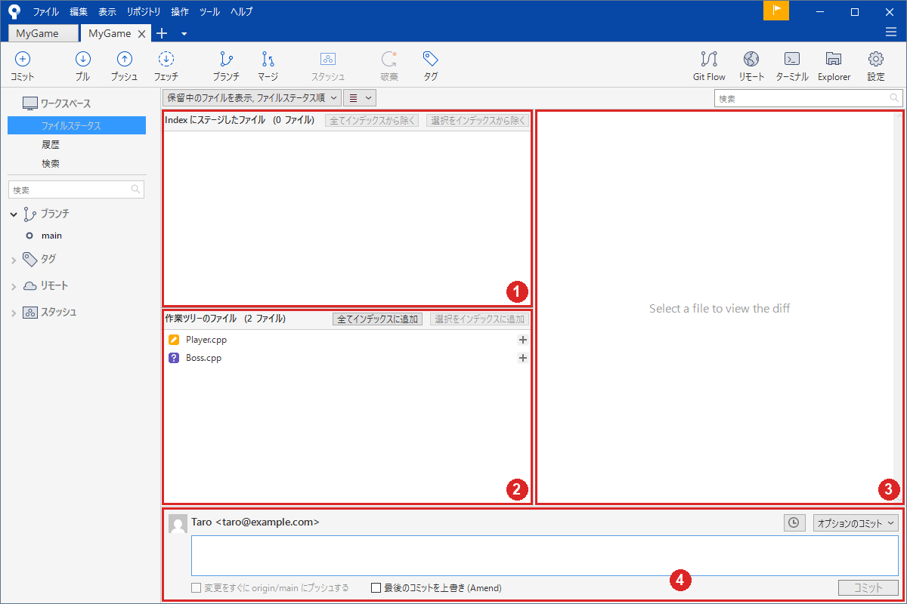
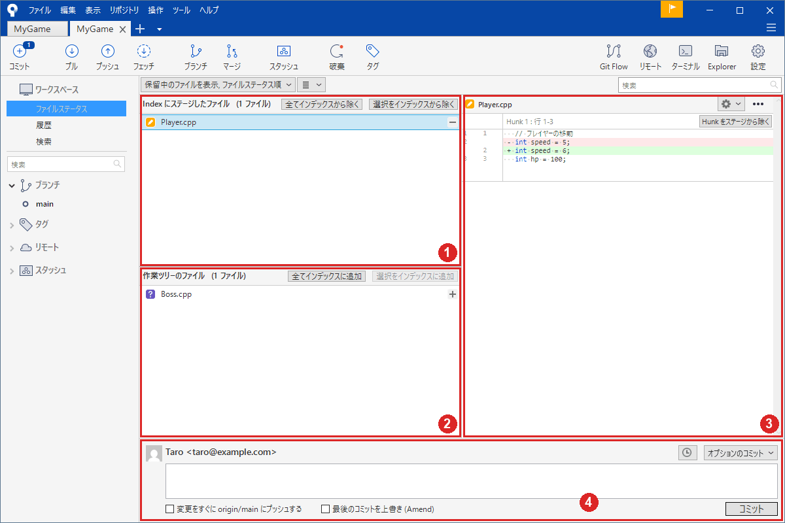
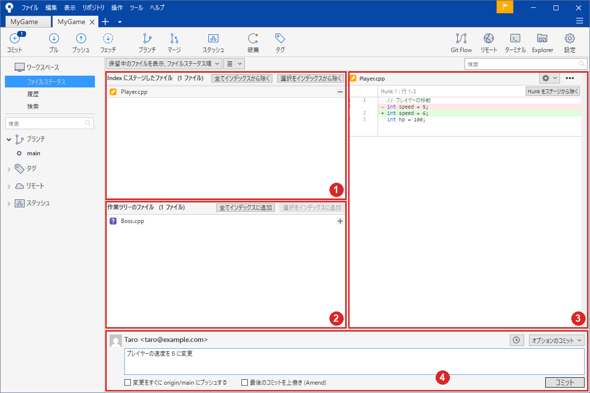

# 記録する（ステージとコミット）

Git の毎日の作業は「直す → 確かめる → 記録する」の繰り返しです。この中で一番よく使うのが SourceTree の「ファイルステータス」画面です。覚えることは少ないのですが <strong>記録が 2 段階に分かれている</strong>ことを知らないと、「記録に入れたのに保存されていない」「コミットしたのに変更が残っている」という場面で必ず迷います。

このページは実際の画面を見ながら、変更を見る・記録に入れる・確定する、の 3 つを説明します。

!!! tip "ポイント"
    - 記録は「インデックスに追加」（記録に入れるものを選ぶ）と「コミット」（確定する）の 2 段階
    - 迷ったら「ファイルステータス」を開く。いまの状態が全部見える
    - コミットは小さく、1 つの目的にする。メッセージは「何をしたか」が一覧で読めるように書く
    - 「全てインデックスに追加」は便利だが、入れたくないものまで入る。ファイル名を見てから押す

!!! info "このページを読む前に"
    - [SourceTree のインストールと最初の設定](install.md)（名前とメールアドレス）
    - [SourceTree の画面](sourcetree.md)
    - [最初の一歩](first-steps.md)（最初のコミットまでの通し）

## リポジトリを作る {#init}

新しいプロジェクトを Git の管理に入れる手順は、[最初の一歩](first-steps.md#create) にあります。すでに GitHub などにあるプロジェクトを持ってくるときは、「作成」の代わりに「クローン」を使います（[リモートとプッシュ・プル](remote.md#clone)）。

## 変更を見る {#status}

何かする前にまず左のサイドバーの「ファイルステータス」を開く習慣を付けてください。どのファイルがどの場所にあるのかが、一目で分かります。



画面は画像の赤い番号の 4 つの領域でできています。まん中の左が①上の欄と②下の欄です。右の③は差分（変更の中身）、一番下の④はコミットのメッセージを書く欄です。

- ①<strong>Index にステージしたファイル</strong>（上）: 次のコミットで記録されるファイル。「インデックス」は「ステージ」と同じ意味で、ここに入れたものだけが記録される
- ②<strong>作業ツリーのファイル</strong>（下）: 直したが、まだ記録に入れていないファイル。新しく作ったファイルもここに出る

ファイルの横のマークで種類が分かります。

- 鉛筆のオレンジ色のマーク: 管理中のファイルを直した
- 紫の「?」: 新しく作ったファイルで、Git がまだ管理していない
- 赤い「−」: 消した
- 警告の三角: 競合している（[コンフリクトを直す](conflict.md)）

`.gitignore` に書いたファイル（`*.obj` など）はそもそもここに出てきません。この画面の例では `test.obj` を作りましたが、出ていません（[.gitignore](gitignore.md)）。

### 変更の中身を見る {#diff}

ファイルを 1 つクリックすると右側にどこがどう変わったかが出ます。

- 赤い行（`−` の付く行）は消えた行
- 緑の行（`+` の付く行）は増えた行

直した行が赤と緑のセットで出ます。行の数字がそのファイルの何行目かを表します。

コミットの前にはこれで「これから記録するもの」を最後に目で確かめてください。デバッグ用に書いた `printf` や一時的にコメントアウトしたコードが紛れ込んでいないか見つけられます。

## インデックスに追加する {#add}

記録したいファイルを選んで「選択をインデックスに追加」を押すとそのファイルが上の欄に移ります（「全てインデックスに追加」は全部移します）。



ファイル名の右の「＋」を押しても、同じです。やめたい（上の欄から下に戻したい）ときは、「選択をインデックスから除く」を押します。

大切なのは <strong>「その時点の中身」が記録に入る</strong>ことです。インデックスに追加したあとにさらにそのファイルを直すと直した分は上の欄に入っていません（同じファイルが、上と下の両方に出ます）。もう一度、追加してください。

「全てインデックスに追加」は楽ですが、`.gitignore` に書かれていないものは何でも入ります。パスワードを書いた設定ファイルや巨大な一時ファイルが混ざる事故の元です。ボタンを押す前に下の欄のファイル名を一通り見てください。

### 一部だけ入れる {#hunk}

1 つのファイルの中に別々の目的の変更が混ざってしまうことがあります。右側の差分の「Hunk（変更の塊）」ごとに「Hunk をステージへ移動」「Hunk を破棄」の 2 つのボタンが付いています。前者を使うとその塊だけを記録に入れられます。コミットを目的ごとに分けるのに使います。

## コミットする {#commit}

記録に入れたら画面の下の欄にメッセージを書いて、「コミット」を押します。



ここで使えるチェックが 2 つあります。

- <strong>変更をすぐに origin/main にプッシュする</strong>: コミットのあと、すぐに共有場所へ送る。慣れるまでは外しておくのが安全（コミットとプッシュを分けて考える）
- <strong>最後のコミットを上書き (Amend)</strong>: 新しいコミットを作らず、直前のコミットを作り直す。プッシュ前の直しには便利だが、プッシュしたあとに使うと履歴が食い違う。詳しくは [取り消す・戻す](undo.md#amend)

コミットすると ID（英数字の羅列）が付きます。`a3f9c21` のような短い形で呼べて戻る・比べるときの住所になります。履歴の画面の右端に ID が出ています。

## コミットメッセージの書き方 {#message}

メッセージは未来の自分とチームへの手紙です。バグを探しているとき履歴の一覧から原因のコミットを見つけられるかは、メッセージの質で決まります。

悪い例は `修正`、`更新`、`aaa`、`いろいろ直した` のような中身が分からないものです。何を直したのかあとから差分を開かないと分かりません。

```text title="読みやすいメッセージの例"
プレイヤーの移動に加速度を追加
敵の当たり判定が 1 フレーム遅れるのを修正
タイトル画面のフェードアウトを追加
```

コツは次のとおりです。

- 1 行目は 50 文字前後で、<strong>何をしたか</strong>を書く。履歴の一覧で読めるのはこの 1 行目だけ
- 理由が必要なら 1 行空けて、2 行目以降に書く
- 「〜を追加」「〜を修正」のように言い切りでそろえる

```text title="理由を足したメッセージ"
敵の当たり判定が 1 フレーム遅れるのを修正

移動の更新より先に判定を呼んでいたため、前フレームの
位置で当たっていた。更新を先に呼ぶよう順序を入れ替えた。
```

## コミットの大きさ {#size}

1 つのコミットには 1 つの目的だけを入れます。「プレイヤーの移動を追加」と「敵のバグ修正」と「画像の差し替え」が 1 つのコミットに混ざると、どれか 1 つだけを取り消したいときに全部を戻すことになります。

迷ったら次の基準で考えてください。

- メッセージを「〜と〜」でつなぎたくなったら、コミットを分ける
- ビルドが通る状態でコミットする。途中で壊れたコミットがあると、あとで不具合を探すときに邪魔になる
- 逆に、1 行直すたびにコミットする必要はない。まとまった意味の単位で区切る

## 一連の流れ {#flow}

ここまでをつなげると毎日の作業は次の形になります。

1. 「ファイルステータス」を開いて、状態を見る
2. ファイルを 1 つずつクリックして、差分を確かめる
3. 記録したいファイルを「インデックスに追加」する
4. メッセージを書いて「コミット」する

これを何度も繰り返すだけで履歴が積み上がっていきます。コミットのあとに履歴の画面を開くといちばん上にいま作ったコミットが見えます。

## ゲームの制作で効く習慣 {#game}

- <strong>動く状態でコミットする</strong>。ビルドが通らない状態を残すと戻ったときに動かない
- 画像・モデル・音声はコードとは別のコミットにする。巨大な差分に埋もれずあとで戻しやすい
- `.sln` や `.vcxproj` はファイルを追加するたびに変わる。追加したらすぐそのファイルと一緒にコミットする
- 実験の前にコミットしておく。うまくいかなければそこへ戻れる

## よくあるミス {#mistakes}

??? failure "「全てインデックスに追加」で、入れたくないものまで入った"
    「全て」は全部です。ボタンを押す前に下の欄を見ていないとパスワードを書いた設定ファイルなどが混ざります。上の欄のファイルを選んで「選択をインデックスから除く」で戻してください。

??? failure "追加したのに、最新の変更が記録されなかった"
    追加したあとにさらにファイルを直しませんでしたか。追加は「その時点の中身」を上の欄に置きます。直した分はもう一度追加します。

??? failure "新しく作ったファイルが、コミットに入っていない"
    新しいファイル（紫の「?」）は、自分で「インデックスに追加」しないと入りません。直しただけのファイルとは扱いが違います。

??? failure "メッセージが `aaa` のまま積み上がった"
    直前の 1 つなら「最後のコミットを上書き (Amend)」で直せます。古いものは直しにくいので最初からこまめに意味のあるメッセージを書く習慣が大切です。

## これだけ覚える {#summary}

- 流れは「状態を見る → 差分を確かめる → インデックスに追加 → コミット」
- 追加は「その時点の中身」を置く。直したらもう一度追加する
- コミットは小さく 1 つの目的で、動く状態にする
- メッセージの 1 行目は「何をしたか」

## 関連ページ {#related}

- [履歴を読む](log.md)
- [取り消す・戻す](undo.md)
- [.gitignore](gitignore.md)
