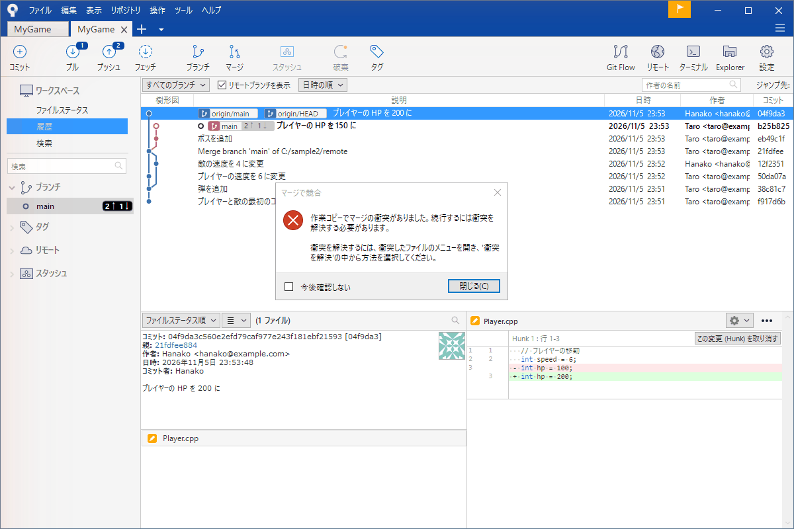
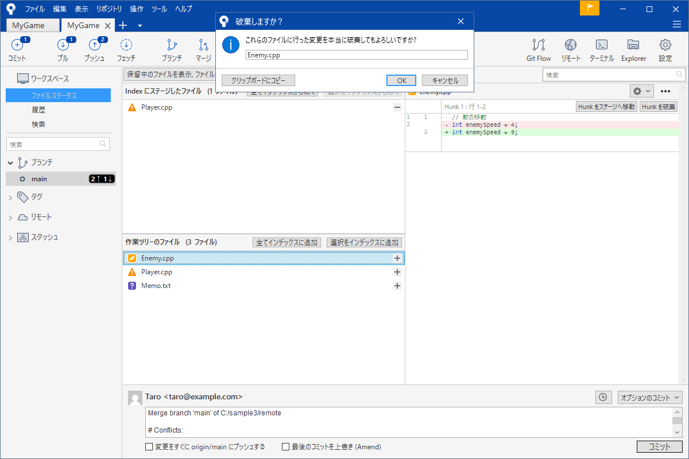
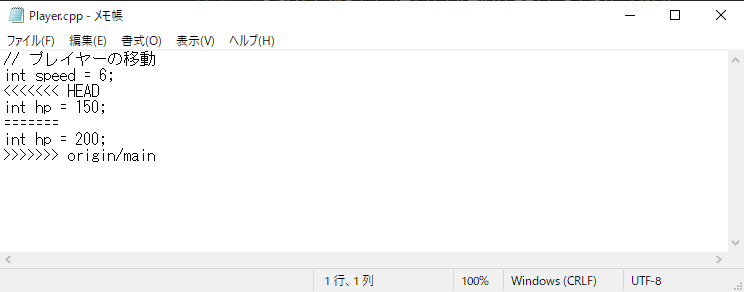
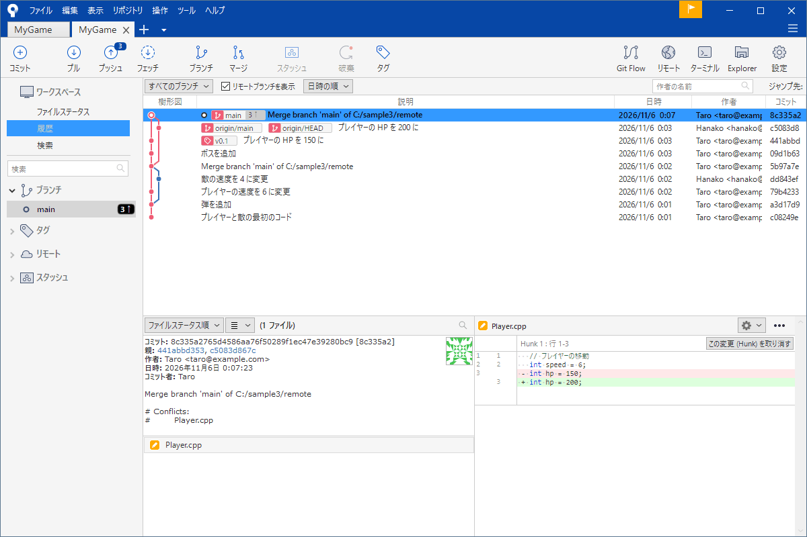
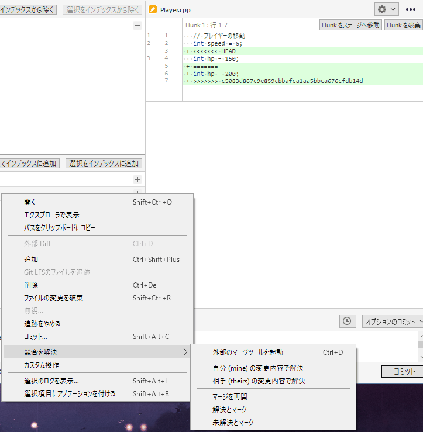

# コンフリクトを直す

マージやプルをしたら「マージで競合」と赤い警告が出た。初めて見ると壊してしまったように感じます。でもこれは壊れたのではなく <strong>Git が「どちらを採用するか人間が決めてほしい」と頼んでいる</strong>状態です。直し方の流れが分かれば慌てずに済みます。

このページは衝突が起きる場面、ファイルに入る目印の読み方、直す手順、やめる方法を説明します。

!!! tip "ポイント"
    - 衝突は同じ場所を別々に直したときだけ起きる。ファイルが壊れたわけではない
    - 衝突したファイルには `<<<<<<<` `=======` `>>>>>>>` の目印が入る。目印を消して正しい内容にして、コミットする
    - 迷ったら「マージを中止」で、やる前の状態に戻れる
    - 直したあと目印の消し忘れを探す

!!! info "このページを読む前に"
    - [マージ](merge.md)
    - [記録する](commit.md)

## 起きる場面 {#when}

衝突が起きるのは次のような場面です。

- 「プル」で他の人が先に直した場所を自分も直していた
- 「マージ」で 2 つの枝が、同じ行を別々の内容に直していた
- 「リベース」「スタッシュの適用」でも同じ理由で起きる

例を見ます。`Player.cpp` の `hp` を自分は 150 に友だちは 200 に直して、友だちが先にプッシュしました。自分がプルすると次のように止まります。



「作業コピーでマージの衝突がありました。続行するには衝突を解決する必要があります」と出ます。「閉じる」を押します。

## ファイルステータスで見る {#status}

ファイルステータスを開くと衝突したファイルに警告の三角マークが付いています。



衝突していないファイルはすでに自動で合体されています。直すのは警告の付いたファイルだけです。

## 目印の読み方 {#read}

衝突したファイルをエディターで開くと Git が目印を書き込んでいます。

```text title="Player.cpp（衝突の中）"
// プレイヤーの移動
int speed = 6;
<<<<<<< HEAD
int hp = 150;
=======
int hp = 200;
>>>>>>> origin/main
```

メモ帳で開くと実際には次のように見えます。



3 つの目印で囲まれた部分が、衝突している場所です。

- `<<<<<<< HEAD` から `=======` まで: 自分（いま立っている枝）の内容。ここでは `hp = 150`
- `=======` から `>>>>>>> origin/main` まで: 取り込もうとした側の内容。ここでは `hp = 200`

どちらを採用するのが正しいかは Git には分かりません。人間が決めます。

## 直す手順 {#fix}

次の順番で直します。

1. 衝突したファイルを開く（SourceTree で、そのファイルを右クリックして「開く」を選ぶとそのファイルに関連づいたエディターで開く。「エクスプローラで表示」でフォルダーから開いてもよい）
2. 目印の 3 行（`<<<<<<<` `=======` `>>>>>>>`）を消し、残したい内容だけにする。どちらか片方でも両方を混ぜてもよい
3. ファイルを保存する
4. SourceTree に戻りそのファイルを「インデックスに追加」する
5. 「コミット」する。メッセージは自動で `Merge branch ...` と入っているので、そのままでよい

この例では友だちと相談して `hp = 200` にすることにしました。直したあとは次のようになります。

```text title="直したあとの Player.cpp"
// プレイヤーの移動
int speed = 6;
int hp = 200;
```

コミットするとマージが終わります。履歴に 2 本の線が合流するコミットが出ます。



## SourceTree の機能で、片方を選ぶ {#tools}

「どちらか一方を丸ごと採用する」と決めているならファイルを開かなくても済みます。衝突したファイルを右クリックして、「競合を解決」を選びます。



- <strong>自分 (mine) の変更内容で解決</strong>: 自分の側を丸ごと採用する
- <strong>相手 (theirs) の変更内容で解決</strong>: 取り込もうとした側を丸ごと採用する
- <strong>外部のマージツールを起動</strong>: 3 方向の差分を見せるツールで、行ごとに選ぶ
- <strong>解決とマーク</strong>: 自分でファイルを直したと SourceTree に伝える
- <strong>マージを再開</strong>: すべて直したあとで続ける

行ごとに選びたいときまたは両方の内容を混ぜたいときは、エディターで直す（上の手順）かマージツールを使います。マージツールは設定（「ツール → オプション → 差分」）で選んでおきます。

## 目印を消し忘れたとき {#leftover}

一番ありがちな事故は `<<<<<<<` などの目印を残したままコミットしてしまうことです。C++ のファイルではコンパイルエラーになるので気づきます。ですが設定ファイルやシーンなどのファイルでは、気づかないことがあります。

コミットの前に次を確かめてください。

- エディターの検索で `<<<<<<<` `>>>>>>>` を探す
- 「ファイルステータス」で、差分を最後に目で確かめる

もしコミットしてしまってもプッシュ前なら直してもう一度コミットすれば済みます。

## 途中でやめる {#abort}

「やっぱりいまは直せない」と思ったら、やめられます。メニューの「操作」からマージの中止を選びます（[マージ](merge.md#abort)）。マージを始める前の状態に戻ります。

## 衝突しやすいファイル {#prone}

ゲームの制作では次のファイルで衝突が起きやすくなります。

- <strong>シーンやプレハブ</strong>: 1 つのファイルに多くの物が入っている。複数人が同時に触ると衝突する
- <strong>パラメーターを集めたファイル</strong>: 敵の強さやアイテムの値を 1 つのファイルに集めると、バランス調整でみんなが同じファイルを触る
- <strong>`.sln` や `.vcxproj`</strong>: ファイルを追加すると、行が挿入される。複数人が同時に追加すると衝突する（どちらの追加も残すが正解のことが多い）
- <strong>バイナリ（画像・モデル・音声）</strong>: 行の差分がなく、両方を混ぜることができない。どちらかを選ぶしかない

## 衝突を減らす {#avoid}

衝突は起きたあとに直すより起きにくくするほうが楽です。

- こまめにプルして最新の状態で作業する
- 大きく書き換える前にチームに声をかける
- ファイルを小さく分ける（1 つのファイルに多くを詰め込まない）
- 担当を決める。シーンは同時に 1 人だけが触る
- コミットとプッシュを小まめにする。溜め込むと衝突が大きくなる

## よくあるミス {#mistakes}

??? failure "目印を残したままコミットした"
    コンパイルが通らない、またはおかしな動きになります。ファイルを開いて目印を消しもう一度コミットします。プッシュ前ならそれで済みます。

??? failure "どちらを採用すべきか分からない"
    1 人で決めずに相手に聞いてください。履歴の画面で相手のコミットの詳細を読むと意図が分かることがあります。

??? failure "バイナリの衝突を直せない"
    画像やモデルは中身を混ぜられません。どちらを採用するかを決めて「自分 (mine)」または「相手 (theirs)」で解決します。

??? failure "直したつもりが、「マージ中」のまま"
    ファイルを直したあと「インデックスに追加」して、コミットするまでが 1 セットです。コミットでマージが完了します。

## これだけ覚える {#summary}

- 衝突は同じ場所を別々に直したときだけ
- 目印を消して正しい内容にして、追加してコミットする
- 一方を丸ごと採用するなら右クリックの「競合を解決」
- 困ったらマージを中止して戻る

## 関連ページ {#related}

- [マージ](merge.md)
- [リモートとプッシュ・プル](remote.md)
- [チームで使う](team.md)
