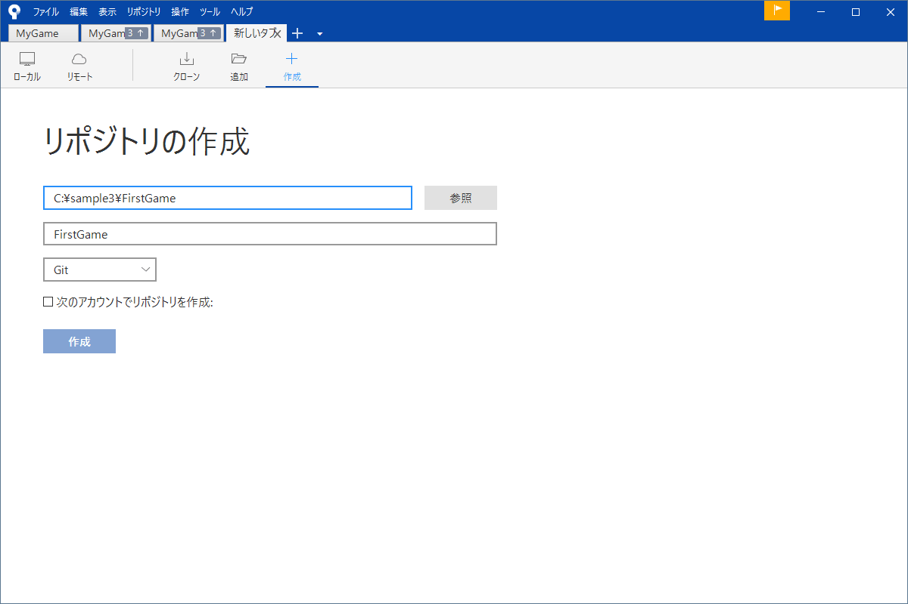
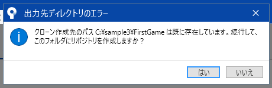
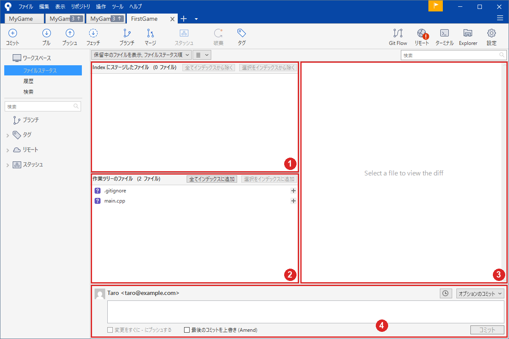
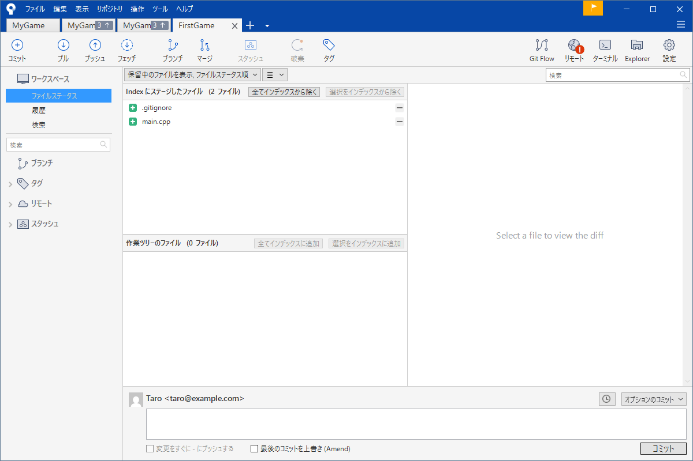
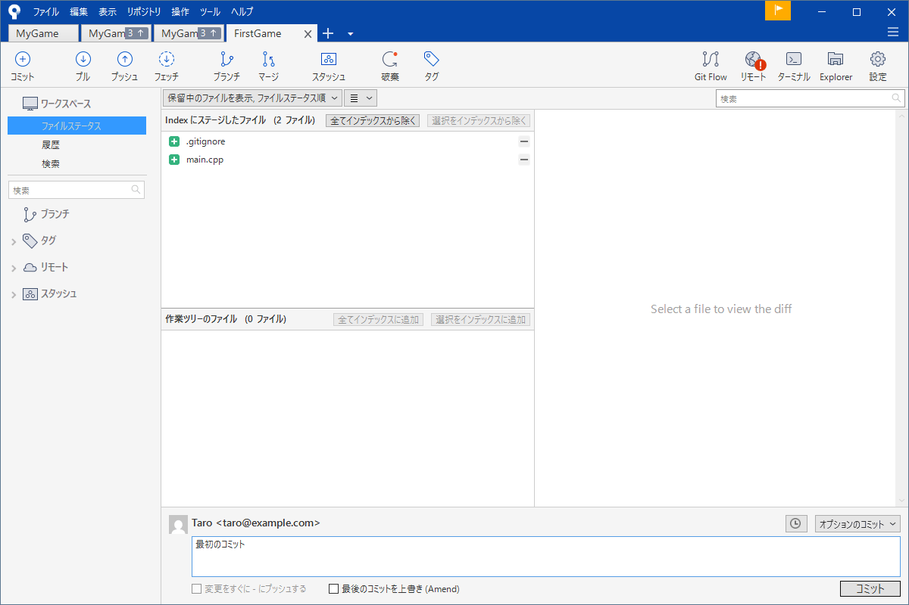
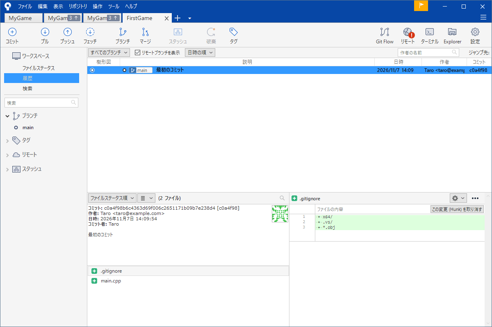

# 最初の一歩（リポジトリを作って最初のコミット）

Git の説明を読んでいると、用語ばかりで実際に何をするのかが見えてきません。そこでこのページでは考え方の説明は後回しにして、<strong>まず 1 回、最初のコミットまでを通しでやります</strong>。所要時間は 10 分ほどです。終わったときには「リポジトリを作る → ファイルを記録する → 履歴に残る」という Git の基本の流れを、体で一度なぞれています。

練習用に `C:\sample\FirstGame` という空のフォルダーを用意して、`main.cpp` というファイルを 1 つ置くところから始めます（名前や場所は、好きなもので構いません）。

!!! tip "ポイント"
    - 「リポジトリを作る」とは、フォルダーを Git に「この履歴を管理して」と教えること。フォルダーの中に `.git` という隠しフォルダーが増えるだけ
    - 最初に `.gitignore`（記録しないファイルの一覧）を置いておく。あとから置くと記録したくないものが履歴に入ってしまう
    - 記録は「インデックスに追加」→「コミット」の 2 段階。ここで一度やっておけばあとは繰り返し

!!! info "このページを読む前に"
    - [SourceTree のインストールと最初の設定](install.md)（名前とメールアドレスを入れておく）
    - [SourceTree の画面](sourcetree.md)（ツールバーとサイドバーの名前）

## 1. 練習用のフォルダーを用意する {#folder}

エクスプローラーで練習用のフォルダー（たとえば `C:\sample\FirstGame`）を作ります。中に `main.cpp` を 1 つ置きます。中身はなんでも構いません。

```cpp title="main.cpp（練習用。中身は何でもよい）"
#include <iostream>

int main() {
  std::cout << "Hello, game!\n";
}
```

もう 1 つ `.gitignore` という名前のファイルを作って、次の 3 行を書きます（Windows のメモ帳で、「すべてのファイル」の種類で、文字コードは UTF-8 で保存します）。

```text title=".gitignore"
x64/
.vs/
*.obj
```

これは「ビルドで自動的にできるフォルダーとファイルは、Git に記録しない」という意味です。Visual Studio でプロジェクトを作ったときに勝手にできるものを、あらかじめ除いています。詳しくは [.gitignore](gitignore.md) にあります。いまは「最初に置くもの」と覚えておけば十分です。

## 2. リポジトリを作る {#create}

SourceTree を開いて、タブの右の「＋」を押し「作成」を選びます。



- <strong>保存先のパス</strong>: 作ったフォルダー（`C:\sample\FirstGame`）。右の「参照」で選べます
- <strong>名前</strong>: SourceTree のタブに出る名前。フォルダー名と同じにしておくと分かりやすい
- 種類は「Git」のままにします

「作成」を押すとすでにフォルダーが存在するので、確認の画面が出ます。



「はい」を押します。空のフォルダーを選んでいれば、この確認は出ません。

これでリポジトリができて新しいタブが開きます。フォルダーの中には `.git` という隠しフォルダーができています（見えなくて構いません。履歴は全部この中に入ります）。

最初の枝の名前は `master` か `main` のどちらかです。SourceTree の「作成」では `master` になることがあります。このサイトでは `main` と書きます。GitHub に載せるなら `main` にそろえておくと迷いません（名前の変え方は[ブランチ](branch.md#rename)）。

## 3. 変更を見る {#status}

左のサイドバーの「ファイルステータス」を選びます。



画面は画像の赤い番号の領域に分かれています（①上の欄、②下の欄、③右の差分、④一番下のコミット欄）。ここでは、①と②を使います。

- ①上の欄「Index にステージしたファイル」: 次の記録に入れると決めたファイル。いまは空
- ②下の欄「作業ツリーのファイル」: フォルダーにあるが、まだ記録に入れていないファイル。`.gitignore` と `main.cpp` が出ている

名前の左の紫の「?」は「Git がまだ知らない新しいファイル」という印です。

## 4. 記録に入れる {#add}

下の欄の「全てインデックスに追加」を押します。2 つのファイルが上の欄に移ります。



これが「次のコミットに入れるファイルを選ぶ」操作です。記録は 2 段階なのでいきなり確定せずいったんここに置きます。まちがえて入れたときは「選択をインデックスから除く」で戻せます。

## 5. コミットする {#commit}

④のコミット欄にメッセージを書きます。ここでは「最初のコミット」とします。



右下の「コミット」を押すと確定します。

## 6. 履歴を見る {#history}

左のサイドバーの「履歴」を選ぶといま作ったコミットが 1 行出ています。



- 行をクリックすると下にそのコミットの詳細が出る
- 左の欄に ID・作者・日時・メッセージが出る
- ファイルの一覧に緑の「＋」が付いたファイルがある。これはこのコミットで「追加された」という印
- 右側に選んだファイルの中身が出る。緑の行は「増えた行」

`main` という名前の札がこのコミットに付いています。ここまでが Git の基本の 1 周です。

## 仕上げ：もう一度、まわしてみる {#again}

`main.cpp` をエディターで少し書き換えて保存してみてください。SourceTree の「ファイルステータス」に戻ると、`main.cpp` が「直したファイル」として、下の欄に出ています（鉛筆の印）。ファイルをクリックすると右に直した行が赤（消えた）と緑（増えた）で出ます。もう一度、「インデックスに追加」→「コミット」をすれば、履歴に 2 行目が増えます。

この「直す → インデックスに追加 → コミット」の繰り返しが、Git の毎日の作業のほとんどです。

## よくあるミス {#mistakes}

??? failure "「作成」を押したのに、ボタンが反応しない"
    保存先のパスと名前の両方が入っていないと押せません。パスは入力したあと別の欄をクリックして確定させてください。

??? failure "ファイルステータスに何も出てこない"
    SourceTree が、別のリポジトリのタブを見ているかもしれません。上のタブの名前を確かめてください。ファイルを置いたフォルダーとは別のフォルダーにリポジトリを作ってしまった場合もあります。

??? failure "コミットしたら、作者の名前が自分のものではなかった"
    名前とメールアドレスの設定が、未設定か別のものです。[インストールと最初の設定](install.md#user) に戻って、確認してください。

## これだけ覚える {#summary}

- 手順は「フォルダーを用意 → `.gitignore` を置く → リポジトリを作る → インデックスに追加 → コミット」
- 記録は 2 段階。「インデックスに追加」で選び「コミット」で確定する
- 履歴の画面でいつ・誰が・何を記録したかが読める

## 関連ページ

- [記録する](commit.md)（この続き。差分の読み方、メッセージの書き方）
- [.gitignore](gitignore.md)
- [Git の考え方](concepts.md)
