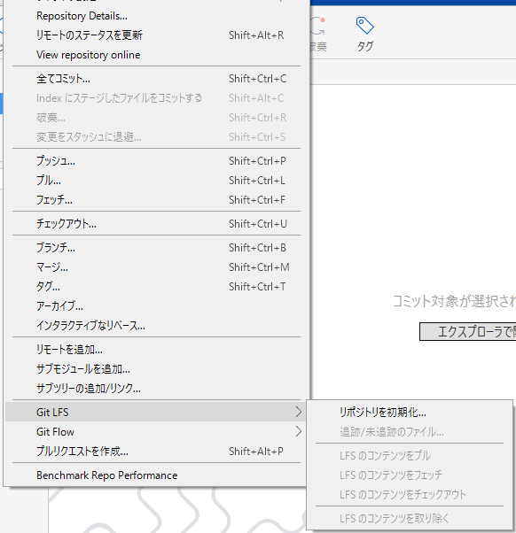
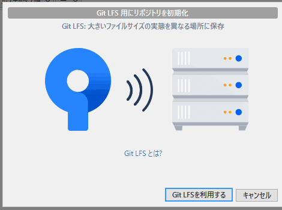
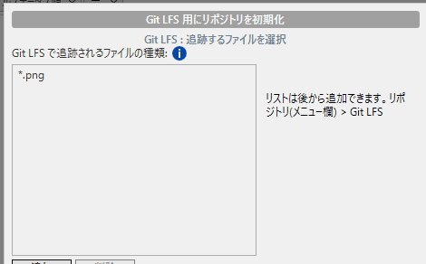

# Git LFS とゲームのリポジトリ

ゲームのプロジェクトにはテクスチャ、モデル、音声のような大きなバイナリが大量に入ります。Git はテキストの差分を管理するのが得意で、バイナリは苦手です。1 ファイルを少し直しただけで、そのファイル全体が履歴に追加されます。100 MB のファイルを 10 回直せば、履歴は 1 GB を超えクローンが遅くなり GitHub に押し返されます。

Git LFS（Large File Storage）は、<strong>大きなファイルの中身を別の置き場に預けリポジトリには小さな目印だけを入れる</strong>仕組みです。リポジトリは軽いままファイルは必要になったときに取ってきます。

!!! tip "ポイント"
    - LFS に預けるのは、画像・モデル・音声・動画などの大きなバイナリ。ソースコードは預けない
    - `git lfs track "*.png"` のように拡張子で指定する。設定は `.gitattributes` に書かれこれをコミットする
    - track はファイルを `git add` する前に行う。あとからでは履歴に入った分は軽くならない
    - GitHub の無料枠には LFS の容量と転送量の上限がある。大きなデータは事前に見積もる

!!! info "このページを読む前に"
    - [記録する](commit.md)（コミット）と [.gitignore](gitignore.md)
    - [事故の対処](accidents.md#bigfile)（巨大ファイルを入れてしまう事故）

## 導入（SourceTree） {#setup}

SourceTree には Git LFS の機能が入っています。リポジトリごとに 1 回、初期化して預けるファイルの種類を決めます。メニューの「リポジトリ → Git LFS」を開きます。



最初は「リポジトリを初期化...」だけが押せます。選ぶと確認の画面が出ます。



「Git LFSを利用する」を押すと次に預けるファイルの種類を決める画面が出ます。



「追加」を押して `*.png` や `*.fbx`、`*.wav` のように拡張子で指定します（`*` は「何でも」の意味です）。1 つずつ追加して最後に「トラックファイル」を押します。あとから追加するときはメニューの「リポジトリ → Git LFS → 追跡/未追跡のファイル...」を使います。

押すとリポジトリのフォルダーに `.gitattributes` というファイルができます。中身は次のような行です。

```text title=".gitattributes"
*.png filter=lfs diff=lfs merge=lfs -text
*.fbx filter=lfs diff=lfs merge=lfs -text
*.wav filter=lfs diff=lfs merge=lfs -text
```

「`*.png` のファイルは LFS で扱う」という意味の設定です。このファイルはファイルステータスに新しいファイルとして出てきます。<strong>必ずコミットして共有します。</strong>共有しないと他の人の環境ではバイナリがそのまま Git に入ってしまいます。

この後に「インデックスに追加」したファイルは、中身ではなくポインタ（ファイルの ID とサイズを書いた数行のテキスト）がコミットされます。本体はプッシュのときに LFS のサーバーへ送られます。

!!! warning "追跡の設定は、ファイルを記録する前に"
    LFS の追跡は <strong>ファイルを「インデックスに追加」する前</strong>に済ませます。すでに記録してしまったファイルはあとから設定しても、履歴に入った分は軽くなりません（[すでにコミットしたファイルを移す](#migrate)）。

### コマンドで同じことをする

画面の操作はコマンドの `git lfs track` と同じ意味です。確かめたいときまたは SourceTree がうまく動かないときのために、コマンドも示します。

```bash
git lfs install                   # 自分の環境で LFS を有効にする（最初の 1 回）
git lfs track "*.png"             # png を LFS で管理する
git add .gitattributes            # 設定ファイルをコミットする
```

## 何を預けるか {#what}

| 種類 | 拡張子の例 | 理由 |
| --- | --- | --- |
| 画像 | `.png` `.jpg` `.tga` `.psd` `.dds` | 数 MB から数百 MB。直すたびに全体が増える |
| モデル | `.fbx` `.blend` `.obj` | 同上 |
| 音声・動画 | `.wav` `.ogg` `.mp4` | 大きく、差分がほとんど効かない |
| ライブラリ（バイナリ） | `.lib` `.dll` | 置くなら LFS。ただし vcpkg で入れる方法が先 |

`.cpp` `.h` `.hlsl` などのテキストは預けません。LFS に入れると差分が見えなくなりマージもできなくなります。

小さなアイコン画像まで預ける必要はありません。基準としては <strong>1 MB を超えるものまたは頻繁に更新するもの</strong>を LFS にします。

## すでにコミットしたファイルを移す {#migrate}

track を忘れて大きなファイルを入れてしまったら `git lfs migrate` で、履歴を書き換えて移せます。

```bash
git lfs migrate import --include="*.png,*.fbx" --everything
```

`--everything` はすべての枝の履歴を書き換えます。コミットの ID が変わるので、<strong>共有済みのリポジトリでは全員に伝え全員がクローンし直す</strong>必要があります。チームに知らせずに実行すると、全員の履歴がずれて大混乱になります。まだ一人で使っている段階でやっておくのが安全です。

## 容量とコスト {#cost}

GitHub の無料のアカウントは LFS の保存容量と月ごとの転送量に上限があります。上限を超えるとプッシュやクローンが失敗します。チーム開発では数 GB のアセットが容易に出てくるので、プロジェクトを始めるときに次を決めておきます。

- どのファイルを LFS にするか（拡張子の一覧）
- 容量が足りなくなったときの置き場（有料枠、社内サーバー、アセットは別管理にするなど）
- 古いアセットを定期的に整理するか

## ゲームのリポジトリの構成 {#layout}

ソースコードとアセットが 1 つのリポジトリに混ざると、クローンが重くなります。小さいうちは 1 つで構いません。大きくなったら分けるかどうかを考えます。

```text title="フォルダー構成の例"
MyGame/
  .gitattributes
  .gitignore
  .editorconfig
  src/              ← C++ のソース
  shaders/          ← HLSL
  assets/           ← 画像・モデル・音声（LFS）
  third_party/      ← 外部ライブラリ（vcpkg なら不要）
  vcpkg.json
  MyGame.sln
```

`assets/` を丸ごと LFS にするなら `git lfs track "assets/**"` と書けます。ただし、アセットの中にテキストの設定ファイル（`.json` など）があれば、LFS に入れたくない場合もあります。拡張子で選ぶほうが後で困りません。

## よくあるミス {#mistakes}

??? failure "クローンしたら、画像が数行のテキストになっている"
    LFS が入っていない環境でクローンすると、ポインタがそのまま残ります。`git lfs install` を実行してから `git lfs pull` で本体を取ってきます。

??? failure "track する前に add していて、履歴が重いまま"
    track は add より前に行う必要があります。履歴に入った分は `git lfs migrate` で移します（上記の注意付き）。

??? failure "GitHub の LFS の上限を超えて、プッシュできなくなった"
    容量の見積もりを事前にしてください。不要なアセットは履歴から消すか有料の容量を足します。

## これだけ覚える {#summary}

- 大きなバイナリは LFS、テキストは普通の Git
- `track` を先に `add` を後に。`.gitattributes` もコミットする
- 履歴の書き換えは全員のクローンし直しが必要。早めに決める

## 関連ページ {#related}

- [Git の考え方](concepts.md)
- [チーム開発の進め方](team.md)
- [外部ライブラリの入れ方](../vs/libraries.md)
