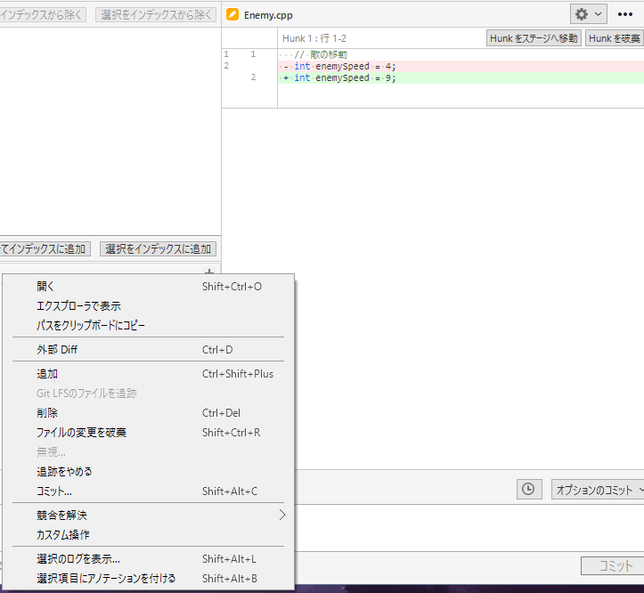
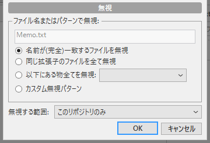

# .gitignore（管理しないファイル）

Visual Studio でビルドすると、`x64/` や `.vs/` に、巨大な一時ファイルが大量にできます。これをそのまま記録すると、リポジトリが重くなり、他の人の PC では意味のないファイルが、毎回「変更」として出てきます。そこで、<strong>「このファイルは、Git の管理に入れない」</strong>と教える仕組みが `.gitignore` です。

このページは、書き方、ゲーム制作で入れるもの、SourceTree の「無視」機能、すでに記録してしまったファイルの外し方を説明します。

!!! tip "ポイント"
    - 最初のコミットの前に、`.gitignore` を置く。あとからでは、履歴に残る
    - ビルドの出力、個人の設定、秘密情報を入れる。ソースと `.sln` は無視しない（管理に入れる）
    - ファイルを右クリックして「無視」を選べば、自分で書かなくてもよい
    - すでに記録したファイルには、効かない。追跡をやめる操作が別に要る

!!! info "このページを読む前に"
    - [記録する](commit.md)

## 基本の書き方 {#basic}

`.gitignore` は、リポジトリのフォルダーに置く、ただのテキストファイルです。各行が、管理しないファイルやフォルダーを指すパターンです。

```gitignore
# Visual Studio
.vs/
*.user
*.suo

# ビルドの出力
x64/
Debug/
Release/
out/
build/

# vcpkg
vcpkg_installed/
```

`#` で始まる行はコメント、空行は無視されます。パターンの書き方を、次に示します。

- `x64/`: 末尾が `/` なら、その名前のフォルダー（どの階層にあっても）
- `*.user`: `*` は任意の文字列。拡張子が `.user` のファイル全部
- `/build`: 先頭が `/` なら、`.gitignore` と同じ階層の `build` だけ
- `docs/*.tmp`: 特定のフォルダーの中だけ
- `!important.user`: `!` で始めると、除外から外す（例外にする）

`/` で始まるかどうかで、範囲が変わります。`build/` と書くと、どの階層の `build` フォルダーも対象です。`/build/` と書くと、リポジトリ直下の `build` だけです。`third_party/lib/build/` のような別物があるときは、意図に合わせて選んでください。

## SourceTree で無視する {#sourcetree}

自分でファイルを書かなくても、SourceTree の画面から、パターンを追加できます。ファイルステータスで、無視したいファイルを右クリックして、「無視...」を選びます。



次の画面が出ます。



- <strong>名前が(完全)一致するファイルを無視</strong>: 選んだファイルだけ
- <strong>同じ拡張子のファイルを全て無視</strong>: `*.obj` のような、拡張子ごと
- <strong>以下にある物全てを無視</strong>: フォルダーごと
- <strong>カスタム無視パターン</strong>: 自分でパターンを書く

下の「無視する範囲」の初期値は「このリポジトリのみ」で、そのリポジトリの `.gitignore` に書かれます（チーム全員に効きます）。「OK」を押すと、`.gitignore` が作られ（または更新され）、そのファイルが、画面から消えます。`.gitignore` 自体も、コミットしてチームに共有してください。

## ゲームの制作で入れるもの {#game}

C++ と Visual Studio のプロジェクトでは、おおむね次の分類で考えます。

- <strong>IDE の個人設定</strong>: `.vs/`、`*.user`、`*.suo`。人ごとに違うので、他人の環境で意味がない
- <strong>ビルドの出力</strong>: `x64/`、`Debug/`、`Release/`、`out/`、`*.obj`、`*.pdb`、`*.exe`。作り直せて、サイズが大きい
- <strong>パッケージの置き場</strong>: `vcpkg_installed/`、`packages/`。インストールで作れて、大きい
- <strong>一時ファイル</strong>: `*.tmp`、`*.log`、`*.bak`。再現できて、差分が邪魔になる
- <strong>秘密情報</strong>: `.env`、`secrets.json`、`*.pem`。漏れると被害が出る

入れすぎる事故にも注意してください。たとえば `*.exe` を無視していて、配布用の外部ツールを置きたいなら、そのファイルだけ `!tools/foo.exe` のように例外にします。`.sln`、`.vcxproj`、`.vcxproj.filters`、ソース、リソース、`.editorconfig`、`.gitattributes` は、管理に入れます。

## テンプレートを使う {#template}

一から書くのは大変なので、GitHub が配っているテンプレートを元にするのが手早い方法です。GitHub でリポジトリを作るときの「Add .gitignore」で「VisualStudio」を選ぶか、`github/gitignore` リポジトリの `VisualStudio.gitignore` をコピーします。Visual Studio でプロジェクトを作るとき「Git リポジトリを作成」を選ぶと、C++ 用の `.gitignore` が自動で置かれます。

テンプレートは広く作ってあるので、自分のプロジェクト特有の出力先（`bin/`、`Saved/`、`Intermediate/` など）は足してください。

## すでに記録したファイルを外す {#untrack}

!!! warning ".gitignore は、すでに記録したファイルには効かない"
    すでにコミットしてしまったファイルは、あとから `.gitignore` に書いても、追跡され続けます。

追跡だけをやめるには、そのファイルを右クリックして、「追跡をやめる」を選びます。ファイルそのものは、作業フォルダーに残ったまま、Git の管理からだけ外れます。選んだら、コミットして、他の人にも反映します。「削除」を選ぶと、ファイルそのものが消えるので、間違えないでください。

フォルダーごとなら、コマンドが早いです（ツールバーの「ターミナル」から開けます）。

```bash
git rm -r --cached x64/                     # フォルダーごと、追跡だけを外す
git commit -m "ビルドの出力を管理から外す"
```

`--cached` が大事です。これを付けないと、ファイルそのものが削除されます。

ただし、過去のコミットには、ファイルが残っています。履歴にサイズの大きいファイルが入ってしまった場合は、履歴の書き換えが必要です。難しい操作なので、[事故の対処](accidents.md#bigfile) を見てください。

## 無視されているか確かめる {#check}

あるファイルが、どのルールで無視されているかを調べるには、コマンドを使います。

```bash
git check-ignore -v x64/Debug/MyGame.exe
```

```text title="実行結果の形"
.gitignore:5:x64/	x64/Debug/MyGame.exe
```

左が「どのファイルの何行目のルールか」、右が対象のファイルです。意図せず無視されているファイルがあるときは、これで原因が分かります。

## 自分だけの無視と全員の無視 {#personal}

リポジトリの `.gitignore` は、全員に効きます。自分のエディターの一時ファイルのように、自分の PC だけで無視したいものは、次の 2 か所に書くと、チームに影響しません。

- `.git/info/exclude`: そのリポジトリだけ、自分だけ
- グローバルの無視ファイル: 全リポジトリに効く、自分用のファイル（SourceTree の「ツール → オプション → Git」の「グローバル無視リスト」で指定できる）

プロジェクトに必要な無視は `.gitignore`、個人の事情は自分用のファイルに、と分けると、`.gitignore` がきれいに保たれます。

## よくあるミス {#mistakes}

??? failure "`.gitignore` に書いたのに、まだ表示される"
    すでに記録されたファイルには効きません。ファイルを右クリックして、「追跡をやめる」を選びます。

??? failure "ビルド生成物を入れてしまい、リポジトリが重くなった"
    `x64/` や `.vs/` を `.gitignore` に書く前にコミットすると、数百 MB が履歴に残ります。履歴から完全に消すのは難しいので、最初のコミットの前に、`.gitignore` を置いてください。

??? failure "`*.exe` を無視したら、必要な外部ツールまで無視された"
    例外を、`!tools/foo.exe` のように書きます。どのルールで無視されているかは、`git check-ignore -v` で調べられます。

## これだけ覚える {#summary}

- 最初のコミットの前に、`.gitignore` を置く
- ビルドの出力、個人の設定、秘密情報を入れる。ソースと `.sln` は無視しない
- ファイルを右クリックして「無視」。すでに記録したものは「追跡をやめる」
- 迷ったら、GitHub の VisualStudio テンプレートを元にする

## 関連ページ {#related}

- [記録する](commit.md)
- [事故の対処](accidents.md)
- [.editorconfig](../vs/editorconfig.md)
