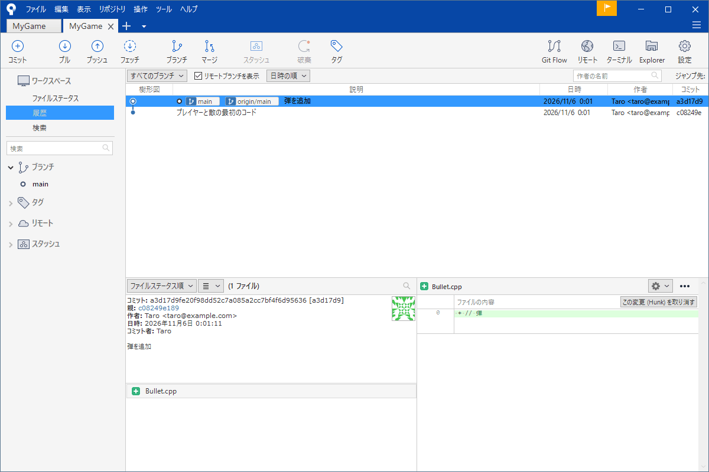
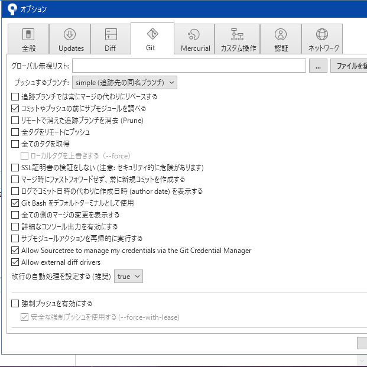

# SourceTree のインストールと最初の設定

Git は「黒い画面にコマンドを打つ道具」という印象が強く、そこで挫折する人が多くいます。でも履歴の確認・コミット・ブランチ・マージのような毎日の作業は、画面で見ながらクリックして済ませられます。このサイトではそのための道具として <strong>SourceTree</strong>（Atlassian 製の無料の Git クライアント）を前提に説明します。

このページでは SourceTree を入れて、最初の 1 回だけ必要な設定（名前とメールアドレス、改行、GitHub との接続）までを済ませます。

!!! tip "ポイント"
    - SourceTree は Git 本体を使って動く。SourceTree のインストーラーが Git も入れてくれる（すでに入っていればそれを使える）
    - 最初に名前とメールアドレスを登録する。これが無いとコミットに作者を付けられない
    - 改行コードの自動処理はオプションの「Git」タブで確かめる。「true」のままで始めてよい
    - GitHub との接続は、Git Credential Manager（ブラウザーでサインインするだけ）が楽

!!! info "このページを読む前に"
    - [Git の考え方](concepts.md)（用語と 3 つの場所）

## インストール {#install}

SourceTree の公式サイト（sourcetreeapp.com）からインストーラーをダウンロードして実行します。起動すると Atlassian アカウントでのサインインを求められます。ここは「Bitbucket の代わりに別のアカウントを使う」を選ぶか Atlassian アカウントを作ります。Git の使い方とは関係なく、GitHub にだけ載せたい場合も SourceTree を使うこと自体にこのアカウントが要ります。

次に、Git 本体と Mercurial を入れるかを聞かれます。<strong>Git だけ</strong>にチェックを入れて進みます（Mercurial は別の管理ソフトで、ゲーム制作ではほぼ使いません）。すでに Git for Windows が入っている PC ならその Git を使うかを聞かれることがあります。どちらでも動きます。

最後に、名前とメールアドレスの入力欄が出ます。ここで入れたものがコミットの作者として記録されます。

!!! note "このサイトの画像について"
    画像は SourceTree 3.4 の日本語表示です。新しい版や英語表示ではボタンの位置や言葉が少し違います。

## 画面の見方 {#screen}

初めて開くとまだリポジトリが無いので、空の画面が出ます。リポジトリを開くと次のような画面になります（画面の全体像は [SourceTree の画面](sourcetree.md) で、部品ごとに詳しく説明します）。



- 上のバーに毎日使う操作（コミット・プル・プッシュ・フェッチ・ブランチ・マージ・スタッシュ・破棄・タグ）が並ぶ
- 左のサイドバーで見る画面（ファイルステータス・履歴・検索）とブランチ・タグ・リモートを選ぶ
- 中央の一覧がコミットの履歴。枝分かれと合流が線で描かれる

## 名前とメールアドレス {#user}

名前とメールアドレスは <strong>すべてのコミットに付く署名</strong>です。あとから履歴を見たとき「誰が書いたか」が分かるように使われます。

SourceTree ではメニューの「ツール → オプション」を開き「全般」タブの「デフォルトユーザー情報」に、フルネームとメールアドレスを入れます。

メールアドレスは GitHub に登録したものと同じにしてください。違うアドレスでコミットすると、GitHub 上でそのコミットが自分のものとして結び付かず貢献として数えられません。公開したくないときは GitHub の設定にある noreply アドレス（`12345678+name@users.noreply.github.com` の形）を使えます。

## オプションの「Git」タブ {#options}

同じオプションの「Git」タブで、Git の動きの既定値を確かめます。



最初に見ておく項目は次の 3 つです。

- <strong>改行の自動処理を設定する</strong>は「true」のままで構いません。Windows の改行（CRLF）と Linux・macOS の改行（LF）の違いを、Git が吸収してくれます。チームで改行がそろわない問題が起きたら、[Git の考え方](concepts.md) と `.gitattributes` の節（下の「改行コードの問題」）を読んでください
- <strong>強制プッシュを有効にする</strong>はチェックを外したままにします。強制プッシュはリモートの履歴を上書きする危ない操作です。使うことになった場面は [事故の対処](accidents.md) で説明します
- <strong>追跡ブランチでは常にマージの代わりにリベースする</strong>も外したままにします。意味が分かってから変えれば十分です

## 改行コードの問題 {#eol}

Windows の改行は CRLF、Linux と macOS は LF です。チームに両方の人がいると同じファイルの全行が「変更された」と表示される事故が起きます。

一番確実なのはリポジトリに `.gitattributes` というファイルを置いて、改行の扱いをファイルごとに決めてしまうことです。メモ帳などで作ってリポジトリのフォルダーに置きコミットします。

```text title=".gitattributes"
* text=auto
*.cpp text eol=lf
*.h   text eol=lf
*.sln text eol=crlf
*.bat text eol=crlf
```

`* text=auto` はテキストかどうかを Git が判断して、リポジトリの中では LF にそろえる指定です。ただし、Visual Studio のソリューション（`.sln`）やバッチ ファイル（`.bat`）は CRLF のほうが安全なので、個別に指定しています。詳しくは [.editorconfig](../vs/editorconfig.md) と [文字コードを UTF-8 にしよう](../vs/utf8.md) を参照してください。

## GitHub との接続 {#auth}

GitHub のリポジトリを使うときは、サインインが要ります。いまの GitHub はパスワードでの認証を受け付けません。次のどちらかを使います。

<strong>Git Credential Manager</strong> は、Git for Windows に同梱されています。初めてプッシュやクローンをするとブラウザーが開き GitHub にサインインすると、認証情報が Windows の資格情報マネージャーに保存されます。次からは入力が要りません。学生の最初の 1 本としてはこれが一番楽です。オプションの「Git」タブにある「Git Credential Manager 経由で認証情報を管理する」のチェックが入っていることを確かめてください。

<strong>SSH 鍵</strong> はパスワードの代わりに鍵のペアで認証する方法です。SourceTree の「ツール → SSH キーの作成/インポート」から、画面の指示で鍵を作れます（PuTTYgen という道具が開きます）。公開鍵を GitHub の「Settings → SSH and GPG keys」に貼り付けます。秘密鍵は誰にも渡さないでください。

どちらを選んでもそのあとの Git の使い方は変わりません。接続の詳しい話は [GitHub を使う](github.md#auth) にあります。

## よくあるミス {#mistakes}

??? failure "コミットのとき「作者が分からない」と言われる"
    名前とメールアドレスが未設定です。「ツール → オプション → 全般」で入れてから、もう一度コミットします。

??? failure "メールアドレスが GitHub のものと違い貢献として数えられない"
    すでにあるコミットのアドレスは、あとからは簡単に直せません。これからのコミットのためにオプションのメールアドレスを直してください。

??? failure "全ファイルが変更されたことになる"
    改行コードが人によって違います。`.gitattributes` を置くとそろいます。

## これだけ覚える {#summary}

- 毎日の操作は SourceTree の画面でできる。コマンドは困ったときだけ使う
- 最初に名前とメールアドレスを入れる（ツール → オプション → 全般）
- 強制プッシュはチェックを外したままにする
- GitHub への接続は Git Credential Manager が楽

## 関連ページ {#related}

- [SourceTree の画面](sourcetree.md)
- [記録する（ステージ・コミット）](commit.md)
- [GitHub を使う](github.md)
