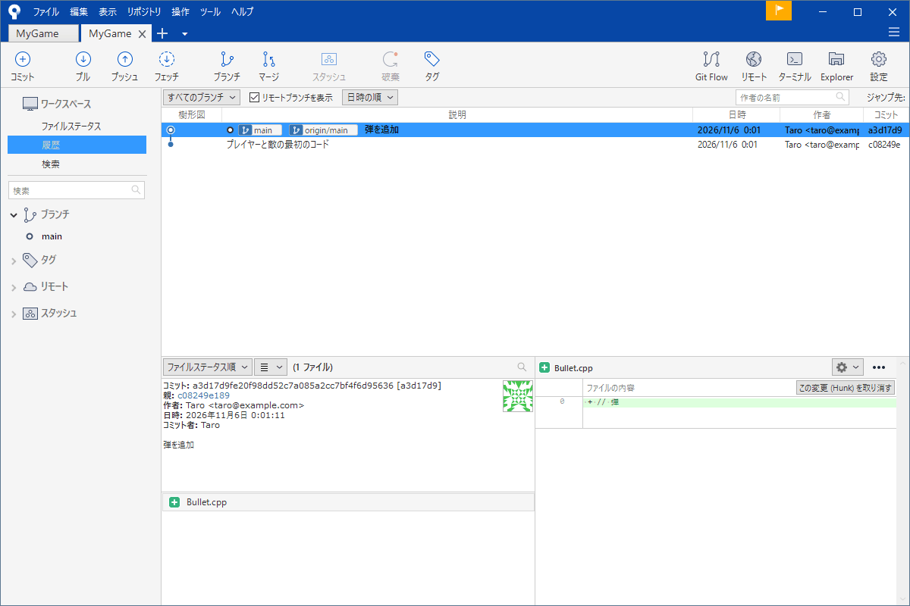
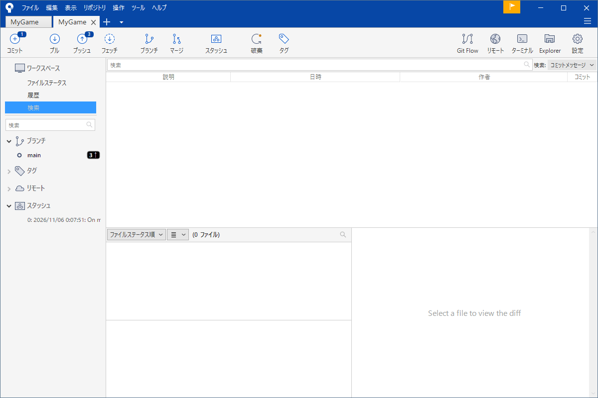

# 履歴を読む

「このバグは、いつ入ったのか」「この行は、誰がなぜ書いたのか」「先週の動いていた状態は、どれか」。コミットを積み上げる目的は、あとでこういう疑問に答えるためです。そのために、履歴を読む画面が SourceTree の「履歴」です。

このページは、履歴の一覧の読み方、1 つのコミットの中身の見方、ファイルごとの履歴、行ごとの作者（アノテーション）、検索を説明します。バグの出始めを探す二分探索だけは、画面にない機能なので、最後にコマンドで紹介します。

!!! tip "ポイント"
    - 左の線は枝分かれと合流を表す。1 行が 1 つのコミット
    - コミットをクリックすると、下に変更されたファイルと差分が出る
    - ファイルを右クリックして「選択のログを表示」で、そのファイルだけの履歴が見える
    - 行ごとの作者は「アノテーションを付ける」で見る
    - 履歴を読むだけなら、何を押しても履歴は壊れない

!!! info "このページを読む前に"
    - [記録する（ステージとコミット）](commit.md)
    - [SourceTree の画面](sourcetree.md)

## 履歴の一覧 {#log}

サイドバーの「履歴」を開くと、コミットが新しい順に並びます。



1 行が、1 つのコミットです。左から順に、次の列があります。

- <strong>樹形図</strong>: 点がコミット、線が親子の関係。線が分かれる所が枝分かれで、集まる所が合流（マージ）
- <strong>説明</strong>: コミットのメッセージの 1 行目。枝の名前や、タグが色つきのラベルで添えられる
- <strong>日時</strong>と<strong>作者</strong>
- <strong>コミット</strong>: ID の短い形（先頭の数文字）

説明の列にある色つきのラベルは、そのコミットに付いている目印です。`main` や `feature/boss` は枝の先端、`origin/main` は共有場所の最新、タグ（`v0.1` など）は名前を付けた区切りを表します。「いまの自分の位置」は、太字で、丸が白抜きの点です。

上の方にある「すべてのブランチ」のプルダウンで、見せる枝を選べます。全部の枝を同時に見ると全体像が分かり、いまの枝だけにすると、自分の道筋だけを追えます。「日時の順」「樹形図の順」といった並び順も切り替えられます。

## 1 つのコミットの中身 {#show}

コミットを 1 つクリックすると、下の部分に、そのコミットの詳細が出ます。

- 左の欄: ID、親（どのコミットの次か）、作者、日時、メッセージ全文
- その下: 変更されたファイルの一覧
- 右の欄: 選んだファイルの差分（赤が消えた行、緑が増えた行）

「親」の欄にある ID は、クリックするとそのコミットへ飛べます。マージのコミットは、親が 2 つあります。

バグを探しているときは、「このコミットで、何が変わったのか」を見ます。ファイルの一覧を見て、怪しいファイルを 1 つずつクリックしていけば、そのコミットの変更の全体が読めます。

## 2 点を比べる {#diff}

離れた 2 つのコミットを比べるには、履歴で 1 つ目をクリックしたあと、<strong>Ctrl キーを押しながら</strong>、2 つ目をクリックします。2 つを選ぶと、2 点の間の差分が出ます。「先週の動いていた状態と、いまの状態で、何が違うのか」を見るときに使います。

コミットの前の変更を見たいときは、「ファイルステータス」の画面でファイルをクリックします（[記録する](commit.md#diff)）。

## ファイルごとの履歴 {#file}

あるファイルだけの経緯を見たいときは、そのファイルを右クリックして「選択のログを表示」を選びます。そのファイルに触れたコミットだけが、一覧に出ます。「このファイルは、どんな経緯でいまの形になったのか」を調べる定番の方法です。

## 行ごとの作者（アノテーション） {#blame}

「この行は、誰がなぜ書いたのか」を知りたいことがあります。ファイルを右クリックして「選択項目にアノテーションを付ける」を選ぶと、各行の左に、その行を最後に変えたコミットの ID と作者が出ます。

誰かを責めるための機能ではなく、<strong>理由を聞きに行く</strong>ための機能です。行の ID から、そのコミットのメッセージを読めば、「なぜそう書いたのか」の手がかりが見つかります。

## 探す {#search}

サイドバーの「検索」を開くと、履歴から探せます。入力欄に言葉を入れて、何から探すかを選びます。



- メッセージ: コミットのメッセージに含まれる言葉で探す
- 作者: 特定の人のコミットだけを探す
- ファイル: 特定のファイルを触ったコミットを探す
- 変更内容: その文字列が増えた・減ったコミットを探す（コードが入った時期を探すとき）

## バグの出始めを探す：二分探索 {#bisect}

「先週は動いていたのに、いまは動かない」とき、その間に 100 個のコミットがあるなら、1 個ずつ試すのは大変です。<strong>二分探索</strong>は、真ん中のコミットに移って「動くか」を確かめ、動いたら後半、動かなければ前半、と半分ずつ絞り込む方法です。100 個でも、7 回ほどの確認で見つかります。

これは SourceTree の画面にはありません。Git のコマンド `git bisect` を使います（ターミナルは、ツールバーの「ターミナル」から開けます）。

```bash
git bisect start             # 探索を始める
git bisect bad               # いまの状態は、動かない
git bisect good a3f9c21      # このコミットでは、動いた
```

Git が真ん中のコミットに切り替えてくれるので、ビルドして確かめ、結果を伝えます。

```bash
git bisect good              # 動いた（動かなければ bad）
```

これを繰り返すと、「このコミットから動かなくなった」と教えてくれます。終わったら、必ず元に戻します。

```bash
git bisect reset             # 探索を終えて、元の枝に戻る
```

途中の状態は、履歴の画面から見ると「分離 HEAD」（どの枝にも属さない状態）になっています。慌てず、`git bisect reset` で戻してください。

## ゲームの制作で効く使い方 {#game}

- 描画が崩れたとき、二分探索で、出始めのコミットを探す
- パラメーターのファイルを右クリックして「選択のログを表示」を開くと、バランス調整の経緯が読める
- 他の人のコミットも読んでおく。何が変わったかを知っていると、競合のときに慌てない

## よくあるミス {#mistakes}

??? failure "履歴にコミットが見当たらない"
    「すべてのブランチ」になっていない可能性があります。別の枝のコミットは、その枝を選ばないと出ません。また、他の人が送ったものは、「フェッチ」しないと手元に来ません。

??? failure "二分探索の途中で、作業が分からなくなった"
    `git bisect reset` で戻れます。探索の前に、作業中の変更はコミットかスタッシュで退避してください。

## これだけ覚える {#summary}

- 履歴の画面は、読むだけなら安全
- コミットをクリックして、変更の中身を読む
- Ctrl を押して 2 つ選ぶと、2 点を比べられる
- ファイルは右クリック「選択のログを表示」と「アノテーションを付ける」
- バグの出始めは、二分探索（コマンド）

## 関連ページ {#related}

- [記録する](commit.md)
- [取り消す・戻す](undo.md)
- [ブランチ](branch.md)
