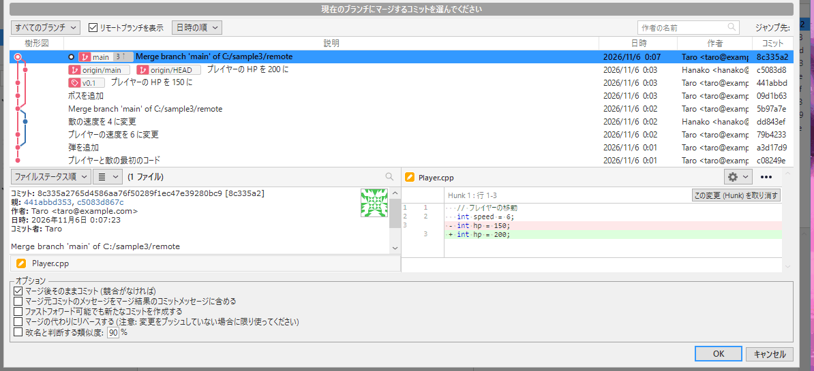
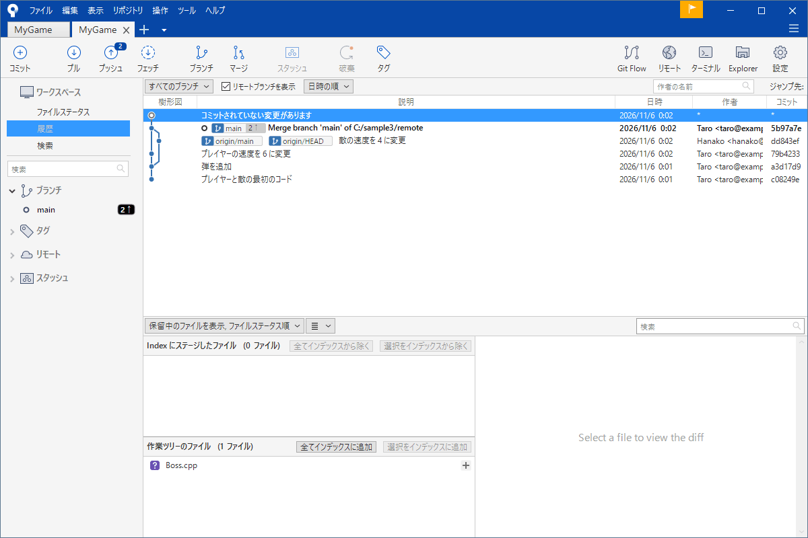
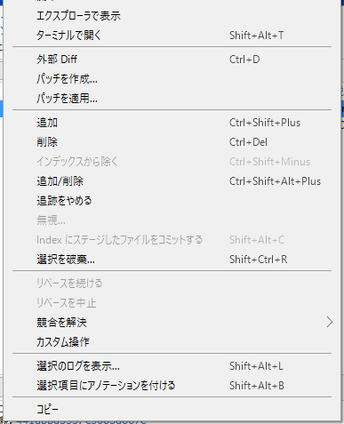

# マージ（合体）

`feature/boss` の枝でボスができた。これを本線の `main` に取り込みたい。枝を分けて作業したら最後には合体が要ります。この合体が<strong>マージ</strong>です。

Git のマージはたいていは自動で終わります。別々のファイル、または同じファイルの別々の場所を直していれば、Git が両方の変更を取り込みます。同じ場所を別々に直していたときだけ衝突（コンフリクト）が起きます。衝突は次の [コンフリクトを直す](conflict.md) で説明します。

!!! tip "ポイント"
    - 合体される側（取り込む側）の枝に立ってから、取り込みたい枝をマージする
    - 一直線に伸びるだけなら札を進めるだけで終わる（fast-forward）。枝が分かれていたら前が 2 つのコミットができる
    - 「プル」も実はフェッチしてからマージしている
    - 衝突しても「マージを中止」で、やる前の状態に戻れる

!!! info "このページを読む前に"
    - [ブランチ](branch.md)
    - [履歴を読む](log.md)

## 基本の使い方 {#basic}

マージは <strong>取り込む側に立って</strong>行います。`main` に `feature/boss` を取り込むならまず `main` に移って（サイドバーでダブルクリック）、ツールバーの「マージ」を押します。

画面の上にいまの枝（取り込まれる側）とマージする枝を選ぶ欄が出ます。取り込みたい枝（`feature/boss`）を選んで、「OK」を押します。

下にはオプションがあります。

- <strong>マージ後そのままコミット (競合がなければ)</strong>: 自動でコミットまで済ませる。普通はチェックのままでよい
- <strong>ファストフォワード可能でも新たなコミットを作成する</strong>: 履歴に「合体した」という痕跡を残す（下の節）
- <strong>マージの代わりにリベースする</strong>: 履歴を一直線に並べ直す（[リベース](rebase.md)）

## fast-forward：札を進めるだけ {#ff}

`main` から枝を分けたあと `main` に新しいコミットが 1 つも増えていなければ、`feature/boss` は `main` の直線上にあります。この場合、合体は「`main` の札を `feature/boss` の位置まで進める」だけで終わります。新しいコミットは作られません。これを fast-forward といいます。

履歴は一直線のままで「いつ合体したか」の記録は残りません。

## マージコミット：前が 2 つのコミット {#merge-commit}

枝を分けたあとに `main` にも新しいコミットが増えていたら、直線にはなりません。このときは、2 つの枝の先端を親に持つ <strong>マージコミット</strong>が 1 つ作られます。

履歴の画面では線が 2 本合流する点として見えます。メッセージは `Merge branch 'feature/boss' into main` のような形で、自動で付きます。

## 履歴に合体の痕跡を残す {#no-ff}

fast-forward できる場合でもあえてマージコミットを作ることがあります。「この機能はここで合体した」と履歴で見えるようにするためです。マージの画面で「ファストフォワード可能でも新たなコミットを作成する」にチェックを入れます。チームでの運用の方針で決めてください。

## 自動で合体できるかの目安 {#auto}

Git が自動で合体できるのは、次のような場合です。

- 別々のファイルを直した
- 同じファイルでも離れた場所を直した

同じ場所（同じ行、またはすぐ隣）を別々に直した場合は Git は、どちらが正しいか決められません。この場合が衝突です。ゲームではシーンやプレハブのような 1 つのファイルを大勢が触るものとパラメーターを集めた 1 つのファイルで起きやすくなります。

## 合体を途中でやめる {#abort}

衝突したときに「いったんなかったことにしたい」ことがあります。SourceTree ではメニューの「操作」から、マージの中止を選べます。衝突のメッセージ画面が出ているときは、その画面で選ぶこともできます。マージを始める前の状態にきれいに戻ります。

衝突を直し始めたあとでもまだコミットしていなければ、やめられます。コミットしてしまったあとは[取り消す・戻す](undo.md) の「リセット」を使います（プッシュ前だけ）。

## 枝を最新に保つ：main を取り込む {#update}

`feature/boss` の作業が長引くと `main` が先に進みます。放っておくと最後の合体で衝突が一気に出ます。そこで、<strong>枝の上でときどき `main` を取り込みます。</strong>

1. `feature/boss` に立つ
2. 「フェッチ」して共有場所の `main`（`origin/main`）を最新にする
3. 「マージ」で `origin/main` を選んで OK する

こまめにやると衝突が小さいうちに直せます。

## プルはマージの一種 {#pull}

ツールバーの「プル」は実は「フェッチ（取ってくる）」と「マージ」を続けて行う操作です。共有場所の枝を自分の枝にマージしています。ですからプルのときにも衝突は起きます。詳しくは [リモートとプッシュ・プル](remote.md#pull) にあります。

## よくあるミス {#mistakes}

??? failure "取り込む側と取り込まれる側を逆にした"
    マージはいま立っている枝に選んだ枝を取り込みます。`feature/boss` に立って `main` をマージすると、`feature/boss` が更新されます（`main` は変わりません）。立つ枝を確かめてから「マージ」を押します。

??? failure "衝突のあと画面が「マージ中」のまま止まった"
    衝突したファイルを直して、コミットを済ませるまでは「マージ中」が続きます。ファイルステータスに警告マークのファイルが残っていないか確かめてください。やめるなら「操作」メニューから、マージを中止します。

??? failure "マージしたのに、変更が入っていない"
    すでに合体済みだと何も起きません。マージ元の枝の先端がすでにいまの枝の履歴に含まれているかを確かめます。

## これだけ覚える {#summary}

- 取り込む側に立って「マージ」する
- 直線なら札が進むだけ分かれていればマージコミットができる
- 同じ場所を直したときだけ衝突する
- 衝突したらマージの中止で戻れる
- 枝はときどき `main` を取り込んでおく

## 関連ページ {#related}

- [コンフリクトを直す](conflict.md)
- [リベース](rebase.md)
- [リモートとプッシュ・プル](remote.md)
