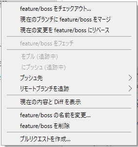
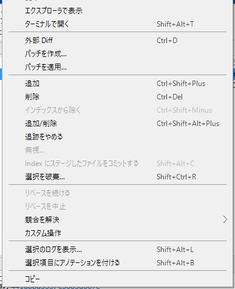
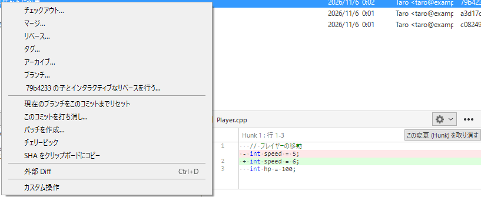

# リベース（履歴を整える）

`main` から枝を分けて作業していたら、その間に `main` が進んだ。マージで取り込むと、「合体のコミット」が増えて、履歴の線が複雑になる。もっと、一直線にきれいに並べたい。その方法が<strong>リベース</strong>です。

リベースは、自分のコミットを、<strong>新しい土台の上に、作り直して載せ替える</strong>操作です。履歴はきれいになりますが、コミットの ID が変わります。この性質が、使ってよい場面と、いけない場面を決めます。このページでは、その見分け方と、SourceTree での操作を説明します。

!!! tip "ポイント"
    - リベースは、コミットを作り直す。ID が変わる
    - 自分だけが使っている、まだプッシュしていない枝にだけ使う
    - `main` や、チームで共有している枝には、使わない
    - 迷ったら、マージを使う。マージは、履歴を書き換えない

!!! info "このページを読む前に"
    - [マージ](merge.md)
    - [取り消す・戻す](undo.md)

## リベースの考え方 {#idea}

`main` から `feature/boss` を分けたあと、`main` に新しいコミットが 2 つ増えたとします。

- マージ: 2 つの枝の先端を合わせて、合体のコミットを 1 つ作る。履歴は、分かれて合流する形が残る
- リベース: `feature/boss` のコミットを、いまの `main` の先端の後ろに、作り直して並べる。履歴は、一直線になる

結果の内容は、ほぼ同じです。違いは、履歴の形です。リベースでは、「最初から、最新の `main` から分けた」ように見えます。

## 基本の使い方 {#basic}

リベースする側（`feature/boss`）に立ちます。サイドバーで、土台にしたい枝（たとえば `main`）を右クリックして、「現在の変更を main にリベース」を選びます。



履歴の画面で、土台にしたいコミットを右クリックして、「リベース...」を選ぶ方法もあります。

リベース中に衝突すると、1 コミットずつ、止まります。直したら（[コンフリクトを直す](conflict.md)）、「操作」メニューの「リベースを続ける」を押します。やめたいときは、同じメニューの「リベースを中止」です。



## マージとリベースの違い {#vs-merge}

- <strong>履歴の形</strong>: マージは分岐と合流が残り、リベースは一直線になる
- <strong>履歴の書き換え</strong>: マージは書き換えない。リベースは、コミットを作り直す（ID が変わる）
- <strong>安全さ</strong>: マージは、取り消しが簡単。リベースは、共有した枝で使うと、事故が起きる
- <strong>衝突</strong>: マージは、1 回で直す。リベースは、コミットごとに直すことがある

迷ったら、マージを使います。リベースは、「自分の枝を、プッシュ前にきれいにしたい」ときだけです。

## リベースでやってはいけないこと {#danger}

<strong>プッシュ済みの枝や、他人が取り込んでいるかもしれない枝を、リベースしてはいけません。</strong>

リベースは、コミットを新しいものに作り直します。自分のリポジトリでは問題ありませんが、他の人が元のコミットをすでに取り込んでいると、その人の履歴と食い違い、同じ変更が二重に入ったり、プッシュが拒否されたりします。直すには強制プッシュが必要になり、他人のコミットを消す事故につながります。

守るルールは、シンプルです。

- 自分だけが使っている枝、まだプッシュしていない枝は、リベースしてよい
- `main` や、チームで共有している枝は、リベースしない
- プッシュ済みの自分の枝をリベースしたら、強制プッシュが必要になる。他人がその枝を使っていないと分かっているときに限る

## インタラクティブなリベース：コミットを整える {#interactive}

履歴の画面で、直したいコミットの<strong>1 つ前</strong>のコミットを右クリックして、「インタラクティブなリベース」を選びます。直近の複数のコミットを、まとめ直す・並べ替える・メッセージを直す、といった編集ができる画面が出ます。

各コミットに、次の指示を付けられます。

- <strong>そのまま使う</strong>
- <strong>メッセージを直す</strong>
- <strong>直前のコミットに合体する</strong>（メッセージも合わせる）
- <strong>直前のコミットに吸収する</strong>（メッセージは捨てる）
- <strong>コミットを捨てる</strong>

たとえば、「プレイヤーを追加」のあとに、「typo 修正」というコミットがあるなら、後者を前者に吸収させれば、typo の直しが履歴から消えます。プルリクエストを出す前に、雑なコミットを整える用途です。

これも履歴を書き換えるので、プッシュ前の枝にだけ使います。

## チェリーピック：1 つだけ持ってくる {#cherry-pick}

別の枝のコミットを 1 つ選んで、いまの枝に複製するのが、チェリーピックです。履歴の画面で、持ってきたいコミットを右クリックして、「チェリーピック」を選びます。



使いどころは、「別の枝で直したバグ修正だけを、リリース用の枝にも入れたい」というときです。枝全体はマージしたくない。でも、この 1 つの修正は欲しい、という場面で役に立ちます。

コミットの<strong>複製</strong>なので、ID は別になります。あとで元の枝をマージしたときに、同じ変更が二重に現れて、紛らわしい衝突が起きることがあります。チェリーピックは、例外的に使います。

## プルのときにリベースする {#pull-rebase}

プルの画面には、「リベース」を選ぶオプションがあります。選ぶと、「取ってきた共有場所の枝の上に、自分のコミットを載せ替える」ので、プルのたびにマージコミットが増えません。履歴が一直線になります。

ただし、自分のコミットを作り直すので、すでにプッシュ済みのコミットがあるときは、使いません。慣れるまでは、普通のプル（マージ）で構いません。

## ゲームの制作で効く使い方 {#game}

- 自分の機能の枝を、プルリクエストの前に、整える（コミットを吸収して減らす）
- 長く続けた枝は、ときどき `main` の上にリベースしておくと、最後の合体が楽になる（ただし、自分だけの枝で）
- 共有の枝は、触らない。チームで決めた規則に従う

## よくあるミス {#mistakes}

??? failure "リベースしたら、プッシュが拒否された"
    コミットを作り直したので、共有場所の古いコミットと食い違っています。自分だけが使っている枝なら、安全な強制プッシュで送れます（下のコマンド）。他人も使っている枝なら、やめて、マージに切り替えてください。

    ```bash
    git push --force-with-lease      # 自分が知らない更新が共有場所にあれば、失敗する
    ```

??? failure "リベースの途中で、何が起きているか分からなくなった"
    「操作」メニューの「リベースを中止」で、始める前の状態に戻れます。

??? failure "共有の枝（`main`）をリベースしてしまった"
    チームに知らせてください。プッシュ前なら、リセットで元に戻せます（[取り消す・戻す](undo.md#reset)）。プッシュ後は、[事故の対処](accidents.md) を見てください。

## これだけ覚える {#summary}

- リベースは、コミットを作り直して、一直線に並べる
- プッシュ前の、自分だけの枝にだけ使う
- 共有の枝には使わない。迷ったら、マージ
- 途中で困ったら、「リベースを中止」

## 関連ページ {#related}

- [マージ](merge.md)
- [事故の対処](accidents.md)
- [チームで使う](team.md)
