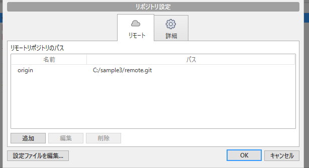
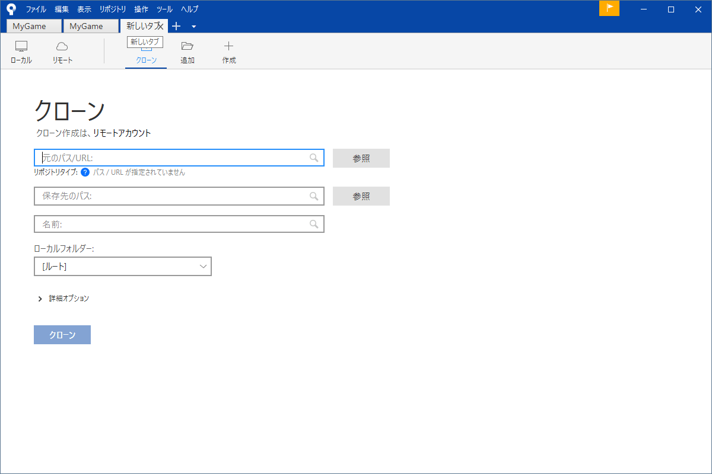
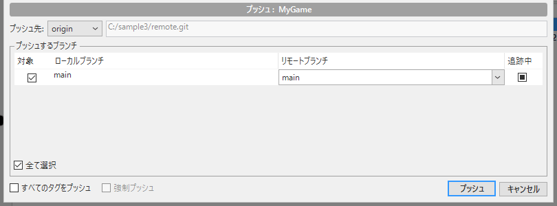
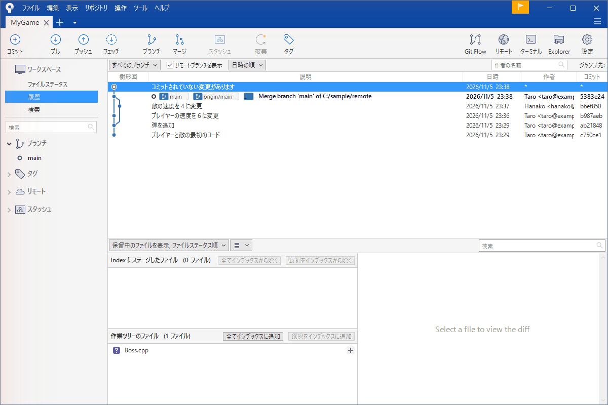
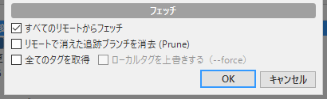
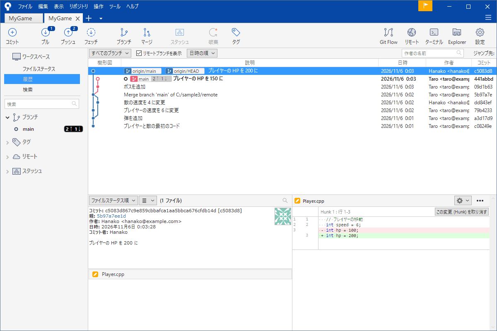
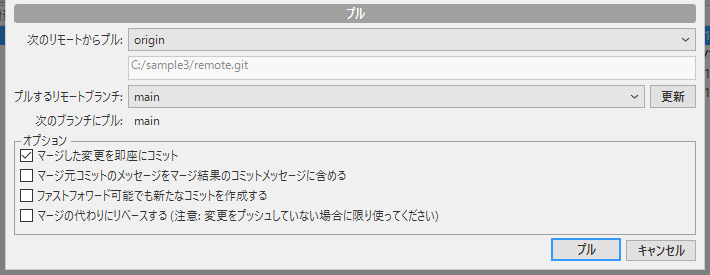
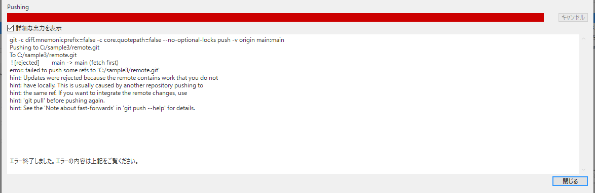
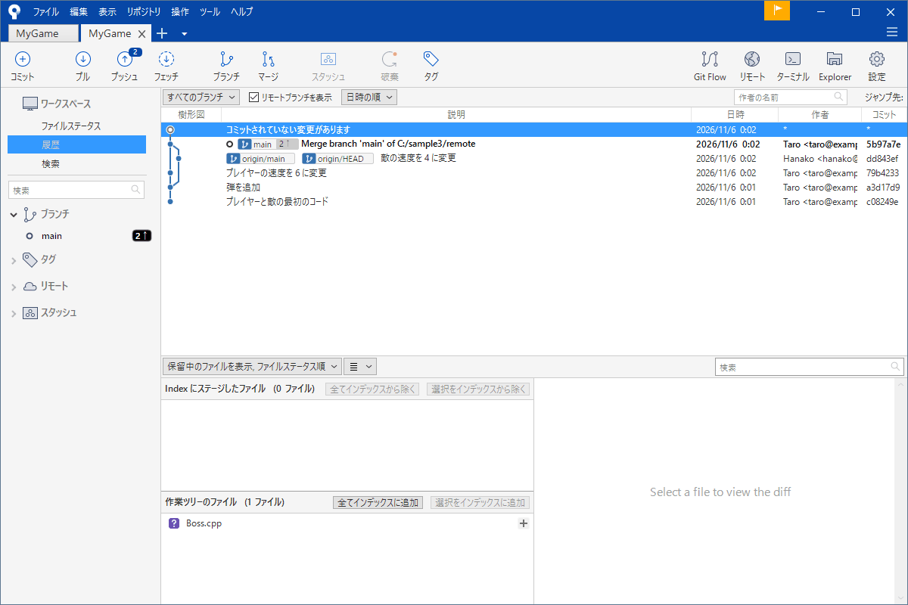

# リモートとプッシュ・プル

手元にコミットを積んでもそれだけでは、自分の PC にしかありません。チームで使うには共有場所（GitHub など）に送って、友だちの変更を受け取る必要があります。この共有場所を<strong>リモート</strong>、送るのを<strong>プッシュ</strong>、受け取るのを<strong>フェッチ</strong>と<strong>プル</strong>といいます。

このページはリモートの登録、クローン、プッシュ、フェッチ、プルを SourceTree の画面で説明します。「プッシュが拒否された」というよくある事故の直し方は、コマンドも示します。

!!! tip "ポイント"
    - リモートの標準の名前は `origin`。共有場所の URL に付いた名前
    - フェッチは「見るだけ」、プルは「取り込んで合体」、プッシュは「送る」
    - ツールバーの数字バッジが、送っていない数と取り込んでいない数を教えてくれる
    - プッシュが拒否されたら、先にプルして合体してからもう一度プッシュする

!!! info "このページを読む前に"
    - [記録する](commit.md)
    - [マージ](merge.md)

## リモートを登録する {#add}

リポジトリを作ったあとで共有場所を使うには、「リモート」を登録します。ツールバーの「設定」を押すとリポジトリの設定が出ます。



「リモート」のタブで「追加」を押して、名前（普通は `origin`）と共有場所の URL（GitHub のページの「Code」から、コピーできる）を入れます。クローンで持ってきたリポジトリは自動で `origin` が登録されています。

## クローン：リモートから持ってくる {#clone}

すでにある共有場所のリポジトリを自分の PC にコピーするのが「クローン」です。SourceTree で新しいタブ（＋）を開き「クローン」を選びます。



- <strong>元のパス / URL</strong>: GitHub の URL
- <strong>保存先のパス</strong>: 自分の PC のコピー先のフォルダー
- <strong>名前</strong>: SourceTree のタブに出す名前

「クローン」を押すと履歴ごとコピーされリポジトリのタブが開きます。初めてのときは GitHub のサインインを求められます（[GitHub との接続](install.md#auth)）。

## プッシュ：自分の記録を送る {#push}

コミットした内容を共有場所に送るのが、ツールバーの「プッシュ」です。



送る枝にチェックを入れて「プッシュ」を押します。新しく作った枝は初めて送るときに共有場所に枝が作られます。「プッシュ」のアイコンの数字はまだ送っていないコミットの数です。

送り終わったあとは履歴の画面で、`origin/main` の目印が自分の `main` と同じ位置まで進みます。



## フェッチ：持ってくるだけ {#fetch}

共有場所の様子を知りたい。でも自分の作業にはまだ混ぜたくない。そのためのものが「フェッチ」です。共有場所の最新を手元に取ってくるだけで、自分の枝やファイルは変わりません。



フェッチしたあとの履歴は `origin/main` が先に進んで見えます。自分の `main` との差がひと目で分かります。



「プル」の数字バッジはフェッチしたあとに取り込んでいないコミットがあると出ます。

## プル：持ってきて合体する {#pull}

「プル」はフェッチをしてさらにいまの枝にマージします。



画面には取ってくる枝（`origin/main`）とオプションがあります。普通は、そのまま「プル」を押します。

- <strong>取得したコミットを現在のブランチにマージ</strong>: 普通のプル。マージコミットができることがある
- <strong>リベース</strong>: 履歴を一直線に並べ直す。意味が分かってから使う（[リベース](rebase.md)）

自分も相手も同じ場所を直していれば、ここで衝突が起きます（[コンフリクトを直す](conflict.md)）。

### フェッチとプルの使い分け {#fetch-vs-pull}

- 作業を始める前や他の人の様子を見たいときは、まず「フェッチ」。履歴の画面で何が来たかを見てから、判断する
- 何が来ても取り込んでよいときはそのまま「プル」

慣れるまではフェッチして見てから、プルする流れが安全です。

## プッシュが拒否されたとき {#rejected}

チームで一番よく出会う失敗が、これです。自分がコミットしてプッシュしようとしたら、友だちが先に `main` にプッシュしていた。



赤い文字で「リモートの履歴と食い違うので、プッシュできない」という意味のエラーが出ます（`rejected` や `non-fast-forward` という言葉が見えます）。共有場所には自分の手元に無いコミットがある。そのまま送ると他の人のコミットを消してしまう。だから、Git が止めています。

プッシュの画面がもう一度出るので、「キャンセル」で閉じます。直し方は次の手順です。

1. 「プル」を押す（共有場所のコミットを手元に取り込んで、合体する）
2. 衝突したら直す（[コンフリクトを直す](conflict.md)）
3. もう一度「プッシュ」を押す

プルしたあとの履歴は自分のコミットと友だちのコミットが、合流した形になります。



そのあとプッシュが通ります。

### 強制プッシュは使わない

エラーの文章を検索して調べると、「`--force` を付ければ通る」という記事が見つかります。<strong>これは使わないでください。</strong>強制プッシュは共有場所の履歴を自分の履歴で上書きします。友だちのコミットが消えます。

どうしても履歴を書き換えたあとに送る必要があるとき（自分だけの枝を作り直したなど）は、コマンドでより安全な方法を使います。

```bash
git push --force-with-lease      # 自分が最後に見た状態から、変わっていなければだけ上書きする
```

`--force-with-lease` は「自分が知らないコミットが共有場所に増えていたら、失敗する」ので他の人の作業を消す事故を防げます。それでも `main` のようなみんなが使う枝には、使いません。

## 枝の追跡と状態 {#tracking}

手元の枝と共有場所の枝は「追跡」という関係でつながります。たとえば、手元の `main` は `origin/main` を追跡しています。

サイドバーの枝の名前の横に数字が出ます。

- 上向き矢印の数字: 共有場所に送っていないコミット（プッシュ待ち）
- 下向き矢印の数字: 共有場所にあって、手元に無いコミット（プル待ち。フェッチのあとに出る）

どちらも 0 なら共有場所と同じ状態です。

## リモートの枝を消す・使う {#remote-branch}

共有場所に送った枝が不要になったときは、サイドバーの「リモート」の中の枝を右クリックして、削除を選びます。これは共有場所の枝を消す操作なので、チームの人にも影響します。ふつうはマージが終わった枝だけを消します。

他の人が作った枝を使うにはフェッチしたあとサイドバーの「リモート」の中から、その枝を探してダブルクリックして「チェックアウト」します。手元に同じ名前の枝ができて追跡が始まります。

## ゲームの制作で効く習慣 {#game}

- 作業を始める前にフェッチかプルをする
- 1 日の終わりにプッシュしてバックアップにする（PC が壊れても、共有場所に残る）
- 大きなバイナリ（動画、音声）は普通のリポジトリには向かない（[Git LFS](git-lfs.md)）

## よくあるミス {#mistakes}

??? failure "プッシュが拒否された"
    他の人が先にプッシュしています。「プル」して合体してからもう一度プッシュしてください。強制プッシュは使いません。

??? failure "プッシュしたのに、友だちに届いていない"
    友だちが「フェッチ」か「プル」をしていません。また、違う枝に送っていないか確かめてください。

??? failure "サインインを求められて、進めない"
    Git Credential Manager のサインイン画面を、探してください。ブラウザーに出ています。また、会社や学校のネットワークでは接続が止められていることがあります。

??? failure "プルしたら、知らないコミットが大量に来た"
    他の人がたくさん進めています。フェッチして履歴で何が来たかを見てから、プルする習慣を付けてください。

## これだけ覚える {#summary}

- 共有場所は origin。クローンで持ってくる
- フェッチは見るだけプルは合体、プッシュは送る
- プッシュが拒否されたらプルして合体してから、もう一度
- 強制プッシュは使わない

## 関連ページ {#related}

- [GitHub を使う](github.md)
- [コンフリクトを直す](conflict.md)
- [チームで使う](team.md)
