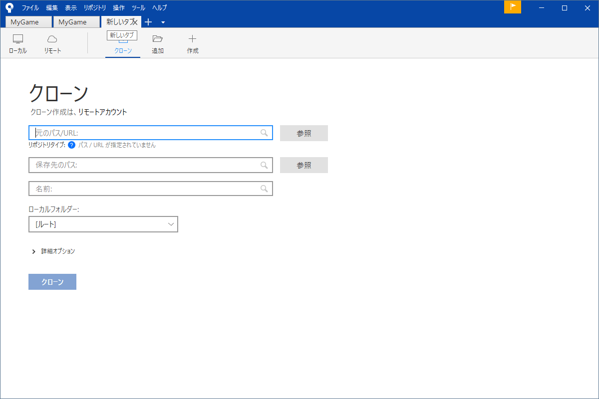
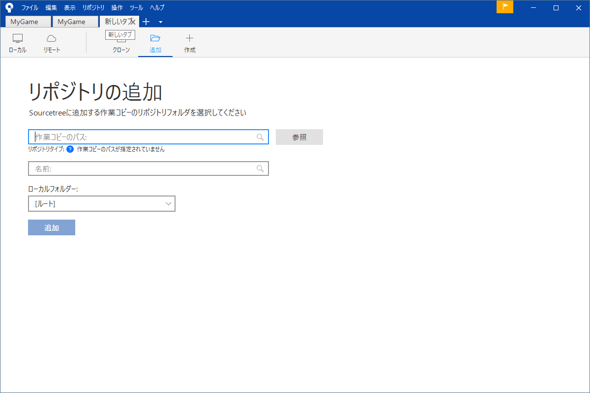
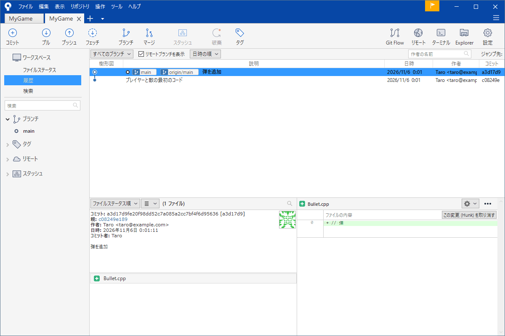
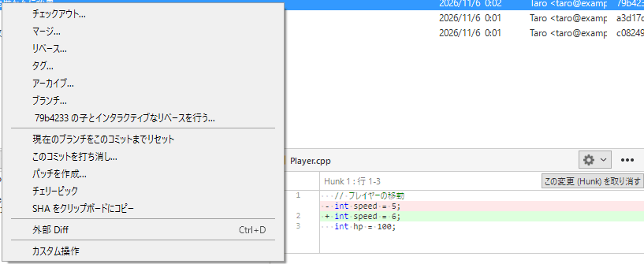
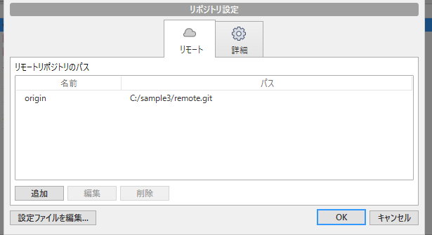
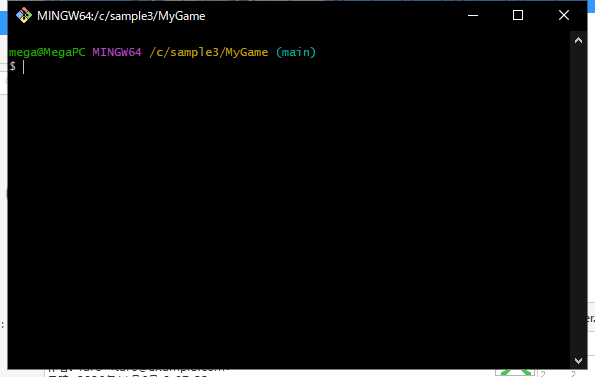

# SourceTree の画面

SourceTree を開いて最初に困るのは、「ボタンが多くてどれを押すのか分からない」ことです。でも毎日使うのはツールバーの 9 個とサイドバーの 3 つの画面だけです。残りは困ったときに探せば足ります。

このページは画面の部品に名前を付けて、リポジトリを開く・追加する・クローンする所までを案内します。このあとの章はここで付けた名前（「ファイルステータス」「履歴」「プッシュ」など）をそのまま使います。

!!! tip "ポイント"
    - 変更を記録するのは「ファイルステータス」、過去を見るのは「履歴」。この 2 つの画面を行き来するのが基本
    - ツールバーの数字のバッジは、「プッシュしていないコミットの数」や「取り込んでいないコミットの数」を表す
    - 迷ったらファイルや行を右クリックする。やれることが全部出てくる
    - 操作のあとは画面が自動で更新される。外のエディターで直したときは F5 で更新する

!!! info "このページを読む前に"
    - [SourceTree のインストールと最初の設定](install.md)

## リポジトリを開く・追加する・クローンする {#setup}

SourceTree は複数のリポジトリを「タブ」で切り替えます。新しいタブの「＋」を押すと 3 つの入り口が出ます。

<strong>クローン</strong>は GitHub などにあるリポジトリを自分の PC に丸ごとコピーします。「元のパス / URL」に GitHub の URL を「保存先のパス」にコピー先のフォルダーを入れて、「クローン」を押します。チームのリポジトリに参加するときはここから始めます。詳しくは [リモートとプッシュ・プル](remote.md#clone) にあります。

<strong>追加</strong>はすでに PC にあるフォルダー（Git の管理下にあるもの）を、SourceTree に登録します。

<strong>作成</strong>は新しいフォルダーを Git の管理に入れて、最初のリポジトリにします。

覚えておくこと: SourceTree は、リポジトリの「窓」でしかありません。フォルダーを SourceTree から外しても、履歴（`.git` という隠しフォルダー）はそのまま残ります。

## 画面の見方 {#layout}

画面は 4 つの領域でできています。

1. <strong>ツールバー</strong>（上）: 毎日使う操作のボタン。左から「コミット」「プル」「プッシュ」「フェッチ」、少し空けて「ブランチ」「マージ」、「スタッシュ」「破棄」「タグ」と並ぶ。右には「Git Flow」「リモート」「ターミナル」「Explorer」「設定」
2. <strong>サイドバー</strong>（左）: 上の「ワークスペース」で、見る画面を選ぶ。その下にブランチ・タグ・リモート・スタッシュの一覧がある
3. <strong>コミットの一覧</strong>（中央上）: 履歴。左の線が枝分かれと合流を表す。1 行が 1 つのコミット
4. <strong>詳細</strong>（中央下と右下）: 選んだコミットの内容（変更されたファイルと、行ごとの差分）

### ワークスペースの 3 つの画面

サイドバーの「ワークスペース」は 3 つの画面の切り替えです。

- <strong>ファイルステータス</strong>: いまの変更を見て、ステージしてコミットする画面。毎日いちばん使う
- <strong>履歴</strong>: 過去のコミットを見る画面。ブランチの様子もここで見える
- <strong>検索</strong>: コミットのメッセージや変更された内容から探す画面。詳しくは [履歴を読む](log.md#search)

### ツールバーのバッジ

ツールバーの「プル」と「プッシュ」には、数字が付くことがあります。「プッシュ」の 2 は「共有場所に送っていないコミットが 2 つある」、「プル」の 1 は「共有場所にまだ取り込んでいないコミットが 1 つある」という意味です（プルの数字は、フェッチしたあとに出ます）。ブランチ名の横にも同じ数字が矢印つきで出ます。

## 毎日の作業 {#daily}

### コミットする {#commit}

「ファイルステータス」を開いて、変更したファイルを選び「選択をインデックスに追加」で記録に入れて、メッセージを書いて「コミット」を押します。詳しくは [記録する](commit.md) にあります。

### フェッチ・プル・プッシュ {#sync}

共有場所とのやり取りはツールバーの 3 つのボタンです。「フェッチ」は共有場所の様子を見るだけ「プル」は取り込んで合体、「プッシュ」は自分のコミットを送る操作です。詳しくは [リモートとプッシュ・プル](remote.md) にあります。

### ブランチを切る・合体する {#branch}

「ブランチ」で新しい枝を作り「マージ」で別の枝を合体します。詳しくは [ブランチ](branch.md) と [マージ](merge.md) にあります。

## 履歴を操作する {#history}

履歴の画面でコミットを右クリックすると、そのコミットに対してできる操作が出ます。

「チェックアウト」「マージ」「リベース」「タグ」「ブランチ」「現在のブランチをこのコミットまでリセット」「このコミットを打ち消し」「チェリーピック」などが並びます。それぞれの意味は[履歴を読む](log.md)、[取り消す・戻す](undo.md)、[ブランチ](branch.md) の章で説明します。

## スタッシュ {#stash}

作業の途中の変更をいったん脇に置く機能です。ツールバーの「スタッシュ」から使います。詳しくは [スタッシュ](stash.md) にあります。

## コンフリクトを直す {#conflict}

マージやプルで同じ場所を直していたとき SourceTree は「マージで競合」と知らせて、競合したファイルに警告のマークを付けます。右クリックの「競合を解決」から、直す方法を選べます。手順は [コンフリクトを直す](conflict.md) にあります。

## 設定しておくと良いこと {#config}

ツールバー右端の「設定」はいま開いているリポジトリの設定です。共有場所の URL（リモート）やこのリポジトリだけのユーザー情報を変えられます。

全体の設定はメニューの「ツール → オプション」です。名前とメールアドレス、強制プッシュを許すかといった項目があります（[インストールと最初の設定](install.md#options)）。

## コマンドを打つ場所 {#terminal}

このサイトは、ふだんの操作を画面で説明しますが、トラブルの対処のところだけは、コマンドを打ちます（[事故の対処](accidents.md)、[コマンド早見表](commands.md) など）。コマンドを打つ画面を<strong>ターミナル</strong>と呼びます。SourceTree のツールバーの右側にある「ターミナル」を押すと、開けます。

開くのは、Git に付いてくる Git Bash という黒い画面で、<strong>いま開いているリポジトリのフォルダー</strong>が、最初から選ばれた状態です。緑の文字が自分のユーザー名、黄色の文字が居場所（`/c/sample3/MyGame` のように、フォルダー）、水色のカッコ内がいまのブランチ名です。一番下の `$` の右が、入力する所です。

使い方は 3 つだけ覚えれば足ります。

1. 本文のコマンドを、そのままコピーして貼り付ける（右クリックで貼り付けられる）
2. Enter キーを押すと、実行される
3. 終わったら、`exit` と打って Enter（または右上の「×」）で閉じる

コマンドを打つ前に、タイトルバーの `MINGW64:/…` の最後が、作業しているリポジトリの名前になっているかを確かめてください。別のフォルダーで打つと、「ここは Git のリポジトリではありません」と言われたり、別のリポジトリを触ったりします。実行したあとは、SourceTree に戻って、F5 で画面を更新すると、結果が反映されます。

## 事故と対処 {#accidents}

SourceTree の画面で戻せるものは、多くあります。たとえば、直前のコミットの取り消しブランチの削除の取り消しなどです。画面で戻せない事故（プッシュしてしまった秘密情報、消えたはずのコミットの復活）はコマンドを使います。[事故の対処](accidents.md) にまとめてあります。

## 使い分けの目安 {#choose}

SourceTree のほかに Visual Studio の中の Git 機能（[Visual Studio の Git](vs-git.md)）や、GitHub Desktop（[GitHub Desktop](github-desktop.md)）もあります。履歴の枝分かれを見ながら作業したいときは SourceTree が見やすく、コードを書く画面から離れたくないときは Visual Studio、手軽に始めたいときは GitHub Desktop が向いています。どれも中身は同じ Git です。

## よくあるミス {#mistakes}

??? failure "外のエディターで直したのに、SourceTree に出てこない"
    画面の更新が遅れています。F5 を押すか別の画面に切り替えて戻してください。オプションの「ファイルに変更が加わった時自動的に更新する」にチェックが入っていれば、自動で更新されます。

??? failure "リポジトリのタブを閉じたら、履歴が消えた気がする"
    消えていません。タブを閉じてもフォルダーと履歴はそのままです。「＋ → 追加」でもう一度開けます。

??? failure "プッシュに失敗して、プッシュの画面がもう一度出る"
    失敗の理由が画面の下に赤く出ています。ほとんどは他の人が先にプッシュしていた場合です。「キャンセル」で閉じて先にプルしてください（[リモートとプッシュ・プル](remote.md#rejected)）。

## これだけ覚える {#summary}

- 見る画面は 3 つ（ファイルステータス・履歴・検索）
- 毎日のボタンは 9 個（コミット・プル・プッシュ・フェッチ・ブランチ・マージ・スタッシュ・破棄・タグ）
- 迷ったら右クリック
- 外で直したときは F5

## 関連ページ {#related}

- [記録する](commit.md)
- [履歴を読む](log.md)
- [リモートとプッシュ・プル](remote.md)
