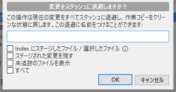
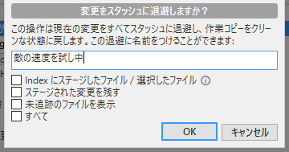
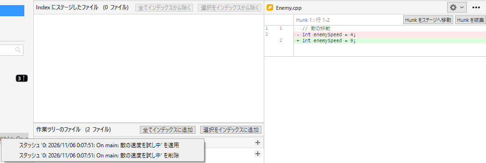
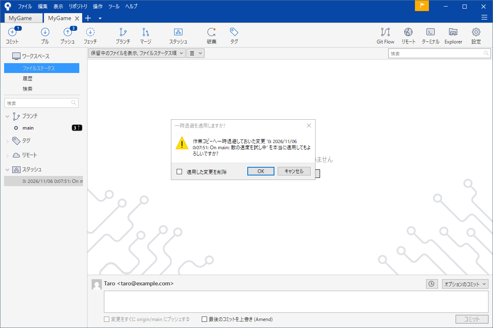

# スタッシュ（作業の一時退避）

敵の AI を書いている途中で、「ボスのバグをいますぐ直して」と頼まれた。でもいまの変更はまだ途中でコミットできる状態ではない。かといって変更を持ったままでは別の枝へ移れないことがある。こういうとき作業の途中の変更を <strong>いったん脇に置いて、あとで戻す</strong>のがスタッシュ（stash）です。

このページはスタッシュに置く・戻す・消す・中身を見るの使い方を説明します。

!!! tip "ポイント"
    - 途中の変更をコミットせずに脇に置ける。置くと作業フォルダーはきれいな状態になる
    - 名前（メッセージ）を付けておく。あとでどれか分からなくなる
    - スタッシュは手元にだけある。プッシュしても共有場所には送られない
    - 戻すとき衝突することがある

!!! info "このページを読む前に"
    - [記録する](commit.md)
    - [ブランチ](branch.md)

## しまう・戻す {#basic}

ツールバーの「スタッシュ」を押します。

「メッセージ」欄に何の作業かの名前を入れます。

画面には 4 つのチェックがあります。

- <strong>Index にステージしたファイル / 選択したファイル</strong>: 「インデックスに追加」したものだけを置く
- <strong>ステージされた変更を残す</strong>: 置いたあともインデックスに追加した変更は、作業フォルダーに残す
- <strong>未追跡のファイルを表示</strong>: 新しく作ったファイルも置く対象に含める
- <strong>すべて</strong>: 全部を置く

何も付けずに「OK」を押すと管理中のファイルの変更が、スタッシュに入ります。作業フォルダーは最後のコミットの状態に戻ります。これで別の枝に移れます。

戻すときはサイドバーの「スタッシュ」の中の項目を右クリックします。

「適用」を選ぶと確認の画面が出ます。

「適用した変更を削除」にチェックを入れると、戻したあとスタッシュ自体を消します。チェックなしで適用するとスタッシュは残ります（同じ変更を別の枝にも使いたいときに便利です）。

「削除」を選ぶと戻さずにスタッシュを捨てます。

## 新しいファイルも含める {#untracked}

スタッシュは既定ではすでに管理しているファイルの変更だけを置きます。新しく作ったばかりのファイル（紫の「?」のファイル）は、作業フォルダーに残ります。新しいファイルも置きたいときはスタッシュの画面で、「未追跡のファイルを表示」にチェックを入れます。新しいファイルを置かないまま別の枝に移ると、そのファイルも移った先に付いてきます。

## 名前を付ける・一覧を見る {#list}

スタッシュはいくつも置けます。サイドバーの「スタッシュ」を開くと新しいものから順に一覧が出ます。

名前（メッセージ）を付けておくと日付と一緒に表示されるので、どれが何の作業か分かります。メッセージなしだと「On main: ...」のような形で、見分けにくくなります。

## 中身を見る {#show}

スタッシュの項目を<strong>クリック</strong>すると右側に置いた変更の差分が出ます。戻す前に「これで合っているか」を確かめられます。

## 戻すときに衝突した {#conflict}

置いたあとに同じ場所を別の変更で直していると、戻すときに衝突します。マージの衝突と同じなので直し方は同じです（[コンフリクトを直す](conflict.md)）。衝突したときはスタッシュが自動で消されないことがあります。直し終わってから手動で削除してください。

## 別の枝で作業を続けたいとき {#branch}

「置いた変更は別の枝で続けたい」ときがあります。そのときは、別の枝に移ってから「適用」します。変更はその枝の上に戻ります。元の枝が変わってしまっている場合に便利です。

## スタッシュを使う場面と使わない場面 {#when}

使う場面は次のとおりです。

- 途中の変更を持ったまま別の枝へ移りたい
- プルの前に作業フォルダーをきれいにしたい
- 大きな実験の前にいまの状態を退避しておきたい

使わない場面もあります。長期間、置いたままにすることです。スタッシュは「一時退避」の場所で、履歴には入りません。忘れてあとで探すのが大変になります。何日も残したい変更はコミットして、専用の枝に置いてください。

## よくあるミス {#mistakes}

??? failure "戻すのを忘れて、作業が消えた気がした"
    サイドバーの「スタッシュ」を開いてください。置いた変更はそこにあります。名前を付ける習慣を付けると見つけやすくなります。

??? failure "新しいファイルが、スタッシュに入っていなかった"
    既定では新しいファイルは入りません。スタッシュの画面で「未追跡のファイルを表示」にチェックを入れてください。

??? failure "どの枝で置いたか分からない"
    スタッシュの項目に置いたときの枝の名前が出ます（「On main」など）。戻す先の枝はどこでも構いません。

??? failure "戻したら、衝突した"
    マージの衝突と同じ直し方です。直したらスタッシュを削除してください。

## これだけ覚える {#summary}

- 途中の変更はスタッシュで脇に置ける
- 名前を付けておく
- 戻すのはサイドバーから「適用」
- 長く残したい変更はコミットして枝に置く

## 関連ページ {#related}

- [ブランチ](branch.md)
- [取り消す・戻す](undo.md)
- [コンフリクトを直す](conflict.md)
