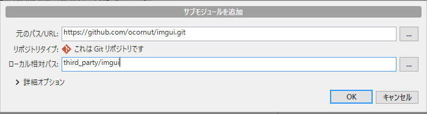
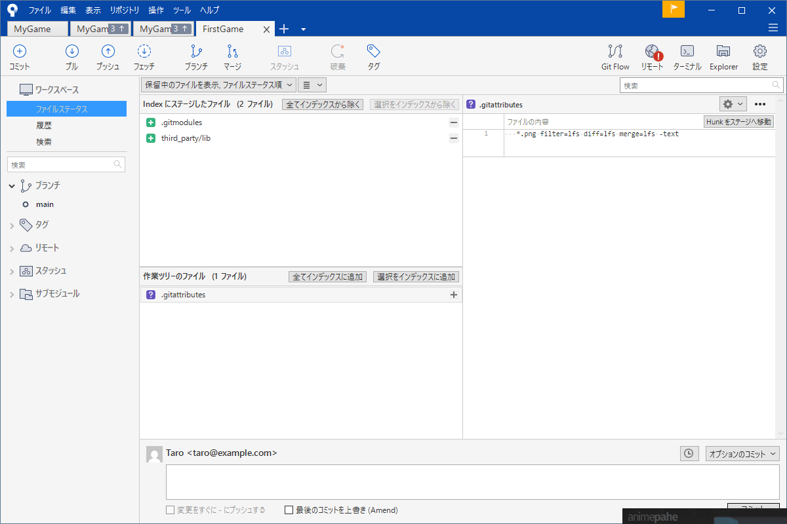
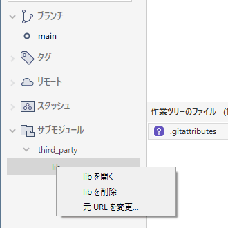

# サブモジュール（他のリポジトリを中に入れる）

ゲームを作っていると他の人が作ったライブラリ（ImGui、Jolt Physics など）をプロジェクトの中に置きたくなります。ソースをそのままコピーして `third_party/` に入れる方法は簡単ですが、ライブラリが更新されたときにどこまでが自分の改変で、どこからが元のコードか分からなくなります。

<strong>サブモジュール</strong>は「他のリポジトリのこのコミットを使う」という指定を自分のリポジトリに記録する仕組みです。ライブラリの中身は自分の履歴には入らず参照だけが入ります。

!!! tip "ポイント"
    - サブモジュールは他のリポジトリの特定のコミットへの参照。中身は別のリポジトリのまま
    - `git clone` だけでは中身が空。`--recurse-submodules` を付けるかあとで `git submodule update --init`
    - 更新は自動ではない。親側で「どのコミットを使うか」を明示的に更新する
    - 扱いが難しい面もある。vcpkg などのパッケージ管理で足りるならそちらが楽

!!! info "このページを読む前に"
    - [リモートとプッシュ・プル](remote.md)
    - [外部ライブラリの入れ方](../vs/libraries.md)（vcpkg との使い分け）

## 追加する {#add}

SourceTree ではメニューの「リポジトリ → サブモジュールを追加...」から追加します。



- <strong>元のパス/URL</strong>: 取り込みたいライブラリのリポジトリの URL（GitHub のページの「Code」でコピーできる）。入れると「これは Git リポジトリです」と確認が出る
- <strong>ローカル相対パス</strong>: 自分のプロジェクトの中の置く場所。`third_party/imgui` のようにまとめる場所を決めておく

「OK」を押すとライブラリが取ってこられファイルステータスに `.gitmodules` などが出てきます。「インデックスに追加」してコミットします。

追加した直後のファイルステータスは次のようになります。`.gitmodules` と置き場所のフォルダー（ここでは `third_party/lib`）が、インデックスに追加された状態で並びます。



（この画像のサブモジュールは手元の別のリポジトリをコマンドで追加して作った練習用です。SourceTree の画面に出るものは、画面から追加した場合と同じです。）

同じことをコマンドでは次のように書きます（画面の動きの意味の確認用です。コマンドを打つ画面の開き方は[SourceTree の画面](sourcetree.md#terminal)にあります）。

```bash
git submodule add https://github.com/ocornut/imgui.git third_party/imgui
git commit -m "ImGui をサブモジュールとして追加"
```

`git submodule add` は指定した URL のリポジトリを `third_party/imgui` に取ってきます。同時に次の 2 つが自動で作られます。

- `.gitmodules`：サブモジュールの URL と置く場所を書いた設定ファイル
- 親リポジトリの中のサブモジュールの位置に「特定のコミットへの参照」

どちらも親リポジトリでコミットします。サブモジュールの中身（ImGui のファイル）は、親のコミットには入りません。入るのは「ImGui のこのコミットを使う」という記録だけです。

## クローンする側の手順 {#clone}

サブモジュールを持つリポジトリをクローンしても、サブモジュールのフォルダーは<strong>空</strong>で作られます。

```bash
git clone --recurse-submodules https://github.com/ユーザー名/MyGame.git
```

最初から `--recurse-submodules` を付けると中身も一緒に取ってきます。付け忘れたときはあとから取れます。

```bash
git submodule update --init --recursive
```

`--init` はサブモジュールを初期化して取得します。`--recursive` はサブモジュールがさらにサブモジュールを持つ場合まで辿ります。

「ビルドしようとしたらヘッダーが見つからない」のは、たいていこの手順の忘れです。

## 更新する {#update}

親が記録しているのは「特定のコミット」なので、ライブラリの新しい版が出ても、自動では追いつきません。更新は 2 段階です。

まず、サブモジュールの中で使いたいコミットに移ります。

```bash
cd third_party/imgui
git fetch
git switch --detach v1.91.0       # タグやコミットを選ぶ
cd ../..
```

次に、親リポジトリで「使うコミットが変わった」ことをコミットします。

```bash
git add third_party/imgui
git commit -m "ImGui を v1.91.0 に更新"
```

サブモジュールの中はふつう分離 HEADの状態です。これは正常で「特定のコミットを使っている」ことを意味します。

他の人が親リポジトリを `pull` したあと手元のサブモジュールを新しい記録に合わせるには、次を実行します。

```bash
git pull
git submodule update --init --recursive
```

`git pull` だけではサブモジュールの中身は更新されません。親が記録を更新したことを知っても、中身はそのままです。`submodule update` で追いつかせます。

## SourceTree のサイドバーで見る {#sidebar}

コミットしたあとサイドバーの「サブモジュール」を開くと置き場所のフォルダーの下にサブモジュールが並びます。右クリックすると 3 つのメニューが出ます。



- <strong>lib を開く</strong>: そのサブモジュールを別のタブのリポジトリとして開く。中でコミットを動かすときに使う
- <strong>lib を削除</strong>: サブモジュールを外す（下の「削除する」）
- <strong>元 URL を変更...</strong>: 取ってくる先の URL を差し替える。ライブラリの置き場所が移ったときに使う

「更新」というメニューはありません。使うコミットを変える操作は「開く」で出たタブで行い親に戻ってコミットします。クローンしたあとに中身を取ってくる操作（`submodule update --init`）の項目は、確かめた範囲では画面に見つかりませんでした。次の節のとおりそこはコマンドを使います。

## 状態を見る {#status}

```bash
git submodule status              # 各サブモジュールの、いま使っているコミット
git status                        # サブモジュールの状態も出る
```

`git status` にサブモジュールが「modified content」「new commits」と出ることがあります。サブモジュール内でファイルを直したあるいは、使っているコミットを動かしたという意味です。意図しない変更ならサブモジュールの中で元に戻します。

## 削除する {#remove}

サブモジュールの削除はフォルダーを消すだけでは足りません。

```bash
git submodule deinit -f third_party/imgui
git rm -f third_party/imgui
rm -rf .git/modules/third_party/imgui
git commit -m "ImGui のサブモジュールを削除"
```

`deinit` で登録を解き `git rm` で記録と `.gitmodules` の項目を消し、`.git/modules` に残った実体も消します。

## 使いどころと避けるべき場面 {#when}

サブモジュールは次のような場面に向いています。

- ライブラリを改変して使う（自分のフォークを指す）
- 特定のバージョンに固定したい。他のリポジトリの履歴と一緒に追跡したい
- ビルドを再現するためにソースごと入れたい

扱いが難しい場面もあります。

- 親とサブモジュールの両方を更新する作業は、手順が増えて忘れやすい
- クローンした直後に中身が空になるので、メンバーに説明が要る
- 画面ツールによってはサブモジュールの扱いが弱い

単にライブラリを使うだけなら[vcpkg](../vs/libraries.md) などのパッケージ管理のほうが楽です。ライブラリのバージョンを指定できビルドまで自動になります。比較は [パッケージ管理の比較](../vs/package-managers.md) にあります。

## よくあるミス {#mistakes}

??? failure "クローンしたら `third_party/imgui` が空だった"
    `git submodule update --init --recursive` を実行します。次のクローンからは `--recurse-submodules` を付けます。

??? failure "サブモジュールを更新したのに、他の人の手元に反映されない"
    親リポジトリで `git add` して `commit` と `push` をしていません。サブモジュールの中の変更だけでは親は更新されません。

??? failure "サブモジュールの中でコミットしたが、消えた"
    サブモジュールは分離 HEADなので、そのまま作業するとコミットを見失います。サブモジュールの中で枝を作ってから作業して、そのリポジトリへプッシュします。

## これだけ覚える {#summary}

- `git submodule add URL 場所` で追加。`.gitmodules` もコミットする
- クローンには `--recurse-submodules`、後からなら `git submodule update --init --recursive`
- 更新は 2 段階。サブモジュールを動かして親でコミットする
- 単純にライブラリを使うだけなら vcpkg が楽

## 関連ページ {#related}

- [外部ライブラリの入れ方](../vs/libraries.md)
- [パッケージ管理の比較](../vs/package-managers.md)
- [リモートとプッシュ・プル](remote.md)
