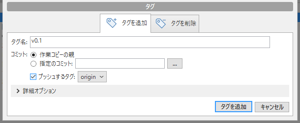
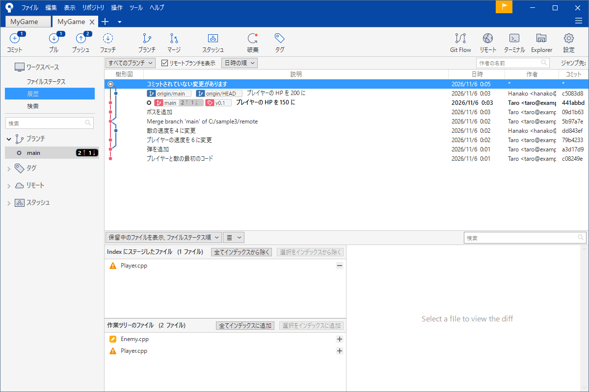

# タグ（バージョンに印を付ける）

「体験版を配ったのは、どのコミットだったか」「v1.0 の状態に戻したい」。コミットの ID（英数字の羅列）は覚えにくく、あとから探すのも大変です。そこで、特別なコミットに<strong>名前の印</strong>を付けておく。それが<strong>タグ</strong>です。

ブランチも名前の札ですが、ブランチは新しいコミットが増えると先へ進みます。タグは、<strong>付けた場所から動きません</strong>。「ここが、v1.0 です」という固定の印です。

!!! tip "ポイント"
    - タグは、動かない印。リリースや、体験版の区切りに付ける
    - 付ける画面で「プッシュするタグ」にチェックを入れると、共有場所にも送れる（プッシュは、別に必要）
    - 名前は、`v1.0.0` のような、規則のあるものにする
    - 付けたタグは、履歴の画面に、色つきのラベルで出る

!!! info "このページを読む前に"
    - [履歴を読む](log.md)
    - [リモートとプッシュ・プル](remote.md)

## タグを作る {#create}

付けたいコミットを選んで、ツールバーの「タグ」を押します。

- <strong>タグ名</strong>: `v0.1` のような名前
- <strong>コミット</strong>: 「作業コピーの親」は、いま立っているコミット（最新のコミット）。「指定のコミット」は、過去のコミットを指定する
- <strong>プッシュするタグ</strong>: チェックを入れると、タグを付けたあと、共有場所に送る。送り先は、`origin` など

「タグを追加」を押すと、付きます。履歴の画面で、そのコミットに、タグの名前のラベルが出ます。

「詳細オプション」を開くと、タグの種類などを選べます。ふつうは、そのままで構いません。

## 見る・取り出す {#list}

サイドバーの「タグ」を開くと、タグの一覧が出ます。ダブルクリックすると、そのタグのコミットへ移れます（チェックアウト）。

<strong>タグに移ると、「分離 HEAD」の状態になります。</strong>どの枝にも属さない状態で、そのまま新しいコミットを作ると、あとで見つけにくくなります。見るだけにするか、新しい枝を作ってから作業を始めてください（[ブランチ](branch.md)）。

## 共有する・消す {#push}

タグは、プッシュしないと、共有場所に送られません。タグを付ける画面で「プッシュするタグ」にチェックを入れ忘れたときは、あとから、プッシュの画面で、タグを送る項目にチェックを入れます（「全てのタグをプッシュ」）。

タグを消すときは、タグを付ける画面の「タグを削除」のタブを使います。あるいは、サイドバーのタグを右クリックして、削除を選びます。共有場所に送ったタグを消すには、リモートのタグの削除も、別に必要です。チームで使っているタグは、消さないのが無難です。

## 名前の付け方 {#naming}

タグの名前は、バージョン番号にするのが定番です。

- `v1.0.0`: 大きな節目
- `v1.2.0`: 機能の追加
- `v1.2.1`: バグ修正だけ

3 つの数字は、左から、大きな変更・機能の追加・バグ修正を表す約束事です（セマンティック バージョニング）。ゲームでは、体験版（`demo-1`）や、締め切りの提出（`submit-2026-12`）のような名前も、よく使われます。

## GitHub のリリースと組み合わせる {#release}

タグを共有場所に送ると、GitHub の「Releases」で、そのタグを元に、リリースのページを作れます。ビルドしたゲームの zip を添付して、配布の場所にできます。ゲームの実行ファイルのような大きなものは、リポジトリには入れず、ここに置くのが基本です。

## ゲームの制作で効く使い方 {#game}

- 体験版や、締め切りの提出に、必ずタグを付ける。「あのとき配ったもの」に、いつでも戻れる
- 提出物のバグを直すときは、タグの位置から新しい枝を作る
- ビルドの番号とタグの名前を、そろえる

## よくあるミス {#mistakes}

??? failure "タグを付けたのに、友だちに見えない"
    タグは、プッシュしないと共有されません。付ける画面で「プッシュするタグ」にチェックを入れたか、確かめてください。

??? failure "タグに移って作業したら、コミットが迷子になった"
    タグに移った状態（分離 HEAD）で作ったコミットは、どの枝にも属しません。作業の前に、新しい枝を作ってください。すでに作ってしまったら、[事故の対処](accidents.md) の分離 HEAD の節を見てください。

??? failure "付ける位置を間違えた"
    タグを削除して、正しいコミットに付け直します。共有場所に送ったあとは、チームに知らせてから、直してください。

## これだけ覚える {#summary}

- タグは、動かない印。リリースや提出に付ける
- 付ける画面で、プッシュも一緒に済ませられる
- 名前は、`v1.0.0` のように、規則を決める
- タグに移ったら、作業の前に、枝を作る

## 関連ページ {#related}

- [GitHub を使う](github.md)
- [ブランチ](branch.md)
- [履歴を読む](log.md)
