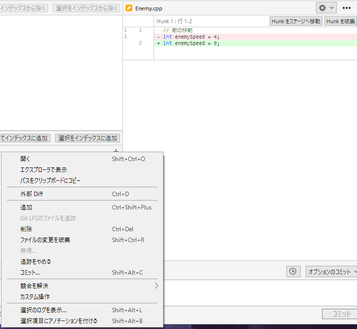
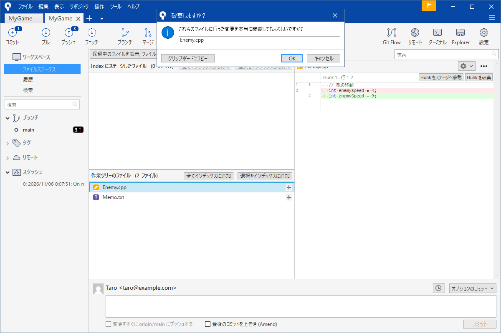
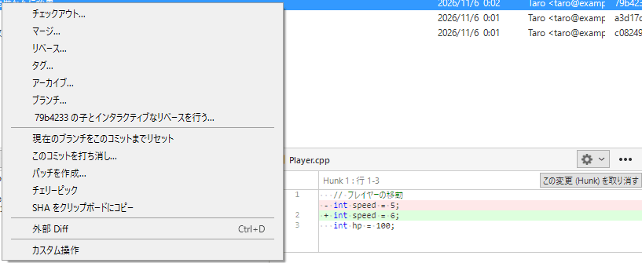
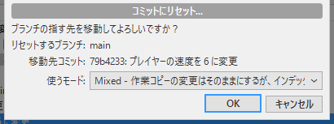
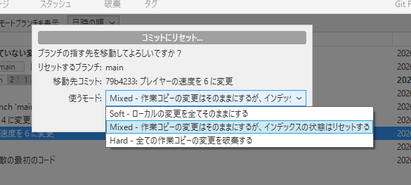

# 取り消す・戻す

「直したら動かなくなった」「コミットのメッセージを間違えた」「あのコミットは、なかったことにしたい」。Git を使う一番の安心は <strong>たいていのことは戻せる</strong>ことです。ただし、「何を戻したいか」によって使う操作が違います。間違った操作を選ぶと戻したいものが戻らないどころか変更を失うことがあります。

このページは戻したいものを 4 つに分けて、SourceTree の画面でどう戻すかを説明します。最後の消えたコミットを取り戻す方法だけは、コマンドを使います。

!!! tip "ポイント"
    - まず「何を戻したいか」を決める。まだ記録していない変更、記録に入れただけのものコミット、プッシュしたあとで操作が違う
    - 「破棄」は直した内容が消えて戻らない。コミットしていない変更は Git も覚えていない
    - プッシュしたコミットには、リセットを使わない。「このコミットを打ち消し」を使う
    - 消えたと思ったコミットは、コマンドで取り戻せることが多い

!!! info "このページを読む前に"
    - [記録する](commit.md)
    - [履歴を読む](log.md)

## 何を戻したいか {#choose}

次の順に自分の状況を探してください。

1. まだコミットしていない変更を元に戻したい → 「[変更を破棄する](#restore)」
2. インデックスに追加したものを外したい → 「[インデックスから外す](#unstage)」
3. 直前のコミットのメッセージや中身を直したい → 「[最後のコミットを直す](#amend)」
4. コミットを取り消したい（まだ共有場所に送っていない） → 「[リセット](#reset)」
5. 共有場所に送ってしまったコミットを取り消したい → 「[打ち消す](#revert)」

## 変更を破棄する {#restore}

ファイルを直したけれどやっぱり元の状態に戻したい。その変更をファイルステータスで右クリックして「ファイルの変更を破棄」を選びます。



押すと確認の画面が出ます。



「OK」を押すとそのファイルは最後にコミットした状態に戻ります。<strong>直した内容は消えて戻りません。</strong>コミットしていない変更は Git が覚えていないからです。迷うときは破棄の代わりにスタッシュ（[スタッシュ](stash.md)）で脇に置いてください。

ツールバーの「破棄」ボタンは選んだファイルや全部の変更をまとめて破棄します。押す前にどのファイルが対象かを必ず見てください。

### インデックスから外す {#unstage}

「インデックスに追加」したファイルを記録の対象から外したいときは、上の欄のファイルを選んで「選択をインデックスから除く」を押します。ファイルの中身はそのまま残ります。記録に入れる対象から外れるだけです。

### 過去の状態を取り出す {#source}

あるファイルをいまのコミットではなく、「先週の状態」に戻したいことがあります。履歴の画面で先週のコミットを右クリックして「チェックアウト」を選ぶと作業フォルダーがその時点の状態になります（どの枝にも属さない「分離 HEAD」の状態です）。そこから必要なファイルをエクスプローラーで別の場所にコピーしておき元の枝（サイドバーの `main` をダブルクリック）に戻って、コピーしたファイルを置き直して、コミットします。作業のほかの部分に影響させないための安全な手順です。

## 最後のコミットを直す {#amend}

コミットしたあとに「メッセージを間違えた」「1 つ入れ忘れたファイルがある」と気づくことがあります。新しくコミットを足してもいいのですが、直前の 1 つだけなら作り直せます。

入れ忘れたファイルがあるときはそのファイルをインデックスに追加して、コミット欄の「最後のコミットを上書き (Amend)」にチェックを入れてから、コミットします。メッセージだけを直したいときも同じチェックを入れて、メッセージを書き換えます。

<strong>プッシュしたあとの Amend は避けてください。</strong>Amend は直前のコミットを別のコミットに置き換えます（ID が変わります）。共有場所にある古いコミットと手元の新しいコミットが食い違いプッシュが拒否されます。Amend はプッシュ前だけに使います。

## リセット：コミットを取り消す {#reset}

「あのコミットはやっぱりなかったことにしたい」。まだ共有場所に送っていないならリセットで取り消せます。

履歴の画面で <strong>戻りたい先のコミット</strong>（残したい最後のコミット）を右クリックして、「現在のブランチをこのコミットまでリセット」を選びます。



すると、リセットのモードを聞かれます。



モードは 3 つあります。



- <strong>Soft</strong>: コミットだけ取り消す。変更はインデックスに追加した状態で残る。「コミットをやり直したい」とき
- <strong>Mixed</strong>: コミットとインデックスを取り消す。変更は作業ツリー（まだ追加していない状態）に残る。「コミットの分け方をやり直したい」とき
- <strong>Hard</strong>: コミットも変更も全部消す。<strong>直した内容は戻らない</strong>。「全部なかったことにしたい」とき

迷ったら Soft か Mixed を選んでください。変更が残るのでやり直せます。Hard は本当に不要なときだけです。

<strong>共有場所に送ったコミットにはリセットを使わないでください。</strong>履歴を書き換えると他の人の手元の履歴と食い違います。送ったあとは次の「打ち消す」を使います。

## 打ち消す：プッシュしたコミットを取り消す {#revert}

共有場所に送ったコミットを取り消すには、「打ち消す」コミットを足します。履歴を書き換えないので他の人に迷惑をかけません。

履歴の画面で取り消したいコミットを右クリックして、「このコミットを打ち消し」を選びます。そのコミットの変更を逆にした内容の新しいコミットが作られます。履歴には「元のコミット」と「それを打ち消すコミット」の両方が残ります。

打ち消しのあとは普通にプッシュできます。履歴が一方向に伸びるだけだからです。

## 消えたコミットを取り戻す {#reflog}

「リセットで必要なコミットまで消してしまった」「間違えてブランチを削除した」。画面の履歴からはもう見えません。でも Git は手元で HEAD（いまの位置）がどこを通ったかを約 90 日間は記録しています。これを使うと消したコミットを取り戻せます。画面にはない機能なのでコマンドを使います（ツールバーの「ターミナル」から開けます）。

まず、通った場所の記録を見ます。

```bash
git reflog
```

```text title="実行結果（例）"
a3f9c21 HEAD@{0}: reset: moving to HEAD~2
7d2e8b0 HEAD@{1}: commit: ボスを追加
5b97a7e HEAD@{2}: commit: プレイヤーの HP を 150 に
```

一番上がいまの位置です。取り戻したいコミットは `7d2e8b0`（リセットの前の位置）です。このコミットに新しい枝を付けて取り戻します。

```bash
git branch rescue 7d2e8b0
```

これで `rescue` という枝が消えたコミットを指します。SourceTree の画面で、サイドバーに `rescue` が現れ履歴にコミットが戻ります。元の枝に戻したいときはその枝に移ってから、マージします。

!!! warning "取り戻せない場合"
    Git が一度も記録していない変更（コミットしていない作業）は、reflog にも残りません。「破棄」で消えた内容は取り戻せません。

## ゲームの制作で効く使い方 {#game}

- 大きな実験の前にコミットかスタッシュで、戻る場所を作っておく
- 画像や音声を「破棄」するときは特に注意する。バイナリはあとで見比べにくい
- リセットの前にいまの位置にブランチを 1 つ作っておく（`backup` など）。失敗しても戻れる

## よくあるミス {#mistakes}

??? failure "破棄したら、直した内容が全部消えた"
    破棄はコミットしていない変更を元に戻せない形で消します。迷うときは先にスタッシュしてください。

??? failure "リセット（Hard）で、必要な変更まで消えた"
    コミットしていた内容なら reflog から取り戻せます（上の「消えたコミットを取り戻す」）。コミットしていない変更は戻りません。

??? failure "プッシュしたコミットをリセットしたら、プッシュが拒否された"
    履歴が食い違っています。リセットを取り消して（reflog）、代わりに「このコミットを打ち消し」を使ってください。

## これだけ覚える {#summary}

- 戻したいものを決める → 操作を選ぶ
- 破棄は戻せない。迷ったらスタッシュ
- リセットはプッシュ前だけ。プッシュ後は「打ち消し」
- 消えたコミットは reflog で取り戻せる

## 関連ページ {#related}

- [スタッシュ](stash.md)
- [事故の対処](accidents.md)
- [ブランチ](branch.md)
