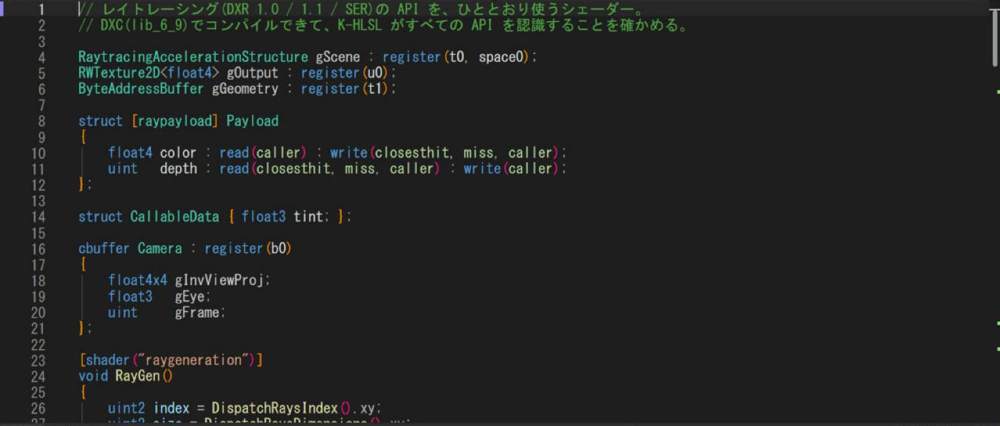
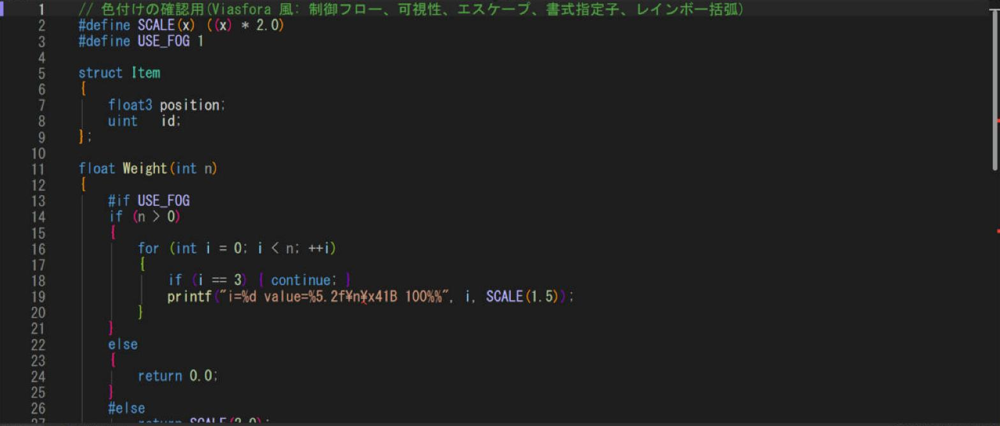

# K-HLSL

HLSL を書いていると、Visual Studio の HLSL 拡張が、新しい構文を間違いだと言ってくることがあります。たとえば `ResourceDescriptorHeap[index]` に「宣言されていません」と赤い波線が出る、といった具合です。コードは DXC で普通にコンパイルできるのに、です。拡張が自前のパーサーで判定していて、シェーダー モデルが上がるたびに置いていかれるのが原因です。

K-HLSL は、判定を<strong>本物の DXC に任せる</strong>ことで、この問題を避けた Visual Studio 用の HLSL 拡張です。Shader Model 6.9 までの構文と組み込み関数、レイトレーシング（DXR 1.0・1.1・SER）、メッシュ シェーダー、ワーク グラフに対応しています。色は VS の C++ と同じ分類を使うので、使っているテーマの C++ の見た目が、そのまま HLSL に出ます。



!!! info "このページを読む前に"
    DXC（`dxc.exe`）は HLSL のコンパイラーで、K-HLSL はエラーの判定にこれを呼びます。DXC 自体の使い方は [Shaders and DXC](../directx/dx12/shaders-dxc.md) にあります。

## ダウンロード

<p><a class="md-button md-button--primary" href="K-HLSL-1.0.9.vsix" download>K-HLSL 1.0.9 をダウンロード（.vsix、約 360 KB）</a></p>

Visual Studio 2026（Community・Professional・Enterprise）で動きます。2022 にも入れられます。Windows の x64 が対象です。ダウンロードした `.vsix` をダブルクリックして、画面の指示に従ってインストールし、Visual Studio を再起動します。新しい版に更新するときも、同じ手順で上書きできます。アンインストールは、Visual Studio の「拡張機能の管理」から行います。

診断には `dxc.exe` が要ります。Windows SDK に入っている物か、[DirectXShaderCompiler](https://github.com/microsoft/DirectXShaderCompiler/releases) の配布物を使ってください。Shader Model 6.9 を使うには、DXC 1.9 以降が必要です。見つかった DXC が古いときは、`lib_6_9` から `lib_6_8`、`lib_6_7` と、使えるプロファイルまで自動で下げて試します。

## 何ができるか

エラーの表示は、保存したときと、入力が止まって 0.7 秒たったときに、DXC を実際に呼んで作ります。独自の判定をしないので、DXC が通すコードにエラーは出ません。エントリ ポイントを決めないときは、ライブラリ ターゲット（`lib_6_x`）で検証するので、ヘッダーだけのファイルでも、構文と型のエラーは見られます。

補完は、組み込み関数、リソースのメソッド（`tex.Sample` など）、構造体のメンバー、スウィズル、セマンティクス（`:` の後）、属性（`[` の後）、`#` ディレクティブ、`#include` のファイル名、`dx::` に出ます。ホバーとシグネチャ ヘルプには、日本語の説明と、必要な Shader Model が出ます。`#include` したファイルの中の関数や変数も、補完・ホバー・定義へ移動の対象です。

色付けは、スコープを見て、引数・ローカル変数・メンバー変数・グローバル変数・列挙子・関数・マクロなどを塗り分けます。さらに、Viasfora を入れている人が C++ で見慣れている色も、そのまま付きます。具体的には、深さ 4 色のレインボー括弧、`public` などの DimGray、文字列のエスケープ（`\n` など）の Magenta、書式指定子（`%d` など）の MediumSlateBlue です。Tab や空白で字下げした `#if` にも、ちゃんとディレクティブの色が付きます。



組み込み関数と型のデータは、DXC の定義表（`gen_intrin_main.txt`）と突き合わせて作っています。レイトレーシング系は、`TraceRay` や `RayQuery` の全メソッド、フラグと定数、SM 6.9 の `dx::HitObject` と `dx::MaybeReorderThread`（Shader Execution Reordering）まで入っています。バインドレスの `ResourceDescriptorHeap` と `NonUniformResourceIndex`、ワーク グラフの属性とレコード型、メッシュ シェーダーの `SetMeshOutputCounts` も同じです。

## 古い HLSL 拡張と一緒に入れてよいか

入れたままで構いません。K-HLSL は、HLSL のファイルを開くと、そのファイルだけを K-HLSL 専用の扱いに切り替えるので、古い拡張の補完・エラー表示・色付けは、そのファイルでは動かなくなります。古い拡張が出す偽のエラーも、出なくなります。完全に消したいときは、拡張機能の管理から無効にしてください。

Visual Studio を起動した直後に自動で開かれるファイルは、切り替えが少し遅れることがあります。その場合は、Viasfora が `NullReferenceException` のバーを出すことがありますが、ファイルを開き直せば直ります。

## 色を変える

メニューバーの「拡張機能」→「K-HLSL」→「色を編集...」で、オプションのダイアログが開きます。左の一覧で「環境」→「フォントおよび色」を選んで、「設定を表示するカテゴリ」を「テキスト エディター」にして、名前が「K-HLSL」で始まる項目（組み込み関数・制御キーワード・プリプロセッサ キーワード・レインボー括弧など）を選びます。独自の関数・型・変数・マクロなどの色は、VS の C++ と共通の項目（「C++ 関数」など）で変えます。どの項目が何の色かは、「色の項目の一覧を表示」で見られます。

## 設定する

設定が要らないことのほうが多いのですが、DXC の場所やターゲットを変えたいときは、シェーダーのあるフォルダー（またはその親）に `.khlsl.json` を置きます。どの項目も省略できます。

```json
{
  "dxc": "C:/tools/dxc/bin/x64/dxc.exe",
  "target": "lib_6_9",
  "entry": "main",
  "defines": ["USE_FOG=1"],
  "includeDirs": ["../shaders/common"]
}
```

| 項目 | 意味 |
| --- | --- |
| `dxc` | `dxc.exe` のパス。省略すると、環境変数 `KHLSL_DXC`、`PATH`、`VULKAN_SDK`、Windows SDK の順に探す |
| `target` | 検証に使うプロファイル（`ps_6_6`、`lib_6_9` など）。省略すると `lib_6_9` から順に下げて試す |
| `entry` | エントリ ポイントの名前 |
| `hlslVersion` | `-HV` に渡す HLSL のバージョン（`2021` など） |
| `defines` | `-D` に渡すマクロ |
| `includeDirs` | `-I` に渡すフォルダー。`#include` の補完と、定義へ移動にも使う |
| `args` | DXC にそのまま渡す引数 |
| `diagnostics` | `false` にすると、DXC によるエラー表示を止める |

1 つのファイルだけ別のターゲットで見たいときは、ファイルの先頭 30 行に、コメントで書けます。

```hlsl
// khlsl: -T ps_6_6 -E PSMain -D USE_FOG=1
```

## うまく動かないとき

補完が出ないときは、ツール → オプション → テキスト エディター → すべての言語 → 全般 の「自動メンバー一覧」がオンかを確かめてください。Ctrl+J（編集 → IntelliSense → メンバーの一覧）でも出せます。それでも動かないときは、`%LOCALAPPDATA%\K-HLSL\server.log` を見ます。ファイルを開いたときに `didOpen` の行が出ていれば、言語サーバーは起動しています。`vsix.log` には、ファイルの扱いを切り替えた記録が出ます。

## まだできないこと

`#if 0` や、定義されていないマクロの `#ifdef` で無効になる範囲を、薄く表示する機能（C++ の「非アクティブ コード」）は、まだありません。Viasfora のレインボー行（インデントの縦線）と、括弧のペアの強調も、作っていません。Vulkan 専用の関数（`vk::` の一部）と、DXC の内部用の関数は、データに載せていません。Shader Model 6.10 は DXC のプレビューなので、載せている物には「6.10 以降」と表示します。

## ソースコードと更新履歴

ソースは [GitHub](https://github.com/qwzxdf/kdocs/tree/main/k-hlsl) にあります（MIT ライセンス）。色付けが Viasfora と VS の C++ に合っているかを確かめる比較テストも、同じ場所にあります。

| 版 | 内容 |
| --- | --- |
| 1.0.9 | 組み込み関数（`normalize` `SampleLevel` など）が橙にならず青のままだった問題を直した。メニューバーの「拡張機能」に「K-HLSL」を追加した（色の編集、色の項目の一覧、このページ、ログのフォルダー） |
| 1.0.8 | `(a * b)` のような掛け算を、型と変数の宣言と取り違えて、変数名が型の色になる問題を直した |
| 1.0.7 | `#include` `#define` を灰色、`if` `for` `return` などを紫にした（VS の C++ と同じ既定色の、専用の表示項目）。`#include` した先で定義された構造体を、型・変数・引数・メンバーとして色付けする。組み込み関数とリソースのメソッドを橙にした |
| 1.0.5 | VS の C++ と同じ分類名で色付けするように作り直した。DXC の定義表と突き合わせて、組み込み関数とメソッドを追加・修正した。大きいファイルでの色付けを速くした |
| 1.0.4 | レインボー括弧・エスケープ・書式指定子の検出を、Viasfora の実装と合わせた |
| 1.0.2 | 補完とホバーが Visual Studio の中で動かない問題を直した。色付けを K-HLSL 専用にした |
| 1.0.0 | 最初の公開 |
