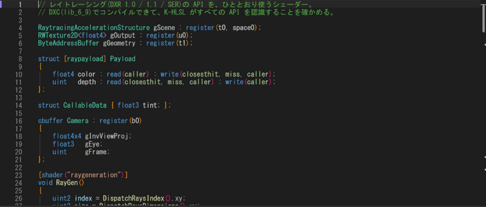
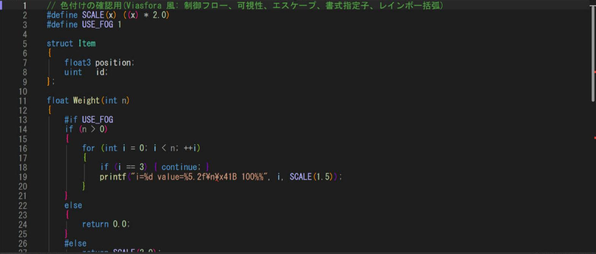

# K-HLSL

HLSL を書いていると Visual Studio の HLSL 拡張が新しい構文を間違いだと言ってくることがあります。たとえば `ResourceDescriptorHeap[index]` に「宣言されていません」と赤い波線が出るといった具合です。コードは DXC で普通にコンパイルできるのにです。拡張が自前のパーサーで判定していて、シェーダー モデルが上がるたびに置いていかれるのが原因です。

K-HLSL は判定を<strong>本物の DXC に任せる</strong>ことで、この問題を避けた Visual Studio 用の HLSL 拡張です。Shader Model 6.9 までの構文と組み込み関数、レイトレーシング（DXR 1.0・1.1・SER）、メッシュ シェーダー、ワーク グラフに対応しています。色は VS の C++ と同じ分類を使うので、使っているテーマの C++ の見た目がそのまま HLSL に出ます。



!!! info "このページを読む前に"
    DXC（`dxc.exe`）は HLSL のコンパイラーで、K-HLSL はエラーの判定にこれを呼びます。DXC 自体の使い方は [Shaders and DXC](../directx/dx12/shaders-dxc.md) にあります。

## ダウンロード

<p><a class="md-button md-button--primary" href="K-HLSL-1.3.10.vsix" download>K-HLSL 1.3.10 をダウンロード（.vsix、約 426 KB）</a></p>

Visual Studio 2026（Community・Professional・Enterprise）で動きます。2022 にも入れられます。Windows の x64 が対象です。ダウンロードした `.vsix` をダブルクリックして、画面の指示に従ってインストールし、Visual Studio を再起動します。新しい版に更新するときも同じ手順で上書きできます。アンインストールは Visual Studio の「拡張機能の管理」から行います。

診断には `dxc.exe` が要ります。Windows SDK に入っている物か[DirectXShaderCompiler](https://github.com/microsoft/DirectXShaderCompiler/releases) の配布物を使ってください。Shader Model 6.9 を使うには、DXC 1.9 以降が必要です。見つかった DXC が古いときは `lib_6_9` から `lib_6_8`、`lib_6_7` と使えるプロファイルまで自動で下げて試します。

## 何ができるか

エラーの表示は保存したときと入力が止まって 0.7 秒たったときに DXC を実際に呼んで作ります。独自の判定をしないので DXC が通すコードにエラーは出ません。エントリ ポイントを決めないときはライブラリ ターゲット（`lib_6_x`）で検証するので、ヘッダーだけのファイルでも構文と型のエラーは見られます。

補完は組み込み関数、リソースのメソッド（`tex.Sample` など）、構造体のメンバー、スウィズル、セマンティクス（`:` の後）、属性（`[` の後）、`#` ディレクティブ、`#include` のファイル名、`dx::` に出ます。ホバーとシグネチャ ヘルプには日本語の説明と必要な Shader Model が出ます。`#include` したファイルの中の関数や変数も補完・ホバー・定義へ移動の対象です。

色はツール → オプション → K-HLSL → 色（拡張機能 → K-HLSL →「色の設定...」からも開きます）で、全部変えられます。Viasfora の設定と同じように色の見本から選びます。レインボー括弧の 4 色、制御キーワード・`#include`・組み込み関数・`public` などの専用色、文字列のエスケープと書式指定子、コメント・文字列・数値・演算子・キーワード、型・関数・引数・ローカル変数・メンバー変数・グローバル変数・マクロ・列挙子・セマンティクス・属性が対象です。空欄の項目は VS の C++ と同じ色です。ほかにレインボー括弧や変数のスコープ別の色分けなどを項目ごとに ON / OFF できます。保存すると開いているファイルにすぐ反映されます。

整形は Ctrl+K, D（ドキュメント全体）と Ctrl+K, F（選択範囲）で使えます。`if (x)` や `for (...)` のあとに `{` を書かずに 1 文だけ続けたとき `switch` の `case`、入れ子の `{ }`、複数行に分けた引数や配列の初期化子、`[unroll]` のような属性だけの行、複数行のブロック コメントを VS の C++ に近い規則で字下げします。`if(` を `if (` に `a=b` を `a = b` に `,` の後ろに空白を足すなど足りない空白も補います。逆に、空白を詰めたり改行の位置を変えたり `#` で始まる行を動かしたりはしません。Enter で入る新しい行や `}` と `;` を打った行にも同じ規則が働きます。

色付けはスコープを見て引数・ローカル変数・メンバー変数・グローバル変数・列挙子・関数・マクロなどを塗り分けます。さらに、Viasfora を入れている人が C++ で見慣れている色もそのまま付きます。深さ 4 色のレインボー括弧、`public` などの DimGray、文字列のエスケープ（`\n` など）の Magenta、書式指定子（`%d` など）の MediumSlateBlue です。Tab や空白で字下げした `#if` にもちゃんとディレクティブの色が付きます。



組み込み関数と型のデータは DXC の定義表（`gen_intrin_main.txt`）と突き合わせて作っています。レイトレーシング系は `TraceRay` や `RayQuery` の全メソッド、フラグと定数、SM 6.9 の `dx::HitObject` と `dx::MaybeReorderThread`（Shader Execution Reordering）まで入っています。バインドレスの `ResourceDescriptorHeap` と `NonUniformResourceIndex`、ワーク グラフの属性とレコード型、メッシュ シェーダーの `SetMeshOutputCounts` も同じです。

## 定数バッファのレイアウトを見る

C++ の構造体と `cbuffer` の並びがずれると、値が別の変数に入って絵が崩れます。原因はたいてい 16 バイトのレジスタの詰め方にあり頭の中で数えるのは面倒です。K-HLSL は `cbuffer`・`ConstantBuffer<T>`・`struct` の配置を HLSL の詰め方のきまり（[Constant Buffer Packing](../directx/concepts/cbuffer-packing.md)）どおりに計算して、3 つの形で見せ C++ の構造体との比較もできます。計算は DXC の逆アセンブリに出るオフセットと突き合わせて、行列・配列・構造体・`double`・`half` を含む数百のケースで一致を確かめています。

ホバーは `cbuffer` の名前、`ConstantBuffer<T>` の変数名、`struct` の名前にカーソルを置くと 1 行の要約（大きさ・レジスタ数・隙間）と小さい字のレジスタの図が出ます。図の升目にカーソルを置くとメンバーのオフセットとサイズが出ます。メンバーの宣言行にカーソルを置くとそのメンバーのオフセットが出ます。

CodeLens は `cbuffer` の宣言の上に `272 バイト（17 レジスタ）・隙間 60 バイト` のような 1 行を出します。表示するかどうかは使っている Visual Studio が言語サーバーの CodeLens に対応しているかによります。

ツール ウィンドウはメニューバーの「拡張機能」→「K-HLSL」→「定数バッファのレイアウトを表示」で開きます。開いている HLSL ファイルの `cbuffer` を一覧にして、選んだ 1 つを 16 バイトのレジスタ × 4 バイトの升目で描きます。メンバーごとに色が付き使われていない隙間は斜線の灰色です。升目をダブルクリックすると宣言の行へ飛びます。保存したときと別のファイルへ移ったときに自動で読み直します。

### C++ の構造体と比べる

C++ の構造体に `cbuffer` を合わせるときずれた場所を探すのが、いちばん時間がかかります。C++ のファイルで `struct` の名前にカーソルを置くと Visual Studio 標準のホバーの下に `K-HLSL: PerObject（108 バイト）を HLSL の cbuffer と比べる ▸` というリンクが出ます。クリックするとツール ウィンドウの下に C++ と HLSL を並べた比較が開きます。

比べる相手は開いている HLSL ファイルのうち同じ名前の `cbuffer` か `struct` です（`uv_scale` と `uvScale` のように、書き方が違うメンバーは同じ名前とみなします）。名前が合う物がなければ最初の `cbuffer` と比べます。上のボックスで比べる相手を選び直せます。

表にはメンバーごとに C++ と HLSL の位置と大きさが出ます。ずれた行は赤で最初のずれを状態の欄で説明します。たとえば `float2` の直後の `float3` なら HLSL は 16 バイトの境界をまたげないので、C++ にも 8 バイトのパディングが要ると出ます。その後ろの行は同じ量のずれの続きなので、オレンジで「ずれの続き」と出ます。表の下には C++ と HLSL のレジスタの図が左右に並びます。

C++ の構造体の大きさは Visual Studio の C++ コンパイラー（MSVC の x64）の規則で、K-HLSL が計算します。コンパイラーは呼びません。標準の型（`float` `int32_t` `double`、ポインターなど）、DirectXMath の型（`XMFLOAT2/3/4`、`XMFLOAT4X4`、`XMVECTOR`、`XMMATRIX` など）、自分で定義した構造体（入れ子・配列・継承）、`alignas`、`#pragma pack`、`std::array` に対応しています。`#include "..."` した近くのフォルダーのヘッダーも読みます。テンプレート、`union`、ビット フィールド、定義が見つからない外部の型は計算できないので、その理由を表示します。計算は MSVC の `sizeof` と `offsetof` で確かめています。

計算に使う設定は DXC の引数と同じものを読みます。`.khlsl.json` の `args` やファイル先頭の `// khlsl:` コメントに書いた `-enable-16bit-types`（`half` が 2 バイトになる）と `-Zpr`、ファイル内の `#pragma pack_matrix` です。`#include` したファイルの `struct` も解決します。

できないこともあります。`min16float` などの最小精度の型を 16 ビット型を有効にせずに配列と組み合わせた場合は、DXC と一致しないことがあります。配列の要素数は数字のほか `#define` や `const int` で決めた定数とその四則演算を解決します。解決できない式は 1 として数えて、注意を表示します。

## 古い HLSL 拡張と一緒に入れてよいか

入れたままで構いません。K-HLSL は HLSL のファイルを開くとそのファイルだけを K-HLSL 専用の扱いに切り替えるので、古い拡張の補完・エラー表示・色付けは、そのファイルでは動かなくなります。古い拡張が出す偽のエラーも出なくなります。完全に消したいときは拡張機能の管理から無効にしてください。

Visual Studio を起動した直後に自動で開かれるファイルは、切り替えが少し遅れることがあります。その場合は Viasfora が `NullReferenceException` のバーを出すことがありますが、ファイルを開き直せば直ります。

## 色を変える

メニューバーの「拡張機能」→「K-HLSL」→「色の設定...」（ツール → オプション → K-HLSL → 色）で、色を変えるページが開きます。Visual Studio 2026 には、旧「フォントおよび色」のページが無いので、K-HLSL の色はこのページで全部変えます。

## 設定する

設定が要らないことのほうが多いのですが、DXC の場所やターゲットを変えたいときは、シェーダーのあるフォルダー（またはその親）に `.khlsl.json` を置きます。どの項目も省略できます。

```json
{
  "dxc": "C:/tools/dxc/bin/x64/dxc.exe",
  "target": "lib_6_9",
  "entry": "main",
  "defines": ["USE_FOG=1"],
  "includeDirs": ["../shaders/common"]
}
```

| 項目 | 意味 |
| --- | --- |
| `dxc` | `dxc.exe` のパス。省略すると環境変数 `KHLSL_DXC`、`PATH`、`VULKAN_SDK`、Windows SDK の順に探す |
| `target` | 検証に使うプロファイル（`ps_6_6`、`lib_6_9` など）。省略すると `lib_6_9` から順に下げて試す |
| `entry` | エントリ ポイントの名前 |
| `hlslVersion` | `-HV` に渡す HLSL のバージョン（`2021` など） |
| `defines` | `-D` に渡すマクロ |
| `includeDirs` | `-I` に渡すフォルダー。`#include` の補完と定義へ移動にも使う |
| `args` | DXC にそのまま渡す引数 |
| `diagnostics` | `false` にすると DXC によるエラー表示を止める |

1 つのファイルだけ別のターゲットで見たいときは、ファイルの先頭 30 行にコメントで書けます。

```hlsl
// khlsl: -T ps_6_6 -E PSMain -D USE_FOG=1
```

## うまく動かないとき

補完が出ないときはツール → オプション → テキスト エディター → すべての言語 → 全般 の「自動メンバー一覧」がオンかを確かめてください。Ctrl+J（編集 → IntelliSense → メンバーの一覧）でも出せます。それでも動かないときは `%LOCALAPPDATA%\K-HLSL\server.log` を見ます。ファイルを開いたときに `didOpen` の行が出ていれば、言語サーバーは起動しています。`vsix.log` にはファイルの扱いを切り替えた記録が出ます。

## まだできないこと

`#if 0` や定義されていないマクロの `#ifdef` で無効になる範囲を薄く表示する機能（C++ の「非アクティブ コード」）は、まだありません。Viasfora のレインボー行（インデントの縦線）と括弧のペアの強調も、作っていません。Vulkan 専用の関数（`vk::` の一部）と DXC の内部用の関数は、データに載せていません。Shader Model 6.10 は DXC のプレビューなので、載せている物には「6.10 以降」と表示します。

## ソースコードと更新履歴

ソースは [GitHub](https://github.com/qwzxdf/kdocs/tree/main/k-hlsl) にあります（MIT ライセンス）。色付けが Viasfora と VS の C++ に合っているかを確かめる比較テストも、同じ場所にあります。

| 版 | 内容 |
| --- | --- |
| 1.3.10 | ホバーを色付きにした。シグネチャや説明の中のコードを、エディターと同じ色（関数・型・数値・キーワード）で表示し、コード ブロックは左の青い線と薄い背景で囲む。表・太字・斜体・区切り線も描き分ける。{ を打ったときにも、その行の字下げを整える（関数の見出しの次の行に { を書く書き方で、字下げが残らない）。ブロック コメントの中で Enter を押すと、前の行に揃う |
| 1.3.9 | Enter と `}` の字下げを直した。`Func() {` で Enter を押したとき、namespace の中などで実際の字下げが整形の規則とずれていると、本体と `}` が前後の行と揃わなかった。新しい行は、基準の行（`}` なら対応する `{` の行）の、規則と実際のずれを足して揃える。`}` `;` を打ったときの整形も同じ |
| 1.3.8 | 言語サーバーが落ちることがある不具合を直した。`struct A : B {}` と `struct B : A {}` のように、基底クラスが循環しているコード（打ちかけのときに起こる）で、定数バッファのレイアウトの計算が終わらず、サーバーが落ちていた |
| 1.3.7 | 補完候補に「キャレットより前の語だけを置き換える」範囲を付けた。IME で変換して Enter で確定したとき、後ろの文字が消えることがある問題への対策。`}` `;` を打ったときの整形は、その文字がキャレットの直前にあるときだけ行う |
| 1.3.6 | 定数バッファのホバーの図を小さくして、ホバーの幅からはみ出さないようにした。説明の文は折り返す |
| 1.3.5 | 組み込み関数（`mul` `saturate` `Sample` など）の既定の色を橙から、`float3` などと同じ青（テーマのキーワードの色）にした。色の設定ページであとから変えられる |
| 1.3.3 | 同じ設定ページを開く「色を編集...」と「色の項目の一覧を表示」を外し、拡張機能 → K-HLSL →「色の設定...」の 1 つにまとめた。1.3.1・1.3.2 と同じ版のまま作り直して、入れ替わらないことがあったので、版を上げた |
| 1.3.1 | 色の設定ページを追加した（ツール → オプション → K-HLSL → 色）。色の見本からレインボー括弧・専用色・コメント・文字列・型・関数・変数など、K-HLSL の色を全部変えられる。レインボー括弧などの ON / OFF もできる。Visual Studio 2026 には旧「フォントおよび色」のページが無く、「色を編集...」が何も開かなかったので、このページを開くようにした。ホバーのシグネチャをふつうのコード ブロックの表示に戻した。Enter で `{}` の間に空行を入れたとき `}` が深く字下げされる問題を直した |
| 1.3.0 | 整形を追加した。Ctrl+K, D（ドキュメント全体）と Ctrl+K, F（選択範囲）で、`if` `for` `while` `else` `do` の本体、`switch` の `case`、`{ }`、複数行の引数、属性行、ブロック コメントを字下げし、`if(` や `a=b` の足りない空白を補う。Enter と `}` `;` を打ったときにも同じ規則で字下げする。「色を編集...」がフォントおよび色のページを開かない場合があったので、開き方を変えた |
| 1.2.1 | `cbuffer CB : register(b0) { ... }` のように `register` を付けた定数バッファの変数が補完・ホバー・定義ジャンプに出なかった問題を直した。`float a, b;` のような 1 行で複数の変数を宣言したときの 2 つ目以降も出るようにした |
| 1.2.0 | C++ の構造体との比較を追加した（C++ のホバーのリンクから、表と図で比べる）。並べ替えの提案と C++ の struct の生成は、外した |
| 1.1.3 | ホバーのシグネチャを見出しの大きさにした（コード ブロックの「コピー」ボタンは付けない） |
| 1.1.2 | ホバーのコード ブロックを小さいインライン コードにした。定数バッファのホバーの図を小さくした |
| 1.1.1 | 自分で決めたセマンティクス（`JOINTS` `WEIGHTS` など）にも色を付けた。定数バッファのホバーに小さい字のレジスタの図を出すようにした |
| 1.1.0 | 定数バッファのレイアウト表示を追加した（ホバー、CodeLens、ツール ウィンドウ。並べ替えの提案と C++ の struct の生成つき） |
| 1.0.9 | 組み込み関数（`normalize` `SampleLevel` など）が橙にならず青のままだった問題を直した。メニューバーの「拡張機能」に「K-HLSL」を追加した（色の編集、色の項目の一覧、このページ、ログのフォルダー） |
| 1.0.8 | `(a * b)` のような掛け算を型と変数の宣言と取り違えて、変数名が型の色になる問題を直した |
| 1.0.7 | `#include` `#define` を灰色、`if` `for` `return` などを紫にした（VS の C++ と同じ既定色の専用の表示項目）。`#include` した先で定義された構造体を型・変数・引数・メンバーとして色付けする。組み込み関数とリソースのメソッドを橙にした |
| 1.0.5 | VS の C++ と同じ分類名で色付けするように作り直した。DXC の定義表と突き合わせて、組み込み関数とメソッドを追加・修正した。大きいファイルでの色付けを速くした |
| 1.0.4 | レインボー括弧・エスケープ・書式指定子の検出を Viasfora の実装と合わせた |
| 1.0.2 | 補完とホバーが Visual Studio の中で動かない問題を直した。色付けを K-HLSL 専用にした |
| 1.0.0 | 最初の公開 |
