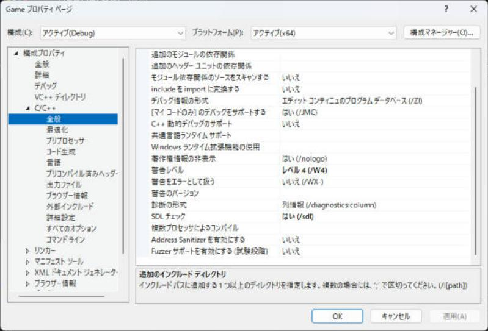

# AddressSanitizer

C++ では**配列の範囲外アクセス**や解放したメモリを使うミスが起きても、その場では何も起きず、あとでまったく別の場所で壊れることがあります。原因が見つけにくいメモリのバグです。AddressSanitizer（アドレス サニタイザー、ASan）は実行中にメモリアクセスを監視し、不正があった瞬間に止めて、詳しく教えてくれるツールです。Visual Studio 2026 の MSVC で、使えます。このページは有効にする方法、見つけられるバグ、エラー出力の読み方、注意点をまとめます。

!!! tip "ポイント"
    - ASan は <strong>範囲外アクセス・解放済みメモリの使用（use-after-free）・二重解放</strong>などを <strong>その場で止めて報告</strong>する。
    - 有効化：プロジェクトのプロパティ → C/C++ → 全般 → 「Address Sanitizer を有効にする」→ はい（/fsanitize=address）。
    - インストーラーで「C++ AddressSanitizer」のコンポーネントが必要。
    - 速さは約 2 倍遅く、メモリは増える。開発・テスト中だけ使う（製品には入れない）。
    - `/RTC1`・`/ZI`（編集して続行）・増分リンクとは併用できない。設定を調整する。
    - エラーの先頭の行（種類）と「どこで確保したか」を読む。

!!! info "このページを読む前に"
    - [vs/index.md](index.md)（このセクション全体の地図と、読む順番）
    - [インストールとプロジェクトの作成](setup.md)（Visual Studio の準備）

## 何を見つけるのか

| バグ | 例 | ASan の報告名 |
| --- | --- | --- |
| **ヒープの範囲外アクセス** | `new int[3]` の 5 番目を読む | `heap-buffer-overflow` |
| スタックの範囲外アクセス | `int a[3];` の 5 番目を書く | `stack-buffer-overflow` |
| グローバル変数の範囲外 | 静的な配列の外 | `global-buffer-overflow` |
| 解放済みメモリの使用 | `delete p;` の後で、`*p` | `heap-use-after-free` |
| 二重解放 | `delete p;` を 2 回 | `attempting double-free` |
| 不正な解放 | `new[]` を `delete` で | `alloc-dealloc-mismatch` |
| スコープ外のスタック使用 | 関数を出た後のローカル変数へのポインタ | `stack-use-after-scope` / `stack-use-after-return` |
| `memcpy` などの範囲外 | `memcpy(dst, src, 100)`（dst が 10 バイト） | `*-buffer-overflow` |

!!! note "メモリリークは見つからない（MSVC）"
    Linux の LeakSanitizer のようなリークの検出は、MSVC の ASan ではサポートされません。リークの調査は[デバッグのやり方](debugging.md)の CRT のリーク検出やプロファイラーのメモリ使用量で行います。

### 普通のデバッグで見つけにくい理由

```cpp
int* p = new int[3];
p[5] = 100;
```

この書き込みは多くの場合、クラッシュしません。ヒープの別の場所をこっそり壊すだけで、あとで無関係な場所がクラッシュします。ASan はこの `p[5]` の瞬間に止めます。

## 有効にする

### 1. コンポーネントを入れる

**Visual Studio Installer** → 変更 → 個別のコンポーネント（または、C++ によるデスクトップ開発のオプション）で、「MSVC AddressSanitizer」にチェックを入れて、インストールします（「C++ によるデスクトップ開発」では、既定で入っています）。

### 2. プロパティで有効にする

1. プロジェクトを選んで、メニューのプロジェクト → プロパティを開く
2. 構成を Debug、プラットフォームを x64 にする
3. C/C++ → 全般 → Address Sanitizer を有効にする → はい (/fsanitize=address)
4. ビルドしてデバッグ実行（F5）する

「Address Sanitizer を有効にする」は、C/C++ → 全般 のページを少し下へスクロールした所にあります。その下の「Fuzzer サポートを有効にする（試験段階）」は、別の機能です。



ソリューション全体（ライブラリを含む）で有効にするとライブラリの中のバグも見つかります。

### 3. 競合する設定を直す

ASan は次の設定と併用できません。エラーや警告が出たら、直します。

| 競合する設定 | 直し方 |
| --- | --- |
| `/RTC1`（ランタイム エラー チェック） | C/C++ → コード生成 → 基本ランタイム チェック → 既定（なし） |
| `/ZI`（編集して続行） | C/C++ → 全般 → デバッグ情報の形式 → `/Zi`（プログラム データベース） |
| 増分リンク（`/INCREMENTAL`） | リンカー → 全般 → 増分リンクを有効にする → いいえ |
| `/clr` | ASan はマネージドコードとは使えない |
| `/MTd` と `/MDd` の混在 | ランタイム ライブラリをそろえる |

### CMake の場合

```cmake
if(MSVC)
  target_compile_options(app PRIVATE /fsanitize=address /Zi)
  target_link_options(app PRIVATE /INCREMENTAL:NO)
endif()
```

Debug 構成の `/RTC1` を外す必要があります。

```cmake
string(REPLACE "/RTC1" "" CMAKE_CXX_FLAGS_DEBUG "${CMAKE_CXX_FLAGS_DEBUG}")
```

### コマンドラインの場合

```text
cl /fsanitize=address /Zi /std:c++latest main.cpp
```

## 実行する

### Visual Studio から

<strong>F5（デバッグ実行）</strong>で不正アクセスがあると、デバッガーがその行で止まります。出力ウィンドウに詳しい報告が出ます。

### 単体で実行するとき

Visual Studio の外（コマンドプロンプトなど）で `.exe` を実行するときは、ASan のランタイム DLL（`clang_rt.asan_dynamic-x86_64.dll`）が見つかる必要があります。

| 方法 | 説明 |
| --- | --- |
| Developer コマンド プロンプトから実行 | 環境変数（`PATH`）が設定されていて、見つかる |
| DLL を実行ファイルの横にコピー | VS の `VC\Tools\MSVC\<バージョン>\bin\Hostx64\x64\` にある |
| PATH に追加 | 同じフォルダーを `PATH` に |

DLL が見つからないと起動時にエラー（`clang_rt.asan_dynamic-x86_64.dll が見つかりません`）が出ます。

## エラー出力の読み方

```cpp
int main() {
  int* p = new int[3];
  p[5] = 100;
  delete[] p;
}
```

```text
=================================================================
==12345==ERROR: AddressSanitizer: heap-buffer-overflow on address 0x... at pc 0x... bp 0x... sp 0x...
WRITE of size 4 at 0x... thread T0
    #0 0x... in main main.cpp:3
    #1 0x... in invoke_main ...

0x... is located 8 bytes after 12-byte region [0x...,0x...)
allocated by thread T0 here:
    #0 0x... in operator new[] ...
    #1 0x... in main main.cpp:2
```

| 部分 | 意味 |
| --- | --- |
| **`ERROR: AddressSanitizer: heap-buffer-overflow`** | バグの種類（ヒープの範囲外） |
| `WRITE of size 4` | 書き込み（または `READ`）。4 バイトのアクセス |
| `#0 ... main.cpp:3` | 不正アクセスをした場所（呼び出し履歴の最初） |
| `located 8 bytes after 12-byte region` | 確保した領域（12 バイト）の 8 バイト後ろにアクセスした |
| `allocated by thread T0 here:` | そのメモリを確保した場所（`main.cpp:2`） |
| `freed by thread T0 here:`（use-after-free のとき） | 解放した場所。誰が解放したか |

読む順番：(1) 種類、(2) アクセスの場所（#0）、(3) 確保・解放の場所。use-after-free では、解放した場所と使った場所の 2 つを見比べます。

### use-after-free の例

```cpp
int* p = new int(42);
delete p;
*p = 1;
```

```text
ERROR: AddressSanitizer: heap-use-after-free on address 0x...
WRITE of size 4 at ...
    #0 ... main.cpp:3
freed by thread T0 here:
    #0 ... operator delete
    #1 ... main.cpp:2
previously allocated by thread T0 here:
    #0 ... operator new
    #1 ... main.cpp:1
```

### スタックの範囲外の例

```cpp
int a[3];
a[5] = 1;
```

```text
ERROR: AddressSanitizer: stack-buffer-overflow on address 0x...
WRITE of size 4 ...
Address 0x... is located in stack of thread T0 at offset 52 in frame
    #0 ... main main.cpp:1
  This frame has 1 object(s):
    [32, 44) 'a' <== Memory access at offset 52 overflows this variable
```

## 設定のオプション

**環境変数 `ASAN_OPTIONS`** で動きを変えられます。

| オプション | 効果 |
| --- | --- |
| `halt_on_error=0` | 最初のエラーで止まらず続行（`-fsanitize-recover=address` でビルドが必要。MSVC では制約あり） |
| `detect_stack_use_after_return=1` | 関数を出た後のローカル変数の使用も検出（有効にすると、メモリを多く使う） |
| `detect_container_overflow=0` | `std::vector` などのコンテナの余白へのアクセスの検出を止める |
| `symbolize=1` | 関数名の解決 |

```text
set ASAN_OPTIONS=detect_stack_use_after_return=1
```

### STL のコンテナの検出

MSVC の `std::vector` と `std::string` はASan に対応した注釈（annotation）を持っています。`capacity` の範囲内でも `size` の外（使っていない余白）へのアクセスを検出できます（`container-overflow`）。

```cpp
std::vector<int> v;
v.reserve(10);
v.push_back(1);
int x = v[3];
```

普通は気づかないバグが見つかります。

!!! warning "ASan あり・なしのバイナリを混ぜない"
    ASan を有効にしてビルドしたライブラリと無効のものを混ぜてリンクすると `LNK2038`（不一致）や誤検出が出ることがあります。全体をそろえるか `_DISABLE_VECTOR_ANNOTATION` / `_DISABLE_STRING_ANNOTATION`（プリプロセッサマクロ）で、注釈を無効にします（[プリプロセッサマクロ](preprocessor.md)）。

## 注意点

| 注意 | 説明 |
| --- | --- |
| **速さが遅くなる** | 約 2 倍。メモリも2〜3 倍。開発・テスト用 |
| 製品には入れない | 速度・サイズ・DLL の依存。Release の製品ビルドは ASan なし |
| カスタム アロケーター | 自作のメモリプールの中の不正は、ASan に見えない。ASan の注釈 API（`ASAN_POISON_MEMORY_REGION`）で、未使用部分を毒化できる |
| 確保した領域の外にまだ別の領域がある | ASan は、確保の周囲に危険地帯（レッドゾーン）を置いて検出する。大きく飛び越えたアクセスはほかの領域に当たって、見逃すことがある |
| 未初期化メモリの読み込み | ASan は、見つけない（MemorySanitizer の領域。MSVC は対応しない） |
| スレッドの競合（データ競合） | ASan は、見つけない（ThreadSanitizer の領域） |
| 整数のオーバーフロー・未定義動作 | ASan は、見つけない（UBSan。MSVC は未対応） |
| ビルドが遅くなる・ファイルが増える | `.pdb` の大きさ実行ファイルのサイズが増える |

## 普通のデバッグと組み合わせる

| 症状 | 使う道具 |
| --- | --- |
| <strong>原因不明のクラッシュ（ヒープ・スタックの破壊）</strong> | ASan |
| リーク（使い終わったメモリが残る） | CRT のリーク検出（`_CRTDBG_MAP_ALLOC`）、プロファイラーのメモリ使用量 |
| スレッドの競合 | デバッガーの並列ウォッチ、設計の見直し（[並行処理の設計](../design/practice/concurrency-design.md)） |
| 未初期化の変数 | 警告レベル /W4、`/sdl`（セキュリティ チェック）、`= {}` で初期化 |
| ロジックの間違い | デバッガー（ブレークポイント、ウォッチ） |

ASan でメモリのバグが見つからないときは、別のバグかもしれません。ASan はメモリのアクセスだけを見ます。

## CI での利用

**ASan つきのビルドを定期的に（または、CI で毎回）実行**すると、メモリのバグを早く見つけられます。

| 方法 | 説明 |
| --- | --- |
| テストを ASan つきで実行 | 単体テストを ASan 付きでビルド・実行 |
| 夜間ビルド | 重いテスト（ゲームの自動プレイ）を ASan 付きで |
| ファジング | ランダムな入力で、ASan つきで実行（libFuzzer） |

CMake に `SANITIZE` オプションを作って、切り替えられるようにしておくと使いやすくなります（[ビルドと CMake の構成](../design/practice/build-cmake.md)）。

<!-- fig:asan-redzone:begin -->

<svg class="fig illust motion" data-fig="asan-redzone" viewBox="0 0 780 400" role="img"><rect x="0" y="0" width="780" height="400" rx="14" fill="#ffffff"/>
<defs><marker id="arr-asan-redzone" markerWidth="9" markerHeight="9" refX="8" refY="4.5" orient="auto"><path d="M0,0 L9,4.5 L0,9 z" fill="#1f2937"/>
</marker>
</defs>
<text x="20" y="28" text-anchor="start" style="font-size:17px;font-weight:700;fill:#1f2937">AddressSanitizer: 配列の両側に「立入禁止」の領域を置き、触ったら止める</text>
<rect x="150" y="150" width="66" height="60" fill="#fecaca" stroke="#94a3b8" stroke-width="1.5"/>
<text x="183.0" y="186" text-anchor="middle" style="font-size:12px;font-weight:700;fill:#e5484d">禁止</text>
<rect x="220" y="150" width="66" height="60" fill="#dbeafe" stroke="#94a3b8" stroke-width="1.5"/>
<text x="253.0" y="186" text-anchor="middle" style="font-size:14px;font-weight:700;fill:#2563eb">a[0]</text>
<rect x="290" y="150" width="66" height="60" fill="#dbeafe" stroke="#94a3b8" stroke-width="1.5"/>
<text x="323.0" y="186" text-anchor="middle" style="font-size:14px;font-weight:700;fill:#2563eb">a[1]</text>
<rect x="360" y="150" width="66" height="60" fill="#dbeafe" stroke="#94a3b8" stroke-width="1.5"/>
<text x="393.0" y="186" text-anchor="middle" style="font-size:14px;font-weight:700;fill:#2563eb">a[2]</text>
<rect x="430" y="150" width="66" height="60" fill="#dbeafe" stroke="#94a3b8" stroke-width="1.5"/>
<text x="463.0" y="186" text-anchor="middle" style="font-size:14px;font-weight:700;fill:#2563eb">a[3]</text>
<rect x="500" y="150" width="66" height="60" fill="#fecaca" stroke="#94a3b8" stroke-width="1.5"/>
<text x="533.0" y="186" text-anchor="middle" style="font-size:12px;font-weight:700;fill:#e5484d">禁止</text>
<rect x="570" y="150" width="66" height="60" fill="#fecaca" stroke="#94a3b8" stroke-width="1.5"/>
<text x="603.0" y="186" text-anchor="middle" style="font-size:12px;font-weight:700;fill:#e5484d">禁止</text>
<rect x="640" y="150" width="66" height="60" fill="#fecaca" stroke="#94a3b8" stroke-width="1.5"/>
<text x="673.0" y="186" text-anchor="middle" style="font-size:12px;font-weight:700;fill:#e5484d">禁止</text>
<text x="360" y="136" text-anchor="middle" style="font-size:13px;font-weight:700;fill:#2563eb">int a[4]（4 要素）</text>
<g opacity="0"><animate attributeName="opacity" dur="14.5s" repeatCount="indefinite" keyTimes="0.0000;0.0687;0.0690;0.1928;0.1931;1.0000" values="0;0;1;1;0;0"/><path d="M253,220 l-10,-18 l20,0 z" fill="#2ea043"/>
<text x="253.0" y="262" text-anchor="middle" style="font-size:13px;font-weight:700;fill:#2ea043">a[0] に書く</text>
</g>
<g opacity="0"><animate attributeName="opacity" dur="14.5s" repeatCount="indefinite" keyTimes="0.0000;0.1928;0.1931;0.3170;0.3172;1.0000" values="0;0;1;1;0;0"/><path d="M323,220 l-10,-18 l20,0 z" fill="#2ea043"/>
<text x="323.0" y="262" text-anchor="middle" style="font-size:13px;font-weight:700;fill:#2ea043">a[1] に書く</text>
</g>
<g opacity="0"><animate attributeName="opacity" dur="14.5s" repeatCount="indefinite" keyTimes="0.0000;0.3170;0.3172;0.4411;0.4414;1.0000" values="0;0;1;1;0;0"/><path d="M393,220 l-10,-18 l20,0 z" fill="#2ea043"/>
<text x="393.0" y="262" text-anchor="middle" style="font-size:13px;font-weight:700;fill:#2ea043">a[2] に書く</text>
</g>
<g opacity="0"><animate attributeName="opacity" dur="14.5s" repeatCount="indefinite" keyTimes="0.0000;0.4411;0.4414;0.5652;0.5655;1.0000" values="0;0;1;1;0;0"/><path d="M463,220 l-10,-18 l20,0 z" fill="#2ea043"/>
<text x="463.0" y="262" text-anchor="middle" style="font-size:13px;font-weight:700;fill:#2ea043">a[3] に書く</text>
</g>
<g opacity="0"><animate attributeName="opacity" dur="14.5s" repeatCount="indefinite" keyTimes="0.0000;0.5652;0.5655;1.0000" values="0;0;1;1"/><path d="M533,220 l-10,-18 l20,0 z" fill="#e5484d"/>
<text x="533.0" y="262" text-anchor="middle" style="font-size:13px;font-weight:700;fill:#e5484d">a[4] に書く</text>
</g>
<text x="390" y="315" text-anchor="middle" style="font-size:15px;font-weight:700;fill:#e5484d" opacity="0">ERROR: AddressSanitizer: stack-buffer-overflow（a[4] への書き込み）<animate attributeName="opacity" dur="14.5s" repeatCount="indefinite" keyTimes="0.0000;0.6756;0.6759;1.0000" values="0;0;1;1"/></text>
<text x="390" y="360" text-anchor="middle" style="font-size:14px;font-weight:700;fill:#1f2937" opacity="0">配列の前後に禁止領域(赤)が自動で置かれる<animate attributeName="opacity" dur="14.5s" repeatCount="indefinite" keyTimes="0.0000;0.0687;0.0690;1.0000" values="1;1;0;0"/></text>
<text x="390" y="360" text-anchor="middle" style="font-size:14px;font-weight:700;fill:#1f2937" opacity="0">a[0]〜a[3] に書く: 範囲内なので問題なし<animate attributeName="opacity" dur="14.5s" repeatCount="indefinite" keyTimes="0.0000;0.0687;0.0690;0.6204;0.6207;1.0000" values="0;0;1;1;0;0"/></text>
<text x="390" y="360" text-anchor="middle" style="font-size:14px;font-weight:700;fill:#1f2937" opacity="0">a[4] に書く: 禁止領域に触れた → その場でプログラムを止めて、行番号を表示<animate attributeName="opacity" dur="14.5s" repeatCount="indefinite" keyTimes="0.0000;0.6204;0.6207;1.0000;1.0000" values="0;0;1;1;0"/></text>
</svg>

<!-- fig:asan-redzone:end -->

## よくあるミス

??? failure "「C++ AddressSanitizer」をインストールしていなくて、ビルドエラーになる"
    **Visual Studio Installer** で、「C++ AddressSanitizer」のコンポーネントを追加します。

??? failure "`/RTC1` と併用してエラー（D8016）になる"
    基本ランタイム チェックを 既定（なし）にします。

??? failure "「編集して続行（/ZI）」と競合する"
    デバッグ情報の形式を`/Zi` に変えます。

??? failure "単体で実行すると、`clang_rt.asan_dynamic-x86_64.dll` が見つからない"
    DLL を実行ファイルの横にコピーするかDeveloper コマンド プロンプトから実行します。

??? failure "ASan 付きとなしのライブラリを混ぜて、`LNK2038` や誤検出が出る"
    全体を同じ設定でビルドします。または、コンテナの注釈を無効にします。

??? failure "製品ビルドに ASan を入れたまま配布した"
    遅く・大きくなりDLL の依存も増えます。開発・テストだけにします。

??? failure "自作のメモリプールの中の不正が見つからない"
    ASan はプールの内側を知りません。注釈の APIで未使用の領域を毒化します。

## これだけ覚える

!!! abstract "まとめ"
    - [x] AddressSanitizer は、範囲外アクセス・use-after-free・二重解放を その場で止めて報告する
    - [x] 有効化はC/C++ → 全般 → Address Sanitizer を有効にする（/fsanitize=address）。インストーラーでコンポーネントが必要
    - [x] `/RTC1`・`/ZI`・増分リンクは、外す
    - [x] 報告は 「種類」→「アクセスした場所」→「確保・解放した場所」の順に読む
    - [x] 約 2 倍遅い。開発・テスト・CI だけ。メモリリーク・スレッドの競合・未初期化は、見つからない

## 関連ページ

- [Visual Studio（目次）](index.md)
- [デバッグのやり方](debugging.md)
- [パフォーマンス プロファイラー](profiler.md)
- [よくあるエラー](errors.md)
- [ビルドと CMake の構成](../design/practice/build-cmake.md)
- [未定義動作（基礎）](../basics/ub.md)
