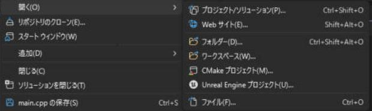
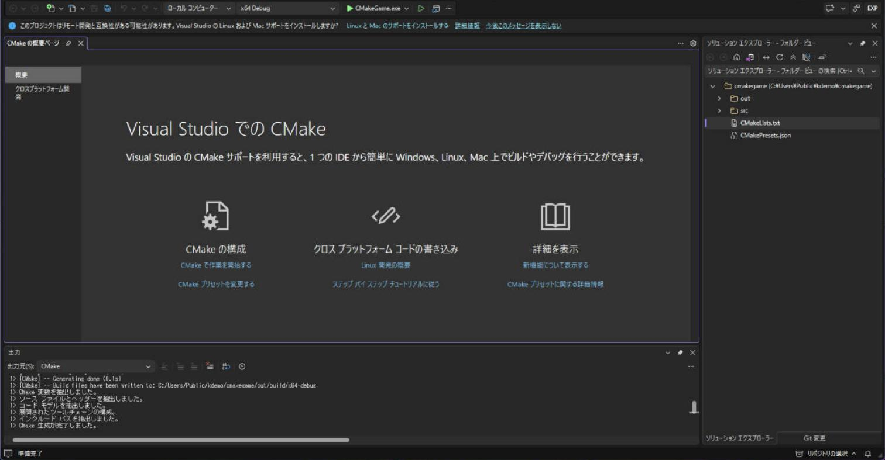
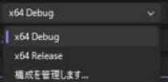
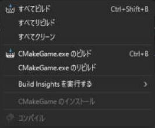
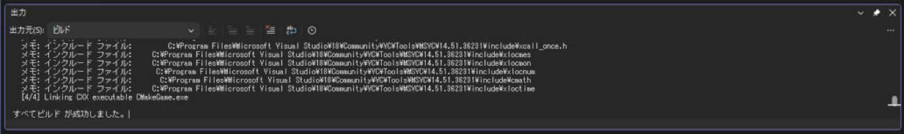

# CMake で使う

<strong>CMake（シーメイク）</strong> は、「どのファイルを、どの設定でビルドするか」を `CMakeLists.txt` というテキストファイルに書いて、Visual Studio のプロジェクトを自動で作ってくれるツールです。Visual Studio は、`.sln` / `.vcxproj` を使わずに、CMake のプロジェクトを「フォルダーを開く」で直接開くこともできます。ライブラリが CMake で配布されている（Jolt Physics など）ときや、将来 Linux / Mac でも動かしたいときに使います。

!!! tip "ポイント"
    - <strong>学生のうちは、Visual Studio のプロジェクト（`.sln`）で十分。</strong> CMake は、必要になったときに覚えればよい。
    - CMake のプロジェクトは、Visual Studio の「**フォルダーを開く**」で開く。`CMakeLists.txt` が見つかると、自動で設定される。
    - 外部ライブラリは、`FetchContent`（ダウンロードして一緒にビルド）か、vcpkg で入れる。
    - ビルドの設定は `CMakePresets.json` に書くと、チームで共有できる。

## 使う場面

| 場面 | おすすめ |
| --- | --- |
| Windows だけ、Visual Studio だけで開発する | **`.sln` のプロジェクト**（[プロジェクトの作成](setup.md)） |
| ライブラリが CMake でしか配られていない | CMake でビルドして、できた `.lib` を使う。または vcpkg |
| Windows 以外（Linux、Mac）でも動かしたい | CMake |
| 複数の IDE（Visual Studio、VS Code、CLion）で開きたい | CMake |

## Visual Studio で CMake のプロジェクトを開く

1. メニュー「ファイル → 開く → **フォルダー**」（Ctrl + Shift + Alt + O）で、`CMakeLists.txt` のあるフォルダーを選ぶ
2. 下に出る「CMake の生成」の出力で、エラーが出ていないことを確認する
3. 上の スタートアップ アイテムの選択（再生ボタンの横）で、実行する `.exe` を選ぶ
4. F5 で実行する



フォルダーを開くと、`CMakeLists.txt` が見つかって、CMake の生成が自動で始まります。下の「出力」の出力元が「CMake」になり、生成の経過が出ます。右の「ソリューション エクスプローラー - フォルダー ビュー」には、フォルダーの中身がそのまま並びます。生成の結果は、`out/build/<プリセット名>` に置かれます。



ツールバーの「x64 Debug」は、`CMakePresets.json` に書いたプリセットです。押すと、`x64 Debug`、`x64 Release` と「構成を管理します...」が出ます。Debug と Release は、ここで切り替えます。



ビルドは、メニューの「ビルド」にある「すべてビルド」（Ctrl + Shift + B）です。`.sln` のときの「ソリューションのビルド」に当たります。



成功すると、出力に「すべてビルド が成功しました。」と出ます。下の画面の「[4/4] Linking CXX executable」は Ninja の進行で、最後が `CMakeGame.exe` のリンクです。



Visual Studio のインストーラーで、「Windows 用 C++ CMake ツール」 のコンポーネントが必要です（「C++ によるデスクトップ開発」には、既定で入っています。[インストール](setup.md)）。

## 最小の CMakeLists.txt

```cmake
cmake_minimum_required(VERSION 3.25)
project(MyGame LANGUAGES CXX)

# C++23 を使う
set(CMAKE_CXX_STANDARD 23)
set(CMAKE_CXX_STANDARD_REQUIRED ON)
set(CMAKE_CXX_EXTENSIONS OFF)

add_executable(MyGame
  src/main.cpp
  src/game.cpp
)

# MSVC のオプション（/utf-8 と警告 /W4）
if(MSVC)
  target_compile_options(MyGame PRIVATE /utf-8 /W4 /MP)
endif()
```

| 命令 | 意味 |
| --- | --- |
| `cmake_minimum_required` | 必要な CMake のバージョン |
| `project` | プロジェクトの名前と言語 |
| `set(CMAKE_CXX_STANDARD 23)` | C++ 言語標準を C++23 に |
| `add_executable(名前 ソース...)` | 実行ファイルを作る。ソースの一覧 |
| `add_library(名前 STATIC ソース...)` | ライブラリを作る |
| `target_include_directories` | インクルードのパス |
| `target_link_libraries` | リンクするライブラリ |
| `target_compile_options` | コンパイラのオプション |
| `find_package` | 入っているライブラリを探す（vcpkg など） |
| `FetchContent` | ライブラリを**ダウンロードして一緒にビルド** |

## 外部ライブラリを入れる

### 方法 A：vcpkg（Visual Studio と相性がよい）

vcpkg を使うには、**ツールチェーン ファイル**を CMake に教えます。`CMakePresets.json` に書くのが定番です。

```json
{
  "version": 3,
  "configurePresets": [
    {
      "name": "windows-base",
      "hidden": true,
      "generator": "Ninja",
      "binaryDir": "${sourceDir}/out/build/${presetName}",
      "cacheVariables": {
        "CMAKE_TOOLCHAIN_FILE": "$env{VCPKG_ROOT}/scripts/buildsystems/vcpkg.cmake"
      }
    },
    {
      "name": "x64-debug",
      "inherits": "windows-base",
      "architecture": { "value": "x64", "strategy": "external" },
      "cacheVariables": { "CMAKE_BUILD_TYPE": "Debug" }
    },
    {
      "name": "x64-release",
      "inherits": "windows-base",
      "architecture": { "value": "x64", "strategy": "external" },
      "cacheVariables": { "CMAKE_BUILD_TYPE": "Release" }
    }
  ]
}
```

`vcpkg.json`（マニフェスト）にライブラリを書いておくと、CMake の生成時に自動で入ります（[外部ライブラリの入れ方](libraries.md#vcpkg)）。

```cmake
find_package(nlohmann_json CONFIG REQUIRED)
target_link_libraries(MyGame PRIVATE nlohmann_json::nlohmann_json)
```

### 方法 B：FetchContent（ダウンロードして一緒にビルド）

```cmake
include(FetchContent)
FetchContent_Declare(
  json
  URL https://github.com/nlohmann/json/releases/download/v3.12.0/json.tar.xz)
FetchContent_MakeAvailable(json)

target_link_libraries(MyGame PRIVATE nlohmann_json::nlohmann_json)
```

- 最初の CMake の生成のときに、ライブラリがダウンロードされて、プロジェクトの一部としてビルドされます
- バージョンを `GIT_TAG` や URL で固定できるので、チームで同じものが使えます
- ネットワークが必要で、ライブラリが大きいと生成に時間がかかります

## CMake と Visual Studio プロジェクトの比較

| 項目 | `.sln` / `.vcxproj` | CMake |
| --- | --- | --- |
| 設定の場所 | プロパティの画面（GUI） | `CMakeLists.txt`（テキスト） |
| Git での管理 | `.vcxproj` が XML で読みにくい | **差分が読みやすい** |
| 他の OS | Windows だけ | Windows / Linux / Mac |
| 学習の難しさ | 画面を見て設定できる | 命令を覚える必要がある |
| ファイルの追加 | ソリューション エクスプローラーで追加 | `CMakeLists.txt` にファイル名を書く |

## CMake で .sln を作る

「やっぱり `.sln` で開きたい」ときは、CMake に Visual Studio のプロジェクトを作らせます。

```powershell
cmake -S . -B build -G "Visual Studio 18 2026" -A x64
```

`build/MyGame.slnx`（Visual Studio 2026 のジェネレーターは `.slnx` を作ります）ができるので、それを Visual Studio で開きます。

## 関連ページ

- [Ninja（高速なビルド ツール）](ninja.md)
- [外部ライブラリの入れ方](libraries.md)
- [インストールとプロジェクトの作成](setup.md)
- [Visual Studio の目次](index.md)
- [CMake 公式ドキュメント](https://cmake.org/cmake/help/latest/)
