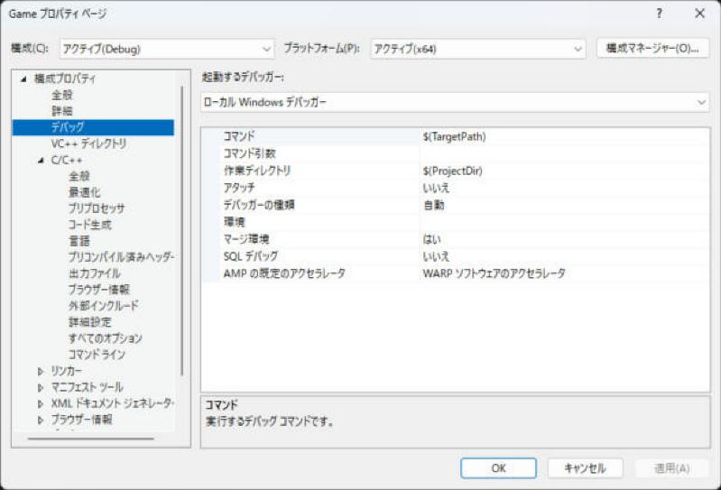

# デバッグの発展（条件・データ ブレークポイント、natvis）

[デバッグのやり方](debugging.md)で、ブレークポイントで止めて値を見るところまでできたら、次は「止める条件を絞る」「変数が変わった瞬間に止める」「自作の型を見やすくする」です。入門のページでは省いた、少し発展の道具をまとめます。

!!! info "このページを読む前に"
    - [デバッグのやり方](debugging.md)（ブレークポイント、ステップ実行、値の見方）

## 条件付きブレークポイント

「ループの 100 回目だけ止めたい」「`hp` が 0 になったときだけ止めたい」ときに使います。

1. 赤い丸を**右クリック → 条件**（または、丸にマウスを重ねて歯車のアイコン）
2. 条件に `i == 100` のような式を入れる

- 条件式: `enemy->hp <= 0` が真のときだけ止まる
- ヒット カウント: 100 回通ったら止まる
- フィルター: 特定のスレッドだけで止まる
- アクション（ログ出力）: 止めずに `{hp}` のような式を出力ウィンドウに出す（`println` を足さずに済む）

## データ ブレークポイント

「**この変数が書き換えられた瞬間**に止めたい」ときに使います（「誰がこの値を壊した？」を探せる）。

1. 変数が見えている状態（デバッグ中）で、「デバッグ → ブレークポイントの新規作成 → データ ブレークポイント」
2. アドレス（`&hp` など）を入れる
3. 続行するとその値が変わった行で止まる

- ハードウェアの機能なので、数個（4 つくらい）までしか使えません
- `ネイティブ コード` のデバッグでだけ使えます

## AddressSanitizer でメモリのバグを探す {#asan}

詳しい使い方は[AddressSanitizer](asan.md) のページにあります。

<strong>AddressSanitizer（ASan）</strong> は、実行中にメモリの使い方を監視して、範囲外アクセス、解放済みメモリの使用（use-after-free）、スタックの範囲外などを見つけて、その場で止めてくれる機能です。

1. インストーラーで 「C++ AddressSanitizer」 を入れておく
2. プロジェクトのプロパティ → C/C++ → 全般 → Address Sanitizer を有効にする → はい (/fsanitize=address)（Debug だけがおすすめ）
3. 実行するとメモリの不正があった行で止まり何が起きたかが詳しく出力される

```cpp
#include <vector>

int main() {
  std::vector<int> v(3);
  int* p = v.data();
  return p[5];  // 範囲外。ASan を有効にすると、ここで止まって教えてくれる
}
```

- 普通のデバッグだと「たまたま動く」未定義動作を確実に見つけられます（[未定義動作](../basics/ub.md)）
- 実行が遅くなりメモリも増えるので、普段は Debug だけで使います
- ASan を使うときは `/INCREMENTAL:NO` などの設定が必要になることがあります。エラーメッセージの指示に従います

## 実行するときの設定（作業ディレクトリと引数） {#debug-settings}

ゲームは `assets/` のような相対パスでファイルを読みます。ところが、Visual Studio から実行したときの「作業ディレクトリ」が `.exe` のあるフォルダーとは限らず、「ファイルが見つからない」ことがあります。プロジェクトのプロパティの<strong>デバッグ</strong>のページで、実行のときの設定を決められます。



「作業ディレクトリ」の既定は `$(ProjectDir)`（`.vcxproj` のあるフォルダー）です。`assets` をそこに置くならそのまま動きます。出力先（`$(OutDir)`）に置いたときはここを `$(OutDir)` に変えます。「コマンド引数」には `main` の `argv` に渡す文字列を書きます（`--windowed` のように起動のオプションを試すとき）。

## natvis（自作の型を見やすく表示する）

自作のクラスをウォッチに出すとき内部のメンバがそのまま並んで見にくいことがあります。natvis（`.natvis` ファイル）を書くと表示の仕方を自分で決められます。

```xml
<?xml version="1.0" encoding="utf-8"?>
<AutoVisualizer xmlns="http://schemas.microsoft.com/vstudio/debugger/natvis/2010">
  <Type Name="Vec2">
    <DisplayString>({x}, {y})</DisplayString>
  </Type>
</AutoVisualizer>
```

プロジェクトに `.natvis` を追加するだけで、ウォッチで `Vec2` が `(1.5, 2)` のように表示されます。

## 関連ページ

- [デバッグのやり方](debugging.md)
- [AddressSanitizer](asan.md)
- [よくあるエラー](errors.md)
