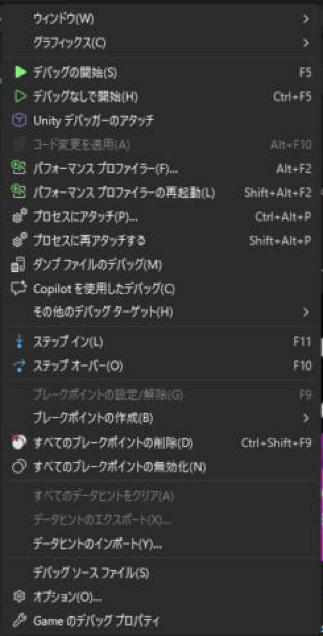
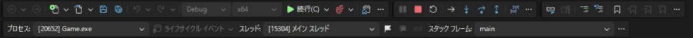
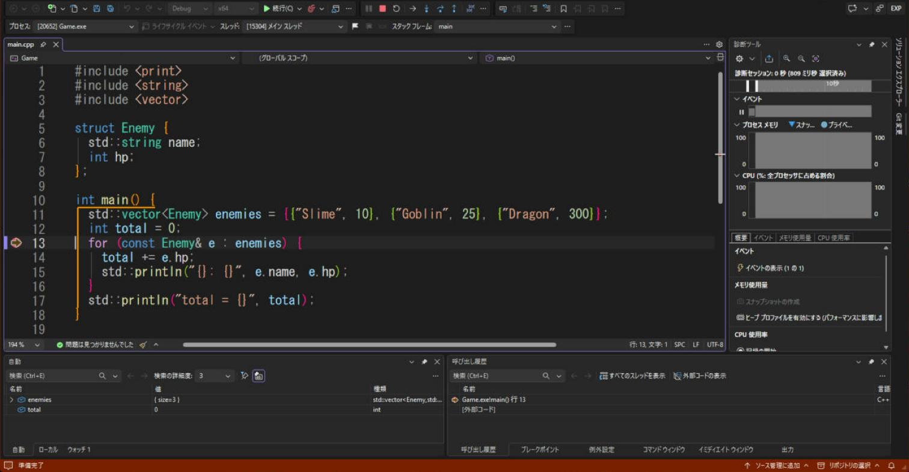
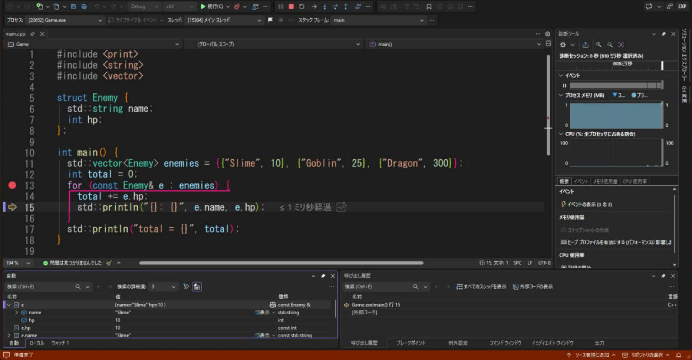

# デバッグのやり方

**デバッグ**はプログラムを途中で止めて、変数の中身を見ながら 1 行ずつ動かすことです。`println` を足して実行し直すよりずっと早くバグの原因が分かります。Visual Studio のデバッガーは強力で、これを使えるかどうかでバグ探しの時間が大きく変わります。

!!! tip "ポイント"
    - **F9** でブレークポイントを置き**F5**（デバッグ開始）で実行する。止まったら F10 で 1 行ずつ進める。
    - 変数にマウスを重ねるかローカル / ウォッチ ウィンドウで値を見る。
    - クラッシュしたら、呼び出し履歴で「どこから呼ばれたか」を見る。
    - デバッグは Debug 構成で行う（Release は変数が消えて見えない）。
    - 条件付きブレークポイントとデータ ブレークポイントを使うと「100 回目だけ止める」「この変数が変わった瞬間に止める」ができる。
    - 条件付き・データ ブレークポイント、メモリのバグ探し、natvis は[発展のページ](debugging-advanced.md)にある。

!!! info "このページを読む前に"
    - [vs/index.md](index.md)（このセクション全体の地図と読む順番）
    - [インストールとプロジェクトの作成](setup.md)（Visual Studio の準備）

## 実行のしかた

- **F5**: デバッグありで開始（ブレークポイントで止まる）
- Ctrl + F5: デバッグなしで開始（普通に実行して、終了時に「何かキーを押してください」）
- Shift + F5: 実行を止める
- Ctrl + Shift + F5: 再起動

メニューの「デバッグ」にも「デバッグの開始」「デバッグなしで開始」「ステップ イン」などが並んでいます。



ツールバーの「ローカル Windows デバッガー」（緑の三角）を押しても、F5 と同じ動きです。止まっている間はこのボタンが「続行」に変わり右に一時停止・停止・再起動・ステップのボタンが並びます。



## ブレークポイントと 1 行ずつ実行

1. 止めたい行の左（行番号の左の余白）をクリックするか**F9** を押すと、赤い丸（ブレークポイント）が付く
2. F5 で実行する。その行に来ると黄色い矢印で止まる
3. 止まっている間に次のキーで進める

次の画面は `for` の行（13 行目）にブレークポイントを置いて、F5 で止めたところです。行番号の左に黄色い矢印があります。下には「自動」と「呼び出し履歴」のウィンドウが並び右には、メモリと CPU の使用量を見る「診断ツール」が出ています。



- <strong>F10</strong>: 名前: ステップ オーバー。動き: 1 行進む。関数の中には入らない
- <strong>F11</strong>: 名前: ステップ イン。動き: 1 行進む。関数の中に入る
- <strong>Shift + F11</strong>: 名前: ステップ アウト。動き: 今の関数の最後まで実行して、呼び出し元に戻る
- <strong>Ctrl + F10</strong>: 名前: カーソル行まで実行。動き: 今の位置からカーソルのある行まで、一気に進む
- <strong>F5</strong>: 名前: 続行。動き: 次のブレークポイントまで一気に進む

```cpp
#include <print>
#include <vector>

int Sum(const std::vector<int>& v) {
  int total = 0;
  for (int x : v) {
    total += x;  // ← ここにブレークポイント。ループのたびに止まる
  }
  return total;
}

int main() {
  std::vector<int> scores = {10, 20, 30};
  std::println("{}", Sum(scores));
}
```

```text title="実行結果"
60
```

F10（ステップ オーバー）を 2 回押すと 13 行目から 15 行目まで進みます。ブレークポイントは赤い丸のまま残り黄色い矢印だけが進みます。下の「自動」ウィンドウにはいまの行の周りの変数が出ます。`e` の左の ▶ を開くと中のメンバー（`name` と `hp`）が見えます。



## 値を見る

止まっている間に次の方法で値が見られます。

- マウスを重ねる: ソースの変数に重ねると、値が小さな窓に出る（ピンで固定もできる）
- **ローカル** ウィンドウ: メニュー「デバッグ → ウィンドウ → ローカル」。今の関数の変数が全部出る
- 自動 ウィンドウ: 今の行の周りの変数だけ出る（下の画面）
- ウォッチ ウィンドウ: 見たい式を自分で入力する。ずっと表示される
- クイック ウォッチ（Shift + F9）: 式を 1 回だけ計算して見る
- 直接実行（イミディエイト）ウィンドウ: 止まった状態で、`v.size()` のような式を実行できる


### ウォッチで使える書き方

- `v`: `std::vector` の中身が展開されて見える
- `v[2]`: 添字で見る
- `ptr,5`: ポインタ `ptr` の先を 5 個ぶんの配列として見る
- `*ptr`: ポインタの指す先の値
- `x,x`: 16 進数で見る（`,d` は 10 進数、`,b` は 2 進数）
- `a + b`: 式をそのまま計算できる
- `$err`: 直前のエラー番号（Windows API）
- `v.size()`: 関数を呼べる（副作用のある関数は呼ばない）

## 呼び出し履歴（コール スタック）

クラッシュしたりブレークポイントで止まったりしたとき**どの関数から呼ばれてここに来たか**が分かります。メニュー「デバッグ → ウィンドウ → 呼び出し履歴」（Alt + 7）。デバッグを始めると既定では画面の右下に出ます。


<div class="anim" data-type="graph" data-label="呼び出し履歴は、クラッシュした場所から、呼び出し元をさかのぼる">
n a Enemy::Attack(...) 0 3 hit
---
n a Enemy::Attack(...) 0 3 hit
n b Scene::UpdateEnemies(...) 0 2
l b a - 呼んだ
---
n a Enemy::Attack(...) 0 3 hit
n b Scene::UpdateEnemies(...) 0 2
n c Game::Update(...) 0 1
l b a - 呼んだ
l c b - 呼んだ
---
n a Enemy::Attack(...)_←_クラッシュ 0 3 hit
n b Scene::UpdateEnemies(...) 0 2
n c Game::Update(...) 0 1
n d main()_←_最初 0 0
l b a - 呼んだ
l c b - 呼んだ
l d c - 呼んだ
</div>

- 行をダブルクリックすると、その関数のソースに移りその時点の変数が見られます。「引数が `nullptr` だったのは誰が渡したのか」を上にたどって調べます
- クラッシュしたらまず 呼び出し履歴で自分のコードの一番上の行を見ます

## 例外とクラッシュ

- **例外が投げられた**: 止まった場所が `throw` の行になる。例外の内容は「例外ヘルパー」の窓に出る
- アクセス違反（`0xC0000005`）: `nullptr` や解放されたメモリを触った。呼び出し履歴で自分のコードに戻る
- 未処理の例外で終了: 例外設定で「投げられたときに止まる」を有効にすると、`catch` に行く前に止められる

メニュー「デバッグ → ウィンドウ → 例外設定」（Ctrl + Alt + E）で、C++ Exceptions にチェックを入れると、例外が投げられた瞬間に止まります。

### assert とデバッグ用のブレーク

```cpp
#include <cassert>
#include <intrin.h>

void Attack(Enemy* target) {
  assert(target != nullptr);  // Debug では、条件が偽だとここで止まる（Release では何もしない）
  if (target->hp < 0) {
    __debugbreak();  // この行で、デバッガーが止まる（MSVC 専用）
  }
}
```

## ゲームでよく使うデバッグのコツ

- 毎フレームのループで特定の敵だけ見たい: 条件付きブレークポイント（`enemy->id == 5`）
- ブレークすると画面が固まって困る: ログ出力のアクション（止めずに値を出力）か `println`
- 変数が「いつの間にか」変わる: データ ブレークポイント
- Release でだけクラッシュする: Release のまま実行して、クラッシュしたらデバッグ アタッチ。「最適化なしの Release」（`/Od`）に設定して再現
- どの関数が遅いか: 「デバッグ → パフォーマンス プロファイラー」（Alt + F2）で CPU 使用率を測る
- 初期化されていない変数: 警告 `C4700` を有効に。ASan でも一部見つかる

## 関連ページ

- [デバッグの発展（条件・データ ブレークポイント、natvis）](debugging-advanced.md)
- [よくあるエラー](errors.md)
- [便利な機能とショートカット](tips.md)
- [未定義動作](../basics/ub.md)
- [Visual Studio の目次](index.md)
