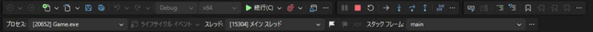
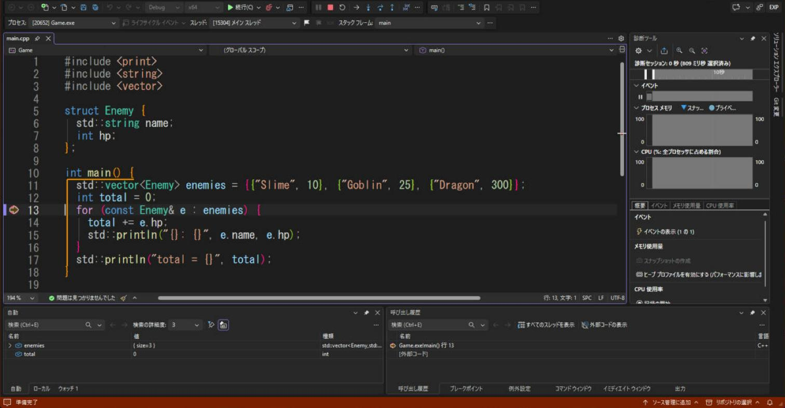
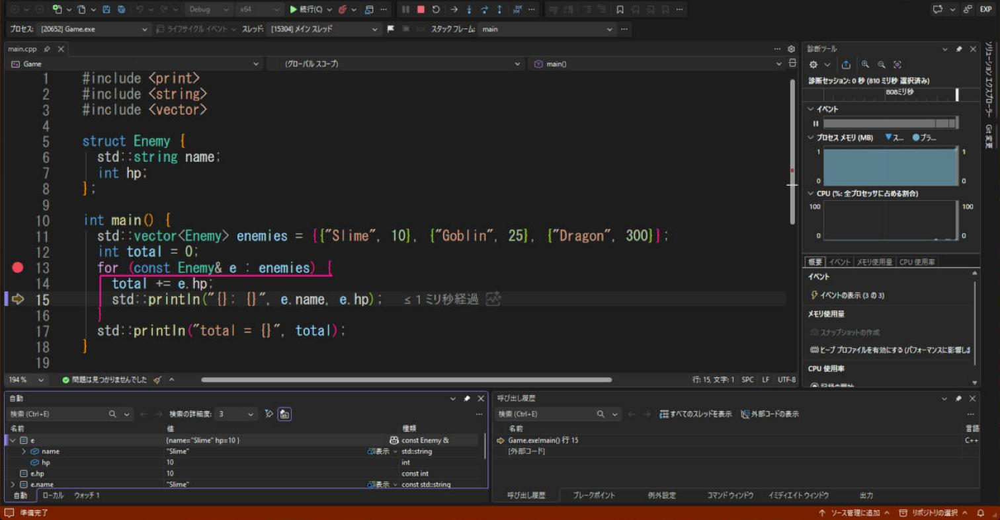
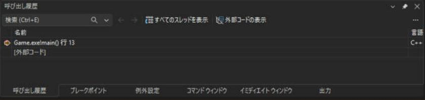
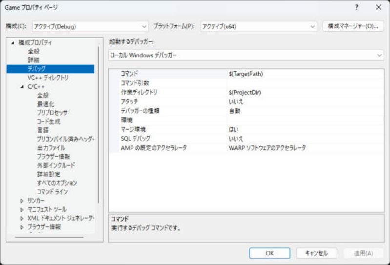

# デバッグのやり方

**デバッグ**は、プログラムを途中で止めて、変数の中身を見ながら 1 行ずつ動かすことです。`println` を足して実行し直すより、ずっと早くバグの原因が分かります。Visual Studio のデバッガーは強力で、これを使えるかどうかで、バグ探しの時間が大きく変わります。

!!! tip "ポイント"
    - **F9** でブレークポイントを置き、**F5**（デバッグ開始）で実行する。止まったら、F10 で 1 行ずつ進める。
    - 変数にマウスを重ねるか、ローカル / ウォッチ ウィンドウで値を見る。
    - クラッシュしたら、呼び出し履歴で「どこから呼ばれたか」を見る。
    - デバッグは Debug 構成で行う（Release は変数が消えて見えない）。
    - 条件付きブレークポイントとデータ ブレークポイントを使うと、「100 回目だけ止める」「この変数が変わった瞬間に止める」ができる。
    - メモリのバグは AddressSanitizer に探してもらう。

!!! info "このページを読む前に"
    - [vs/index.md](index.md)（このセクション全体の地図と、読む順番）
    - [インストールとプロジェクトの作成](setup.md)（Visual Studio の準備）

## 実行のしかた

| キー | 動き |
| --- | --- |
| **F5** | デバッグありで開始（ブレークポイントで止まる） |
| Ctrl + F5 | デバッグなしで開始（普通に実行して、終了時に「何かキーを押してください」） |
| Shift + F5 | 実行を止める |
| Ctrl + Shift + F5 | 再起動 |

メニューの「デバッグ」にも、「デバッグの開始」「デバッグなしで開始」「ステップ イン」などが並んでいます。


ツールバーの「ローカル Windows デバッガー」（緑の三角）を押しても、F5 と同じ動きです。止まっている間は、このボタンが「続行」に変わり、右に一時停止・停止・再起動・ステップのボタンが並びます。



## ブレークポイントと 1 行ずつ実行

1. 止めたい行の左（行番号の左の余白）をクリックするか、**F9** を押すと、赤い丸（ブレークポイント）が付く
2. F5 で実行する。その行に来ると黄色い矢印で止まる
3. 止まっている間に次のキーで進める

次の画面は、`for` の行（13 行目）にブレークポイントを置いて、F5 で止めたところです。行番号の左に黄色い矢印があります。下には「自動」と「呼び出し履歴」のウィンドウが並び、右には、メモリと CPU の使用量を見る「診断ツール」が出ています。



| キー | 名前 | 動き |
| --- | --- | --- |
| F10 | ステップ オーバー | 1 行進む。関数の中には入らない |
| F11 | ステップ イン | 1 行進む。関数の中に入る |
| Shift + F11 | ステップ アウト | 今の関数の最後まで実行して、呼び出し元に戻る |
| Ctrl + F10 | カーソル行まで実行 | 今の位置からカーソルのある行まで、一気に進む |
| F5 | 続行 | 次のブレークポイントまで一気に進む |

```cpp
#include <print>
#include <vector>

int Sum(const std::vector<int>& v) {
  int total = 0;
  for (int x : v) {
    total += x;  // ← ここにブレークポイント。ループのたびに止まる
  }
  return total;
}

int main() {
  std::vector<int> scores = {10, 20, 30};
  std::println("{}", Sum(scores));
}
```

```text title="実行結果"
60
```

F10（ステップ オーバー）を 2 回押すと、13 行目から 15 行目まで進みます。ブレークポイントは赤い丸のまま残り、黄色い矢印だけが進みます。下の「自動」ウィンドウには、いまの行の周りの変数が出ます。`e` の左の ▶ を開くと、中のメンバー（`name` と `hp`）が見えます。



## 値を見る

止まっている間に次の方法で値が見られます。

| 方法 | 使い方 |
| --- | --- |
| マウスを重ねる | ソースの変数に重ねると、値が小さな窓に出る（ピンで固定もできる） |
| **ローカル** ウィンドウ | メニュー「デバッグ → ウィンドウ → ローカル」。今の関数の変数が全部出る |
| 自動 ウィンドウ | 今の行の周りの変数だけ出る（下の画面） |
| ウォッチ ウィンドウ | 見たい式を自分で入力する。ずっと表示される |
| クイック ウォッチ（Shift + F9） | 式を 1 回だけ計算して見る |
| 直接実行（イミディエイト）ウィンドウ | 止まった状態で、`v.size()` のような式を実行できる |


### ウォッチで使える書き方

| 入力 | 意味 |
| --- | --- |
| `v` | `std::vector` の中身が展開されて見える |
| `v[2]` | 添字で見る |
| `ptr,5` | ポインタ `ptr` の先を 5 個ぶんの配列として見る |
| `*ptr` | ポインタの指す先の値 |
| `x,x` | 16 進数で見る（`,d` は 10 進数、`,b` は 2 進数） |
| `a + b` | 式をそのまま計算できる |
| `$err` | 直前のエラー番号（Windows API） |
| `v.size()` | 関数を呼べる（副作用のある関数は呼ばない） |

## 呼び出し履歴（コール スタック）

クラッシュしたり、ブレークポイントで止まったりしたとき、**どの関数から呼ばれてここに来たか**が分かります。メニュー「デバッグ → ウィンドウ → 呼び出し履歴」（Alt + 7）。デバッグを始めると、既定では画面の右下に出ます。



<div class="anim" data-type="graph" data-label="呼び出し履歴は、クラッシュした場所から、呼び出し元をさかのぼる">
n a Enemy::Attack(...) 0 3 hit
---
n a Enemy::Attack(...) 0 3 hit
n b Scene::UpdateEnemies(...) 0 2
l b a - 呼んだ
---
n a Enemy::Attack(...) 0 3 hit
n b Scene::UpdateEnemies(...) 0 2
n c Game::Update(...) 0 1
l b a - 呼んだ
l c b - 呼んだ
---
n a Enemy::Attack(...)_←_クラッシュ 0 3 hit
n b Scene::UpdateEnemies(...) 0 2
n c Game::Update(...) 0 1
n d main()_←_最初 0 0
l b a - 呼んだ
l c b - 呼んだ
l d c - 呼んだ
</div>

- 行をダブルクリックすると、その関数のソースに移り、その時点の変数が見られます。「引数が `nullptr` だったのは誰が渡したのか」を上にたどって調べます
- クラッシュしたら、まず 呼び出し履歴で自分のコードの一番上の行を見ます

## 条件付きブレークポイント

「ループの 100 回目だけ止めたい」「`hp` が 0 になったときだけ止めたい」ときに使います。

1. 赤い丸を**右クリック → 条件**（または、丸にマウスを重ねて歯車のアイコン）
2. 条件に `i == 100` のような式を入れる

| 種類 | 使い方 |
| --- | --- |
| 条件式 | `enemy->hp <= 0` が真のときだけ止まる |
| ヒット カウント | 100 回通ったら止まる |
| フィルター | 特定のスレッドだけで止まる |
| アクション（ログ出力） | 止めずに、`{hp}` のような式を出力ウィンドウに出す（`println` を足さずに済む） |

## データ ブレークポイント

「**この変数が書き換えられた瞬間**に止めたい」ときに使います（「誰がこの値を壊した？」を探せる）。

1. 変数が見えている状態（デバッグ中）で、「デバッグ → ブレークポイントの新規作成 → データ ブレークポイント」
2. アドレス（`&hp` など）を入れる
3. 続行すると、その値が変わった行で止まる

- ハードウェアの機能なので、数個（4 つくらい）までしか使えません
- `ネイティブ コード` のデバッグでだけ使えます

## 例外とクラッシュ

| 状況 | 見方 |
| --- | --- |
| **例外が投げられた** | 止まった場所が `throw` の行になる。例外の内容は「例外ヘルパー」の窓に出る |
| アクセス違反（`0xC0000005`） | `nullptr` や、解放されたメモリを触った。呼び出し履歴で自分のコードに戻る |
| 未処理の例外で終了 | 例外設定で「投げられたときに止まる」を有効にすると、`catch` に行く前に止められる |

メニュー「デバッグ → ウィンドウ → 例外設定」（Ctrl + Alt + E）で、C++ Exceptions にチェックを入れると、例外が投げられた瞬間に止まります。

### assert とデバッグ用のブレーク

```cpp
#include <cassert>
#include <intrin.h>

void Attack(Enemy* target) {
  assert(target != nullptr);  // Debug では、条件が偽だとここで止まる（Release では何もしない）
  if (target->hp < 0) {
    __debugbreak();  // この行で、デバッガーが止まる（MSVC 専用）
  }
}
```

## AddressSanitizer でメモリのバグを探す {#asan}

詳しい使い方は、[AddressSanitizer](asan.md) のページにあります。

<strong>AddressSanitizer（ASan）</strong> は、実行中にメモリの使い方を監視して、範囲外アクセス、解放済みメモリの使用（use-after-free）、スタックの範囲外などを見つけて、その場で止めてくれる機能です。

1. インストーラーで 「C++ AddressSanitizer」 を入れておく
2. プロジェクトのプロパティ → C/C++ → 全般 → Address Sanitizer を有効にする → はい (/fsanitize=address)（Debug だけがおすすめ）
3. 実行すると、メモリの不正があった行で止まり、何が起きたかが詳しく出力される

```cpp
#include <vector>

int main() {
  std::vector<int> v(3);
  int* p = v.data();
  return p[5];  // 範囲外。ASan を有効にすると、ここで止まって教えてくれる
}
```

- 普通のデバッグだと「たまたま動く」未定義動作を確実に見つけられます（[未定義動作](../basics/ub.md)）
- 実行が遅くなり、メモリも増えるので、普段は Debug だけで使います
- ASan を使うときは、`/INCREMENTAL:NO` などの設定が必要になることがあります。エラーメッセージの指示に従います

## ゲームでよく使うデバッグのコツ

| やりたいこと | 方法 |
| --- | --- |
| 毎フレームのループで、特定の敵だけ見たい | 条件付きブレークポイント（`enemy->id == 5`） |
| ブレークすると画面が固まって困る | ログ出力のアクション（止めずに値を出力）か、`println` |
| 変数が「いつの間にか」変わる | データ ブレークポイント |
| Release でだけクラッシュする | Release のまま実行して、クラッシュしたらデバッグ アタッチ。「最適化なしの Release」（`/Od`）に設定して再現 |
| どの関数が遅いか | 「デバッグ → パフォーマンス プロファイラー」（Alt + F2）で CPU 使用率を測る |
| 初期化されていない変数 | 警告 `C4700` を有効に。ASan でも一部見つかる |

## 実行するときの設定（作業ディレクトリと引数） {#debug-settings}

ゲームは、`assets/` のような相対パスでファイルを読みます。ところが、Visual Studio から実行したときの「作業ディレクトリ」が `.exe` のあるフォルダーとは限らず、「ファイルが見つからない」ことがあります。プロジェクトのプロパティの<strong>デバッグ</strong>のページで、実行のときの設定を決められます。



「作業ディレクトリ」の既定は `$(ProjectDir)`（`.vcxproj` のあるフォルダー）です。`assets` をそこに置くなら、そのまま動きます。出力先（`$(OutDir)`）に置いたときは、ここを `$(OutDir)` に変えます。「コマンド引数」には、`main` の `argv` に渡す文字列を書きます（`--windowed` のように、起動のオプションを試すとき）。

## natvis（自作の型を見やすく表示する）

自作のクラスをウォッチに出すとき、内部のメンバがそのまま並んで見にくいことがあります。natvis（`.natvis` ファイル）を書くと、表示の仕方を自分で決められます。

```xml
<?xml version="1.0" encoding="utf-8"?>
<AutoVisualizer xmlns="http://schemas.microsoft.com/vstudio/debugger/natvis/2010">
  <Type Name="Vec2">
    <DisplayString>({x}, {y})</DisplayString>
  </Type>
</AutoVisualizer>
```

プロジェクトに `.natvis` を追加するだけで、ウォッチで `Vec2` が `(1.5, 2)` のように表示されます。

## 関連ページ

- [よくあるエラー](errors.md)
- [便利な機能とショートカット](tips.md)
- [未定義動作](../basics/ub.md)
- [Visual Studio の目次](index.md)
