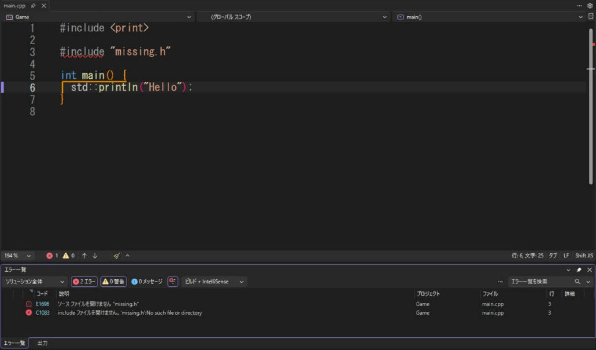
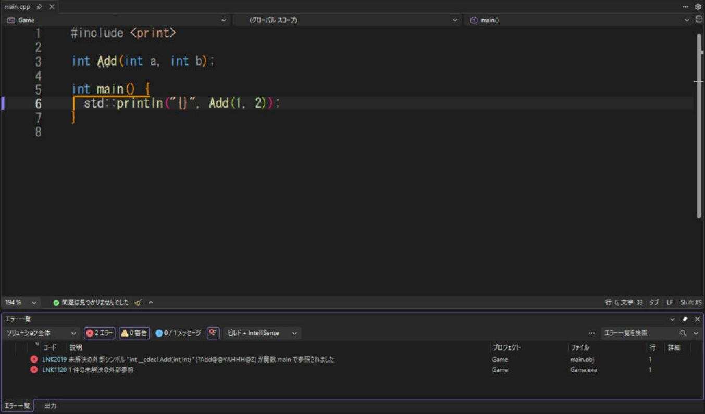

# よくあるエラー

Visual Studio（MSVC）で C++ を書いていると、**決まったエラー**によく出会います。エラーは番号（`C1083`、`LNK2019` など）で検索すると、情報がすぐ見つかります。ここでは、特によく出るものと、その直し方をまとめます。

!!! tip "ポイント"
    - エラーの<strong>一番上のもの（最初のエラー）</strong>から直す。後ろのエラーは、最初のエラーの**連鎖**であることが多い。
    - `C` で始まるエラー<strong>は、コンパイルのエラー（文法・宣言・インクルードの問題）。</strong>`LNK` で始まるエラーは、リンクのエラー（定義が見つからない・ライブラリが足りない）。
    - エラーメッセージの行番号の 1〜2 行前が原因のことが多い（`;` 忘れなど）。
    - 「出力」ウィンドウ（Ctrl + Alt + O）のほうが、「エラー一覧」より詳しい。

!!! info "このページを読む前に"
    - [vs/index.md](index.md)（このセクション全体の地図と、読む順番）
    - [インストールとプロジェクトの作成](setup.md)（Visual Studio の準備）

## エラーの種類

| 種類 | 番号 | 起きるタイミング |
| --- | --- | --- |
| コンパイル エラー | `C2xxx`, `C1xxx` | ソースコードを読んでいるとき |
| 警告 | `C4xxx` | 同上（直さなくてもビルドは通る） |
| リンク エラー | `LNKxxxx` | 作った部品をつなげているとき |
| 実行時エラー | （番号は出ない / `0xC0000005` など） | 実行しているとき |

## コンパイル エラー

### C1083：include ファイルを開けません

```text
error C1083: include ファイルを開けません。'nlohmann/json.hpp': No such file or directory
```

存在しないヘッダ `missing.h` を `#include` したときの画面です。ソースには赤い波線が付き、下の「エラー一覧」に 2 行が並びます。`E1696` はエディターの IntelliSense が出す指摘で、`C1083` が、ビルドしたときのコンパイラの本物のエラーです。同じ原因から、2 つ出ます。直すのは 1 つで、どちらも消えます。



エラー一覧の「コード」の列は、番号で検索するときに、そのまま使えます。行をダブルクリックすると、そのファイルのその行へ飛びます。

| 原因 | 直し方 |
| --- | --- |
| ライブラリが入っていない | vcpkg で入れる / ファイルを置く（[外部ライブラリの入れ方](libraries.md)） |
| **インクルードのパス**が設定されていない | C/C++ → 全般 → 追加のインクルード ディレクトリ に、ヘッダのある親フォルダーを追加 |
| 構成やプラットフォームを間違えて設定した | プロパティで「すべての構成」「x64」にして設定し直す |
| 綴りが違う、フォルダーの区切り | `#include <nlohmann/json.hpp>` のように、`/` で書く |
| 自分のヘッダを `<>` で書いた | 自分のヘッダは `#include "my.h"` のように `""` で書く |

### C2039 / C3861：'print' は 'std' のメンバーではありません

```text
error C2039: 'println': は 'std' のメンバーではありません
```

| 原因 | 直し方 |
| --- | --- |
| `#include <print>` を忘れた | 追加する |
| C++ 言語標準が古い | C++ 言語標準を ISO C++ Latest（`/std:c++latest`） にする（[設定](settings.md)） |
| Visual Studio が古い | 2022 の 17.7 以降に更新する |

### C2065：識別子が定義されていません

```text
error C2065: 'vector': 定義されていない識別子です
```

- `#include <vector>` を忘れたか、`std::vector` と書いていません。クイック アクション（Ctrl + .）が `#include` を足してくれます。

### C2143 / C2059：構文エラー

```text
error C2143: 構文エラー: ';' が '}' の前に必要です
```

- 直前の行に `;` や `)` が足りないことがほとんどです。エラーの行ではなく、その前の行を見ます。クラスや構造体の `}` の後ろの `;` 忘れも多いです。

### C4996：このバージョンの関数は非推奨です

```text
warning C4996: 'strcpy': This function or variable may be unsafe. Consider using strcpy_s instead.
```

- `strcpy` などの古い C の関数に出ます。安全な書き方に直すのが正しい対処です（`std::string`、`snprintf` → [cstring](../stl/memory/cstring.md)）
- 古いコードで、どうしても使うなら、プロパティの「プリプロセッサの定義」に `_CRT_SECURE_NO_WARNINGS` を足すと消えます（根本的な解決ではありません）

### C4819：ファイルは現在のコードページで表示できない文字を含んでいます {#mojibake}

```text
warning C4819: ファイルは、現在のコードページ (932) で表示できない文字を含んでいます。データの損失を防ぐために、ファイルを Unicode 形式で保存してください。
```

- ソースファイルが UTF-8 なのに、コンパイラが Shift_JIS として読んでいます。`/utf-8` を付けます（C/C++ → コマンド ライン → 追加のオプション、[設定](utf8.md)）

文字化けの原因の見つけ方は、[文字化けのトラブルシューティング](../encoding/mojibake.md) に、症状ごとにまとめています。

#### 画面が文字化けする（`繧ｳ繝ｳ…` や `????`）

| 症状 | 原因と直し方 |
| --- | --- |
| コンソールに `譁・ｭ怜喧縺・` のような文字が出る | ソースは UTF-8 だが、コンソールが Shift_JIS。`chcp 65001` を打つか、Windows Terminal で実行する。起動時に `SetConsoleOutputCP(CP_UTF8);` を呼ぶ方法もある（`<windows.h>`） |
| コンソールに `?` が出る | フォントが日本語に対応していない。コンソールのフォントを変える |
| 文字列が一部欠ける | `/utf-8` を付けずに、日本語を含む文字列リテラルを使っている |

### C2220 / C4244：警告がエラーになっている・型の変換の警告

```text
warning C4244: '=': 'double' から 'float' への変換です。データが失われる可能性があります
```

- `double`（`1.5`）を `float` に入れると出ます。リテラルに `f` を付ける（`1.5f`）、または `static_cast<float>()` で明示します。

## リンク エラー

リンクのエラーは、<strong>「宣言はあるが、定義（本体）が見つからない」</strong>ときに出ます。

### LNK2019：外部シンボルが未解決です

```text
error LNK2019: 未解決の外部シンボル "int __cdecl Add(int,int)" が関数 main で参照されました
```

`Add` を宣言だけして、本体を書かずにビルドしたときの画面です。ソースには波線が出ません。コンパイルは通って、最後のリンクで失敗するからです。エラー一覧の「ファイル」の列が、`main.cpp` ではなく `main.obj` になっているのが、リンクの段階のエラーだという目印です。`LNK1120` は「未解決が 1 件ある」という集計で、原因は `LNK2019` のほうに書かれています。



| 原因 | 直し方 |
| --- | --- |
| 関数の定義を書いていない（宣言だけ） | `.cpp` に本体を書く |
| 定義のある `.cpp` が、プロジェクトに入っていない | ソリューション エクスプローラーで、`.cpp` が表示されているか確認。「追加 → 既存の項目」 |
| ライブラリの `.lib` を指定していない | リンカー → 入力 → 追加の依存ファイル に、`.lib` の名前を追加（[外部ライブラリの入れ方](libraries.md)） |
| ライブラリの ディレクトリが違う | リンカー → 全般 → 追加のライブラリ ディレクトリ を確認 |
| x64 と Win32 が混ざっている | プラットフォームをそろえる。ライブラリが 32 ビット版だと、64 ビットのプロジェクトではリンクできない |
| テンプレート・`inline` 関数の定義を `.cpp` に書いた | テンプレートの本体はヘッダに書く |
| `static` メンバ変数の定義がない | クラスの外（`.cpp`）に `int Class::count = 0;` と定義を書く。または `inline static` にする |
| `main` が無い / 引数が違う | `int main()` か `int main(int argc, char* argv[])` を書く |

!!! tip "読み方"
    メッセージの `"int __cdecl Add(int,int)"` が、**見つからない関数の名前**です。この関数の**定義がどこにあるはずか**を考えます。

### LNK1104：ファイルを開くことができません

```text
error LNK1104: ファイル 'mylib.lib' を開くことができません。
```

- 追加の依存ファイルに書いた `.lib` が、ライブラリ ディレクトリの中に見つからない。ファイル名と、ディレクトリのパス（`$(Configuration)` の使い方）を確認します。

### LNK2001：外部シンボルが未解決です

- LNK2019 とほぼ同じです。`static` 変数や、`extern` した変数の定義が無いときに出ます。

### LNK2005：すでに定義されています

```text
error LNK2005: "int g_count" は既に main.obj で定義されています
```

| 原因 | 直し方 |
| --- | --- |
| ヘッダに変数や関数の定義を書いた（複数の `.cpp` が include して、重複した） | ヘッダには宣言だけを書く。変数は `inline` にする（C++17）、関数は `inline` を付ける |
| 同じ `.cpp` を 2 回追加した | プロジェクトの重複を消す |
| ランタイム ライブラリが混ざっている | 次の LNK2038 / LNK4098 を確認 |

### LNK2038：不一致が検出されました {#runtime_library}

```text
error LNK2038: '_ITERATOR_DEBUG_LEVEL' の不一致が検出されました: 値 '0' は値 '2' と一致しません
error LNK2038: 'RuntimeLibrary' の不一致が検出されました: 値 'MD_DynamicRelease' は値 'MDd_DynamicDebug' と一致しません
```

- Debug 用のライブラリと Release 用のライブラリを混ぜています。 ライブラリごとに、Debug と Release の `.lib` が別々にあり、ビルド構成と合ったものを使う必要があります
- ランタイム ライブラリ（C/C++ → コード生成）の /MD、/MDd、/MT、/MTd を、ライブラリとプロジェクトで同じにします

| 構成 | DLL 版 | 静的版 |
| --- | --- | --- |
| Debug | `/MDd` | `/MTd` |
| Release | `/MD` | `/MT` |

vcpkg の `x64-windows`（DLL）なら `/MD` / `/MDd`、`x64-windows-static` なら `/MT` / `/MTd` です。

### LNK4098 / LNK4272

- `LNK4098`: 既定のライブラリ（`MSVCRT`）が、他のライブラリと衝突しています。ランタイム ライブラリを統一します
- `LNK4272`: 「ライブラリ コンピューターの種類 'x86' は、ターゲット コンピューターの種類 'x64' と競合しています」。ライブラリが 32 ビット版です。64 ビット版を使います

## 実行時のエラー

### 〜.dll が見つからないため、コードの実行を続行できません

- 必要な **DLL が、exe と同じフォルダーにありません**。DLL を `exe` の横にコピーします（ビルド後イベントで自動化できます → [外部ライブラリの入れ方](libraries.md#lib_dll)）
- vcpkg なら、`x64-windows` で入れたライブラリの DLL は、ビルド時に自動でコピーされます

### 0xc000007b：アプリケーションを正しく起動できませんでした

- 32 ビットと 64 ビットが混ざっています。 64 ビットの exe が、32 ビットの DLL を読もうとしています（またはその逆）。DLL を同じビット数のものにします

### アクセス違反（0xC0000005）

```text
例外がスローされました: 読み取りアクセス違反。 this は 0x0 でした。
```

- `nullptr` を使った<strong>か、</strong>解放されたメモリ<strong>を触りました。</strong>呼び出し履歴で、自分のコードの一番上を見ます（[デバッグ](debugging.md)）
- `this は nullptr でした` なら、`nullptr` のポインタのメンバ関数を呼んでいます。そのポインタを作った場所を探します

### スタック オーバーフロー（0xC00000FD）

- 再帰が止まらないか、大きな配列をローカル変数にしています（`int a[1000000];` は、スタックに載りきりません）。配列は `std::vector` にします

### デバッグ アサーションに失敗しました

```text
Debug Assertion Failed! Expression: vector subscript out of range
```

- Debug 構成の標準ライブラリが、範囲外アクセスなどを見つけて教えてくれています。呼び出し履歴で、`operator[]` を呼んだ自分のコードを見ます。Release では黙って壊れるので、見つかったのは幸運です

### The program '[...] exe' has exited with code -1073740791 (0xc0000409)

- スタックの破壊、または `std::terminate`（捕まえていない例外）です。例外設定（Ctrl + Alt + E）で、例外が投げられた瞬間に止めて、原因を探します。

## ビルドが遅い・止まる

| 症状 | 対処 |
| --- | --- |
| ビルドがとても遅い | 「C/C++ → 全般 → 複数プロセッサによるコンパイル」を <strong>はい (/MP)</strong> に。ヘッダの include を減らす（前方宣言）。プリコンパイル済みヘッダを使う |
| 変更していないのに毎回全部ビルドされる | ヘッダの日付が未来になっていないか確認。`vcpkg` のマニフェスト モードで毎回インストールされていないか確認 |
| 「ファイルを開けません: 〜.exe」 | 前回の実行が終了していない（ゲームのウィンドウが残っている）。タスク マネージャーで終了する |
| 「PDB が開けません」 | 実行中のプログラムが PDB を使っている。終了してからビルドする |
| ソリューションが開かない | `.vs` フォルダーを削除して開き直す |

## 質問するときに書くこと

エラーを人に聞くとき（または検索するとき）は、次を伝えると、すぐ答えが返ってきます。

1. **エラーメッセージの全文**（番号つき。画面の写真ではなく、テキストで）
2. Visual Studio のバージョンと、C++ 言語標準
3. エラーが出るコード（短くして、そこだけでエラーが出る形にする）
4. 構成とプラットフォーム（Debug / Release、x64）
5. 外部ライブラリが関係するなら、入れ方（vcpkg か、手動か）

## 関連ページ

- [外部ライブラリの入れ方](libraries.md)
- [C++23 を使えるようにする設定](settings.md)
- [デバッグのやり方](debugging.md)
- [Visual Studio の目次](index.md)
