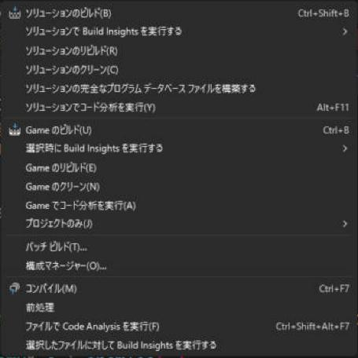
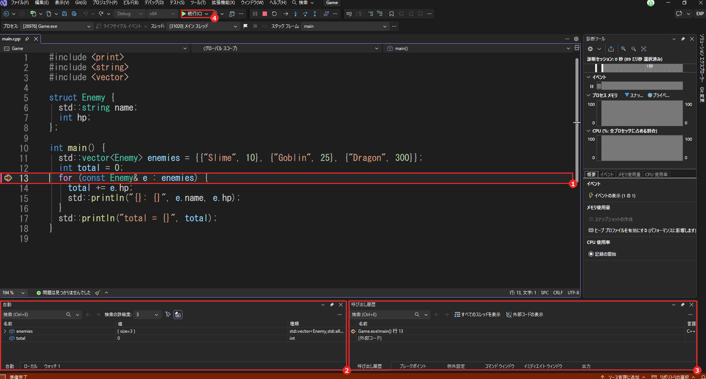

# 最初の一歩：ビルドして、実行して、止める

プロジェクトを作って `main` を書いたら、次にやることは「動かす」です。ところが、初めての人は、ここで 3 つ迷います。「ビルド」と「実行」は何が違うのか。F5 と Ctrl + F5 は何が違うのか。止まったときに、どこを見ればよいのか。

このページは、画面の見方と、この 3 つの迷いどころを、最短で通ります。詳しい話は、各ページへのリンクで先に進めます。

!!! tip "ポイント"
    - 上のツールバーで、構成を `Debug`、プラットフォームを `x64` にしてから動かす
    - ビルドは「実行ファイルを作る」こと。実行は「作ったものを動かす」こと。F5 や Ctrl + F5 は、必要ならビルドしてから実行する
    - 普段は F5（デバッグあり）。出力だけ見たいときは Ctrl + F5（デバッグなし）
    - 動かない・止まるときは、「エラー一覧」と「出力」を見る。止めて中身を見たいときは、ブレークポイントを置く

!!! info "このページを読む前に"
    - [インストールとプロジェクトの作成](setup.md)（プロジェクトができていること）
    - [C++23 を使えるようにする設定](settings.md)（`std::println` が動くこと）

## ツールバーを確かめる {#toolbar}

画面の上のツールバーに、動かし方を決める 3 つの部品があります。

1. <strong>構成</strong>: `Debug` と `Release` を切り替える。開発中は `Debug`。デバッグに必要な情報が入り、ブレークポイントで止められる
2. <strong>プラットフォーム</strong>: `x64` にする。今の Windows の標準で、このサイトの設定もすべて x64 を前提にしている
3. <strong>開始ボタン</strong>: 緑の三角。押すと、デバッグありで実行する（F5 と同じ）

構成とプラットフォームを変えると、プロパティの設定が別々に持たれます。設定を変えたのに効かないときは、画面の構成がそのときの設定と同じかを確かめてください（[構成](terms/configuration.md)、[プラットフォーム](terms/platform.md)）。

## ビルドする {#build}

メニューの「ビルド」から、「ソリューションのビルド」（Ctrl + Shift + B）を選びます。ソースコードをコンパイルしてリンクし、実行ファイル（`.exe`）を作る操作です（[ビルド](terms/build.md)）。

結果は、画面下の「出力」と「エラー一覧」に出ます。成功すると、「出力」に `ビルド: 1 正常終了` のような行が出ます。失敗すると、「エラー一覧」に赤いエラーが並びます。

エラーの行をダブルクリックすると、その行へ飛びます。1 つ目のエラーだけを見てください。2 つ目以降は、1 つ目の影響で出ていることがよくあります（[エラーメッセージの読み方](error-messages.md)、[よくあるエラー](errors.md)）。

## 実行する：F5 と Ctrl + F5 {#run}

実行の仕方は 2 つあります。

- <strong>F5（デバッグ開始）</strong>: デバッガーを付けて実行する。ブレークポイントで止まり、変数の中身を見られる。普段はこちら
- <strong>Ctrl + F5（デバッグなしで開始）</strong>: デバッガーなしで実行する。終わったあとにコンソールが「続行するには何かキーを押してください」と待ってくれるので、出力を落ち着いて読める。少し速い

コンソール アプリで F5 を押すと、コンソールが一瞬開いて、すぐ閉じることがあります。プログラムが終わったので、閉じただけです。出力を読みたいときは、Ctrl + F5 を使うか、ブレークポイントを `main` の最後の行に置きます。

実行しようとすると、「ビルドが古い」と聞かれたり、自動でビルドされたりします。ソースを直したあとは、F5 を押すだけで、ビルドして実行まで進みます。

## 止めて、中身を見る：ブレークポイント {#break}

「動いたけれど、値が思ったとおりにならない」。そんなときは、実行を途中で止めて、変数の中身を見ます。止めたい行の左の余白をクリックすると、赤い丸（ブレークポイント）が付きます。そのまま F5 で実行すると、その行の手前で止まります。

1. <strong>黄色の矢印</strong>: 次に実行する行。まだ実行していない
2. <strong>自動ウィンドウ</strong>: 近くの変数の名前と値。ここでは `enemies` の要素が 3 つで、`total` が 0
3. <strong>呼び出し履歴</strong>: いま、どの関数が、どの関数から呼ばれているか
4. <strong>続行</strong>: 次のブレークポイントまで、実行を再開する

1 行ずつ進めるには、F10（ステップ オーバー）を押します。関数の中に入るときは、F11（ステップ イン）です。止めるのは、Shift + F5 です。操作の詳しい説明は、[デバッグのやり方](debugging.md)にあります。

## つまずいたとき {#trouble}

- <strong>`std::println` が使えない</strong>: C++23 の設定がまだです。[C++23 を使えるようにする設定](settings.md)を先に済ませてください
- <strong>`.exe` が見つからない、起動しない</strong>: スタートアップ プロジェクトが、実行したいプロジェクトになっているかを確かめます（ソリューション エクスプローラーで太字のもの）
- <strong>日本語が化ける</strong>: [文字コードを UTF-8 にしよう](utf8.md)
- <strong>リンカーのエラー（`LNK` で始まる番号）</strong>: [よくあるエラー](errors.md)

## これだけ覚える {#summary}

- 構成は Debug、プラットフォームは x64
- ビルドは「作る」、実行は「動かす」。F5 はデバッグあり、Ctrl + F5 はなし
- 値を見たいときは、ブレークポイントで止めて、自動ウィンドウを見る
- エラーは、1 つ目だけ見る

## 関連ページ {#related}

- [デバッグのやり方](debugging.md)
- [ビルド](terms/build.md)
- [よくあるエラー](errors.md)
