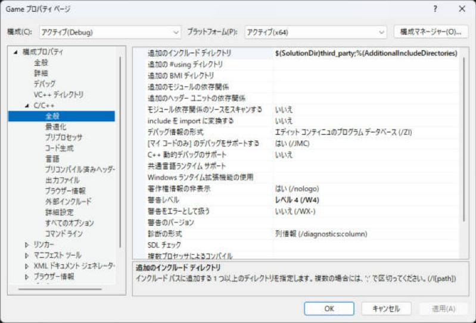
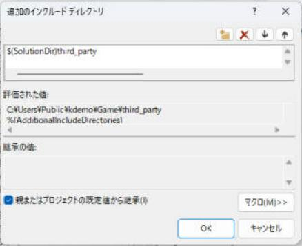
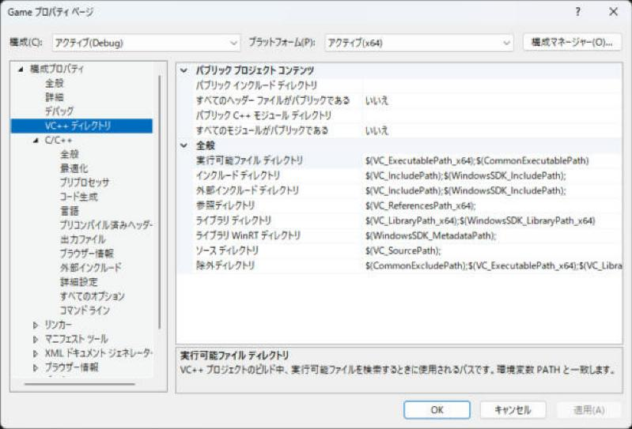
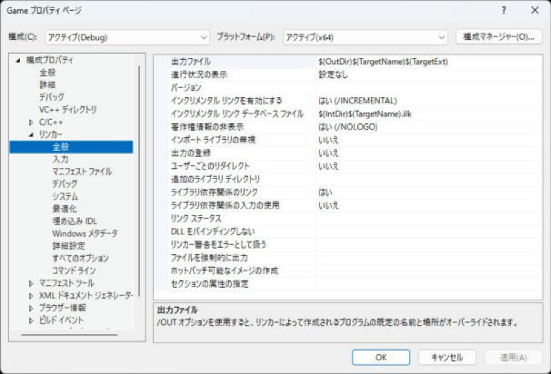
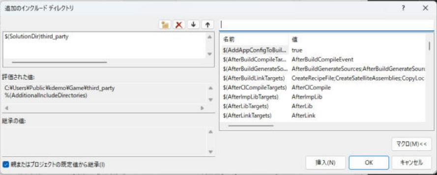

# インクルード ディレクトリとマクロ

`#include "foo.h"` と書いたとき、コンパイラは**どのフォルダーから `foo.h` を探すか**を知っている必要があります。その探す場所の一覧がインクルード ディレクトリです。Visual Studio では、プロジェクトのプロパティで追加します。パスを書くときは、`$(SolutionDir)` のようなマクロを使うと、フォルダーの場所が変わっても壊れません。このページでは、追加のインクルード ディレクトリの設定と、パスに使えるマクロをまとめます。

!!! tip "ポイント"
    - 追加するのは <strong>C/C++ → 全般 → 追加のインクルード ディレクトリ</strong>。複数あるときは `;` で区切る
    - パスは<strong>絶対パスで書かず</strong>、`$(SolutionDir)` や `$(ProjectDir)` を使う。他の人の PC でも、そのままビルドできる
    - Visual Studio のマクロは `%VAR%` ではなく `$(マクロ名)` の形で書く
    - 何が入るか分からないときは、プロパティ画面の入力欄で「編集」→「マクロ」ボタンを押すと、使えるマクロと、現在の値の一覧が出る
    - 外部ライブラリのヘッダは「外部インクルード ディレクトリ」に入れると、警告が出なくなる
    - 設定するときは、構成（Debug / Release）とプラットフォーム（x64）が合っているか確認する

## このページを読む前に

- [プロジェクト（.vcxproj）](terms/project.md)
- [構成（Configuration）](terms/configuration.md)

## ヘッダはどこから探されるか {#search}

`#include` の書き方で、探し始める場所が変わります。

| 書き方 | 探す順番 |
| --- | --- |
| `#include "foo.h"` | ① **今のファイルがあるフォルダー** → ② 追加のインクルード ディレクトリ → ③ 外部インクルード ディレクトリ → ④ 標準のフォルダー |
| `#include <foo.h>` | ② 追加のインクルード ディレクトリ → ③ 外部インクルード ディレクトリ → ④ 標準のフォルダー（今のファイルのフォルダーは見ない） |

自分のプロジェクトのヘッダは `""`、標準ライブラリや外部ライブラリは `<>` で書く、と分けておくと迷いません。どこにも見つからないと、`C1083: include ファイルを開けません` になります（[よくあるエラー](errors.md)）。

## 追加のインクルード ディレクトリを設定する {#additional}

1. ソリューション エクスプローラーで、プロジェクトを選んで、メニューの<strong>プロジェクト → プロパティ</strong>を開く（プロジェクトを右クリック → プロパティ、でも同じ）
2. 上の構成を「すべての構成」、プラットフォームを「x64」にする
3. 左の一覧で C/C++ → 全般 を選び、「追加のインクルード ディレクトリ」の右端の ▼ から「<編集...>」を選ぶ
4. 新しい行を足して、パスを書く


プロパティ ページは、左に設定のグループ、右に項目が並ぶ画面です。上の「構成」と「プラットフォーム」がいま編集している対象を表します。



項目の右端にある ▼ を押すと、メニューが出ます。「<編集...>」を選ぶと、1 行に 1 つずつ書ける専用の画面が開きます。




上の欄に書いたマクロが実際のどのパスになるかは、その下の「評価された値」に出ます。ここで、意図したフォルダーになっているかを確かめます。

```text
$(SolutionDir)third_party;$(ProjectDir)include;%(AdditionalIncludeDirectories)
```

| 項目 | 説明 |
| --- | --- |
| `;` 区切り | 複数のフォルダーを並べるときの区切り（編集画面では 1 行に 1 つ書く） |
| `%(AdditionalIncludeDirectories)` | プロパティ シートなど、上位の設定を引き継ぐ。消さない |
| 相対パス | プロジェクト（`.vcxproj`）のあるフォルダーが基準。`..\third_party` のように書ける |
| 末尾の `\` | あってもなくても動く。マクロの値は、末尾に `\` が付くものが多い |

この設定は、コンパイラのオプション `/I` になります。

```text
cl /I C:\proj\third_party /I C:\proj\Engine\include main.cpp
```

### 外部インクルード ディレクトリ {#external}

外部ライブラリのヘッダは、自分では直せないので、警告が大量に出ると困ります。VC++ ディレクトリ → 外部インクルード ディレクトリに入れると、そこのヘッダの警告が出なくなります（コンパイラのオプションは `/external:I`）。


使い方は [外部ライブラリの入れ方](libraries.md#external_include) にもあります。

| 設定場所 | 警告 | 使いどころ |
| --- | --- | --- |
| C/C++ → 全般 → 追加のインクルード ディレクトリ | 出る | 自分のヘッダ |
| VC++ ディレクトリ → 外部インクルード ディレクトリ | 出ない | 外部ライブラリのヘッダ |

### ライブラリ ディレクトリも同じ形 {#lib}

`.lib` を探す場所は、リンカー → 全般 → 追加のライブラリ ディレクトリ（`/LIBPATH`）です。書き方はインクルードと同じで、`$(SolutionDir)third_party\lib\$(Platform)` のようにマクロが使えます。




## パスに使えるマクロ {#macros}

マクロは `$(名前)` で書き、ビルドのときに、その場の値に置き換えられます。プロパティの文字列欄なら、どこでも使えます。

| マクロ | 意味 | 値の例 |
| --- | --- | --- |
| `$(SolutionDir)` | `.sln` があるフォルダー（末尾に `\` が付く） | `C:\proj\Prest\` |
| `$(SolutionName)` | ソリューション名 | `Prest` |
| `$(ProjectDir)` | `.vcxproj` があるフォルダー（末尾に `\` が付く） | `C:\proj\Prest\Engine\` |
| `$(ProjectName)` | プロジェクト名 | `Engine` |
| `$(TargetName)` | 出力ファイル名（拡張子なし） | `Engine` |
| `$(Configuration)` | 構成名 | `Debug` / `Release` |
| `$(Platform)` | プラットフォーム名 | `x64` |
| `$(OutDir)` | 出力ディレクトリ | `C:\proj\Prest\bin\x64\Debug\` |
| `$(IntDir)` | 中間ディレクトリ（`.obj` が置かれる） | `C:\proj\Prest\Engine\obj\x64\Debug\` |
| `$(VCInstallDir)` | Visual C++ のインストール先 | |
| `$(WindowsSdkDir)` | Windows SDK のフォルダー | |

`$(OutDir)` と `$(IntDir)` の値は、プロジェクトの設定で変わるので、上の値は一例です。

### マクロの一覧を見る {#show-macros}

マクロの名前を覚えておく必要はありません。

1. パスを書く入力欄を選んで、右端の ▼ から「<編集...>」を選ぶ
2. 開いた画面の右下にある<strong>「マクロ(M)>>」</strong>ボタンを押す
3. 画面が右に広がって、使える全マクロと、現在の値の一覧が出る。上の検索欄に名前の一部を打つと絞り込める。選んで「挿入」を押すと、書いていた欄に入る



環境変数も、`$(名前)` で読めます（たとえば `$(USERPROFILE)`）。同じ名前のマクロがあるときは、マクロが優先されます。

### 使用例 {#examples}

| やりたいこと | 書き方 |
| --- | --- |
| ソリューション直下の `third_party` をインクルードに足す | `$(SolutionDir)third_party` |
| 自分のプロジェクトの `include` フォルダーを足す | `$(ProjectDir)include` |
| 出力を構成ごとのフォルダーに分ける（出力ディレクトリ） | `$(SolutionDir)bin\$(Platform)\$(Configuration)\` |
| 中間ファイルをプロジェクトごとに分ける（中間ディレクトリ） | `$(SolutionDir)obj\$(ProjectName)\$(Platform)\$(Configuration)\` |
| ライブラリを構成ごとに使い分ける（追加の依存ファイル） | `mylib_$(Configuration).lib` |
| 実行時に `assets` フォルダーを出力先へコピー（ビルド後イベント） | `xcopy /Y /E /I "$(ProjectDir)assets" "$(OutDir)assets"` |
| デバッグ時の作業ディレクトリをプロジェクトにそろえる | `$(ProjectDir)` |

出力ディレクトリを `$(Platform)\$(Configuration)\` で分けておくと、Debug と Release の `.exe` や `.lib` が混ざりません。ライブラリの Debug 用と Release 用を `mylib_Debug.lib` のように分けているとき、`$(Configuration)` で 1 行にまとめられます。

## 複数のプロジェクトにまとめて設定する {#props}

同じインクルード ディレクトリをソリューションの全プロジェクトに足したいときは、プロパティ シートを使います。

`Directory.Build.props` を `.sln` と同じフォルダーに置くと、配下の全プロジェクトに自動で適用されます。

```xml
<Project>
  <ItemDefinitionGroup>
    <ClCompile>
      <AdditionalIncludeDirectories>$(SolutionDir)third_party;%(AdditionalIncludeDirectories)</AdditionalIncludeDirectories>
    </ClCompile>
  </ItemDefinitionGroup>
</Project>
```

プロパティ シートの考え方は [C++23 を使えるようにする設定](settings.md) と [プリプロセッサマクロ](preprocessor.md) にあります。

## よくあるミス

??? failure "別の構成に設定していて、ビルドで見つからない"
    プロパティ画面の上にある**構成**が「Debug」のままだと、Release でビルドしたときに設定が効きません。「すべての構成」にしてから入力します。`x64` と `Win32` も同じです。

??? failure "`%(AdditionalIncludeDirectories)` を消してしまった"
    引き継ぎの記述を消すと、上位（プロパティ シートや既定値）で足していたフォルダーがすべて外れます。編集画面で、「親または既定の設定から継承」のチェックを残してください。

??? failure "絶対パスで書いて、他の人の PC でビルドできない"
    `C:\Users\自分の名前\...` と書くと、その PC でしか動きません。`$(SolutionDir)` や相対パスにします。

??? failure "`$(SolutionDir)` のあとにも `\` を付けて、`\\` になる"
    `$(SolutionDir)` は、すでに末尾に `\` が付いています。`$(SolutionDir)\third_party` と書いても動くことが多いですが、文字列として比べるときに、食い違います。`$(SolutionDir)third_party` と書くのが基本です。

??? failure "`#include <foo.h>` で自分のヘッダが見つからない"
    `<>` は、今のファイルのフォルダーを探しません。自分のヘッダは `""` で書くか、そのフォルダーを追加のインクルード ディレクトリに入れます。

## これだけ覚える

- 追加するのは <strong>C/C++ → 全般 → 追加のインクルード ディレクトリ</strong>。パスは `$(SolutionDir)` や `$(ProjectDir)` で書く
- マクロの一覧は、入力欄の「編集」→「マクロ」で見られる
- 外部ライブラリのヘッダは、外部インクルード ディレクトリに入れる
- 構成とプラットフォームを設定の前に確認する

## 関連ページ

- [外部ライブラリの入れ方](libraries.md)
- [C++23 を使えるようにする設定](settings.md)
- [プリプロセッサマクロ](preprocessor.md)
- [プロジェクトの種類とエントリーポイント](project-types.md)
- [よくあるエラー](errors.md)
