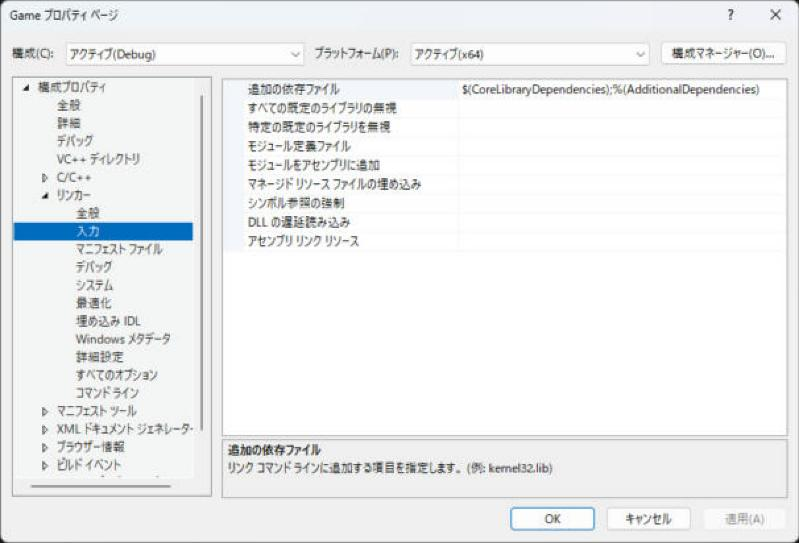

# 外部ライブラリの入れ方

C++ には、Python の `pip` や Node.js の `npm` のような「標準のパッケージ管理」がありません。そのため、**ライブラリごとに入れ方が違います**。Visual Studio では、次の 3 つのどれかを使います。この [外部ライブラリ](../libs/index.md) のカテゴリの各ページは、最初に Visual Studio での入れ方を書いていて、この基本を前提にしています。

!!! tip "ポイント"
    - 迷ったら **vcpkg**。`vcpkg install ライブラリ名:x64-windows` と**1 回打つだけ**で、`#include` できるようになる。
    - ヘッダだけのライブラリ（nlohmann/json、zpp_bits、cista など）は、ファイルを置いて「追加のインクルード ディレクトリ」を設定するだけでもよい。
    - `.lib` / `.dll` を配るライブラリは、インクルードのパス + ライブラリのパス + 追加の依存ファイル の 3 つを設定する。
    - ライブラリはプラットフォーム（x64）と構成（Debug / Release）に合ったものを使う。ここがずれるとリンクエラーになる。
    - 設定を変えるときは、構成を「すべての構成」、プラットフォームを「x64」にしてから変える。

!!! info "このページを読む前に"
    - [vs/index.md](index.md)（このセクション全体の地図と、読む順番）
    - [インストールとプロジェクトの作成](setup.md)（Visual Studio の準備）

## どの方法を使うか

| 方法 | 向いているライブラリ | 手間 | 管理のしやすさ |
| --- | --- | --- | --- |
| <strong>[1. ヘッダを置く](#header_only)</strong> | ヘッダだけで使えるもの | 少ない | ○（フォルダーを Git に入れられる） |
| [2. vcpkg](#vcpkg) | たいていのライブラリ（vcpkg に入っているもの） | 少ない | ◎（バージョンも管理できる） |
| [3. .lib / .dll を使う](#lib_dll) | 配布されているビルド済みのもの、自分でビルドしたもの | 多い | △ |
| [4. ソースごとプロジェクトに入れる](#add_source) | `.cpp` が少ないライブラリ（simdjson など） | 中 | ○ |
| [5. CMake の FetchContent](cmake.md) | CMake のプロジェクト | 中 | ◎ |

## 1. ヘッダだけのライブラリを置く {#header_only}

**ヘッダだけ**（`.hpp` / `.h` だけ）のライブラリは、ファイルを置いて、インクルードのパスを教えるだけで使えます。

1. ライブラリのヘッダをプロジェクトの横の `third_party/ライブラリ名/` に置く（Git から取得、または ZIP を展開）

```text
MyGame/
├── MyGame.sln
├── MyGame/
│   └── main.cpp
└── third_party/
    └── nlohmann/
        └── json.hpp          ← #include <nlohmann/json.hpp> で使いたい
```

2. プロジェクトのプロパティ → C/C++ → 全般 → 追加のインクルード ディレクトリ に、`$(SolutionDir)third_party` を追加
3. これで `#include <nlohmann/json.hpp>` が使える

`$(SolutionDir)` は、ソリューション（`.sln`）があるフォルダーを表すマクロです。絶対パスを書かなくてよいので、チームで共有しても動きます。

| よく使うマクロ | 意味 |
| --- | --- |
| `$(SolutionDir)` | ソリューションのフォルダー（最後に `\` が付く） |
| `$(ProjectDir)` | プロジェクトのフォルダー |
| `$(Configuration)` | `Debug` または `Release` |
| `$(Platform)` | `x64` など |
| `$(OutDir)` | 出力ディレクトリ |

### 外部ヘッダの警告を消す {#external_include}

外部ライブラリのヘッダは、自分が書いたものではないので、警告が大量に出ても直せません。外部インクルード ディレクトリとして登録すると、その中のヘッダの警告を無効にできます（MSVC 17.x 以降）。

1. C/C++ → 全般 → 追加のインクルード ディレクトリ ではなく、
2. VC++ ディレクトリ → 外部インクルード ディレクトリ に `$(SolutionDir)third_party` を追加
3. C/C++ → 全般 → 外部ヘッダーの警告レベル を レベル 0 にする

## 2. vcpkg で入れる {#vcpkg}

<strong>vcpkg（ブイシーピーケージー）</strong> は、Microsoft が作っている C++ のパッケージ管理ツールです。ライブラリのダウンロード、ビルド、パスの設定をまとめてやってくれます。

### 準備（最初に 1 回だけ）

Visual Studio Installer で、「vcpkg パッケージ マネージャー」 のコンポーネントにチェックが入っていることを確認します（[インストール](setup.md)）。

次に、「Developer PowerShell for VS」（スタートメニューから開く。または Visual Studio のメニュー → 表示 → ターミナル）で、次を打ちます。

```powershell
vcpkg integrate install
```

これで、ビルド時に vcpkg のライブラリが自動で見つかるようになります（ユーザー全体の設定。1 回やれば、すべてのプロジェクトで有効です）。

!!! note "vcpkg が見つからないとき"
    Visual Studio に入っている vcpkg は、Developer PowerShell から使えます。見つからないときは、[vcpkg を GitHub から取得](https://github.com/microsoft/vcpkg) して（`git clone` → `bootstrap-vcpkg.bat`）、そのフォルダーの `vcpkg.exe` を使います。

### 方法 A：クラシック モード（全プロジェクトで共有）

```powershell
vcpkg install nlohmann-json:x64-windows
```

- `:x64-windows` は トリプレット（どの環境向けにビルドするか）です。普通は `x64-windows`（DLL を使う）か `x64-windows-static`（`.lib` に入れて、DLL を配らなくてよい）
- インストールしたら、プロジェクトでは何も設定せずに `#include <nlohmann/json.hpp>` が使えます（`integrate install` のおかげ）
- ライブラリの一覧は `vcpkg search キーワード`、インストール済みは `vcpkg list`

### 方法 B：マニフェスト モード（プロジェクトごとに管理）

プロジェクトのフォルダーに `vcpkg.json`<strong> というファイルを置くと、</strong>そのプロジェクトが使うライブラリをファイルで管理できます。Git に入れておけば、チームの全員が同じライブラリ・同じバージョンで動かせます。

1. プロジェクト（`.vcxproj` と同じ場所）に `vcpkg.json` を作る

```json
{
  "name": "mygame",
  "version": "0.1.0",
  "dependencies": [
    "nlohmann-json",
    "simdjson",
    "cereal"
  ]
}
```

2. プロジェクトのプロパティに「vcpkg」のページがあれば、Use Vcpkg Manifest を はい にする（`vcpkg integrate install` 済みなら、自動で有効なことが多い）。プロパティの一覧に「vcpkg」が出ない環境もあります（この画面の `C/C++`・`リンカー` などの並びに、無ければ、そのままビルドして、出力に vcpkg の経過が出るかで確かめます）
3. ビルドすると、`vcpkg.json` に書いたライブラリが自動でダウンロード・ビルドされる（最初は時間がかかる）

| 設定（プロパティ → vcpkg） | 意味 |
| --- | --- |
| Use Vcpkg | vcpkg を使う（はい） |
| Use Vcpkg Manifest | `vcpkg.json` を使う（はい） |
| Triplet | `x64-windows` など。空なら自動 |
| Use Static Libraries | `x64-windows-static` 系を使う（DLL を配らなくてよくなる） |

!!! warning "ランタイム ライブラリをそろえる"
    `x64-windows-static` を使うなら、プロジェクトの C/C++ → コード生成 → ランタイム ライブラリ を `/MT`（Debug は `/MTd`）にします。`x64-windows`（DLL）なら `/MD`（Debug は `/MDd`）です。そろっていないと `LNK2038`（RuntimeLibrary の不一致）が出ます（[よくあるエラー](errors.md#runtime_library)）。

### vcpkg に入っているライブラリの名前

| このサイトで解説しているもの | vcpkg の名前 |
| --- | --- |
| nlohmann/json | `nlohmann-json` |
| simdjson | `simdjson` |
| rapidyaml | `ryml` |
| cereal | `cereal` |
| zpp_bits | `zpp-bits` |
| yalantinglibs（struct_pack） | `yalantinglibs` |
| cista | `cista` |
| Dear ImGui | `imgui`（バックエンドは `imgui[win32-binding,dx11-binding]` のように指定） |
| ImGuizmo | `imguizmo` |
| imgui-node-editor | `imgui-node-editor`（ポート名は `vcpkg search` で確認） |
| Jolt Physics | `joltphysics` |

名前は `vcpkg search キーワード` で確認します。ポートによってバージョンが違うことがあります。

## 3. .lib と .dll を使う {#lib_dll}

ビルド済みのライブラリ（`.lib` と `.dll` が配られているもの、自分でビルドしたもの）は、**3 つの設定**が必要です。

| ファイルの種類 | 役割 |
| --- | --- |
| ヘッダ（`.h`） | 関数や型の宣言。コンパイル時に必要 |
| `.lib`（インポート ライブラリ / 静的ライブラリ） | リンク時に必要。静的ライブラリなら中身が `.exe` に入る |
| `.dll` | 実行時に必要。`.exe` と同じフォルダーに置く |

```text
third_party/
└── mylib/
    ├── include/
    │   └── mylib.h
    └── lib/
        └── x64/
            ├── Debug/
            │   ├── mylib.lib
            │   └── mylib.dll
            └── Release/
                ├── mylib.lib
                └── mylib.dll
```

### 設定の手順

構成を すべての構成、プラットフォームを x64 にしてから、次の 3 つを設定します。

| 手順 | 場所 | 入れる値 |
| --- | --- | --- |
| ① ヘッダの場所 | C/C++ → 全般 → 追加のインクルード ディレクトリ | `$(SolutionDir)third_party\mylib\include` |
| ② `.lib` の場所 | リンカー → 全般 → 追加のライブラリ ディレクトリ | `$(SolutionDir)third_party\mylib\lib\x64\$(Configuration)` |
| ③ `.lib` の名前 | リンカー → 入力 → 追加の依存ファイル | `mylib.lib` |

① は、C/C++ → 全般 のページです。ヘッダの探し方は [インクルード ディレクトリとマクロ](include-dirs.md#additional) に画面つきで書いています。


② は、リンカー → 全般 のページの「追加のライブラリ ディレクトリ」です。


③ は、リンカー → 入力 のページです。先頭の「追加の依存ファイル」に `.lib` の名前を足します。最初から入っている `$(CoreLibraryDependencies);%(AdditionalDependencies)` は、消さずに、`;` で区切って後ろに足します。



- ② の `$(Configuration)` を使うと、Debug のときは Debug の `.lib`、Release のときは Release の `.lib` が自動で選ばれます
- Debug と Release で `.lib` の名前が違う場合（`mylibd.lib` など）は、構成を個別に選んで、③ をそれぞれ設定します

### DLL を実行ファイルの横にコピーする

`.dll` は、実行したときに見つからないと `〜.dll が見つからないため、コードの実行を続行できません` というエラーになります。ビルド後にコピーする設定をしておくと楽です。

| 場所 | 入れる値 |
| --- | --- |
| ビルド イベント → ビルド後イベント → コマンド ライン | `xcopy /y /d "$(SolutionDir)third_party\mylib\lib\x64\$(Configuration)\*.dll" "$(OutDir)"` |

### ソースコードで .lib を指定する方法

プロジェクトの設定ではなく、ソースに書く方法もあります（MSVC 専用）。

```cpp
#pragma comment(lib, "mylib.lib")  // この .lib をリンクする
```

## 4. .cpp ごとプロジェクトに入れる {#add_source}

[simdjson](../libs/serialization/simdjson.md) のように、**ヘッダ 1 つと `.cpp` 1 つ**で済むライブラリは、両方をプロジェクトに追加するのが一番簡単です。

1. `simdjson.h` と `simdjson.cpp` を `third_party/simdjson/` に置く
2. ソリューション エクスプローラーで、プロジェクトを右クリック → 追加 → 既存の項目 で、両方を追加
3. 追加のインクルード ディレクトリ に `$(SolutionDir)third_party\simdjson` を追加

`.cpp` が追加されたので、そのライブラリのコードもいっしょにコンパイルされ、リンクの設定はいりません。

!!! warning ".cpp が大きいライブラリは Release の速度に注意"
    ライブラリの `.cpp` もプロジェクトの設定（Debug は最適化なし）でコンパイルされます。速さを測るときは、Release で測ります。

## ライブラリを入れたあとの確認

どの方法でも、**短いプログラムで、`#include` してビルドできるか**を確認します。

```cpp
#include <print>

#include <nlohmann/json.hpp>

int main() {
  nlohmann::json j = {{"name", "Alice"}, {"hp", 100}};
  std::println("{}", j.dump());
}
```

| 出るエラー | 原因 |
| --- | --- |
| `C1083: include ファイルを開けません` | インクルードのパスが違う / ライブラリが入っていない |
| `LNK2019: 外部シンボルが未解決` | `.lib` を指定していない / プラットフォームや構成が違う |
| `LNK1104: ファイル 'xxx.lib' を開けません` | ライブラリのディレクトリが違う / ファイル名が違う |
| `〜.dll が見つかりません`（実行時） | DLL を exe の横にコピーしていない |

詳しくは [よくあるエラー](errors.md) を見てください。

## ライブラリの入れ方の目安

| ライブラリの形 | 一番楽な方法 |
| --- | --- |
| vcpkg にある | **vcpkg**（マニフェスト モード） |
| ヘッダだけ | `third_party/` に置いて、インクルードのパスを足す |
| `.cpp` が 1〜数個 | ソースごとプロジェクトに追加 |
| ビルド済みの `.lib` / `.dll` | 3 つの設定 + ビルド後イベントで DLL をコピー |
| 大きくて CMake で配布されている（Jolt Physics など） | vcpkg、または CMake でビルドして `.lib` を使う |

## 関連ページ

- [外部ライブラリの目次](../libs/index.md)
- [C++23 を使えるようにする設定](settings.md)
- [よくあるエラー](errors.md)
- [CMake で使う](cmake.md)
- [vcpkg 公式ドキュメント](https://learn.microsoft.com/ja-jp/vcpkg/)
