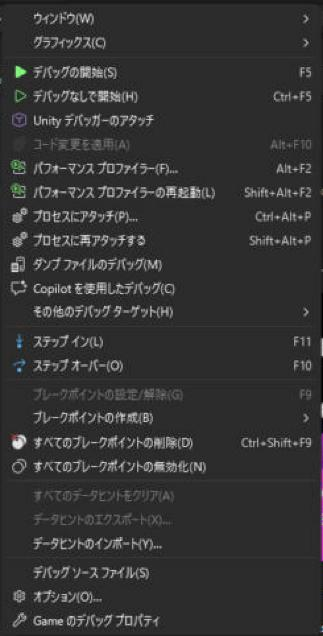
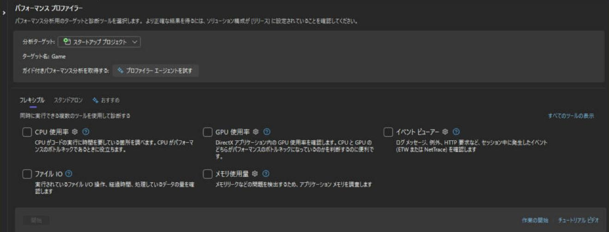

# パフォーマンス プロファイラー

プログラムが遅いとき、**勘で直す**のではなく、**どこで時間を使っているか**を、**プロファイラー**で測ります。Visual Studio には、**パフォーマンス プロファイラー**が入っていて、**CPU の使用率**、**メモリの使用量**、**GPU の使用率**などを、**グラフと表**で見られます。このページは**使い方**（起動・測り方・結果の読み方）と、**測る前の準備**、**ほかのツール**（PIX、Tracy など）をまとめます。最適化の考え方は、[計測（プロファイリング）](../optimize/measure.md)にあります。

!!! tip "ポイント"
    - <strong>Release 構成で測る</strong>（Debug は別物）。<strong>ただし、デバッグ情報（`.pdb`）は付けておく</strong>（関数名が見えるように）。
    - 起動は <strong>「デバッグ」→「パフォーマンス プロファイラー」</strong>（<strong>Alt + F2</strong>）。<strong>デバッガーなしで実行</strong>して測る。
    - まず <strong>CPU 使用率</strong>。<strong>「ホット パス」（一番時間を使っている呼び出しの流れ）</strong>を見る。
    - <strong>「合計 CPU」</strong>（その関数と呼んだ先の合計）と、<strong>「自己 CPU」</strong>（その関数自身だけ）を、区別して読む。
    - <strong>測る時間は、遅い場面だけ</strong>。<strong>同じ場面を何度も測って</strong>、比べる。
    - <strong>GPU が遅い</strong>なら、Visual Studio のツールより、<strong>PIX・RenderDoc</strong> が向く。

## 測る前の準備

### 構成は Release

| 構成 | 速さ | プロファイルに向くか |
| --- | --- | --- |
| **Debug** | **何倍も遅い**（最適化なし、検査あり） | **向かない**。**本番と違う場所が遅く見える** |
| **Release** | **本番に近い** | **向く** |

### デバッグ情報を付ける

Release では、既定で**デバッグ情報（`.pdb`）が作られますが**関数名の解決に必要です。

| 設定 | 場所 | 値 |
| --- | --- | --- |
| **デバッグ情報の形式** | C/C++ → 全般 | <strong>プログラム データベース（/Zi）</strong>（Release でも付ける） |
| **デバッグ情報の生成** | リンカー → デバッグ | <strong>デバッグ情報を生成する：はい（/DEBUG）</strong> |
| **参照されない関数を除去** | リンカー → 最適化 | `/OPT:REF`、`/OPT:ICF`（Release の既定）。**関数名がまとめられて見える**ことがある |
| **フレーム ポインターの省略** | C/C++ → 最適化 | 呼び出し履歴がうまくたどれないときは、**`/Oy-`**（省略しない）で測る |

!!! note "ICF（同一の関数をまとめる最適化）"
    `/OPT:ICF` は**中身が同じ関数を、1 つにまとめます**。プロファイラーで**別の関数名で表示**されることがあります。気になるときは、`/OPT:NOICF` で測ります。

### 測りやすい構成を作る

**Debug / Release のほかに、「Profile」構成**を作る方法があります（Release をコピーして、**デバッグ情報つき、プロファイラー用のマクロ**を有効にする）。

```text
Debug：    最適化なし、デバッグ検査あり
Profile：  Release と同じ最適化 + デバッグ情報 + ENABLE_PROFILER
Release：  最適化 + 製品用（プロファイラーなし）
```

（[プリプロセッサマクロ](preprocessor.md)）

### 測る環境

| 注意 | 説明 |
| --- | --- |
| **ほかのアプリを閉じる** | ブラウザー・ウイルス対策などが、CPU を使うとぶれる |
| **電源プラン** | **高パフォーマンス**。ノート PC は、**電源につなぐ** |
| **VSync を切る** | VSync がフレーム時間を一定にしてしまう |
| **同じ場面を測る** | リプレイや**固定シードの再現**ができると、比べやすい |
| **ウォームアップ** | 起動直後はキャッシュやロードの影響が出る。**少し待ってから測る** |

## プロファイラーを使う

### 起動する

1. **デバッグ → パフォーマンス プロファイラー**（**Alt + F2**）を開く
2. **ターゲット**（開始するプロジェクト）を選ぶ
3. **使うツール**（**CPU の使用率**など）に**チェック**を入れる
4. **開始**を押す
5. ゲームが起動するので、**測りたい場面**を実行する
6. **終了**（ゲームを閉じる、または**収集の停止**を押す）
7. **レポート**（`.diagsession`）が、開く

**デバッガーをつけずに実行**されるので、**Release に近い速さ**で測れます。

メニューは「デバッグ」の中にあります。



開いたタブが、次の画面です。上の「分析ターゲット」が測る対象で、既定は「スタートアップ プロジェクト」です。その下の「フレキシブル」に、使えるツールが、チェックボックスで並びます。下のほうにある「開始」ボタンで、測定を始めます。ここでは、まだ何もチェックしていないので、「開始」が灰色になっています。



上の説明に「ソリューション構成が［リリース］に設定されていることを確認してください」とあるとおり、構成を Release にしてから開きます。

### 使えるツール

| ツール | 内容 |
| --- | --- |
| **CPU 使用率** | **どの関数が、CPU 時間を使っているか**。**まず、これ** |
| **メモリ使用量** | **ヒープの使用量・確保**をスナップショットで調べる |
| **GPU 使用率** | **GPU の使用率・フレーム時間**（DirectX） |
| **ファイル IO** | **ファイルの読み書きの回数と時間** |
| **イベント ビューアー** | ETW イベントの表示 |
| **インストルメンテーション** | **関数の呼び出し回数**と正確な時間（遅い。対象を絞って使う）。「すべてのツールの表示」を押すと出る |

C++ のゲームで最初に開くのは、「CPU 使用率」です。右上の「すべてのツールの表示」を押すと、ここに出ていないツールも並びます。

!!! note "ツールの名前や位置は、バージョンで変わります"
    ここでの名前は、Visual Studio 2026 の例です。**一部のツールは、デバッガーの「診断ツール」ウィンドウ**（デバッグ中に出る）でも使えます。

### 診断ツール（デバッグ中）

**F5 でデバッグ実行**すると、**診断ツール**が画面に出ます（表示 → 診断ツール、**Ctrl + Alt + F2**）。

| 機能 | 内容 |
| --- | --- |
| **イベント** | ブレークポイント、例外、出力 |
| **プロセス メモリ** | メモリ使用量の**推移**。**リークの発見**の入口 |
| **CPU 使用率** | CPU の使用率の推移 |

**デバッガーがついている**ので、**速さの測定には向きません**。**メモリの傾向をざっと見る**用途です。

## CPU 使用率の読み方

### ホット パス

レポートを開くと、**CPU 使用率のグラフ**と、**関数の一覧**が出ます。

| ビュー | 内容 |
| --- | --- |
| **ホット パス** | **一番、時間を使っている呼び出しの流れ**（炎のアイコン）を、**ツリー**で表示。**まず、ここを見る** |
| **関数** | 関数ごとの**合計 CPU** と**自己 CPU** の一覧 |
| **呼び出し元/呼び出し先** | **ある関数を誰が呼び、何を呼んでいるか** |
| **呼び出しツリー** | 呼び出しの階層（展開して辿る） |
| <strong>フレーム グラフ（炎グラフ）</strong> | **幅が時間**。**広い所が重い** |
| **モジュール** | DLL ごとの時間 |
| **スレッド** | スレッドごとの時間 |

### 合計 CPU と自己 CPU

<svg class="fig flow" viewBox="0 0 885 364" role="img" aria-label="呼び出しツリー：自己 CPU が大きい関数が、直す対象"><defs><marker id="fl76825" markerWidth="9" markerHeight="9" refX="8" refY="4.5" orient="auto"><path d="M0,0 L9,4.5 L0,9 z" fill="currentColor"/></marker></defs><text x="14" y="22" class="fig-title">呼び出しツリー：自己 CPU が大きい関数が、直す対象</text><line x1="207.1" y1="87.0" x2="339.4" y2="125.0" stroke="currentColor" stroke-width="2" marker-end="url(#fl76825)"/><line x1="505.9" y1="171.0" x2="648.6" y2="209.0" stroke="currentColor" stroke-width="2" marker-end="url(#fl76825)"/><line x1="153.7" y1="87.0" x2="392.8" y2="293.0" stroke="currentColor" stroke-width="2" marker-end="url(#fl76825)"/><rect x="28.0" y="44.0" width="198" height="40" rx="9" fill="rgba(76,139,245,0.22)" stroke="#4c8bf5" stroke-width="2"/><text x="127.0" y="64.0" text-anchor="middle" dominant-baseline="central" style="font-weight:600">Update() 合計40% 自己2%</text><rect x="294.0" y="128.0" width="251" height="40" rx="9" fill="rgba(76,139,245,0.22)" stroke="#4c8bf5" stroke-width="2"/><text x="419.5" y="148.0" text-anchor="middle" dominant-baseline="central" style="font-weight:600">UpdateEnemies() 合計30% 自己5%</text><rect x="613.0" y="212.0" width="244" height="40" rx="9" fill="rgba(76,139,245,0.22)" stroke="#4c8bf5" stroke-width="2"/><text x="735.0" y="232.0" text-anchor="middle" dominant-baseline="central" style="font-weight:600">FindNearest() 合計25% 自己25%</text><rect x="290.0" y="296.0" width="259" height="40" rx="9" fill="rgba(76,139,245,0.22)" stroke="#4c8bf5" stroke-width="2"/><text x="419.5" y="316.0" text-anchor="middle" dominant-baseline="central" style="font-weight:600">UpdateParticles() 合計8% 自己8%</text></svg>

| 指標 | 意味 |
| --- | --- |
| <strong>合計 CPU（Total）</strong> | その関数 **+ 呼んだ先**の、合計時間 |
| <strong>自己 CPU（Self）</strong> | **その関数自身のコードだけ**の時間 |

**自己 CPU が大きい関数**が、**直す候補**です。**合計だけ大きい**関数は、**呼んだ先**に原因があります。

### 見るべきもの

| 発見 | 次にすること |
| --- | --- |
| **自己 CPU が大きい関数** | その関数の**アルゴリズム・メモリの並び**を見直す（[アルゴリズム](../optimize/algorithms.md)、[メモリとキャッシュ](../optimize/memory-cache.md)） |
| **`operator new` / `malloc` / `free` が上位** | **ヒープ確保が多い**（[毎フレームのヒープ確保を避ける](../optimize/frame-allocation.md)） |
| **`memcpy` / コンストラクタ / コピー** | **無駄なコピー**（[コピーとムーブ](../optimize/copy-move.md)） |
| <strong>ロックの待ち（`WaitForSingleObject` など）</strong> | **スレッドの競合**（[マルチスレッド化](../optimize/multithreading.md)） |
| **ログ・文字列の関数** | **文字列の作成**（[文字列とハッシュ](../optimize/strings-hash.md)） |
| **STL の内部関数** | どの**呼び出し元**から来ているかを、**呼び出し元**ビューで確認 |
| **描画のドライバー（D3D・`dxgi`）の関数** | **描画命令の数が多い**（[描画の最適化](../rendering/index.md)） |

### ソースコードの行を見る

**関数名をダブルクリック**すると、**ソースコードの各行の時間**が見えます（**デバッグ情報があれば**）。**どの行が重いか**が分かります。

**最適化されたコード**は、**インライン展開**で**関数が見えなくなる**ことがあります。**呼び出し元の行にまとめられて**表示されます。

## メモリ使用量

| 機能 | 内容 |
| --- | --- |
| **スナップショット** | **ある時点のヒープの内容**を保存。**2 つのスナップショットを比べる** |
| **差分** | 2 つの間で**増えたオブジェクト・確保の場所**を表示 |
| **ヒープのプロファイリング** | **確保の呼び出し元**を追跡（有効にして、実行する） |

**リークを調べる**には、**開始後と数分後**の、2 回スナップショットを撮って、**差分**を見ます。**確保の呼び出し元**が分かれば、原因を特定できます（[デバッグ](debugging.md)、[AddressSanitizer](asan.md)）。

## GPU 使用量

<strong>DirectX（11 / 12）</strong>のアプリで、**GPU の使用率、フレーム時間**を見られます。

| 内容 | 説明 |
| --- | --- |
| **フレーム時間** | 各フレームに、**GPU がかかった時間** |
| **GPU の使用率** | GPU が**飽和しているか** |
| **CPU 待ち** | GPU が、CPU を待っていないか |

**GPU の細かい調査**（どの描画命令・シェーダーが重いか）は、**PIX**や**RenderDoc**が、向いています。

## ほかのツール

| ツール | 特徴 | 使いどころ |
| --- | --- | --- |
| **PIX on Windows** | **DirectX の、GPU・CPU のタイミング**を、キャプチャ。**Microsoft 製・無料** | **DX11 / DX12 の描画の最適化**。描画命令ごとの時間、ステート、シェーダーのデバッグ |
| **RenderDoc** | **グラフィックスのフレームキャプチャ**。無料。多くの API に対応 | 描画の**不具合の調査**、命令の確認 |
| **Tracy Profiler** | **フレームごとの CPU/GPU のゾーン**を、**リアルタイム**で表示。ソースに**マクロを入れる** | **ゲーム用に定番**。**スパイクの調査** |
| **Superluminal** | 見やすい CPU プロファイラー（**有料**・評価版あり） | 日常的な CPU の最適化 |
| **Windows Performance Analyzer（WPA）+ ETW** | **OS 全体**のトレース | スレッドの待ち、ファイル I/O、システムの影響 |
| **Intel VTune / AMD uProf** | **CPU のカウンター**（キャッシュミス、分岐予測ミス） | **低レベルの最適化** |
| **Very Sleepy** | 軽量で手軽（無料）。サンプリング型 | 簡単に試したいとき |
| **自作のタイマー** | `std::chrono` で**区間を測る** | **画面に表示**して、常に監視（[計測](../optimize/measure.md)） |

### サンプリングと計装

| 方式 | 説明 | 長所 | 短所 |
| --- | --- | --- | --- |
| **サンプリング** | 一定間隔で**今、どの関数が動いているか**を、記録 | **軽い**（実行速度に影響が小さい）。コードを変えない | **短い関数は見逃す**。**正確な回数は不明** |
| <strong>計装（インストルメンテーション）</strong> | **関数の入口・出口**に計測コードを入れる | **正確な回数・時間** | **遅くなる**。計測が結果をゆがめる |

**Visual Studio の「CPU 使用率」は、サンプリング**です。**Tracy** などは、**自分でマクロを入れる計装**です。**まずサンプリングで全体を見て、気になる所を計装**する、という使い分けです。

## Tracy のようなゲーム向けプロファイラー

**ゲームはフレームごとの動きが重要**です。Visual Studio のプロファイラーは**全体の平均**を見ますが、**Tracy** のようなツールは、**フレームごとの内訳**が見えます。

```cpp
#include <tracy/Tracy.hpp>

void Update() {
  ZoneScoped;
  UpdateEnemies();
  UpdateParticles();
}

void MainLoop() {
  while (running) {
    Update();
    Render();
    FrameMark;
  }
}
```

| 機能 | 説明 |
| --- | --- |
| **`ZoneScoped`** | **関数のスコープの時間**を、記録 |
| **`FrameMark`** | **フレームの区切り**。フレームごとの時間が分かる |
| **メモリの確保の記録** | `operator new` を、**フックして記録**できる |
| **GPU のゾーン** | DX11 / DX12 に対応 |
| **ネットワークで接続** | <strong>別のウィンドウ（プロファイラーの UI）</strong>に、**リアルタイム表示** |

**`ENABLE_PROFILER` マクロ**で、**製品ビルドでは、消せる**ようにしておきます（[プリプロセッサマクロ](preprocessor.md)）。

## 結果の読み方の注意

| 注意 | 説明 |
| --- | --- |
| **1 回の結果を信用しない** | **ぶれる**。複数回測って、**中央値**を見る |
| **変更は、1 つずつ** | 何が効いたか、分からなくなる |
| **速度は割合で見る** | 絶対時間は、PC で変わる。<strong>「全体の何 % か」</strong>で、優先度を決める |
| **サンプリングの偏り** | **短い関数は見えにくい** |
| **測定が結果を変える** | 計装は遅くなる。**サンプリングが基本** |
| **ボトルネックは移動する** | 1 つ直すと**次の場所が一番重く**なる。**また測る** |
| **最悪のフレームを見る** | 平均でなく、**カクつくフレーム**の内訳（[フレーム時間の設計](../optimize/frame-budget.md)） |

<!-- fig:flame-graph:begin -->

<svg class="fig illust motion" data-fig="flame-graph" viewBox="0 0 780 440" role="img"><rect x="0" y="0" width="780" height="440" rx="14" fill="#ffffff"/>
<defs><marker id="arr-flame-graph" markerWidth="9" markerHeight="9" refX="8" refY="4.5" orient="auto"><path d="M0,0 L9,4.5 L0,9 z" fill="#1f2937"/>
</marker>
</defs>
<text x="20" y="28" text-anchor="start" style="font-size:17px;font-weight:700;fill:#1f2937">フレーム グラフ: 幅 = かかった時間。幅の広い所が、直す候補</text>
<g opacity="0"><animate attributeName="opacity" dur="15.5s" repeatCount="indefinite" keyTimes="0.0000;0.0643;0.0645;1.0000" values="0;0;1;1"/><rect x="70.0" y="290" width="638.0" height="54" fill="#64748b" opacity="0.9"/>
<text x="390.0" y="322" text-anchor="middle" style="font-size:12px;font-weight:700;fill:#ffffff">Frame 16.0 ms</text>
</g>
<g opacity="0"><animate attributeName="opacity" dur="15.5s" repeatCount="indefinite" keyTimes="0.0000;0.2901;0.2903;1.0000" values="0;0;1;1"/><rect x="70.0" y="228" width="238.0" height="54" fill="#2563eb" opacity="0.9"/>
<text x="190.0" y="260" text-anchor="middle" style="font-size:12px;font-weight:700;fill:#ffffff">Update 6.0</text>
<rect x="310.0" y="228" width="318.0" height="54" fill="#2ea043" opacity="0.9"/>
<text x="470.0" y="260" text-anchor="middle" style="font-size:12px;font-weight:700;fill:#ffffff">Render 8.0</text>
<rect x="630.0" y="228" width="78.0" height="54" fill="#cbd5e1" opacity="0.9"/>
<text x="670.0" y="260" text-anchor="middle" style="font-size:12px;font-weight:700;fill:#1f2937">待ち 2.0</text>
</g>
<g opacity="0"><animate attributeName="opacity" dur="15.5s" repeatCount="indefinite" keyTimes="0.0000;0.5159;0.5161;1.0000" values="0;0;1;1"/><rect x="70.0" y="166" width="138.0" height="54" fill="#2563eb" opacity="0.9"/>
<text x="140.0" y="198" text-anchor="middle" style="font-size:12px;font-weight:700;fill:#ffffff">AI 3.5</text>
<rect x="210.0" y="166" width="78.0" height="54" fill="#2563eb" opacity="0.9"/>
<text x="250.0" y="198" text-anchor="middle" style="font-size:12px;font-weight:700;fill:#ffffff">Physics 2.0</text>
<rect x="290.0" y="166" width="18.0" height="54" fill="#2563eb" opacity="0.9"/>
<text x="300.0" y="198" text-anchor="middle" style="font-size:9px;font-weight:700;fill:#ffffff">他 0.5</text>
<rect x="310.0" y="166" width="58.0" height="54" fill="#2ea043" opacity="0.9"/>
<text x="340.0" y="198" text-anchor="middle" style="font-size:9px;font-weight:700;fill:#ffffff">Culling 1.5</text>
<rect x="370.0" y="166" width="198.0" height="54" fill="#e5484d" opacity="0.9"/>
<text x="470.0" y="198" text-anchor="middle" style="font-size:12px;font-weight:700;fill:#ffffff">Draw 5.0</text>
<rect x="570.0" y="166" width="58.0" height="54" fill="#2ea043" opacity="0.9"/>
<text x="600.0" y="198" text-anchor="middle" style="font-size:9px;font-weight:700;fill:#ffffff">UI 1.5</text>
</g>
<text x="390" y="375" text-anchor="middle" style="font-size:14px;font-weight:700;fill:#1f2937" opacity="0">1 フレーム(16 ms)の、関数ごとの時間を積み上げる<animate attributeName="opacity" dur="15.5s" repeatCount="indefinite" keyTimes="0.0000;0.0643;0.0645;1.0000" values="1;1;0;0"/></text>
<text x="390" y="375" text-anchor="middle" style="font-size:14px;font-weight:700;fill:#1f2937" opacity="0">一番下: フレーム全体<animate attributeName="opacity" dur="15.5s" repeatCount="indefinite" keyTimes="0.0000;0.0643;0.0645;0.2901;0.2903;1.0000" values="0;0;1;1;0;0"/></text>
<text x="390" y="375" text-anchor="middle" style="font-size:14px;font-weight:700;fill:#1f2937" opacity="0">1 段上: Update / Render / 待ち に分ける<animate attributeName="opacity" dur="15.5s" repeatCount="indefinite" keyTimes="0.0000;0.2901;0.2903;0.5159;0.5161;1.0000" values="0;0;1;1;0;0"/></text>
<text x="390" y="375" text-anchor="middle" style="font-size:14px;font-weight:700;fill:#1f2937" opacity="0">さらに内訳。Draw が 5.0 ms で最大 → まずここを調べる<animate attributeName="opacity" dur="15.5s" repeatCount="indefinite" keyTimes="0.0000;0.5159;0.5161;1.0000;1.0000" values="0;0;1;1;0"/></text>
</svg>

<!-- fig:flame-graph:end -->

## よくあるミス

??? failure "Debug で測って、本番と違う場所を直してしまう"
    **Release 構成**で測ります。

??? failure "関数名が、アドレスの数字（`0x00007ff6...`）で表示される"
    <strong>デバッグ情報（`.pdb`）</strong>が、ありません。`/Zi` と `/DEBUG` を設定して、ビルドし直します。

??? failure "デバッガーをつけたまま、速さを測る"
    **F5 ではなく、プロファイラーから**起動します（**デバッガーなし**）。

??? failure "合計 CPU だけを見て、呼び出し先を直す"
    **自己 CPU** が大きい関数が、直す対象です。**合計が大きいだけ**の関数は、呼び出し先に原因があります。

??? failure "VSync が有効のまま測って、GPU の余裕が分からない"
    VSync を切って測ります。

??? failure "遅い場面だけでなく、全体を長時間測って、結果が薄まる"
    **遅い場面だけ**を測ります。

??? failure "プロファイラーのマクロを、製品ビルドに残す"
    **製品では無効**にします（`ENABLE_PROFILER` を定義しない）。

## これだけ覚える

!!! abstract "まとめ"
    - [x] <strong>Release 構成で測る</strong>。<strong>`/Zi`・`/DEBUG` でデバッグ情報は付ける</strong>
    - [x] 起動は <strong>Alt + F2</strong>。<strong>デバッガーなし</strong>で<strong>遅い場面</strong>だけ測る
    - [x] <strong>ホット パス</strong>から見る。<strong>自己 CPU が大きい関数</strong>が、直す対象
    - [x] <strong>`operator new`・`memcpy`・ロック待ち</strong>が上位なら、確保・コピー・競合を疑う
    - [x] <strong>GPU は PIX・RenderDoc</strong>、<strong>フレームごとのスパイクは Tracy</strong> など、<strong>用途で使い分ける</strong>
    - [x] 変更は<strong>1 つずつ</strong>。<strong>直したら、また測る</strong>

## 関連ページ

- [Visual Studio（目次）](index.md)
- [計測（プロファイリング）](../optimize/measure.md)
- [フレーム時間の設計](../optimize/frame-budget.md)
- [毎フレームのヒープ確保を避ける](../optimize/frame-allocation.md)
- [デバッグのやり方](debugging.md)
- [AddressSanitizer](asan.md)
- [プリプロセッサマクロ](preprocessor.md)
- [C++23 を使えるようにする設定](settings.md)
