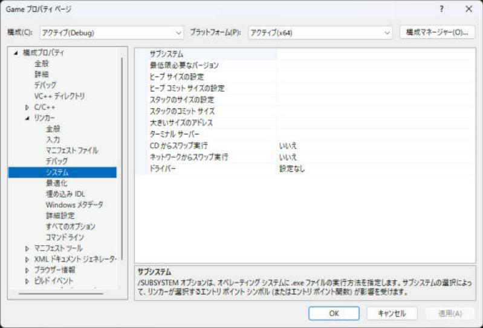

# プロジェクトの種類とエントリーポイント

Visual Studio で新しいプロジェクトを作るとき「**コンソール アプリ**」と「Windows デスクトップ アプリケーション」のように、似た名前のテンプレートが並びます。この違いはプログラムがどの関数から始まるか（エントリーポイント）とコンソール画面を持つかです。ゲームではウィンドウを作るので「Windows アプリ」が基本ですが、Debug のときだけコンソールを出したい場面もよくあります。このページではプロジェクトの種類とサブシステム、`main` と `WinMain` の違いを説明します。

!!! tip "ポイント"
    - コンソール アプリは <strong>`main`</strong> から、Windows アプリは <strong>`WinMain`（`wWinMain`）</strong>から始まる。決めているのはリンカーの「サブシステム」設定
    - サブシステムが CONSOLE なら黒いコンソール画面付き WINDOWS ならコンソール画面なし
    - 食い違うと `LNK2019: 未解決の外部シンボル WinMain`（または `main`）になる。テンプレートを間違えたらサブシステムを直すのが早い
    - 成果物の種類は exe / lib / dll。DLL のエントリーポイントは `DllMain`
    - ゲームは Windows サブシステムで作りデバッグ用には `AllocConsole` でコンソールを足す、という形が多い

## このページを読む前に

- [プロジェクト（.vcxproj）](terms/project.md)
- [ソリューション（.sln）](terms/solution.md)

## プロジェクトの種類 {#types}

最初に選ぶテンプレートで成果物の種類とサブシステムが決まります。あとからプロパティで変えられます。

| テンプレート | 成果物 | サブシステム | エントリーポイント | 使いどころ |
| --- | --- | --- | --- | --- |
| コンソール アプリ | `.exe` | CONSOLE | `main` | 学習用、小さなツール、サンプルコード |
| Windows デスクトップ アプリケーション | `.exe` | WINDOWS | `wWinMain` | ゲーム本体、ウィンドウを持つアプリ |
| 空のプロジェクト | 選べる | 選べる | 選べる | 自分で全部決めたいとき |
| 静的ライブラリ | `.lib` | なし | なし | エンジンの共通部分 |
| ダイナミック リンク ライブラリ（DLL） | `.dll` | WINDOWS | `DllMain`（省略できる） | プラグイン、ゲームと分けて更新したい部分 |

「空のプロジェクト」でもあとから設定すれば、どの種類にもできます。

## エントリーポイントとは {#entry}

プログラムを実行すると OS は `.exe` の中の<strong>最初に動く場所（エントリーポイント）</strong>を呼びます。ただし、これは自分で書く `main` ではありません。

1. OS がランタイム（C ランタイム）のスタートアップ関数を呼ぶ
2. スタートアップ関数がグローバル変数の初期化などを済ませる
3. そのあとで自分の `main` や `WinMain` を呼ぶ

スタートアップ関数の名前はサブシステムと `main` の種類で決まります。

- <strong>`int main()`</strong>: スタートアップ関数（リンカーのエントリ ポイント）: `mainCRTStartup`。文字: char
- <strong>`int wmain()`</strong>: スタートアップ関数（リンカーのエントリ ポイント）: `wmainCRTStartup`。文字: wchar_t
- <strong>`int WINAPI WinMain(...)`</strong>: スタートアップ関数（リンカーのエントリ ポイント）: `WinMainCRTStartup`。文字: char
- <strong>`int WINAPI wWinMain(...)`</strong>: スタートアップ関数（リンカーのエントリ ポイント）: `wWinMainCRTStartup`。文字: wchar_t

自分で書くのは左の列にある関数です。スタートアップ関数はサブシステムの設定に合わせて、リンカーが自動で選びます。

### コンソール アプリ（main）

```cpp
#include <print>

int main() {
  std::println("Hello");
  return 0;
}
```

```text title="実行結果"
Hello
```

`main` は引数なしでも `int main(int argc, char* argv[])` でも書けます。コンソール画面が出て `std::println` の出力がそこに出ます。

### Windows アプリ（WinMain）

```cpp
#include <windows.h>

// Windows アプリのエントリーポイント。wWinMain は文字が UTF-16（wchar_t）の版
int WINAPI wWinMain(HINSTANCE instance, HINSTANCE prev_instance,
                    PWSTR cmd_line, int show_cmd) {
  MessageBoxW(nullptr, L"Hello", L"Game", MB_OK);
  return 0;
}
```

- `instance`: このプログラム自身を表すハンドル。ウィンドウの登録（`RegisterClass`）で使う
- `prev_instance`: 昔の名残。今は常に `nullptr`
- `cmd_line`: コマンドライン引数（プログラム名を除いた 1 本の文字列）
- `show_cmd`: ウィンドウの最初の表示方法（`SW_SHOW` など）

戻り値は終了コードです。コンソール画面は出ません。`std::println` や `printf` で出力しても見える場所がありません。

## サブシステムを変える {#subsystem}

エントリーポイントの違いはプロパティの 1 か所で決まります。

1. プロジェクトを選んでメニューの<strong>プロジェクト → プロパティ</strong>を開く
2. 構成を「すべての構成」、プラットフォームを「x64」にする
3. リンカー → システム → サブシステム を選ぶ



- <strong>コンソール</strong>: リンカーのオプション: `/SUBSYSTEM:CONSOLE`。画面: コンソールあり。呼ばれる関数: `main` / `wmain`
- <strong>Windows</strong>: リンカーのオプション: `/SUBSYSTEM:WINDOWS`。画面: コンソールなし。呼ばれる関数: `WinMain` / `wWinMain`

エントリーポイントを名前で直接指定することもできます。リンカー → 詳細設定 → エントリ ポイント にスタートアップ関数の名前（`mainCRTStartup` など）を書きます（`/ENTRY`）。

### 組み合わせを変える {#combos}

サブシステムとエントリ ポイントの組み合わせで、コンソールの有無と書く関数を選べます。

- <strong>コンソールあり `main`</strong>: サブシステム: CONSOLE。エントリ ポイント: （空）。書く関数: `main`
- <strong>コンソールなし `WinMain`</strong>: サブシステム: WINDOWS。エントリ ポイント: （空）。書く関数: `wWinMain`
- <strong>コンソールなし `main`</strong>: サブシステム: WINDOWS。エントリ ポイント: `mainCRTStartup`。書く関数: `main`
- <strong>コンソールあり `WinMain`</strong>: サブシステム: CONSOLE。エントリ ポイント: `wWinMainCRTStartup`。書く関数: `wWinMain`

## ゲームでの使いどころ {#game}

ゲームの本体はウィンドウを作るので、**Windows サブシステム**が基本です。でもデバッグ中は `std::println` で出力を見たいときがあります。そのときは、Debug のときだけコンソールを作ります。

```cpp
#include <windows.h>

#include <cstdio>
#include <print>

int WINAPI wWinMain(HINSTANCE instance, HINSTANCE prev_instance,
                    PWSTR cmd_line, int show_cmd) {
#ifdef _DEBUG
  // Debug のときだけ、コンソール画面を作って、標準出力をつなぐ
  AllocConsole();
  FILE* fp = nullptr;
  freopen_s(&fp, "CONOUT$", "w", stdout);
#endif

  std::println("ゲーム開始");  // Debug では、コンソールに出る
  // ... ウィンドウの作成とメイン ループ ...
  return 0;
}
```

- `AllocConsole` + `freopen_s`: 実行中にコンソールを作る。Release では何も出ない
- `OutputDebugStringA`: Visual Studio の「出力」ウィンドウに文字を出す。コンソールを作らなくて済む
- サブシステムを構成ごとに変える: Debug だけ CONSOLE、Release だけ WINDOWS にする。プロパティで構成を選んで設定する

## DLL とライブラリ {#dll}

### ダイナミック リンク ライブラリ（`.dll`）

DLL には `main` がありません。代わりに `DllMain` というエントリーポイントを書けます。DLL が読み込まれたり外されたりしたときに OS が呼びます。

```cpp
#include <windows.h>

BOOL WINAPI DllMain(HINSTANCE instance, DWORD reason, LPVOID reserved) {
  switch (reason) {
    case DLL_PROCESS_ATTACH:  // プロセスに読み込まれた
      break;
    case DLL_PROCESS_DETACH:  // プロセスから外される
      break;
    case DLL_THREAD_ATTACH:   // 新しいスレッドが作られた
      break;
    case DLL_THREAD_DETACH:   // スレッドが終わる
      break;
  }
  return TRUE;
}
```

`DllMain` の中でできることは限られます（別の DLL の読み込みスレッドの待ち合わせなどをすると、固まります）。重い初期化は `InitializeGame()` のような関数を別に用意して、呼ぶ側から呼びます。

関数を外から使えるようにするには `__declspec(dllexport)` を付けます。

```cpp
extern "C" __declspec(dllexport) void InitializeGame() {
  // ...
}
```

### 静的ライブラリ（`.lib`）

静的ライブラリにはエントリーポイントがありません。ほかのプロジェクトから**プロジェクトの参照**で使います。サブシステムの設定もありません。

## よくあるミス

??? failure "`LNK2019: 未解決の外部シンボル WinMain` が出る"
    サブシステムが WINDOWS なのに、`main` しか書いていません。`wWinMain` を書くかサブシステムを CONSOLE にします。メッセージが `invoke_main` の中という場合も同じ原因です。

??? failure "`LNK2019: 未解決の外部シンボル main` が出る"
    逆でサブシステムが CONSOLE なのに、`WinMain` しか書いていません。サブシステムを WINDOWS にするか `main` を書きます。

??? failure "`wWinMain` と `WinMain` を取り違える"
    `WinMain` は char の文字列を `wWinMain` は wchar_t の文字列を受け取ります。エントリ ポイントは書いた関数に合わせて自動で決まります。

??? failure "Windows アプリで `std::println` を書いたのに、何も出ない"
    コンソールがないので、出力の行き先がありません。Debug だけ `AllocConsole` で足すか `OutputDebugStringA` で、「出力」ウィンドウに出します。

??? failure "プロジェクトの種類を間違えて作り直した"
    作り直さなくてもプロパティで直せます。**全般 → 構成の種類**（exe / lib / dll）とリンカー → システム → サブシステムを変えて、エントリーポイントの関数を書きます。

## これだけ覚える

- <strong>`main` はコンソール、`WinMain`（`wWinMain`）は Windows アプリ</strong>。決めているのはリンカーのサブシステム
- ゲームは Windows サブシステムで作り Debug のときだけコンソールを足す
- `LNK2019` で `WinMain` や `main` が見つからないときは、サブシステムと関数が合っていない
- exe / lib / dll の違いは、プロパティの構成の種類で変えられる

## 関連ページ

- [プロジェクト（.vcxproj）](terms/project.md)
- [インクルード ディレクトリとマクロ](include-dirs.md)
- [よくあるエラー](errors.md)
- [プリプロセッサマクロ](preprocessor.md)
