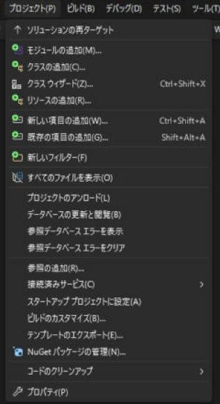
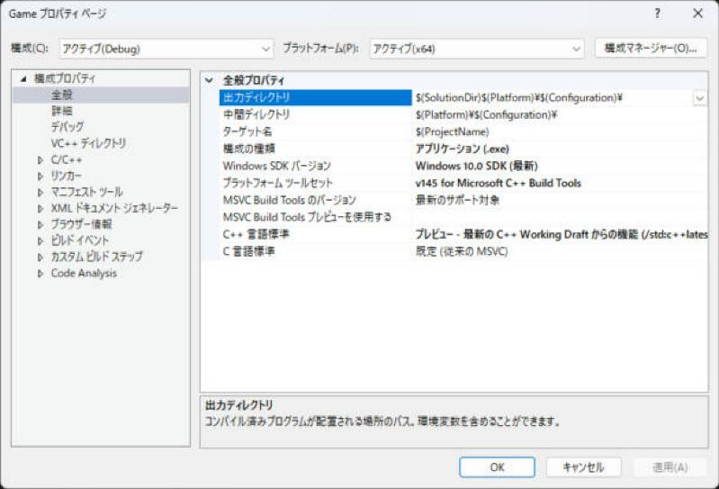
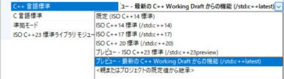
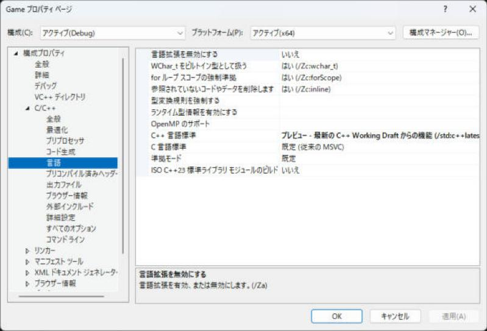
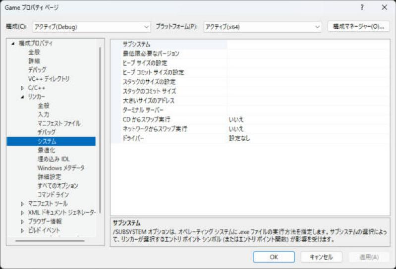
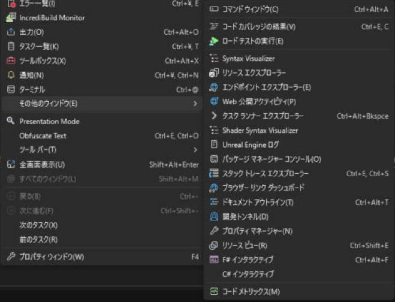
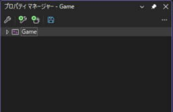

# C++23 を使えるようにする設定

プロジェクトを作った直後は、C++14 や C++17 の設定になっています。このサイトのサンプルを動かすには、**C++ 言語標準を C++23 に変える**必要があります。あわせて、文字コード（`/utf-8`）と警告レベルも最初に設定しておくと、あとで困りません。

!!! tip "ポイント"
    - プロパティを開くときは、左上の **構成**を「**すべての構成**」、プラットフォームを「すべてのプラットフォーム」にしてから変更する（Debug だけ変えて Release が C++14 のまま、を防ぐ）。
    - C/C++ → 言語 → C++ 言語標準 をプレビュー - ISO C++23 標準（`/std:c++23preview`）か、プレビュー - 最新の C++ Working Draft からの機能（`/std:c++latest`）にする。
    - C/C++ → コマンド ライン に `/utf-8` を足して、日本語の文字化けを防ぐ（詳しくは [文字コードを UTF-8 にしよう](utf8.md)）。
    - 警告レベル は レベル 4（/W4）。まず警告を読む癖をつける。
    - 設定はプロジェクトごと。新しいプロジェクトを作ったら、毎回やる（または [プロパティ シート](#property_sheet) を使い回す）。

!!! info "このページを読む前に"
    - [vs/index.md](index.md)（このセクション全体の地図と、読む順番）
    - [インストールとプロジェクトの作成](setup.md)（Visual Studio の準備）

## プロパティを開く {#open}

1. ソリューション エクスプローラーで、**プロジェクト名**を選んで、メニューのプロジェクト → プロパティを開く（プロジェクト名を右クリック → プロパティ、や Alt + Enter でも開く）
2. 左上の 構成 を すべての構成、プラットフォーム を すべてのプラットフォーム（または x64）に切り替える
3. 左のツリーから項目を選んで、右側で値を変える
4. 適用 → OK



開くのは、次のような「プロパティ ページ」です。左のツリーが設定のグループで、右に項目が並びます。上の「構成」と「プラットフォーム」がいま編集している対象です。



「構成」のドロップダウンを開くと、アクティブな構成、Debug、Release、「すべての構成」が選べます。


!!! warning "構成を切り替えてから変更する"
    プロパティ画面を開いた直後は、「アクティブ（Debug）」と「x64」だけが選ばれていることが多いです。そのまま変えると、Release ビルドには反映されません。必ず、先に「すべての構成」に切り替えます。

## C++ 言語標準

| 場所 | 値 |
| --- | --- |
| **C/C++ → 言語 → C++ 言語標準** | プレビュー - ISO C++23 標準 (/std:c++23preview) または プレビュー - 最新の C++ Working Draft からの機能 (/std:c++latest) |



Visual Studio 2026（18.11）では、選択肢は「既定（ISO C++14）」「C++14」「C++17」「C++20」と、プレビュー扱いの 2 つ（`/std:c++23preview` と `/std:c++latest`）です。C++23 は、この 2 つのどちらかを選びます。`/std:c++23preview` は C++23 の範囲、`/std:c++latest` はそれより先の機能も含みます。

`/std:c++latest` は「そのバージョンで使える、一番新しい機能を全部有効にする」設定です。C++23 の機能（`<print>`、`<expected>`、`std::flat_map` など）をコンパイラが対応している範囲で使えるようになります。

同じ画面の、準拠モード（`/permissive-`）は、新しいプロジェクトでは有効になっています。規格に厳密になり、あいまいなコードがエラーになります。「既定」と表示されていても、`/std:c++20` 以降なら `/permissive-` が自動で付きます。



!!! note "使える機能は Visual Studio のバージョンで変わる"
    `/std:c++latest` にしても、Visual Studio 自体が古いと使えない機能があります。このサイトは Visual Studio 2026 を前提にしていて、`<print>`・`<expected>`・`<mdspan>`・`std::generator` は、2026 ではどれも最初から使えます。`std::flat_map` や `std::flat_set` のように、18.x の途中で入った機能は、各ページの「コンパイラ対応」の表で版を確かめてください。

## 文字コード（/utf-8） {#utf8}

C++ のソースに日本語を書くなら、<strong>コンパイラに `/utf-8` を付ける</strong>のが、最初の設定の 1 つです。MSVC は、何も指定しないと、ソースを Shift_JIS（CP932）として読むので、UTF-8 で保存したファイルは化けます。

| 場所 | 入れる値 |
| --- | --- |
| C/C++ → コマンド ライン → 追加のオプション | `/utf-8` |


上の「すべてのオプション」は、コンパイラに実際に渡される内容の一覧です。この画面の下の欄に `/utf-8` と書くと、上の一覧にも現れます。

`.editorconfig`、`.gitattributes`、既存ファイルの変換、コンソールの文字化けまで含めた詳しい説明は、[文字コードを UTF-8 にしよう](utf8.md) にまとめています。ここでは `/utf-8` を入れるところまでにして、あとでそのページを読んでください。

## 警告レベル

| 場所 | 値 |
| --- | --- |
| **C/C++ → 全般 → 警告レベル** | レベル 4 (/W4) |
| C/C++ → 全般 → 警告をエラーとして扱う | 最初は「いいえ」。慣れたら「はい (/WX)」 |

- 警告（`warning C4xxx`）は、バグの予告です。`int` と `size_t` の比較（符号の違い）、使っていない変数、`float` への暗黙の変換、などが出ます
- 外部ライブラリのヘッダが大量に警告を出すときは、ライブラリのヘッダを `外部インクルード ディレクトリ` に置いて、外部ヘッダの警告を無効にします（[外部ライブラリの入れ方](libraries.md#external_include)）

## その他のよく変える設定

| 場所 | 設定 | おすすめ | 意味 |
| --- | --- | --- | --- |
| C/C++ → 全般 | 複数プロセッサによるコンパイル | <strong>はい (/MP)</strong> | 複数のコアで並列にコンパイルして、ビルドが速くなる |
| C/C++ → 全般 | SDL チェック | はい (/sdl) | セキュリティのチェックを足す。学生のうちは「はい」でよい |
| C/C++ → 最適化 | 最適化（Debug） | 無効 (/Od) | デバッグしやすい（変数が消えない） |
| C/C++ → 最適化 | 最適化（Release） | 速度を優先 (/O2) | 製品用。速い |
| C/C++ → コード生成 | ランタイム ライブラリ | Debug は /MDd、Release は /MD | ライブラリとそろえる（[よくあるエラー](errors.md#runtime_library)） |
| C/C++ → 全般 | Address Sanitizer を有効にする | Debug だけ「はい」 | メモリのバグを実行時に見つける（[デバッグ](debugging.md#asan)） |
| リンカー → システム | サブシステム | コンソール (/SUBSYSTEM:CONSOLE) | `main` から始める。ウィンドウだけなら「Windows」（[画面](#subsystem)） |
| 全般 | 出力ディレクトリ | `$(SolutionDir)bin\$(Configuration)\` | 実行ファイルの置き場所 |
| 全般 | 中間ディレクトリ | `$(SolutionDir)obj\$(ProjectName)\$(Configuration)\` | 途中のファイルの置き場所 |

### サブシステムの設定場所 {#subsystem}



## 構成とプラットフォーム

画面上の工具バーに「**Debug**」「x64」というドロップダウンがあります。

| 構成 | 目的 | 特徴 |
| --- | --- | --- |
| Debug | 開発中 | 最適化なし。デバッグ情報あり。`assert` が有効。遅いが、バグを見つけやすい |
| Release | 製品・速度の確認 | 最適化あり。`assert` が無効。速い |

- x64 を選びます。Win32（32 ビット）は、古い環境向けです
- Debug で動くのに Release でおかしくなるときは、初期化していない変数や、未定義動作を疑います（[未定義動作](../basics/ub.md)）
- ゲームの速さを測るのは、必ず Release で行います（Debug は何倍も遅くなります）

## プロパティ シートで設定を使い回す {#property_sheet}

プロジェクトを作るたびに同じ設定をするのは大変です。**プロパティ シート**（`.props` ファイル）に設定を書いて、複数のプロジェクトで共有できます。

1. メニュー → 表示 → その他のウィンドウ → プロパティ マネージャー（右下にウィンドウが開く）





2. プロジェクトを右クリック → 新しいプロジェクト プロパティ シートの追加 → `Common.props` という名前で保存
3. 作った `Common.props` を右クリック → プロパティ → 上の設定（C++23、/utf-8、/W4 など）を入れる
4. ほかのプロジェクトでは、プロパティ マネージャーで 既存のプロパティ シートの追加 から、同じ `Common.props` を選ぶ

## 設定が反映されているか確認する

プロジェクトのプロパティ → **C/C++ → コマンド ライン** を開くと、実際にコンパイラに渡されるオプションが一覧で見えます。`/std:c++latest`（または `/std:c++23preview`）と `/utf-8`、`/W4` が入っていれば成功です。

次のコードがビルドできて、実行すると文字が出れば、C++23 と `/utf-8` が効いています。

```cpp
#include <print>

int main() {
  std::println("C++23 で日本語が出ました");
}
```

```text title="実行結果"
C++23 で日本語が出ました
```

- `error C2039: 'println': は 'std' のメンバーではありません` や、`<print>` が開けないと言われたら、C++ 言語標準が古いか、Visual Studio が古いです
- 日本語が `繧ｳ繝ｳ` のような文字になったら、`/utf-8` が効いていません（[文字化け](errors.md#mojibake)）

## 関連ページ

- [インストールとプロジェクトの作成](setup.md)
- [外部ライブラリの入れ方](libraries.md)
- [よくあるエラー](errors.md)
- [Visual Studio の目次](index.md)
