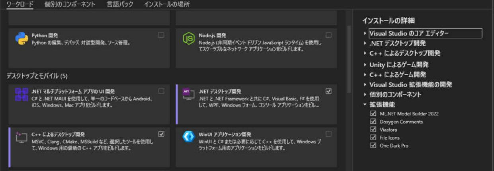
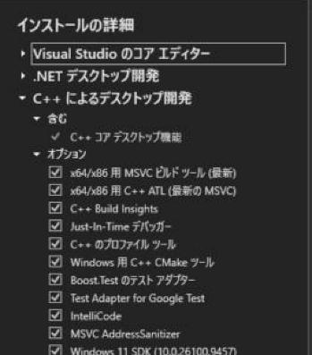
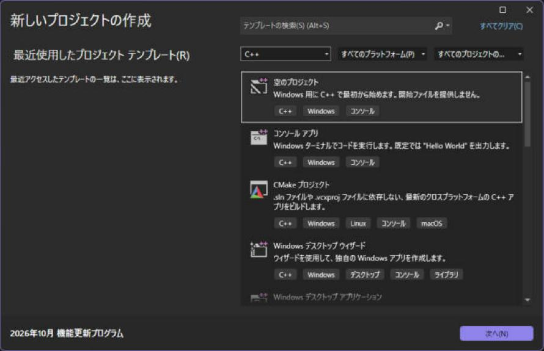
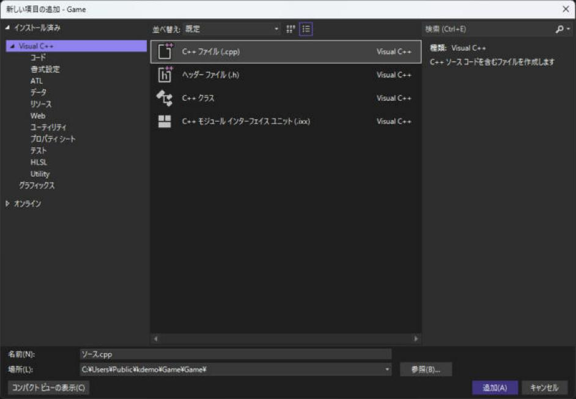
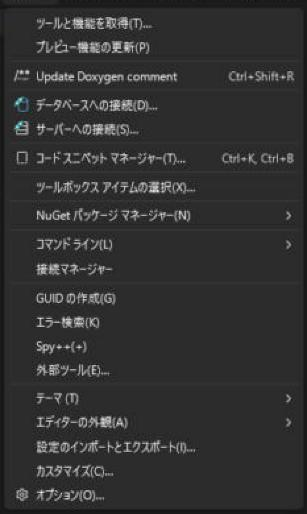
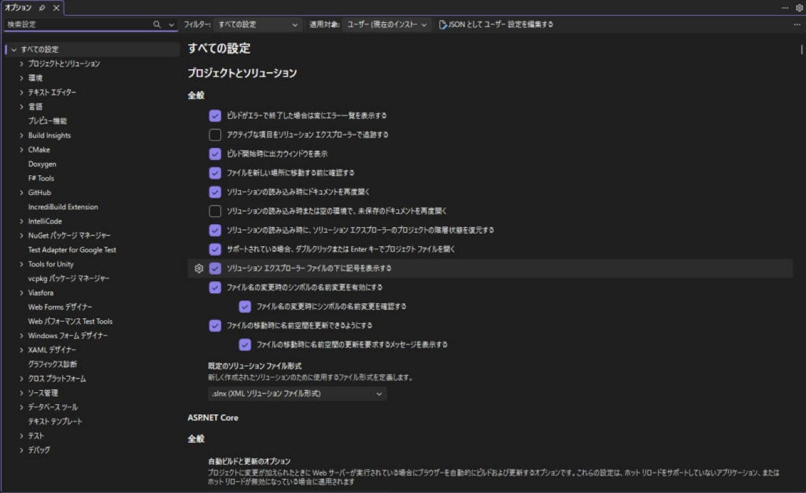

# インストールとプロジェクトの作成

Visual Studio 2026 で C++ を始めるときの、インストールから「Hello」を動かすところまでです。このサイトの画面は、すべて Visual Studio 2026（18.x）の日本語版です。

!!! tip "ポイント"
    - インストールのとき、<strong>「C++ によるデスクトップ開発」</strong>のワークロードにチェックを入れる。
    - プロジェクトは <strong>「空のプロジェクト」</strong> か 「コンソール アプリ」 で作る。
    - プラットフォームは x64。構成は開発中は Debug。
    - ファイルはソリューション フォルダーの中にまとめて置く（`src/`、`third_party/` など）。

!!! info "このページを読む前に"
    - [vs/index.md](index.md)（このセクション全体の地図と、読む順番）

## インストール

1. [Visual Studio の公式サイト](https://visualstudio.microsoft.com/ja/) から **Visual Studio Community**（学生・個人は無料）をダウンロードする
2. インストーラーを起動して、ワークロードの画面で 「C++ によるデスクトップ開発」 にチェックを入れる
3. 必要に応じて、右側の「インストールの詳細」で、次を足す



「C++ によるデスクトップ開発」を開くと、既定で入るコンポーネントが見えます。下の表の名前は、この一覧の表記です。



| コンポーネント | 何に使うか |
| --- | --- |
| Windows 11（または 10）SDK | Windows のヘッダとライブラリ。ワークロードに含まれる |
| vcpkg パッケージ マネージャー | 外部ライブラリを入れる（[外部ライブラリの入れ方](libraries.md)） |
| MSVC AddressSanitizer | メモリのバグ探し（[デバッグ](debugging.md)）。既定で入る |
| Windows 用 C++ CMake ツール | CMake のプロジェクトを開くとき（[CMake で使う](cmake.md)）。既定で入る |
| 日本語の言語パック | メニューが日本語になる（インストール時の言語タブ） |

!!! note "バージョンを確認する"
    メニューの「ヘルプ」→「Microsoft Visual Studio のバージョン情報」でバージョンが分かります。このサイトは Visual Studio 2026（18.x） を前提に書いています。C++ のコンパイラ（MSVC）は、ツールセット `v145` です。古い版のときは、Visual Studio Installer で「更新」を押します。

## プロジェクトを作る

1. Visual Studio を起動して、<strong>「新しいプロジェクトの作成」</strong> を選ぶ（起動済みなら、メニューのファイル → 新規作成 → プロジェクト/ソリューション、または Ctrl + Shift + N）
2. 一覧から 「コンソール アプリ」（C++）を選んで「次へ」


テンプレートの一覧は、最初は C# のものが先頭に出ることがあります。一覧の上にある「すべての言語」を「C++」に切り替えると、C++ のテンプレートだけに絞れます。「空のプロジェクト」「コンソール アプリ」「CMake プロジェクト」「Windows デスクトップ ウィザード」などが並びます。


3. プロジェクト名（半角英数字、たとえば `MyGame`）と場所を入れる
   - 場所のパスに日本語やスペースを入れない（ライブラリやツールが失敗する原因になります）
   - 「ソリューションとプロジェクトを同じディレクトリに配置する」は、チェックしないほうが整理しやすい
4. 「作成」 を押す

`MyGame.cpp` に `Hello World` を出すコードが入ります。Ctrl + F5（デバッグなしで開始）で実行できます。

### 「空のプロジェクト」を使うとき

ゲームのように、自分でファイルを作っていくなら 「空のプロジェクト」 のほうが、余計なファイルが入りません。`main.cpp` を自分で追加します。

1. ソリューション エクスプローラーでプロジェクトを選んで、メニューのプロジェクト → 新しい項目の追加（Ctrl + Shift + A）
2. C++ ファイル（.cpp） を選んで、名前を `main.cpp` にして追加

最初に出るのは名前だけの小さな画面です。下の「すべてのテンプレートを表示」を押すと、次のような、テンプレートを選べる画面に変わります。左の「Visual C++」の下に `.cpp`・`.h`・クラス・モジュールなどがあります。


3. 次のコードを書いて、Ctrl + F5 を押す

```cpp
#include <print>

int main() {
  std::println("Hello, C++23!");
}
```

```text title="実行結果"
Hello, C++23!
```

`std::println` がエラーになるときは、[C++23 の設定](settings.md) を先に済ませてください。

## ソリューションとプロジェクトのしくみ {#project-structure}

```text
MyGame/                       ← ソリューション フォルダー
├── MyGame.slnx               ← ソリューション（プロジェクトの入れ物）
├── MyGame/                   ← プロジェクト フォルダー
│   ├── MyGame.vcxproj        ← プロジェクトの設定（ビルド設定がここに書かれる）
│   ├── MyGame.vcxproj.filters← ソリューション エクスプローラーのフォルダー分け
│   ├── main.cpp
│   └── ...
├── x64/Debug/                ← ビルド結果（.exe など）。Git に入れない
└── .vs/                      ← Visual Studio の一時ファイル。Git に入れない
```

Visual Studio 2026 では、新しく作るソリューションのファイルが `.sln` ではなく <strong>`.slnx`</strong> になります。中身は短い XML で、Git の差分が読みやすくなりました。`.sln` も、そのまま開けます。既定の形式は、メニューのツール → オプションで開く設定画面の「プロジェクトとソリューション → 全般」にある「既定のソリューション ファイル形式」で変えられます。





この画面は、検索欄に言葉を入れると、設定を絞り込めます。このサイトで「オプションで〜をオンにします」と書いたものは、ここで探します。

| 用語 | 説明 |
| --- | --- |
| ソリューション エクスプローラー | 右側（または左側）に出る、ファイルの一覧。ここでファイルを追加・削除する |
| フィルター | ソリューション エクスプローラー上の見かけだけのフォルダー。実際のフォルダーとは別 |
| スタートアップ プロジェクト | F5 で実行されるプロジェクト。太字で表示される。右クリック → 「スタートアップ プロジェクトに設定」 |

!!! warning "フィルターと実際のフォルダーは別"
    ソリューション エクスプローラーで「新しいフィルター」を作っても、ディスク上にはフォルダーはできません。整理したいときは、エクスプローラーでフォルダーを作ってファイルを移し、ソリューション エクスプローラーの上部の「すべてのファイルを表示」ボタンで、ファイルをプロジェクトに含めなおします。

## 複数のプロジェクトを持つ

ゲームでは、<strong>ゲーム本体（exe）</strong> とエンジン（lib）、ツール（exe） のように、プロジェクトを分けることがあります。

1. ソリューションを右クリック → 追加 → 新しいプロジェクト で、「静的ライブラリ」（C++）を追加する
2. ゲーム本体のプロジェクトを右クリック → 追加 → 参照 → ライブラリのプロジェクトにチェックを入れる
3. ゲーム本体の `追加のインクルード ディレクトリ` に、ライブラリの `include` フォルダーを足す（[外部ライブラリの入れ方](libraries.md)）

## Git に入れないもの

`.gitignore` に次を書いておきます（Visual Studio の「Git」メニューから作成すると自動で入ります）。

```text
.vs/
x64/
Debug/
Release/
*.user
*.suo
*.ipch
```

## 関連ページ

- [C++23 を使えるようにする設定](settings.md)
- [外部ライブラリの入れ方](libraries.md)
- [Visual Studio の目次](index.md)
