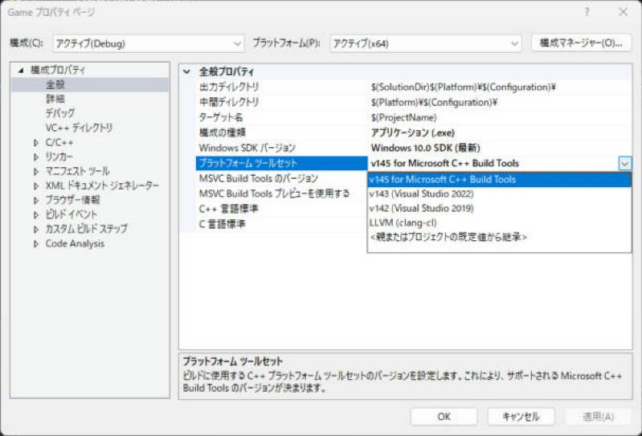

# MSVC（Microsoft のコンパイラ）

MSVC（エムエスブイシー、Microsoft Visual C++）は、<strong>Visual Studio が使う C++ のコンパイラ一式</strong>です。コンパイラ本体の `cl.exe`、リンカーの `link.exe`、標準ライブラリ（MSVC STL）、C ランタイムなどをまとめてこう呼びます。GCC や Clang とは別のコンパイラで、同じ C++ のコードでも通ったり通らなかったり結果が違ったりすることがあります。

!!! tip "ポイント"
    - MSVC は `cl.exe`（コンパイラ）、`link.exe`（リンカー）、標準ライブラリ、ランタイムの一式
    - バージョンは <strong>ツールセット</strong>（Visual Studio 2026 は `v145`）とマクロ `_MSC_VER` で見分ける
    - このサイトのサンプルは GCC で動作確認しているので、<strong>MSVC では動かない書き方</strong>が、まれにある（コンパイラ対応の表で確認する）
    - C++ の機能は MSVC STL のバージョンで決まる。Visual Studio を更新すると、使える機能が増える
    - Visual Studio には、MSVC のほかに Clang（`clang-cl`）も入れられる

## このページを読む前に

- [ビルド（コンパイルとリンク）](build.md)

## MSVC は何でできているか {#parts}

| 部品 | 実体 | 役割 |
| --- | --- | --- |
| コンパイラ | `cl.exe` | C++ のソースを機械語（`.obj`）にする |
| リンカー | `link.exe` | `.obj` と `.lib` を `.exe`／`.dll` にする |
| ライブラリアン | `lib.exe` | `.obj` から、静的ライブラリ（`.lib`）を作る |
| アセンブラー | `ml64.exe` | アセンブリ言語を機械語にする |
| リソース コンパイラ | `rc.exe`（Windows SDK） | アイコンやバージョン情報を、実行ファイルに入れる |
| C++ 標準ライブラリ | MSVC STL | `std::vector`、`std::string`、`<print>` など |
| C ランタイム | UCRT（Universal CRT） | `printf`、`malloc`、`fopen` など。**Windows SDK に入っている** |
| コンパイラのランタイム | `vcruntime` | 例外処理、`new` の土台など |
| Windows SDK | ヘッダーと `.lib` | Windows API（`windows.h`、`d3d11.h` など） |

Visual Studio のインストーラーで、「C++ によるデスクトップ開発」を選ぶとこれらが一式入ります。IDE を入れずにコンパイラだけが欲しいときは、Build Tools for Visual Studio（コマンド ライン専用）を使います。

!!! note "MSVC STL は、オープンソース"
    MSVC の標準ライブラリは、GitHub で公開されています（`microsoft/STL`）。`std::vector` の実装を読みたいときや不具合報告のときに役立ちます。ヘッダーは Visual Studio のインストール先の `VC\Tools\MSVC\<バージョン>\include` にもあり Visual Studio から「定義へ移動」（F12）で開けます。

## ツールセットとバージョン {#toolset}

MSVC のバージョンには似た名前のものが複数あるので、混乱しやすいです。

| 呼び名 | 例 | 意味 |
| --- | --- | --- |
| Visual Studio のバージョン | 2026 | IDE の製品の名前 |
| Visual Studio の内部バージョン | 18.x（2026） | IDE の更新ごとの番号 |
| **プラットフォーム ツールセット** | `v145`（2026） | コンパイラ一式の版。プロジェクトのプロパティで選ぶ |
| コンパイラのバージョン | `19.51` など | `cl.exe` の版 |
| マクロ `_MSC_VER` | `1951` など | コード中で、コンパイラの版を調べる |

プロジェクトのプロパティ → 全般 → プラットフォーム ツールセットで、どの版のコンパイラでビルドするかを選べます。新しい Visual Studio で、古いツールセットを使うこともできます。



v143 と v142 は、その版の Visual Studio を入れていないと、使えません（ビルド ツールだけを、インストーラーの「個別のコンポーネント」で足せます）。

| ツールセット | 対応する Visual Studio | `_MSC_VER` の範囲の目安 |
| --- | --- | --- |
| v140 | 2015 | 1900 |
| v141 | 2017 | 1910〜1916 |
| v142 | 2019 | 1920〜1929 |
| v143 | 2022 | 1930〜1949（更新のたびに増える） |
| v145 | 2026 | 1950〜 |

`cl.exe` のバージョンは Developer Command Prompt で、引数なしで実行すると表示されます。

```text
> cl
Microsoft (R) C/C++ Optimizing Compiler Version 19.51.36231 for x64
```

### コードの中でコンパイラを見分ける

```cpp
#include <print>

int main() {
#if defined(_MSC_VER) && !defined(__clang__)
  // MSVC。__clang__ が定義されていたら、clang-cl なので、ここには入らない。
  std::println("MSVC のバージョン: {}", _MSC_VER);
#elif defined(__clang__)
  std::println("Clang {}.{}", __clang_major__, __clang_minor__);
#elif defined(__GNUC__)
  std::println("GCC {}.{}", __GNUC__, __GNUC_MINOR__);
#endif
}
```

| マクロ | 定義するコンパイラ |
| --- | --- |
| `_MSC_VER` | MSVC（`clang-cl` も定義する） |
| `__clang__` | Clang（`clang-cl` も定義する） |
| `__GNUC__` | GCC（Clang も定義する） |

`clang-cl` は `_MSC_VER` と `__clang__` の両方が定義されます。MSVC だけを区別したいなら `_MSC_VER` かつ `__clang__` が無いことを調べます。

### `__cplusplus` に注意

標準が決めている `__cplusplus` というマクロはMSVC では既定で、古い値（`199711L`）のままです。 実際の言語標準を表すようにするには、`/Zc:__cplusplus` を付けます。Visual Studio のプロジェクトでは、新しいものほどこの設定が既定で入りますが、コマンド ラインの `cl` では付けないと古いままです。標準の版を調べたいときは MSVC では `_MSVC_LANG` を使います。

```cpp
#include <print>

int main() {
#if defined(_MSVC_LANG)
  std::println("_MSVC_LANG = {}", _MSVC_LANG);   // 202302L など
#endif
  std::println("__cplusplus = {}", __cplusplus);
}
```

## C++ の標準への対応 {#standard}

MSVC は標準の機能をバージョンごとに少しずつ取り込んでいます。**同じ `/std:c++latest` でも Visual Studio の更新で、使える機能が増えます。** 各機能の対応状況はこのサイトでは、各ページの「コンパイラ対応」の表に載せています。

| 機能 | 使える Visual Studio |
| --- | --- |
| `<print>` / `std::println` | 2022 17.7〜 |
| `std::generator` | 2022 17.6〜 |
| `<expected>` | 2022 17.3〜 |
| `<mdspan>` | 2022 17.9〜 |
| deducing this（明示的なオブジェクト引数） | 2022 17.2〜 |
| `import std;`（標準ライブラリのモジュール） | 2022 17.5〜（C++23 の機能として、設定が必要） |

`std::flat_map` など後から入った機能の対応はページごとに確認します。コンパイラが機能を持っているかどうかコードで調べるには、機能テスト マクロ（`__cpp_lib_print` など）が使えます。

```cpp
#include <version>

#if defined(__cpp_lib_print)
#include <print>
#endif
```

## GCC や Clang と違うところ {#difference}

同じ C++ でもコンパイラが違うと扱いが変わる場面があります。初心者が出会いやすいものを集めます。

| 項目 | MSVC | GCC / Clang |
| --- | --- | --- |
| 呼び出すコマンド | `cl`（オプションは `/` 始まり） | `g++`、`clang++`（オプションは `-` 始まり） |
| 標準の指定 | `/std:c++latest`、`/std:c++20` | `-std=c++23` |
| 警告 | `/W4`、`/Wall` | `-Wall -Wextra` |
| 最適化 | `/O2`、`/Od` | `-O2`、`-O0` |
| 例外処理 | `/EHsc` を付ける | 既定で有効 |
| 規格への厳密さ | `/permissive-`（Visual Studio の新しいプロジェクトは既定） | 既定でおおむね厳密 |
| デバッグ情報 | `.pdb`（別のファイル） | DWARF（実行ファイルに入る）、Windows の Clang は `.pdb` も可 |
| DLL の公開 | `__declspec(dllexport)` が必要 | 既定で全部公開（`-fvisibility=hidden` で絞る） |
| 強制インライン | `__forceinline` | `__attribute__((always_inline))` |
| ブレークポイント | `__debugbreak()` | `__builtin_trap()` |
| ライブラリの指定 | `#pragma comment(lib, "d3d11.lib")` が使える | 使えない（コマンド ラインで `-l`） |
| `long` の大きさ（64 ビット） | 4 バイト | Linux では 8 バイト |

### `#pragma comment(lib, ...)`

MSVC は**ソースの中にリンクするライブラリを書ける**独特の機能を持ちます。DirectX のサンプルでよく見ます。

```cpp
// ソースの中で、リンクする .lib を指定する（MSVC だけの機能）。
#pragma comment(lib, "d3d11.lib")
#pragma comment(lib, "dxgi.lib")
#pragma comment(lib, "d3dcompiler.lib")
```

プロジェクトの設定に書く（リンカー → 入力 → 追加の依存ファイル）のと同じ効果です。GCC や Clang（Linux）では、この書き方は無視されるか警告になります。他のコンパイラでもビルドしたいときは、CMake の `target_link_libraries` に書きます。

### 属性の違い

C++20 の `[[no_unique_address]]` は MSVC では、ABI の互換性のため効きません（無視されます）。代わりに MSVC 専用の `[[msvc::no_unique_address]]` を使います。C++ の標準の機能でも MSVC だけ違う動きをするものは、まれにあります。

### 標準の解釈の違い

| 項目 | 内容 |
| --- | --- |
| 2 段階の名前探索（two-phase lookup） | MSVC は、`/permissive-` を付けると規格どおりに近づく。付けないとテンプレートの中の間違いを見逃すことがある |
| `/permissive-` | 規格に厳密になる。付けると GCC で通る書き方に近づく |
| 浮動小数点 | `/fp:precise`（既定）。`-ffast-math` のような設定は `/fp:fast` |

自分のコードを複数のコンパイラで、確認できるようにしておくとどれかの拡張に頼っていないかが分かります。

## Visual Studio で、別のコンパイラを使う {#clang}

Visual Studio には MSVC のほかに**Clang** も入れられます。

| 方式 | 内容 |
| --- | --- |
| MSVC（既定） | `cl.exe`。ほとんどの人がこれを使う |
| LLVM（clang-cl） | Clang を MSVC のコマンド ライン（`/` 始まりのオプション）で使う。MSVC のヘッダーとライブラリと互換 |
| Clang を直接使う | `clang++` をほかの OS と同じ形で使う（CMake などで指定） |

### clang-cl を使う

1. Visual Studio インストーラー → 変更 → 個別のコンポーネント → Windows 用 C++ Clang コンパイラを入れる
2. プロジェクトのプロパティ → 全般 → プラットフォーム ツールセット → LLVM (clang-cl)

`clang-cl` は MSVC と同じ ABI でビルドするので、MSVC でビルドしたライブラリと混ぜて使えます。エラーの文章が分かりやすい警告の種類が多いという利点があります。

## 実行時に必要なもの（ランタイムの配布） {#redist}

MSVC で `/MD` を指定してビルドした実行ファイルは、**実行するマシンにランタイムの DLL が必要**です。

| DLL | 内容 |
| --- | --- |
| `vcruntime140.dll`、`vcruntime140_1.dll` | コンパイラのランタイム |
| `msvcp140.dll` | C++ の標準ライブラリ |
| `ucrtbase.dll` | C ランタイム（Windows 10 以降は OS に入っている） |

ランタイムが無いマシンで実行すると、「`VCRUNTIME140.dll が見つからないため…`」と出ます。対処は 3 つです。

| 方法 | 内容 |
| --- | --- |
| 再頒布可能パッケージを入れる | 遊ぶ人に「Visual C++ 再頒布可能パッケージ（x64）」を、インストールしてもらう |
| DLL を `.exe` の横に置く | 必要な DLL だけを一緒に配布する |
| `/MT` で静的リンクする | DLL が要らなくなる。実行ファイルは大きくなる。ライブラリもすべて `/MT` でそろえる必要がある |

なお、Visual Studio 2015 以降（v140〜v145）は、ランタイムが互換です。古いツールセットでビルドした実行ファイルが、新しい再頒布パッケージでも動きます。逆に、古いランタイムでは新しいツールセットの実行ファイルが動かないことがあります。

## よくあるミス

??? failure "GCC では通るコードが、MSVC でエラーになる（またはその逆）"
    標準に厳密な方が正しいことが多いです。まず `/permissive-` を付けて警告を確認します。標準の書き方に直すとどちらでも通ります。コンパイラ固有の機能（`#pragma comment`、`__declspec`）はマクロで包みます。

??? failure "`std::println` や `<print>` が、見つからない"
    Visual Studio が古い（17.7 より前）か C++ 言語標準が `/std:c++latest` になっていません（[C++23 を使えるようにする設定](../settings.md)）。

??? failure "`__cplusplus` が、199711 になっている"
    MSVC の仕様です。`/Zc:__cplusplus` を付けるか `_MSVC_LANG` を使います。

??? failure "別のマシンで、実行ファイルが動かない（`VCRUNTIME140.dll`）"
    ランタイムがそのマシンに入っていません。再頒布可能パッケージを入れるか `/MT` でビルドします。

??? failure "ツールセットが見つからない（`MSB8020`）"
    プロジェクトが `v142` を指定しているが、そのツールセットがインストールされていません。Visual Studio インストーラーで追加するかプロパティの「プラットフォーム ツールセット」を、いまのバージョンにします。

## これだけ覚える

!!! abstract "まとめ"
    - [x] MSVC は `cl.exe`、`link.exe`、MSVC STL、ランタイムなどの一式
    - [x] バージョンはツールセット（2026 は `v145`）と `_MSC_VER` で見分ける
    - [x] `__cplusplus` は MSVC では古いまま。`_MSVC_LANG` か `/Zc:__cplusplus` を使う
    - [x] `/permissive-` で規格に厳密にしておくと GCC とも揃いやすい
    - [x] `clang-cl` は MSVC と互換。ライブラリを混ぜられる
    - [x] 配布するときはランタイム（`VCRUNTIME140.dll`）を考える

## 関連ページ

- [ビルド（コンパイルとリンク）](build.md)
- [構成（Configuration）](configuration.md)
- [C++23 を使えるようにする設定](../settings.md)
- [インストールとプロジェクトの作成](../setup.md)
- [よくあるエラー](../errors.md)
- [Visual Studio の目次](../index.md)
