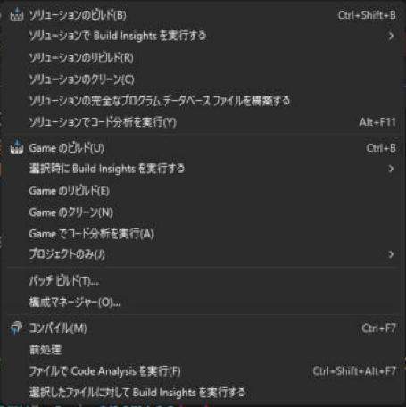
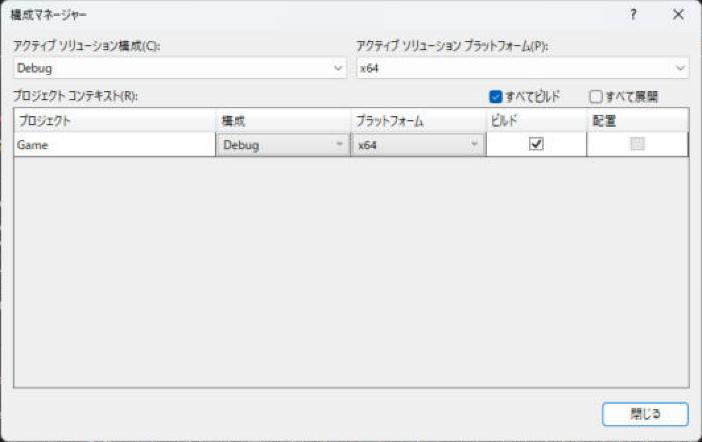

# ソリューション（.sln）

ソリューションは、<strong>複数のプロジェクトを 1 つにまとめて開くための入れ物</strong>です。ファイルとしては `.sln` が 1 つあるだけで、ビルドの設定そのものは持っていません。持っているのは、「どのプロジェクトが含まれるか」「どの順に作るか」「Debug のとき、各プロジェクトのどの構成を使うか」という、プロジェクト同士の関係です。

!!! tip "ポイント"
    - `.sln` は、プロジェクトの一覧と、構成の対応表だけが書かれた、短いテキストファイル
    - 実際にコンパイルする設定は、プロジェクト側（`.vcxproj`）にある
    - ゲーム本体・ライブラリ・ツールを分けるなら、1 つのソリューションに、複数のプロジェクトを入れる
    - 「ソリューション フォルダー」は、ソリューション エクスプローラー上の整理用で、ディスク上のフォルダーではない
    - `.vs/` フォルダーと `*.user` は、個人の一時ファイルなので Git に入れない

## このページを読む前に

- [インストールとプロジェクトの作成](../setup.md)

## ソリューションの役割 {#role}

プロジェクトが 1 つだけなら、ソリューションの存在はほとんど意識しません。それでも、Visual Studio は必ずソリューションを経由してプロジェクトを開きます。ゲームを作ると、すぐに複数のプロジェクトが必要になるからです。

| プロジェクト | 種類 | 役割 |
| --- | --- | --- |
| `Game` | 実行ファイル（`.exe`） | ゲーム本体 |
| `Engine` | 静的ライブラリ（`.lib`） | 描画や入力などの共通部分 |
| `Editor` | 実行ファイル（`.exe`） | ステージを作るツール |
| `Tests` | 実行ファイル（`.exe`） | 単体テスト |

`Game` と `Editor` が、どちらも `Engine` を使います。ソリューションに 4 つのプロジェクトを入れておくと、次のことができます。

- `Engine` を直したあと、F5 で `Game` を実行すると、`Engine` が先にビルドし直される
- 「ソリューションのビルド」で、4 つ全部を、依存関係の順に作る
- 4 つのプロジェクトに、同じ Debug / Release の切り替えを、まとめて適用する

## .sln の中身 {#file}

`.sln` は、テキストファイルです。メモ帳で開けます。中身は、次のようになっています。

```text
Microsoft Visual Studio Solution File, Format Version 12.00
# Visual Studio Version 17
VisualStudioVersion = 17.0.31903.59
MinimumVisualStudioVersion = 10.0.40219.1
Project("{8BC9CEB8-8B4A-11D0-9D1B-00A0C91BC942}") = "Engine", "Engine\Engine.vcxproj", "{1A2B3C4D-0000-0000-0000-000000000001}"
EndProject
Project("{8BC9CEB8-8B4A-11D0-9D1B-00A0C91BC942}") = "Game", "Game\Game.vcxproj", "{1A2B3C4D-0000-0000-0000-000000000002}"
	ProjectSection(ProjectDependencies) = postProject
		{1A2B3C4D-0000-0000-0000-000000000001} = {1A2B3C4D-0000-0000-0000-000000000001}
	EndProjectSection
EndProject
Global
	GlobalSection(SolutionConfigurationPlatforms) = preSolution
		Debug|x64 = Debug|x64
		Release|x64 = Release|x64
	EndGlobalSection
	GlobalSection(ProjectConfigurationPlatforms) = postSolution
		{1A2B3C4D-0000-0000-0000-000000000001}.Debug|x64.ActiveCfg = Debug|x64
		{1A2B3C4D-0000-0000-0000-000000000001}.Debug|x64.Build.0 = Debug|x64
		{1A2B3C4D-0000-0000-0000-000000000002}.Debug|x64.ActiveCfg = Debug|x64
		{1A2B3C4D-0000-0000-0000-000000000002}.Debug|x64.Build.0 = Debug|x64
	EndGlobalSection
EndGlobal
```

| 部分 | 意味 |
| --- | --- |
| `Project("{8BC9CEB8-…}")` | プロジェクトを 1 つ登録する。先頭の GUID は、プロジェクトの種類（これは C++ のプロジェクト）。後ろの GUID が、そのプロジェクト自身の ID |
| `"Engine\Engine.vcxproj"` | プロジェクトファイルの場所（`.sln` からの相対パス） |
| `ProjectDependencies` | このプロジェクトが、先に作っておくべき別のプロジェクト |
| `SolutionConfigurationPlatforms` | ソリューションが持つ、構成とプラットフォームの組 |
| `ProjectConfigurationPlatforms` | 「ソリューションの `Debug|x64` を選んだとき、各プロジェクトはどの構成で、ビルドするか」の対応表 |

`ActiveCfg` が「どの構成を使うか」、`Build.0` が「ビルドの対象に含めるか」です。`Build.0` の行が無いプロジェクトは、ソリューションのビルドで飛ばされます。

!!! warning "GUID をコピーした同じプロジェクトを、2 つ入れない"
    プロジェクトのフォルダーをコピーして、別名で入れるとき、`.vcxproj` の中の `ProjectGuid` が同じままだと、ソリューションの中で同じ ID が 2 つになり、依存関係が混ざります。コピーしたら、プロジェクトの GUID は変えます（Visual Studio の「追加 → 既存のプロジェクト」で入れると、ぶつかった GUID は、自動で振り直されることもあります）。

### 新しい形式：.slnx

`.sln` は、昔から独自の書式で書かれていて、人が読んだり、Git で統合したりするのに向いていませんでした。そこで、<strong>XML で書く新しい形式 `.slnx`</strong>が用意されました。Visual Studio 2026 では、新しく作るソリューションが、この形式になります。

```xml
<Solution>
  <Configurations>
    <Platform Name="x64" />
  </Configurations>
  <Project Path="Engine/Engine.vcxproj" />
  <Project Path="Game/Game.vcxproj">
    <BuildDependency Project="Engine/Engine.vcxproj" />
  </Project>
</Solution>
```

行数が大幅に減って、Git の差分も見やすくなります。`.sln` も、そのまま開けます。ただし、古い Visual Studio や、`.sln` だけを読むツールでは `.slnx` を開けないので、チームの環境を確認します。既定の形式は、メニュー「ツール → オプション」の「プロジェクトとソリューション → 全般」にある「既定のソリューション ファイル形式」で変えられます（[画面](../setup.md#project-structure)）。

## ソリューション エクスプローラー {#explorer}

画面の右側にある、ファイルの一覧です。階層は、次のようになっています。

```text
ソリューション 'MyGame'（2 プロジェクト）
├── Engine（プロジェクト）
│   ├── 参照
│   ├── 外部依存関係
│   ├── ヘッダー ファイル
│   ├── ソース ファイル
│   └── リソース ファイル
└── Game（プロジェクト、太字 = スタートアップ）
```

操作は、次のとおりです。

| やりたいこと | 操作 |
| --- | --- |
| ソリューション全体をビルドする | ソリューションを右クリック → **ソリューションのビルド**（Ctrl + Shift + B） |
| 1 つのプロジェクトだけビルドする | そのプロジェクトを右クリック → ビルド |
| 実行するプロジェクトを変える | そのプロジェクトを右クリック → スタートアップ プロジェクトに設定 |
| プロジェクトを増やす | ソリューションを右クリック → 追加 → 新しいプロジェクト／既存のプロジェクト |
| プロジェクトの順を決める | ソリューションを右クリック → プロジェクトの依存関係 |

### ソリューション フォルダー

ソリューションを右クリック → 追加 → 新しいソリューション フォルダーで作る、整理用のフォルダーです。`Libs`、`Tools` のように、プロジェクトを分類できます。

ソリューション フォルダーは、ディスクの上に作られません。`.sln` の中だけにある、仮のフォルダーです。プロジェクトの実際の場所は、変わりません。`README.md` や `.editorconfig` のような、プロジェクトに属さないファイルを、ソリューション フォルダーに入れておくと、Visual Studio から開けて便利です。

## 構成の対応（構成マネージャー） {#config-manager}

メニュー → **ビルド → 構成マネージャー**で開きます。ここで、`.sln` の `ProjectConfigurationPlatforms` を、画面で編集しています。





| 列 | 意味 |
| --- | --- |
| プロジェクト | ソリューションの中のプロジェクト |
| 構成 | そのプロジェクトで使う構成（Debug / Release） |
| プラットフォーム | そのプロジェクトで使うプラットフォーム（x64 など） |
| ビルド | このチェックが外れていると、ソリューションのビルドで飛ばされる |

たとえば、ツールの `Editor` は、Release のときだけ作る、という設定ができます。ソリューションの構成名とプロジェクトの構成名は、同じ名前でなくてもかまいません。この対応表が、ソリューションの構成の切り替えで、どの構成が選ばれるかを決めています。

!!! failure "ライブラリだけ、古い構成のままになっている"
    ソリューションを Release に切り替えたのに、`Engine` だけ Debug でビルドされていた。ゲーム本体は Release のランタイム（`/MD`）、ライブラリは Debug のランタイム（`/MDd`）になり、`LNK2038` のようなリンク エラーになります。構成マネージャーを開いて、対応が合っているか確かめます（[構成](configuration.md)）。

## プロジェクトの依存関係とビルド順 {#dependency}

ソリューションのビルドは、**依存の先に書かれたものから**順に作ります。

| 方法 | やり方 | 効果 |
| --- | --- | --- |
| プロジェクトの参照 | `Game` を右クリック → 追加 → 参照 → `Engine` にチェック | 依存関係ができる。さらに、`Engine.lib` が自動でリンクされる（[プロジェクト](project.md#reference)） |
| ビルドの依存関係 | ソリューションを右クリック → プロジェクトの依存関係 | ビルド順だけを決める。リンクはしない |

プロジェクトの参照を使えば、順番とリンクが一度に決まります。

ビルドする順番は、プロジェクトの依存関係を満たす範囲で、並列にできるものは並列に作られます。`/MP` を付けると、1 つのプロジェクトの中のファイルも、並列にコンパイルされます（[ビルド](build.md)）。

## 複数のプロジェクトに、設定を共有する {#share}

プロジェクトごとに同じ設定（C++ の標準、`/utf-8`、警告レベル）をするのは、手間で、ミスのもとです。次の 2 つの方法があります。

| 方法 | 内容 |
| --- | --- |
| プロパティ シート（`.props`） | プロパティ マネージャーで、各プロジェクトに追加する（[C++23 を使えるようにする設定](../settings.md#property_sheet)） |
| `Directory.Build.props` | ソリューション フォルダーに置くと、**その下のすべてのプロジェクトに自動で効く** |

```xml
<!-- MyGame/Directory.Build.props -->
<Project>
  <ItemDefinitionGroup>
    <ClCompile>
      <LanguageStandard>stdcpplatest</LanguageStandard>
      <WarningLevel>Level4</WarningLevel>
      <MultiProcessorCompilation>true</MultiProcessorCompilation>
      <AdditionalOptions>/utf-8 %(AdditionalOptions)</AdditionalOptions>
    </ClCompile>
  </ItemDefinitionGroup>
</Project>
```

この方法なら、新しいプロジェクトを作っても、同じ設定が自動で付きます。

## ソリューションの中の、個人用のファイル {#personal}

| ファイル／フォルダー | 内容 | Git |
| --- | --- | --- |
| `.vs/` | Visual Studio の一時ファイル（開いているファイル、IntelliSense のキャッシュ、ブレークポイントなど） | 入れない |
| `*.user` | ユーザーごとの設定（デバッグの引数、作業ディレクトリなど） | 入れない |
| `*.suo` | 古い形式の、ソリューションごとの個人設定 | 入れない |
| `x64/`、`Debug/`、`Release/` | ビルドの結果 | 入れない |
| `.sln`、`.vcxproj`、`.vcxproj.filters`、`.props` | プロジェクトの定義 | **入れる** |

`.vs/` を消しても、ソリューションは壊れません。IntelliSense がおかしいときに、Visual Studio を閉じて `.vs/` を削除すると、直ることがよくあります。

## よくあるミス

??? failure "ソリューションを開いたら、プロジェクトが「読み込めません」と出る"
    `.sln` に書かれたパスに、`.vcxproj` が無いのが原因です。フォルダーを移動したり、名前を変えたりしたときに起きます。`.sln` をテキストエディターで開いて、`Project(...)` の行の相対パスを直します。

??? failure "F5 を押したら、ライブラリのプロジェクトが実行されて、「実行できません」と出る"
    スタートアップ プロジェクトが、ライブラリ（`.lib`）になっています。`.exe` を作るプロジェクトを右クリックして、「スタートアップ プロジェクトに設定」を選びます。

??? failure "別のプロジェクトのヘッダーが見つからない（C1083）"
    プロジェクトの参照は、リンクの順番を決めるだけで、**インクルード パスは足しません**。`追加のインクルード ディレクトリ` に、ライブラリの `include` を足します（[外部ライブラリの入れ方](../libraries.md)）。

??? failure "チーム内で、`.sln` が毎回、コンフリクトする"
    Visual Studio が、自分の環境に合わせて `.sln` を書き換えて、差分が増えます。`.gitattributes` で改行をそろえ（[文字コードを UTF-8 にしよう](../utf8.md#gitattributes)）、可能なら `.slnx` に切り替えると、減らせます。

## これだけ覚える

!!! abstract "まとめ"
    - [x] ソリューションは、プロジェクトをまとめる入れ物。設定は持たない
    - [x] 構成の対応表と、依存関係が、`.sln` に書かれている
    - [x] ゲーム、ライブラリ、ツールは、別のプロジェクトにして、1 つのソリューションに入れる
    - [x] 共通の設定は、`Directory.Build.props` にまとめる
    - [x] `.vs/` と `*.user` は、Git に入れない

## 関連ページ

- [プロジェクト（.vcxproj）](project.md)
- [構成（Configuration）](configuration.md)
- [インストールとプロジェクトの作成](../setup.md)
- [Visual Studio の目次](../index.md)
