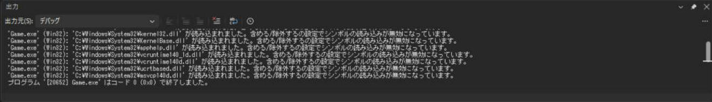
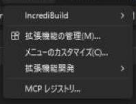

# 便利な機能とショートカット

Visual Studio には、**覚えると作業が速くなるキーと機能**がたくさんあります。ここでは、C++ でゲームを作るときに、よく使うものだけを選んでいます。

!!! tip "ポイント"
    - まず覚えるのは **F5 / Ctrl + F5 / F9 / F10 / F11**（実行とデバッグ）と、**F12**（定義へ移動）、Ctrl + ,（何でも検索）。
    - 名前を変えるときは Ctrl + R, R（全部の使用箇所を直す）。手で置換しない。
    - 整形は Ctrl + K, Ctrl + D（ファイル全体）。チームで揃えるなら `.clang-format`。
    - 文字コードや字下げの設定は `.editorconfig` に書いて、Git に入れる。

## 実行・ビルド

ショートカットは、全部を一度に覚える必要はありません。毎日使うものから、1 つずつ手に慣らしていくのが現実的です。最初は、実行とデバッグのキー（F5・F9・F10・F11）だけで十分で、これだけでマウスの往復がほとんどなくなります。

| キー | 動き |
| --- | --- |
| **F5** | デバッグ開始 |
| Ctrl + F5 | デバッグなしで実行 |
| Ctrl + Shift + B | ソリューションをビルド |
| Ctrl + B（設定による）/ Ctrl + F7 | 今のファイルだけコンパイル |
| Ctrl + Break | ビルドを中止 |
| F9 | ブレークポイントの設定・解除 |
| F10 / F11 | ステップ オーバー / ステップ イン |

## 移動・検索

| キー | 動き |
| --- | --- |
| **F12** | 定義へ移動（関数・クラスの宣言を見る） |
| Ctrl + F12 | 実装へ移動（宣言から `.cpp` の定義へ） |
| Alt + F12 | 定義をその場でのぞく（ページを移動しない） |
| Shift + F12 | すべての参照を検索（どこで使われているか） |
| Ctrl + , | 何でも検索（ファイル、クラス、関数、記号を名前で探す） |
| Ctrl + T | 同上（全体を検索） |
| Ctrl + Shift + F | フォルダー内のファイルを全文検索 |
| Ctrl + F / Ctrl + H | 今のファイルで検索 / 置換 |
| Ctrl + G | 行番号へ移動 |
| Ctrl + -（マイナス）/ Ctrl + Shift + - | 前の編集位置へ戻る / 進む |
| Ctrl + K, Ctrl + O（または Alt + O） | ヘッダ ⇔ ソースの切り替え |
| Ctrl + Tab | 開いているファイルの切り替え |
| Ctrl + M, Ctrl + M | 今の関数・ブロックを折りたたむ / 開く |

## 編集

| キー | 動き |
| --- | --- |
| **Ctrl + R, R** | 名前の変更（変数・関数・クラスの名前を、使用箇所ごと変える） |
| Ctrl + . | クイック アクション（`#include` の追加、関数の実装の生成、など） |
| Ctrl + K, Ctrl + D | ファイル全体を整形 |
| Ctrl + K, Ctrl + F | 選択した範囲を整形 |
| Ctrl + K, Ctrl + C / U | 選択をコメントアウト / 解除 |
| Alt + ↑ / ↓ | 今の行（または選択）を上下に移動 |
| Ctrl + D（なければ Ctrl + Shift + D） | 今の行を複製 |
| Ctrl + L | 今の行を削除 |
| Ctrl + Shift + V | 貼り付け履歴から選ぶ |
| Alt + クリック＆ドラッグ | 矩形選択（縦に選んで、複数の行を同時に編集） |
| Ctrl + Space | 補完の候補を出す |
| F1 | カーソル位置の関数の、Microsoft のドキュメントを開く |

### Ctrl + . でできること

エラーの波線の上で Ctrl + . を押すと、直し方の候補が出ます。

| 場面 | 出てくる候補 |
| --- | --- |
| `std::vector` を使ったが `#include` していない | `#include <vector>` を追加 |
| ヘッダに関数を宣言した | `.cpp` に定義を作成 |
| 関数の引数が `const&` にできる | 参照にする候補 |
| 未使用の変数 | 削除 |

## ウィンドウと表示

| キー / 操作 | 動き |
| --- | --- |
| **Ctrl + Alt + L** | ソリューション エクスプローラーを開く |
| Ctrl + Alt + O | 出力ウィンドウ（ビルドの結果、`OutputDebugString` の出力。[画面](#output)） |
| Ctrl + Alt + E | 例外設定（[デバッグ](debugging.md)） |
| Ctrl + `（日本語キーボードでは Ctrl + @） | ターミナル（PowerShell）を開く（メニューは表示 → ターミナル） |
| ウィンドウのタブをドラッグ | 好きな場所に並べる。別のモニターに出せる |
| Ctrl + マウス ホイール | 文字の拡大・縮小 |

### 出力ウィンドウ {#output}

ビルドの経過と、デバッグ中のメッセージが出る場所です。上の「出力元」で、「ビルド」と「デバッグ」を切り替えます。次の画面は、デバッグが終わったあとの「デバッグ」です。読み込んだ DLL の一覧と、最後に「プログラム 'Game.exe' はコード 0 (0x0) で終了しました。」と出ています。コードの `0` が、`main` の戻り値です。



## IntelliSense（補完・波線）が変なとき

Visual Studio のエディターの波線は、<strong>ビルドとは別の仕組み（IntelliSense）</strong> が出しています。ビルドは通るのに赤い波線が消えない、あるいはその逆、ということが起きます。

| 状況 | 対処 |
| --- | --- |
| ビルドは通るのに波線が消えない | IntelliSense の更新を待つ。ダメなら「プロジェクト → 再スキャン」か、ソリューションを閉じて開き直す |
| 外部ライブラリの `#include` に波線 | インクルードのパス設定が、今の構成・プラットフォームに入っているか確認 |
| `.vs` フォルダーが壊れた | Visual Studio を閉じて、`.vs/` フォルダーを削除して開き直す |
| 新しい C++ の機能に波線 | C++ 言語標準の設定が C++23 になっているか（IntelliSense は別に判断しているので、`/std:c++latest` を設定する） |

!!! note "ビルドの結果が正しい"
    波線とビルドの結果が食い違うときは、ビルドの結果を信じます。出力ウィンドウのエラーを読みます。

## コード整形（clang-format） {#clang_format}

Visual Studio は **clang-format** に対応しています。プロジェクトのフォルダーに `.clang-format` というファイルを置くと、整形（Ctrl + K, Ctrl + D）のルールがそれに従います。

```yaml
# .clang-format（Google C++ Style をもとにする）
BasedOnStyle: Google
ColumnLimit: 100
```

このサイトのサンプルは Google C++ Style なので、`BasedOnStyle: Google` を指定すると、同じ書き方に自動で揃います。

## .editorconfig（文字コードや字下げをそろえる） {#editorconfig}

**`.editorconfig`** は、エディターの設定を、ファイルで共有する仕組みです。チームの全員が、同じ文字コード・改行・字下げで書けます。書き方、ファイルの種類ごとの書き分け、Visual Studio 独自の設定は、[.editorconfig（エディターの設定をそろえる）](editorconfig.md) で詳しく説明しています。文字コードだけを決めたいときは、[文字コードを UTF-8 にしよう](utf8.md#editorconfig) の、2 行で十分です。

## 便利な拡張機能

メニュー「拡張機能 → 拡張機能の管理」から入れられます。



開いた画面の上に、「参照」「インストール済み」「更新プログラム」「ローミング」のタブがあります。入れたい拡張機能は、「参照」で名前を検索します。入れたあとは、Visual Studio を一度閉じると、インストールが始まります。


| 拡張機能 | 何ができるか |
| --- | --- |
| **Visual Assist** | 補完・移動・名前変更が速い。有料（学生向けの無料プランがある） |
| ReSharper C++ | コードの検査とリファクタリング。有料（学生は無料） |
| Visual Studio IntelliCode | AI による補完の候補 |
| GitHub Copilot | コードの提案（学生は無料） |
| Markdown Editor | ドキュメントの編集 |

## 関連ページ

- [デバッグのやり方](debugging.md)
- [C++23 を使えるようにする設定](settings.md)
- [Visual Studio の目次](index.md)
